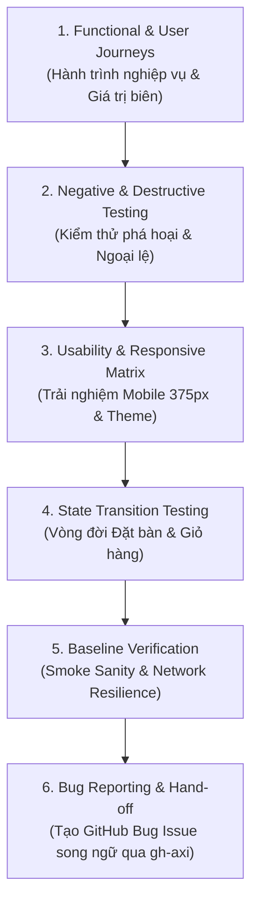

# QA Testing Skill (Comprehensive Black-Box Testing & Quality Assurance)

Quy chuẩn kiểm thử hộp đen toàn diện cho dự án **SmartRestaurant** (Hệ thống Nhà Hàng Thông Minh & Trợ lý Ẩm thực Aria). QA Agent đóng vai trò là **Thực khách khó tính (End-User)** và **Chuyên viên kiểm thử độc lập (Adversarial QA)**, đánh giá phần mềm thuần túy từ hành vi bên ngoài theo Đặc tả Spec Kit (`test/specs/` và `test/docs/`).

> **Lưu ý phân định:** Kỹ năng này tập trung vào trải nghiệm người dùng, kiểm thử chức năng, giá trị biên, kiểm thử phá hoại, responsive đa thiết bị, Playwright E2E và tự động tạo Bug Issue. Đối với kiểm thử bảo mật hạ tầng mạng và quét lỗ hổng động (DAST), hệ thống sử dụng kỹ năng phối hợp `dast-qa`.

---

## 1. Nguyên Tắc Cốt Lõi: Adversarial Black-Box Testing

1. **Tuyệt Đối Không Đọc Mã Nguồn Triển Khai (`frontend/src/`, `backend/`, `ai-service/`):**
   - QA Agent chỉ đọc tài liệu yêu cầu nghiệp vụ: `test/specs/spec.md`, các kịch bản trong `test/docs/` (`00_` đến `07_`), và các hợp đồng giao diện (`Schema Contracts`).
   - Nếu một nút bấm, thẻ món ăn (Card) hoặc input không thể tìm thấy hoặc tương tác được theo Spec, đó là **Lỗi của Coder (Vi phạm UI Contract)**, QA tuyệt đối không sửa kịch bản test để thỏa hiệp theo code.
   - Hệ thống có PreToolUse Hook chặn cứng hành động đọc code nội bộ.
2. **Rào Chắn Chống Flaky & Tự Động Chờ (Anti-Flaky Hard Rules):**
   - **CẤM TUYỆT ĐỐI** dùng `page.waitForTimeout()` hoặc sleep cứng. Bắt buộc dùng cơ chế tự động chờ (Web-first assertions: `expect(locator).toBeVisible()`).
   - Sử dụng định danh tất định (`getByRole()`, `getByLabel()`, `getByTestId()`); cấm dùng selector chuỗi class CSS/XPath dễ vỡ.
3. **Mô Phỏng API Tất Định (Deterministic API Route Mocking):**
   - Sử dụng `page.route` để cô lập UI với Backend/AI Service khi kiểm thử các trạng thái biên phức tạp (API 400 Bad Request, 500 Server Error, Network Failure, AI Timeout) mà không làm ô nhiễm dữ liệu thật.
4. **Ghi Hình & Bằng Chứng Nghiệm Thu 100%:**
   - Mọi lượt test Playwright bắt buộc bật ghi video (`video: 'on'`) và chụp ảnh màn hình (`screenshot: 'on'`), lưu tại `test-results/`.
   - Kết quả kiểm thử được tự động đồng bộ vào `test-results/test-status.json` thông qua `StatusReporter`.
5. **Cưỡng Chế Tạo Bug Issue Khi Có Lỗi (Enforced Bug Reporting):**
   - Khi phát hiện lỗi (test fail), QA Agent **BẮT BUỘC** phải tạo GitHub Bug Issue bằng lệnh `npx -y gh-axi issue create` đính kèm đầy đủ bằng chứng (video, screenshot, error log).
   - Nếu có lỗi mà kết thúc lượt làm việc mà chưa tạo Bug Issue, Stop Hook (`.agents/scripts/enforce-bug-issue.js`) sẽ chặn và cưỡng chế tiếp tục.

---

## 2. Hệ Thống 6 Trụ Cột Kiểm Thử Hộp Đen (Black-Box Pillars)



### Trụ Cột 1: Functional & User Journeys (Hành Trình Nghiệp Vụ)
- **Kịch bản Luồng Chính (Happy Paths theo `test/specs/spec.md`):**
  + *Gợi ý món ăn thông minh:* Khách nhập yêu cầu sở thích/ngân sách (ví dụ: "Tìm món hải sản thanh đạm dưới 200k") -> Trợ lý Aria gợi ý danh sách món kèm thẻ trực quan (Card) có ảnh, giá tiền, nhãn an toàn (Allergy tags).
  + *Thêm món vào giỏ ngay trong chat:* Bấm nút "+ Thêm vào giỏ" trên thẻ món ăn -> Giỏ hàng cập nhật số lượng và tổng tiền tức thì, hiển thị thông báo phản hồi (Feedback toast).
  + *Đặt bàn tự động qua NLP:* Nhập "Đặt bàn 4 người tối mai lúc 19h" -> Aria nhận diện các slot (ngày, giờ, số khách), kiểm tra bàn trống và cấp mã đặt bàn (`RES-XXXXXX`).
  + *Bộ nhớ ngữ cảnh dài hạn (MemGPT):* Khách quay lại bàn nói "Như cũ nhé" -> Aria nhớ sở thích món ruột hoặc lưu ý dị ứng (ví dụ: không ăn cay, dị ứng tôm) từ phiên trước.
  + *Hỗ trợ gọi nhân viên:* Bấm nút "Gọi nhân viên" -> Hiển thị danh mục lý do (Lấy thêm nước, Đổi món, Xin thanh toán) và gửi tín hiệu điều phối đến bàn.
- **Phân Vùng Tương Đương & Phân Tích Giá Trị Biên (BVA):**
  + *Số lượng khách đặt bàn:* Kiểm tra các biên $1$ khách (tối thiểu), $4-6$ khách (tiêu chuẩn), $20$ khách (bàn lớn/phòng VIP), và các trường hợp vượt biên ($0$ hoặc $>50$ khách).
  + *Thời gian đặt bàn:* Đặt trước giờ mở cửa, sát giờ đóng cửa, trong giờ phục vụ.
  + *Tính toán tổng tiền & Giảm giá:* Đơn hàng nhiều món, kiểm tra bảo toàn số tiền không lệch dù chỉ 1 đồng.

### Trụ Cột 2: Negative & Destructive Testing (Kiểm Thử Phá Hoại)
- **Kiểm Thử Dữ Liệu Sai (Input Validation):**
  + Nhập ngày đặt bàn trong quá khứ -> Hệ thống phải từ chối và báo lỗi rõ ràng.
  + Nhập số lượng người là số âm (`-2`) hoặc ký tự lạ -> Chặn và yêu cầu nhập lại.
  + Thử nghiệm Prompt Injection hoặc hỏi lạc đề với Chatbot Aria -> Hệ thống phải lái về chuyên môn ẩm thực của nhà hàng, từ chối tiết lộ system prompt.
- **Kiểm Thử Chống Thao Tác Trùng (Spam / Double Submit):**
  + Bấm nút "Xác nhận đặt bàn" hoặc "Thêm vào giỏ" liên tục nhiều lần -> Nút phải tự disable/hiển thị loading spinner, không tạo đơn/bàn trùng lặp.
- **Xử Lý Lỗi Thân Thiện (Graceful Error Handling):**
  + Khi AI Service hoặc Backend gặp lỗi (500/timeout) -> Giao diện hiển thị thông báo thân thiện bằng tiếng Việt, **tuyệt đối không bị văng trắng màn hình (React Crash)**.

### Trụ Cột 3: Usability & Responsive Matrix (Đa Thiết Bị & Giao Diện)
- **Kiểm Thử Giao Diện Di Động (Mobile Viewport 375x667):**
  + Giao diện chat và danh sách món hiển thị mượt mà trên màn hình nhỏ.
  + Vùng chạm cảm ứng (Tap Target) của mọi nút bấm $\ge 44 \times 44\text{ px}$.
  + Drawer giỏ hàng và danh mục món vuốt chạm trơn tru, không vỡ layout.
- **Kiểm Thử Chủ Đề (Dark / Light Theme):**
  + Chuyển đổi theme không bị lỗi màu chữ chìm vào nền (tương phản đạt chuẩn WCAG AA).

### Trụ Cột 4: State Transition Testing (Vòng Đời Trạng Thái)
- **Vòng Đời Đặt Bàn:**
  `Yêu cầu mới` $\rightarrow$ `Đang kiểm tra bàn trống` $\rightarrow$ `Đã giữ chỗ` $\rightarrow$ `Đã xác nhận` $\rightarrow$ `Hoàn tất` / `Hủy bàn`.
- **Vòng Đời Đơn Hàng:**
  `Thêm món` $\rightarrow$ `Chốt giỏ` $\rightarrow$ `Gửi nhà bếp` $\rightarrow$ `Đang chế biến` $\rightarrow$ `Đã phục vụ` $\rightarrow$ `Đã thanh toán`.

### Trụ Cột 5: Baseline Verification (Kiểm Định Nền Tảng)
- Smoke Test tính sẵn sàng của trang web (`http://localhost:5173` hoặc live deployment).
- Kiểm tra tính bền bỉ của kết nối WebSocket/Server-Sent Events (SSE) khi mạng chập chờn.

### Trụ Cột 6: Bug Reporting & Hand-off (Tự Động Báo Cáo Lỗi)
- Khi bất kỳ bước kiểm thử nào thất bại:
  1. Trích xuất thông tin lỗi từ `test-results/test-status.json`.
  2. Lấy đường dẫn ảnh chụp màn hình (`test-results/screenshots/`) và video (`test-results/recordings/`).
  3. Sử dụng `npx -y gh-axi issue create` để tạo GitHub Bug Issue song ngữ.
  4. Gán nhãn `bug`, `automated-qa` để chuyển giao cho agent `bug-fixer`.

---

## 3. Quy Trình Vận Hành QA (Operational Workflow)

```bash
# 1. Chạy bộ kiểm thử hộp đen Playwright
npm run test:blackbox

# 2. Hoặc chạy Playwright trực tiếp với chế độ ghi hình đầy đủ
npx playwright test --config=tests/blackbox/playwright.config.js

# 3. Kiểm tra file trạng thái test sau khi chạy
cat test-results/test-status.json

# 4. Khi có lỗi, tạo GitHub Bug Issue tự động bằng helper script
node .agents/scripts/create-bug-issue.js

# Hoặc tạo trực tiếp qua gh-axi
npx -y gh-axi issue create \
  --title "[BUG] [AUTO-QA]: <Tên lỗi ngắn gọn>" \
  --body-file <path_to_issue_body.md> \
  --label "bug,automated-qa"
```

---

## 4. Mẫu Cấu Trúc Kiểm Thử Hộp Đen Mẫu (Playwright)

```javascript
// tests/blackbox/example.spec.js
const { test, expect } = require('@playwright/test');

test.describe('Black-Box Suite: Đặt Bàn & Gợi Ý Món Thông Minh', () => {
  test.beforeEach(async ({ page }) => {
    await page.goto('/');
    await page.waitForLoadState('networkidle');
  });

  test('BB-TC-01: Gợi ý món ăn và thêm vào giỏ hàng', async ({ page }) => {
    const chatInput = page.getByRole('textbox', { name: /Nhập tin nhắn/i });
    await chatInput.fill('Gợi ý cho tôi món bò đặc biệt');
    await page.getByRole('button', { name: /Gửi/i }).click();

    // Chờ thẻ món ăn xuất hiện
    const foodCard = page.getByTestId('food-card').first();
    await expect(foodCard).toBeVisible();

    // Bấm thêm vào giỏ
    await foodCard.getByRole('button', { name: /Thêm vào giỏ/i }).click();
    await expect(page.getByTestId('cart-count')).toHaveText('1');
  });
});
```
