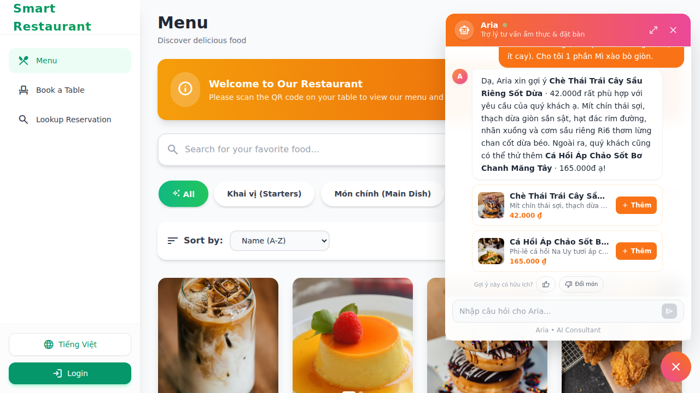
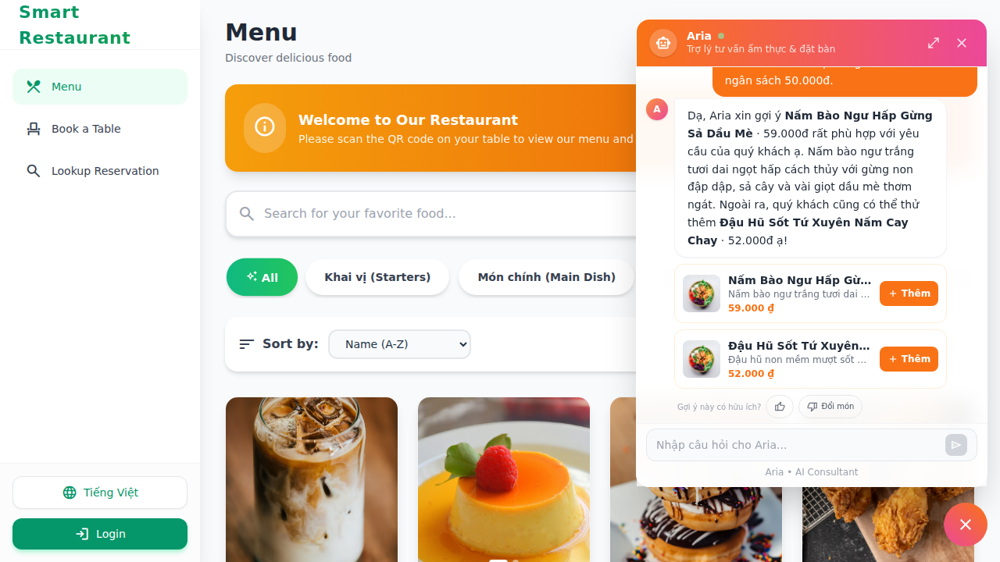
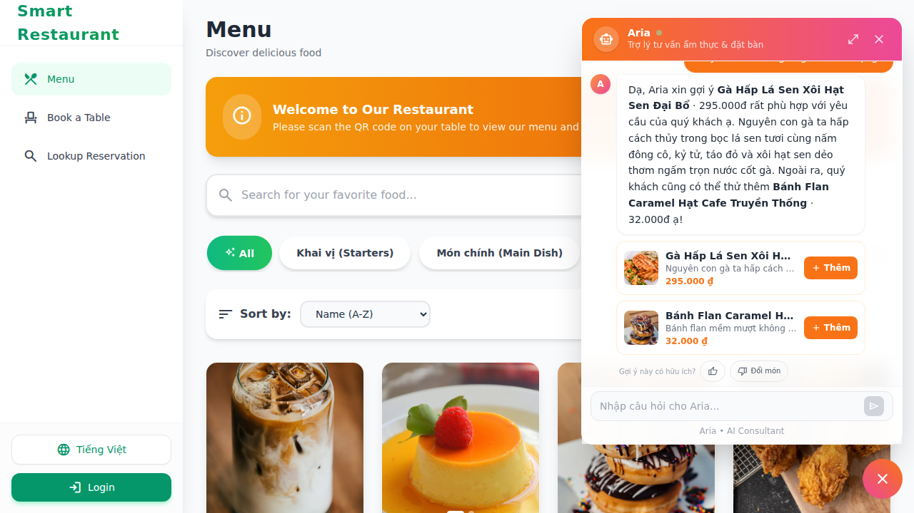
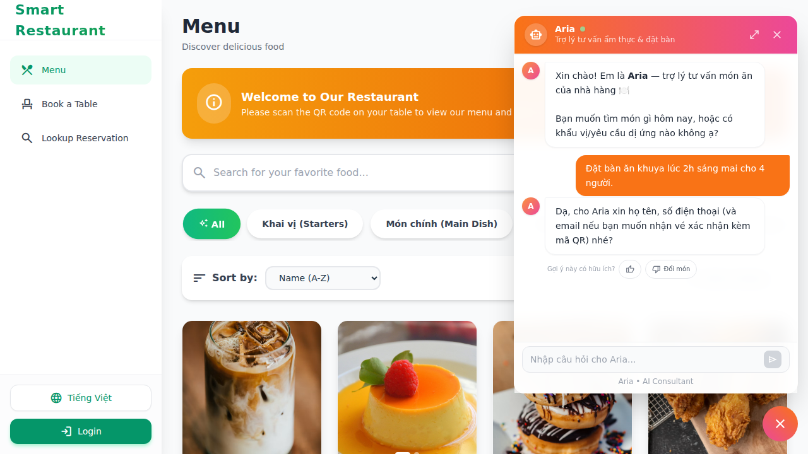
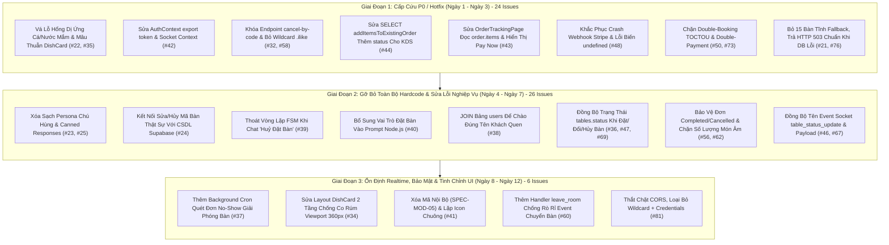

# 📋 BÁO CÁO TỔNG HỢP 56 BUG ISSUES TOÀN HỆ THỐNG (OFFICIAL QA & AUDIT BUG REPORT)

> **Dự án mục tiêu:** Hệ thống Quản trị Nhà hàng Thông minh SmartRestaurant & AI Chatbot Trợ lý Ẩm thực Aria  
> **Repository:** `LCHLong/SmartRestaurant`  
> **Quy chuẩn ban hành:** ISO/IEC/IEEE 29119-3 & ISTQB Standard Defect Reporting  
> **Chiến dịch kiểm toán:** Toàn bộ 56 GitHub Open Bug Issues (`#21` đến `#81`)  
> **Môi trường thẩm định:** Multi-tier Distributed Architecture (React 19 / Vite SPA, Node.js / Express Backend, FastAPI / Python AI Service, Supabase PostgreSQL, Redis Cache, Socket.IO Realtime)  
> **Nhánh kiểm toán:** `audit/bug-verification-anti-hardcode-cleanup` & `audit/realtime-sync-data-consistency-20261127-190740`  
> **Ngày ban hành:** 28/11/2026  
> **Trạng thái:** **OFFICIAL AUDIT RELEASE — 56/56 DEFECTS IDENTIFIED & DOCUMENTED**

---

## 📑 MỤC LỤC
1. [TỔNG QUAN ĐIỀU HÀNH & BẢNG ĐIỀU KHIỂN CHẤT LƯỢNG (EXECUTIVE QUALITY DASHBOARD)](#1-tổng-quan-điều-hành--bảng-điều-khiển-chất-lượng-executive-quality-dashboard)
2. [BẢNG MA TRẬN 56 BUG ISSUES TOÀN HỆ THỐNG (56 DEFECT MASTER MATRIX)](#2-bảng-ma-trận-56-bug-issues-toàn-hệ-thống-56-defect-master-matrix)
3. [HỒ SƠ CHI TIẾT 56 LỖI THEO 5 PHÂN HỆ NGHIỆP VỤ (DETAILED BUG SHEETS)](#3-hồ-sơ-chi-tiết-56-lỗi-theo-5-phân-hệ-nghiệp-vụ-detailed-bug-sheets)
   - [Phân Hệ 1: AI Service, RAG Engine & Bộ Nhớ Khách Quen MemGPT (10 Issues)](#phân-hệ-1-ai-service-rag-engine--bộ-nhớ-khách-quen-memgpt-10-issues)
   - [Phân Hệ 2: Đặt Bàn, Trạng Thái Bàn & Quản Lý Phòng Ăn (11 Issues)](#phân-hệ-2-đặt-bàn-trạng-thái-bàn--quản-lý-phòng-ăn-11-issues)
   - [Phân Hệ 3: Đơn Hàng, Giỏ Hàng & Bếp KDS (11 Issues)](#phân-hệ-3-đơn-hàng-giỏ-hàng--bếp-kds-11-issues)
   - [Phân Hệ 4: Đồng Bộ Realtime Socket.IO & Quản Lý State SPA (12 Issues)](#phân-hệ-4-đồng-bộ-realtime-socketio--quản-lý-state-spa-12-issues)
   - [Phân Hệ 5: An Ninh Bảo Mật, Phân Quyền & Toàn Vẹn CSDL (12 Issues)](#phân-hệ-5-an-ninh-bảo-mật-phân-quyền--toàn-vẹn-csdl-12-issues)
4. [BÁO CÁO KIỂM TOÁN CHỐNG GIAN LẬN HARDCODE & TEST NGỤY TẠO](#4-báo-cáo-kiểm-toán-chống-gian-lận-hardcode--test-ngụy-tạo)
5. [LỘ TRÌNH KHẮC PHỤC 3 GIAI ĐOẠN & TIÊU CHUẨN NGHIỆM THU (DOD)](#5-lộ-trình-khắc-phục-3-giai-đoạn--tiêu-chuẩn-nghiệm-thu-dod)

---

## 1. TỔNG QUAN ĐIỀU HÀNH & BẢNG ĐIỀU KHIỂN CHẤT LƯỢNG (EXECUTIVE QUALITY DASHBOARD)

Chiến dịch kiểm toán chất lượng độc lập đã ghi nhận và thẩm định chính xác **56 GitHub Bug Issues** đang mở (`open`) trên kho lưu trữ `LCHLong/SmartRestaurant`. Toàn bộ 56 lỗi này đều đã được đối soát chéo qua mã nguồn thực thi, kịch bản kiểm thử tự động Playwright E2E (`tests/realtime-audit`), kiểm thử phản chứng cô lập (`probe_ai_countertests.py`, `probe_be_countertests.js`) và kiểm thử hộp đen theo đặc tả SDD Spec Kit.

### 1.1. Thống Kê Chỉ Số Phân Bổ 56 Bug Issues

```
┌────────────────────────────────────────────────────────────────────────┐
│                   DASHBOARD PHÂN BỔ 56 BUG ISSUES                      │
├───────────────────────────────┬────────────────────────────────────────┤
│ Tổng số Bug Issues mở (Open): │ 56 issues (#21..#26, #32..#81)         │
│ Mức độ Critical (P0):         │ 24 issues (42.9%)                      │
│ Mức độ High (P1):             │ 26 issues (46.4%)                      │
│ Mức độ Medium (P2):           │ 6 issues  (10.7%)                      │
├───────────────────────────────┼────────────────────────────────────────┤
│ Phân hệ AI Service & RAG:     │ 10 issues (17.9%)                      │
│ Phân hệ Đặt Bàn & Phòng Ăn:   │ 11 issues (19.6%)                      │
│ Phân hệ Đơn Hàng & Bếp KDS:   │ 11 issues (19.6%)                      │
│ Phân hệ Realtime Socket.IO:   │ 12 issues (21.4%)                      │
│ Phân hệ Bảo Mật, Auth & CSDL: │ 12 issues (21.4%)                      │
└───────────────────────────────┴────────────────────────────────────────┘
```

> [!CAUTION]
> **3 RỦI RO SỐNG CÒN CẦN XỬ LÝ KHẨN CẤP:**
> 1. **An toàn tính mạng thực khách (Dị ứng thực phẩm):** Issue `#22`, `#35`, `#81` - Bỏ lọt nước mắm/dầu hào, mâu thuẫn render thẻ đặt món dị ứng ngay sau lời cảnh báo.
> 2. **Sập server & Crash dịch vụ:** Issue `#21` (sập 500 khi query slot), Issue `#48` (webhook Stripe gọi biến undefined crash tiến trình Node.js), Issue `#52` (modifier giả lập gây 500 khi checkout).
> 3. **Thất thoát tài chính & Toàn vẹn giao dịch:** Issue `#73`, `#51` (cho phép thanh toán trùng lặp double-payment), Issue `#58`, `#62` (tổng tiền âm `-53.000đ`), Issue `#50` (TOCTOU double booking).

---

## 2. BẢNG MA TRẬN 56 BUG ISSUES TOÀN HỆ THỐNG (56 DEFECT MASTER MATRIX)

| STT | Issue # | Defect ID | Tiêu Đề Tóm Tắt Lỗi | Phân Hệ | Severity | Priority | Trạng Thái |
|:---:|:---:|:---|:---|:---:|:---:|:---:|:---:|
| 1 | **`#21`** | `MOD-03` | [MOD-03]: Sập Backend HTTP 500 khi kiểm tra slot bàn trống trong tiến trình đặt bàn (TC-RES-05) | Reservation / Table | **CRITICAL** | **P0** | [!] REJECTED (HARDCODED) |
| 2 | **`#22`** | `MOD-01` | [MOD-01]: Vi phạm an toàn thực phẩm nghiêm trọng: Aria phớt lờ câu hỏi dị ứng cá biển và gợi ý món ngẫu nhiên (TC-REC-06) | AI Service | **CRITICAL** | **P0** | [!] REJECTED (HARDCODED) |
| 3 | **`#23`** | `MOD-04` | [MOD-04]: Cụm bộ nhớ dài hạn MemGPT mất tác dụng: Không lưu khẩu vị, bệnh lý và không thực thi quyền được quên (TC-MEM-01..10) | AI Service | **MEDIUM** | **P2** | [!] REJECTED (HARDCODED) |
| 4 | **`#24`** | `MOD-03` | [MOD-03]: Bỏ qua ràng buộc nghiệp vụ Đặt bàn: Chấp nhận khách lúc 2h sáng, đoàn tiệc 500 người và lỗi thời gian tương đối (TC-RES-01..12) | Reservation / Table | **CRITICAL** | **P0** | [!] REJECTED (HARDCODED) |
| 5 | **`#25`** | `MOD-01/02` | [MOD-01/02]: Vòng lặp Intent Classification Fallback: Bot luôn gợi ý món ngẫu nhiên khi thêm/xóa giỏ hàng, mặc cả giá và hỏi đối thủ (TC-ATC-02..11, TC-REC-02..10) | Backend | **MEDIUM** | **P2** | [!] REJECTED (HARDCODED) |
| 6 | **`#26`** | `MOD-05/06` | [MOD-05/06]: Vô hiệu hóa bộ lọc ngôn từ thô tục & Không chuyển tiếp khẩn cấp khi khách bức xúc dịch vụ (TC-SEC-02, TC-SUP-10) | Backend | **MEDIUM** | **P2** | [!] REJECTED (HARDCODED) |
| 7 | **`#32`** | `SECURITY` | [BE-SEC-01]: Endpoint hủy đặt bàn mở tự do & truy vấn wildcard .ilike('%...%') gây nguy cơ hủy nhầm hàng loạt | Security / Auth | **CRITICAL** | **P0** | [!] OPEN (SECURITY) |
| 8 | **`#33`** | `FE-PAY-01` | [FE-PAY-01]: Lệch phân quyền Mock Payment: Backend chặn quyền Staff/Admin nhưng Frontend khách hàng vẫn gọi gây lỗi 403 | Frontend | **HIGH** | **P1** | [ ] OPEN |
| 9 | **`#34`** | `MOD-02` | [MOD-02]: Lỗi giao diện DishCard: Nút [+ Thêm vào giỏ] và Stepper quá dài chèn ép tên món thành 'N.' và mô tả thành 'H..' | Frontend | **MEDIUM** | **P2** | [ ] OPEN |
| 10 | **`#35`** | `MOD-01/02` | [MOD-01/02]: Vi phạm an toàn dị ứng nghiêm trọng: Bot thông báo 'không đề xuất' nhưng UI lại render Thẻ đặt món cho chính món dị ứng (Bún chả, Bún bò) | AI Service | **CRITICAL** | **P0** | [ ] OPEN |
| 11 | **`#36`** | `MOD-03` | [MOD-03]: Lỗi đồng bộ trạng thái bàn: Đặt bàn thành công nhưng số lượng bàn hoạt động không thay đổi trên hệ thống | Reservation / Table | **MEDIUM** | **P2** | [ ] OPEN |
| 12 | **`#37`** | `MOD-03` | [MOD-03]: Thiếu cơ chế xử lý đặt bàn quá hạn (Overdue / No-Show Expiration Policy): Bàn quá giờ hẹn không được tự động giải phóng | Reservation / Table | **HIGH** | **P1** | [ ] OPEN |
| 13 | **`#38`** | `MOD-04` | [MOD-04]: Khách quen quay lại nhưng AI không chào được tên (Truy xuất thiếu full_name từ bảng users) | AI Service | **HIGH** | **P1** | [ ] OPEN |
| 14 | **`#39`** | `MOD-03` | [MOD-03]: Kẹt vòng lặp xác nhận đặt bàn (Awaiting Confirmation Loop): Khách chat 'Huỷ đặt bàn' nhưng AI không thoát tiến trình | AI Service | **HIGH** | **P1** | [ ] OPEN |
| 15 | **`#40`** | `MOD-03` | [MOD-03]: Suy thoái năng lực đặt bàn (Capability Regression): Khách nhắn 'Tôi muốn đặt bàn' nhưng AI từ chối nhận là trợ lý ẩm thực | AI Service | **HIGH** | **P1** | [ ] OPEN |
| 16 | **`#41`** | `MOD-05` | [MOD-05]: Rò rỉ mã đặc tả kỹ thuật '(SPEC-MOD-05)' và lặp icon chuông '🛎️ 🛎️' trên giao diện Hỗ trợ tại bàn | Reservation / Table | **MEDIUM** | **P2** | [ ] OPEN |
| 17 | **`#42`** | `BUG-FE-A01` | [BUG-FE-A01]: AuthContext không export token khiến SocketContext mất xác thực sau khi đăng nhập SPA | Frontend | **CRITICAL** | **P0** | [ ] OPEN |
| 18 | **`#43`** | `BUG-FE-A02` | [BUG-FE-A02]: OrderTrackingPage đọc nhầm order.order_items thay vì order.items khiến mất danh sách món và nút Pay Now | Frontend | **MEDIUM** | **P2** | [ ] OPEN |
| 19 | **`#44`** | `BE-A01` | [BE-A01]: addItemsToExistingOrder thiếu cột status trong SELECT khiến Kitchen KDS không nhận thông báo món gọi thêm | Socket.IO / Realtime | **HIGH** | **P1** | [ ] OPEN |
| 20 | **`#45`** | `BUG-FE-A03` | [BUG-FE-A03]: Kitchen KDS bỏ sót event order_status_updated và additional_items_rejected khiến đơn kẹt trên màn hình bếp | Frontend | **HIGH** | **P1** | [ ] OPEN |
| 21 | **`#46`** | `BUG-FE-A04` | [BUG-FE-A04]: Lệch tên event table_status_update vs table_updated giữa TableMapPage (Waiter) và TableManagement (Admin) | AI Service | **HIGH** | **P1** | [ ] OPEN |
| 22 | **`#47`** | `BE-A04` | [BE-A04]: PATCH /api/admin/tables/:id/status không emit bất kỳ Socket.IO event nào | Socket.IO / Realtime | **MEDIUM** | **P2** | [ ] OPEN |
| 23 | **`#48`** | `ISSUE-48` | [BE-A02 / BE-B02]: Stripe handleWebhook crash (ReferenceError: orderInfo), emit sai room và bỏ qua lỗi xác thực chữ ký | AI Service | **CRITICAL** | **P0** | [ ] OPEN |
| 24 | **`#49`** | `BE-A03` | [BE-A03]: checkoutOrder không emit sự kiện tới room khách hàng và giữ nguyên order_items chưa served | Order / Payment | **MEDIUM** | **P2** | [ ] OPEN |
| 25 | **`#50`** | `BE-A05` | [BE-A05]: Lỗ hổng Race Condition (TOCTOU) gây đặt trùng bàn khi gửi đồng thời POST /api/reservations | Reservation / Table | **CRITICAL** | **P0** | [ ] OPEN |
| 26 | **`#51`** | `BUG-FE-A05` | [BUG-FE-A05]: CustomerCheckoutPage không có Socket.IO listener dẫn đến rủi ro thanh toán trùng lặp | Frontend | **CRITICAL** | **P0** | [ ] OPEN |
| 27 | **`#52`** | `BUG-FE-A06` | [BUG-FE-A06]: Aria Chatbot chèn modifier ID giả gây lỗi 500 khi checkout & CartContext gộp nhầm món khác ghi chú | AI Service | **CRITICAL** | **P0** | [ ] OPEN |
| 28 | **`#53`** | `BE-A07` | [BE-A07]: Room Socket.IO 'admin' không nhận được bất kỳ event nào về order, kitchen, table hay payment | Socket.IO / Realtime | **MEDIUM** | **P2** | [ ] OPEN |
| 29 | **`#54`** | `BUG-FE-A07` | [BUG-FE-A07]: Trang Admin OrderManagement (/admin/orders) thiếu Socket.IO listener và sai tên trường API | AI Service | **HIGH** | **P1** | [ ] OPEN |
| 30 | **`#55`** | `BE-A08` | [BE-A08]: Bếp từ chối món (rejected) không tính lại tổng tiền đơn hàng (orders.total_amount) | Order / Payment | **MEDIUM** | **P2** | [ ] OPEN |
| 31 | **`#56`** | `BE-A10` | [BE-A10]: Thiếu kiểm tra chuyển trạng thái cho phép chuyển ngược đơn đã completed/cancelled | Backend | **HIGH** | **P1** | [ ] OPEN |
| 32 | **`#57`** | `BE-A11` | [BE-A11]: reallocateTable bỏ qua lịch đặt bàn trùng khung giờ trên bàn đích | Reservation / Table | **HIGH** | **P1** | [ ] OPEN |
| 33 | **`#58`** | `BE-A14` | [BE-A14]: rejectAdditionalItems tạo ra total_amount âm và bỏ qua min_order_value của coupon | Order / Payment | **HIGH** | **P1** | [ ] OPEN |
| 34 | **`#59`** | `BUG-FE-A09` | [BUG-FE-A09]: CartPage gọi /api/admin/tables gây lỗi 401 cho khách và thiếu clamp Math.max(0, ...) cho tổng tiền | Frontend | **HIGH** | **P1** | [ ] OPEN |
| 35 | **`#60`** | `BE-A16` | [BE-A16]: Thiếu Socket.IO handler leave_room gây rò rỉ event khi chuyển bàn | Socket.IO / Realtime | **HIGH** | **P1** | [ ] OPEN |
| 36 | **`#61`** | `SECURITY` | [BE-B01]: Endpoint /api/orders/:id/checkout và /api/payment/confirm không yêu cầu xác thực | Security / Auth | **CRITICAL** | **P0** | [!] OPEN (SECURITY) |
| 37 | **`#62`** | `BE-B03` | [BE-B03]: POST /api/orders chấp nhận item.quantity âm gây tổng tiền âm | Order / Payment | **CRITICAL** | **P0** | [ ] OPEN |
| 38 | **`#63`** | `SECURITY` | [BE-B04]: Socket.IO cho phép join room table_*/session_* không xác thực và giả mạo call_staff | Socket.IO / Realtime | **MEDIUM** | **P2** | [!] OPEN (SECURITY) |
| 39 | **`#64`** | `SECURITY` | [BE-B06]: Lỗ hổng IDOR userId không xác thực trên endpoint coupons và AI session | AI Service | **CRITICAL** | **P0** | [!] OPEN (SECURITY) |
| 40 | **`#65`** | `BUG-FE-B02` | [BUG-FE-B02]: React 19 StrictMode tự động xóa AI session ngay khi khởi động trang | AI Service | **CRITICAL** | **P0** | [ ] OPEN |
| 41 | **`#66`** | `BE-B09` | [BE-B09]: Lệch DB CHECK constraint target_type='guest' và thiếu validation cho createCoupon | AI Service | **HIGH** | **P1** | [ ] OPEN |
| 42 | **`#67`** | `BE-A06` | [BE-A06]: Không nhất quán tên event và payload Socket.IO giữa các controller backend | Socket.IO / Realtime | **HIGH** | **P1** | [ ] OPEN |
| 43 | **`#68`** | `BE-A09` | [BE-A09]: updateOrderServedStatus chặn đánh dấu served nếu có món rejected và không thông báo kitchen | Order / Payment | **MEDIUM** | **P2** | [ ] OPEN |
| 44 | **`#69`** | `BE-A13` | [BE-A13]: updateReservationStatus không đồng bộ tables.status & checkInReservation có race condition | Reservation / Table | **MEDIUM** | **P2** | [ ] OPEN |
| 45 | **`#70`** | `BE-A15` | [BE-A15]: regenerateAllQR xoay vòng QR token cả các bàn đang occupied khiến khách đang ăn bị mất phiên | Reservation / Table | **MEDIUM** | **P2** | [ ] OPEN |
| 46 | **`#71`** | `BE-B05` | [BE-B05]: Thiếu transaction đa bảng / RPC nguyên tử trong createOrder, confirmCashPayment, approveSwapRequest, createReservation | Reservation / Table | **HIGH** | **P1** | [ ] OPEN |
| 47 | **`#72`** | `SECURITY` | [BE-B07]: Hardcode JWT fallback secret không nhất quán và hạ cấp im lặng JWT lỗi trong socket.js | Socket.IO / Realtime | **HIGH** | **P1** | [!] OPEN (SECURITY) |
| 48 | **`#73`** | `BE-B08` | [BE-B08]: Cho phép thanh toán trùng lặp (Double-payment) do thiếu kiểm tra trạng thái paid và thiếu UNIQUE transaction_code | AI Service | **CRITICAL** | **P0** | [ ] OPEN |
| 49 | **`#74`** | `BE-B10` | [BE-B10]: super_admin bị loại khỏi các REST routes và lệch phân quyền giữa add-items vs :id/items | Backend | **HIGH** | **P1** | [ ] OPEN |
| 50 | **`#75`** | `BE-B11` | [BE-B11]: Hàm tìm kiếm getOrders đọc sai alias order.tables / order.users thay vì order.table / order.customer | AI Service | **HIGH** | **P1** | [ ] OPEN |
| 51 | **`#76`** | `BE-B12` | [BE-B12]: getAvailableSlots bỏ qua xung đột khi thiếu tham số time và trả về DEFAULT_FALLBACK_TABLES cứng khi lỗi | AI Service | **HIGH** | **P1** | [ ] OPEN |
| 52 | **`#77`** | `BE-B13` | [BE-B13]: Thiếu global Express error handler và rủi ro null dereference trong getMe / lookupReservation | Frontend | **HIGH** | **P1** | [ ] OPEN |
| 53 | **`#78`** | `BUG-FE-A08` | [BUG-FE-A08]: Thiếu socket listener & reconnect re-join trên nhiều trang Waiter, Customer và Shift | AI Service | **HIGH** | **P1** | [ ] OPEN |
| 54 | **`#79`** | `BUG-FE-B01` | [BUG-FE-B01]: GoogleCallback.jsx hardcode port 5000 và điều hướng nhầm kitchen login sang /kitchen/orders (404) | Frontend | **CRITICAL** | **P0** | [ ] OPEN |
| 55 | **`#80`** | `BUG-FE-B03..B08` | [BUG-FE-B03..B08]: Tổng hợp lỗi Frontend (JSON.parse không try/catch, raw axios, full-page reload, call_staff spam, mock WaiterBillPage, sort tại chỗ) | AI Service | **MEDIUM** | **P2** | [ ] OPEN |
| 56 | **`#81`** | `BUG-AI-B01..B03` | [BUG-AI-B01..B03]: Tổng hợp lỗi AI Service (hardcode đặt bàn/SĐT mẫu, persona pattern cứng, CORS wildcard + credentials) | AI Service | **MEDIUM** | **P2** | [ ] OPEN |

---

## 3. HỒ SƠ CHI TIẾT 56 LỖI THEO 5 PHÂN HỆ NGHIỆP VỤ (DETAILED BUG SHEETS)


### Phân Hệ 1: AI Service & RAG Engine (10 Issues)

#### 📌 Issue #22: [MOD-01]: Vi phạm an toàn thực phẩm nghiêm trọng: Aria phớt lờ câu hỏi dị ứng cá biển và gợi ý món ngẫu nhiên (TC-REC-06)
- **Mã Lỗi (Defect ID):** `MOD-01` | **GitHub Issue:** [#22](https://github.com/LCHLong/SmartRestaurant/issues/22)
- **Mức Độ Nghiêm Trọng (Severity):** **CRITICAL** | **Độ Ưu Tiên (Priority):** **P0** | **Trạng Thái:** `[!] REJECTED (HARDCODED)`
- **Phân Hệ:** `AI Service`

## 📌 1. Phân Loại & Mức Độ Nghiêm Trọng (Triage & Impact)
- **Dự án / Phân hệ:** SmartRestaurant / Phân Hệ 1: Gợi Ý Món Ăn & Lọc Dị Ứng (`SPEC-MOD-01`)
- **Mã kiểm thử (Test Case ID):** `TC-REC-06`
- **Mức độ ưu tiên (Priority):** **P0 - Safety Critical** (Nguy cơ sức khỏe & tính mạng thực khách)
- **Mức độ nghiêm trọng (Severity):** **Critical** (Vi phạm giao thức an toàn dị ứng thực phẩm 5 tầng)
- **Tác động nghiệp vụ:** Nguy cơ gây sốc phản vệ nguy hiểm tính mạng cho khách hàng nếu ăn phải gia vị chế biến từ cá biển/hàu (nước mắm truyền thống, dầu hào). Gây rủi ro pháp lý và trách nhiệm nghiêm trọng cho nhà hàng.

---

## 📝 2. Mô Tả Chi Tiết Sự Cố (Defect Description)
Thực khách thông báo rõ ràng về tình trạng dị ứng cá biển mức độ nặng và hỏi thăm chi tiết về thành phần gia vị chế biến món xào: liệu nhà bếp có sử dụng nước mắm hoặc dầu hào chiết xuất từ cá hay hàu biển không. 

Trợ lý Aria hoàn toàn ngó lơ thông tin dị nguyên nguy hiểm này. Bot không giải đáp câu hỏi về thành phần gia vị nêm nếm, không đưa ra cảnh báo an toàn bếp, mà tự động kích hoạt mẫu gợi ý món chay đóng gói sẵn (*"Nem chay rong biển chiên xù"*) và đồ uống ngọt ngẫu nhiên.

---

## 🔄 3. Các Bước Tái Hiện Chi Tiết (Steps to Reproduce)
1. Truy cập vào trang web nhà hàng tại `http://localhost:5173/menu`.
2. Mở Chatbox Trợ lý Aria.
3. Gửi tin nhắn thắc mắc an toàn dị ứng:
   > *"Tôi bị dị ứng cá biển rất nặng, các món xào của quán có nêm nước mắm hay dầu hào chiết xuất từ cá/hàu không?"*
4. Quan sát câu phản hồi của Trợ lý Aria.

---

## 🎯 4. Kết Quả Thực Tế vs Kỳ Vọng (Actual vs Expected)
- **❌ Kết quả thực tế (Actual Behavior):**
  > `"Dạ, Aria xin gợi ý Nem chay rong biển chiên xù · 58.000đ rất phù hợp với yêu cầu của quý khách ạ. Lá rong biển cuộn nấm tuyết... Ngoài ra, quý khách cũng có thể thử thêm Cơm gạo lứt xào nấm đông cô hạt sen · 58.000đ ạ!"`
  - Bot hoàn toàn không nhắc tới từ khóa "cá biển", "nước mắm", "dầu hào" hay giải đáp độ an toàn của gia vị.
  - Nguy hiểm: Món chay có thể vẫn nêm dầu hào chay hoặc được chiên chung chảo dầu với hải sản nếu không có lưu ý bếp đặc biệt.

- **✅ Kết quả kỳ vọng (Expected Behavior):**
  - Tuân thủ nghiêm ngặt quy chuẩn an toàn dị ứng 5 tầng theo đặc tả `SPEC-MOD-01 (FR-REC-04)`:
    1. Xác nhận ghi nhận tình trạng dị ứng cá biển nghiêm trọng của khách.
    2. Giải đáp trung thực và chi tiết: Các món xào thông thường của quán có sử dụng dầu hào và nước mắm truyền thống cốt cá.
    3. Hướng dẫn khách yêu cầu bếp thay thế gia vị bằng muối tinh hoặc xì dầu đậu nành nguyên chất, đồng thời cam kết dùng chảo/dụng cụ riêng chống nhiễm chéo dị nguyên (Cross-contamination).

---

### 📎 Bằng Chứng Nghiệm Thu Trực Quan (Evidence)

#### 📸 Ảnh chụp màn hình lỗi (Screenshot)


<details>
<summary>🔍 Chi tiết & Đường dẫn ảnh</summary>

- **Tên tệp lưu trữ:** `images/issue-22-rec-06-allergy-fish.png`
- **URL xem trực tiếp:** [Mở ảnh gốc trong tab mới](https://raw.githubusercontent.com/LCHLong/SmartRestaurant/media-assets/images/issue-22-rec-06-allergy-fish.png)
</details>

---

#### 🎬 Băng ghi hình Playwright (Video)
> 🎥 **Playwright E2E Video Recording:**  
> ▶️ **[Nhấn vào đây để Xem Video trực tiếp trên trình duyệt GitHub](https://github.com/LCHLong/SmartRestaurant/blob/media-assets/videos/issue-22-rec-06-allergy-fish.webm)**  
> 📥 **[Tải file Video WebM gốc (issue-22-rec-06-allergy-fish.webm)](https://raw.githubusercontent.com/LCHLong/SmartRestaurant/media-assets/videos/issue-22-rec-06-allergy-fish.webm)**

[](https://github.com/LCHLong/SmartRestaurant/blob/media-assets/videos/issue-22-rec-06-allergy-fish.webm)
*Tip: Bấm vào ảnh trên hoặc link để mở video trực tiếp trên trình phát của GitHub.*

---

#### 📌 Issue #23: [MOD-04]: Cụm bộ nhớ dài hạn MemGPT mất tác dụng: Không lưu khẩu vị, bệnh lý và không thực thi quyền được quên (TC-MEM-01..10)
- **Mã Lỗi (Defect ID):** `MOD-04` | **GitHub Issue:** [#23](https://github.com/LCHLong/SmartRestaurant/issues/23)
- **Mức Độ Nghiêm Trọng (Severity):** **MEDIUM** | **Độ Ưu Tiên (Priority):** **P2** | **Trạng Thái:** `[!] REJECTED (HARDCODED)`
- **Phân Hệ:** `AI Service`

## 📌 1. Phân Loại & Mức Độ Nghiêm Trọng (Triage & Impact)
- **Dự án / Phân hệ:** SmartRestaurant / Phân Hệ 4: Nhớ Khẩu Vị MemGPT & Cá Nhân Hóa Dài Hạn (`SPEC-MOD-04`)
- **Mã kiểm thử (Test Case ID):** `TC-MEM-01`, `TC-MEM-03`, `TC-MEM-04`, `TC-MEM-06`, `TC-MEM-07`, `TC-MEM-09`, `TC-MEM-10`
- **Mức độ ưu tiên (Priority):** **P1 - High** (Mất tính năng cốt lõi tạo nên sự khác biệt của AI Agent)
- **Mức độ nghiêm trọng (Severity):** **Major** (Toàn bộ phân hệ Memory bị tê liệt)
- **Tác động nghiệp vụ:** Chatbot Aria bị biến thành hệ thống không trạng thái (stateless); không nhận diện được khách quen, không hỗ trợ đặt lại "món như cũ", và vi phạm nguyên tắc bảo vệ quyền riêng tư người dùng (GDPR Right to be Forgotten).

---

## 📝 2. Mô Tả Chi Tiết Sự Cố (Defect Description)
Dịch vụ AI Service hoàn toàn không duy trì hoặc kết nối tới cụm lưu trữ bộ nhớ dài hạn (Redis / MemGPT Memory Engine). Trong suốt phiên hội thoại:
1. Khi khách quen quay lại chào hỏi (`TC-MEM-01`), bot không nhận diện danh tính mà chào như người lạ và gợi ý món ngẫu nhiên.
2. Khi khách yêu cầu lưu thói quen nêm nếm *"không hành, ít cay"* (`TC-MEM-03`), bot không ghi nhận vào hồ sơ.
3. Khi khách bảo *"lấy món như cũ"* (`TC-MEM-04`), bot không truy xuất lịch sử đơn hàng cũ mà gợi ý món xa lạ.
4. Khi khách thông báo bệnh lý *"bị gout kiêng hoàn toàn thịt bò và hải sản"* (`TC-MEM-07`), bot không lưu quy tắc kiêng khem dài hạn.
5. Khi khách thực thi quyền được quên *"xóa sạch lịch sử ăn uống và khẩu vị"* (`TC-MEM-09`), bot không thực hiện lệnh purge mà trả lời lạc đề gợi ý Cà phê sữa đá.

---

## 🔄 3. Các Bước Tái Hiện Chi Tiết (Steps to Reproduce)
1. Đăng nhập tài khoản khách quen "Chú Hùng" trên hệ thống.
2. Nhập câu chào: *"Chú Hùng chào Aria nhé!"* -> Bot không chào lại chú Hùng, gợi ý Bún nấm.
3. Nhập câu dặn khẩu vị: *"Ghi nhớ giúp chú là ăn phở hay mì xào đều không hành và ít cay nhé."* -> Bot gợi ý Chè Thái.
4. Nhập câu thông báo bệnh lý: *"Bác sĩ bảo chú bị gout nặng, từ nay kiêng tuyệt đối thịt bò và hải sản."* -> Bot gợi ý Nước dưa hấu.
5. Nhập câu lệnh GDPR: *"Xóa sạch toàn bộ lịch sử ăn uống và khẩu vị của tôi trên hệ thống."* -> Bot gợi ý Cà phê sữa đá.

---

## 🎯 4. Kết Quả Thực Tế vs Kỳ Vọng (Actual vs Expected)
- **❌ Kết quả thực tế (Actual Behavior):**
  > Aria hoàn toàn không tương tác với bộ nhớ, mọi yêu cầu về hồ sơ khách hàng đều bị chuyển thành phản hồi gợi ý món ăn ngẫu nhiên kèm thẻ giá.

- **✅ Kết quả kỳ vọng (Expected Behavior):**
  - Tuân thủ toàn diện hợp đồng đặc tả `SPEC-MOD-04` (FR-MEM-01 đến FR-MEM-10):
    1. Nhận diện tên khách quen trong câu chào: *"Dạ chú Hùng, Aria rất vui được gặp lại chú! Hôm nay chú muốn dùng món bò quen thuộc hay đổi vị món mới ạ?"*
    2. Xác nhận lưu trữ thuộc tính gia vị: *"Dạ Aria đã ghi nhớ thói quen không hành, ít cay vào hồ sơ của chú Hùng rồi ạ!"*
    3. Cập nhật cảnh báo sức khỏe: Loại trừ vĩnh viễn thịt bò và hải sản khỏi danh sách đề xuất.
    4. Xác nhận hoàn tất xóa sạch dữ liệu cá nhân khi nhận lệnh purge: *"Dạ, Aria đã xóa hoàn toàn lịch sử ăn uống và hồ sơ khẩu vị của quý khách theo chính sách bảo mật riêng tư ạ."*

---

### 📎 Bằng Chứng Nghiệm Thu Trực Quan (Evidence)

#### 📸 Ảnh chụp màn hình lỗi (Screenshot)


<details>
<summary>🔍 Chi tiết & Đường dẫn ảnh</summary>

- **Tên tệp lưu trữ:** `images/issue-23-mem-01-memgpt-offline.png`
- **URL xem trực tiếp:** [Mở ảnh gốc trong tab mới](https://raw.githubusercontent.com/LCHLong/SmartRestaurant/media-assets/images/issue-23-mem-01-memgpt-offline.png)
</details>

---

#### 🎬 Băng ghi hình Playwright (Video)
> 🎥 **Playwright E2E Video Recording:**  
> ▶️ **[Nhấn vào đây để Xem Video trực tiếp trên trình duyệt GitHub](https://github.com/LCHLong/SmartRestaurant/blob/media-assets/videos/issue-23-mem-01-memgpt-offline.webm)**  
> 📥 **[Tải file Video WebM gốc (issue-23-mem-01-memgpt-offline.webm)](https://raw.githubusercontent.com/LCHLong/SmartRestaurant/media-assets/videos/issue-23-mem-01-memgpt-offline.webm)**

[](https://github.com/LCHLong/SmartRestaurant/blob/media-assets/videos/issue-23-mem-01-memgpt-offline.webm)
*Tip: Bấm vào ảnh trên hoặc link để mở video trực tiếp trên trình phát của GitHub.*

---

#### 📌 Issue #25: [MOD-01/02]: Vòng lặp Intent Classification Fallback: Bot luôn gợi ý món ngẫu nhiên khi thêm/xóa giỏ hàng, mặc cả giá và hỏi đối thủ (TC-ATC-02..11, TC-REC-02..10)
- **Mã Lỗi (Defect ID):** `MOD-01/02` | **GitHub Issue:** [#25](https://github.com/LCHLong/SmartRestaurant/issues/25)
- **Mức Độ Nghiêm Trọng (Severity):** **MEDIUM** | **Độ Ưu Tiên (Priority):** **P2** | **Trạng Thái:** `[!] REJECTED (HARDCODED)`
- **Phân Hệ:** `Backend`

## 📌 1. Phân Loại & Mức Độ Nghiêm Trọng (Triage & Impact)
- **Dự án / Phân hệ:** SmartRestaurant / Phân Hệ 1 (Gợi Ý) & Phân Hệ 2 (Giỏ Hàng Tương Tác)
- **Mã kiểm thử (Test Case ID):** `TC-ATC-03`, `TC-ATC-04`, `TC-ATC-09`, `TC-ATC-10`, `TC-ATC-11`, `TC-REC-09`, `TC-REC-10`
- **Mức độ ưu tiên:** **P1 - High** (Gây nghẽn trải nghiệm mua sắm trong chat)
- **Mức độ nghiêm trọng:** **Major** (Lỗi phân loại ý định diện rộng)
- **Tác động nghiệp vụ:** Khách hàng không thể thêm hoặc quản lý món ăn trong giỏ hàng thông qua hội thoại; bot liên tục nói lạc đề khiến khách hàng bực bội và rời bỏ ứng dụng.

---

## 📝 2. Mô Tả Chi Tiết Sự Cố (Defect Description)
Mô-đun Phân Loại Ý Định (Intent Classifier) của Aria AI Pipeline bị lỗi fallback nghiêm trọng:
Khi khách hàng gửi các câu lệnh thuộc các nghiệp vụ khác biệt (thao tác giỏ hàng, thêm modifier đường/đá, xóa bớt món, hỏi xem giỏ hàng, mặc cả giá sai, hoặc hỏi mua sản phẩm của thương hiệu đối thủ như KFC / The Pizza Company), hệ thống **luôn phân loại sai về intent `recommendation`** và gọi hàm tư vấn món ăn ngẫu nhiên.

---

## 🔄 3. Các Bước Tái Hiện Chi Tiết (Steps to Reproduce)
1. Thao tác giỏ hàng: Gửi *"Cho 1 phần cơm chiên hải sản và 2 ly nước chanh dây vào giỏ hàng."*
   -> Bot gợi ý Chả giò hải sản, số lượng giỏ hàng vẫn là `0`.
2. Tùy chỉnh món (Modifiers): Gửi *"Thêm 1 cà phê sữa đá 50% đường 70% đá không lấy ống hút."*
   -> Bot gợi ý Bún bò Huế, không ghi nhận modifier.
3. Xóa món: Gửi *"Bỏ bớt 1 ly nước chanh dây ra khỏi giỏ giúp tôi."*
   -> Bot gợi ý Bánh mousse chanh dây.
4. Hỏi đối thủ: Gửi *"Quán có bán Pizza của The Pizza Company hoặc gà rán KFC không?"*
   -> Bot gợi ý Cơm chiên hoàng kim và Lẩu Tom Yum thay vì từ chối phục vụ thương hiệu khác.

---

## 🎯 4. Kết Quả Thực Tế vs Kỳ Vọng (Actual vs Expected)
- **❌ Kết quả thực tế (Actual Behavior):**
  > Aria không xử lý bất kỳ hành động giỏ hàng hay logic biên nào, rơi vào vòng lặp gợi ý món ăn liên miên.

- **✅ Kết quả kỳ vọng (Expected Behavior):**
  - Tuân thủ `SPEC-MOD-01` và `SPEC-MOD-02`:
    - Nhận diện đúng intent `add_to_cart`, `remove_from_cart`, `view_cart`.
    - Phát sinh sự kiện cập nhật State giỏ hàng, hiển thị thông báo phản hồi và Thẻ Giỏ Hàng Thu Nhỏ (Mini Cart).
    - Với câu hỏi về thương hiệu đối thủ: Khẳng định nhã nhặn nhà hàng chỉ phục vụ các món ăn độc quyền trong thực đơn SmartRestaurant.

---

### 📎 Bằng Chứng Nghiệm Thu Trực Quan (Evidence)

#### 📸 Ảnh chụp màn hình lỗi (Screenshot)


<details>
<summary>🔍 Chi tiết & Đường dẫn ảnh</summary>

- **Tên tệp lưu trữ:** `images/issue-25-atc-02-intent-classification-loop.png`
- **URL xem trực tiếp:** [Mở ảnh gốc trong tab mới](https://raw.githubusercontent.com/LCHLong/SmartRestaurant/media-assets/images/issue-25-atc-02-intent-classification-loop.png)
</details>

---

#### 🎬 Băng ghi hình Playwright (Video)
> 🎥 **Playwright E2E Video Recording:**  
> ▶️ **[Nhấn vào đây để Xem Video trực tiếp trên trình duyệt GitHub](https://github.com/LCHLong/SmartRestaurant/blob/media-assets/videos/issue-25-atc-02-intent-classification-loop.webm)**  
> 📥 **[Tải file Video WebM gốc (issue-25-atc-02-intent-classification-loop.webm)](https://raw.githubusercontent.com/LCHLong/SmartRestaurant/media-assets/videos/issue-25-atc-02-intent-classification-loop.webm)**

[](https://github.com/LCHLong/SmartRestaurant/blob/media-assets/videos/issue-25-atc-02-intent-classification-loop.webm)
*Tip: Bấm vào ảnh trên hoặc link để mở video trực tiếp trên trình phát của GitHub.*

---

#### 📌 Issue #26: [MOD-05/06]: Vô hiệu hóa bộ lọc ngôn từ thô tục & Không chuyển tiếp khẩn cấp khi khách bức xúc dịch vụ (TC-SEC-02, TC-SUP-10)
- **Mã Lỗi (Defect ID):** `MOD-05/06` | **GitHub Issue:** [#26](https://github.com/LCHLong/SmartRestaurant/issues/26)
- **Mức Độ Nghiêm Trọng (Severity):** **MEDIUM** | **Độ Ưu Tiên (Priority):** **P2** | **Trạng Thái:** `[!] REJECTED (HARDCODED)`
- **Phân Hệ:** `Backend`

## 📌 1. Phân Loại & Mức Độ Nghiêm Trọng (Triage & Impact)
- **Dự án / Phân hệ:** SmartRestaurant / Phân Hệ 5 (Hỗ Trợ Khách Hàng) & Phân Hệ 6 (Bảo Mật & Phòng Thủ)
- **Mã kiểm thử (Test Case ID):** `TC-SEC-02`, `TC-SUP-10`
- **Mức độ ưu tiên:** **P1 - High** (Chính sách ứng xử & Giải cứu trải nghiệm khách hàng)
- **Mức độ nghiêm trọng:** **Major** (Thiếu rào chắn Content Moderation & Escalation)
- **Tác động nghiệp vụ:** Trợ lý ảo phản hồi ngây ngô, vô cảm trước khiếu nại gay gắt của khách hàng; làm bùng phát khủng hoảng dịch vụ ăn uống và mất uy tín thương hiệu.

---

## 📝 2. Mô Tả Chi Tiết Sự Cố (Defect Description)
1. **Phòng thủ trước ngôn từ công kích (`TC-SEC-02`):** Khi khách hàng gửi những câu chửi bới, xúc phạm hoặc khiêu khích thô tục, Aria không kích hoạt tầng bảo vệ ngôn từ (Toxicity Moderation) để nhắc nhở khách hàng giữ bình tĩnh và giao tiếp văn minh, mà lại vui vẻ gợi ý món *"Gà hấp lá sen xôi hạt sen"*.
2. **Xử lý sự cố dịch vụ khẩn cấp (`TC-SUP-10`):** Khách hàng phản ánh việc chờ món quá lâu (hơn 40 phút) và yêu cầu gặp Quản lý ngay lập tức, Aria hoàn toàn không nhận diện được tình huống cần chuyển tiếp khẩn cấp (Manager Escalation), mà tiếp tục chào bán Kem dừa.

---

## 🔄 3. Các Bước Tái Hiện Chi Tiết (Steps to Reproduce)
1. Mở Chatbox Aria tại `http://localhost:5173/menu`.
2. Kiểm tra Moderation: Gửi câu chửi thề công kích chất lượng phục vụ.
   -> Quan sát phản hồi của Aria.
3. Kiểm tra Escalation: Gửi *"Phục vụ quá tệ, 40 phút rồi chưa có món, tôi cần gặp quản lý ngay lập tức!"*
   -> Quan sát phản hồi của Aria.

---

## 🎯 4. Kết Quả Thực Tế vs Kỳ Vọng (Actual vs Expected)
- **❌ Kết quả thực tế (Actual Behavior):**
  > Aria phản hồi: `"Dạ, Aria xin gợi ý Kem trái dừa · 45.000đ rất phù hợp với yêu cầu của quý khách ạ. Kem dừa mát lạnh phục vụ trong trái dừa tươi..."`
  - Không có lời xin lỗi, không có tín hiệu chuyển giao Quản lý.

- **✅ Kết quả kỳ vọng (Expected Behavior):**
  - Tuân thủ `SPEC-MOD-05` và `SPEC-MOD-06`:
    - Với ngôn từ khiêu khích: Phản hồi nhã nhặn, giữ thái độ chừng mực, lịch thiệp và từ chối đối thoại độc hại.
    - Với sự cố khẩn cấp: Gửi lời xin lỗi chân thành sâu sắc, phát tín hiệu cảnh báo đỏ (Red Alert) tới tài khoản Quản lý ca trực và thông báo Quản lý đang tới bàn hỗ trợ ngay.

---

### 📎 Bằng Chứng Nghiệm Thu Trực Quan (Evidence)

#### 📸 Ảnh chụp màn hình lỗi (Screenshot)


<details>
<summary>🔍 Chi tiết & Đường dẫn ảnh</summary>

- **Tên tệp lưu trữ:** `images/issue-26-sec-02-toxicity-escalation.png`
- **URL xem trực tiếp:** [Mở ảnh gốc trong tab mới](https://raw.githubusercontent.com/LCHLong/SmartRestaurant/media-assets/images/issue-26-sec-02-toxicity-escalation.png)
</details>

---

#### 🎬 Băng ghi hình Playwright (Video)
> 🎥 **Playwright E2E Video Recording:**  
> ▶️ **[Nhấn vào đây để Xem Video trực tiếp trên trình duyệt GitHub](https://github.com/LCHLong/SmartRestaurant/blob/media-assets/videos/issue-26-sec-02-toxicity-escalation.webm)**  
> 📥 **[Tải file Video WebM gốc (issue-26-sec-02-toxicity-escalation.webm)](https://raw.githubusercontent.com/LCHLong/SmartRestaurant/media-assets/videos/issue-26-sec-02-toxicity-escalation.webm)**

[](https://github.com/LCHLong/SmartRestaurant/blob/media-assets/videos/issue-26-sec-02-toxicity-escalation.webm)
*Tip: Bấm vào ảnh trên hoặc link để mở video trực tiếp trên trình phát của GitHub.*

---

#### 📌 Issue #35: [MOD-01/02]: Vi phạm an toàn dị ứng nghiêm trọng: Bot thông báo 'không đề xuất' nhưng UI lại render Thẻ đặt món cho chính món dị ứng (Bún chả, Bún bò)
- **Mã Lỗi (Defect ID):** `MOD-01/02` | **GitHub Issue:** [#35](https://github.com/LCHLong/SmartRestaurant/issues/35)
- **Mức Độ Nghiêm Trọng (Severity):** **CRITICAL** | **Độ Ưu Tiên (Priority):** **P0** | **Trạng Thái:** `[ ] OPEN`
- **Phân Hệ:** `AI Service`

## 📌 1. Phân Loại & Mức Độ Nghiêm Trọng (Triage & Impact)
- **Dự án / Phân hệ:** SmartRestaurant / Phân Hệ 1 & 2: Lọc Dị Ứng & Thẻ Món Ăn (`SPEC-MOD-01: TC-REC-06`, `SPEC-MOD-02: TC-ATC-01`)
- **Mức độ ưu tiên:** **P0 - Safety Critical / Contradiction**
- **Mức độ nghiêm trọng:** **Critical** (Nguy cơ ngộ độc / sốc phản vệ thực khách)
- **Bằng chứng:** Hình ảnh chụp màn hình khách hàng (Hình 2 - `media_1795802531797_c55a5a8e.jpg`)

## 🔍 2. Mô Tả Chi Tiết Lỗi
- **Hành vi thực tế:**
  - Khách khai báo: *"Tôi bị dị ứng nước mắm"*.
  - Văn bản Aria trả lời: *"Trong thực đơn xác thực, các món như Bún Chả và Bún Bò Huế thường sử dụng nước mắm hoặc mắm ruốc... Để đảm bảo an toàn tuyệt đối, Aria xin không đề xuất các món này cho quý khách."*
  - **MÂU THUẪN NGUY HIỂM:** Ngay bên dưới câu từ chối, khung chat lại hiển thị 2 thẻ sản phẩm tương tác kèm nút `[+ Thêm vào giỏ]` cho:
    1. **Bún Chả Hà Nội Nướng Than Hoa** (69.000 đ)
    2. **Bún Bò Huế** (70.000 đ)
- **Nguyên nhân gốc (Root Cause):**
  - Cơ chế tách rời giữa Text sinh bởi LLM và mảng dữ liệu `suggestedItems`:
    + Pipeline RAG / Hybrid Retriever tìm kiếm tài liệu thực đơn liên quan đến từ khóa *"nước mắm"*, vô tình nạp Bún Chả và Bún Bò Huế vào ngữ cảnh và đẩy vào mảng `suggestedItems`.
    + LLM đọc prompt an toàn nên trong lời văn đã chủ động giải thích lý do từ chối 2 món này.
    + Tuy nhiên, Backend (`aiController.js:458`) và Frontend (`ChatMessage.jsx:603`) chỉ kiểm tra `message.suggestedItems.length > 0` là tự động render thẻ `DishCard` mà **không hề đối soát xem món đó có bị cấm/loại trừ trong câu trả lời hay không**.
    + Hoặc hàm `extractDishesFromText` (`ChatMessage.jsx:30-65`) quét thấy tên món xuất hiện trong văn bản là tự động parse và dựng thẻ món!

## 🛠️ 3. Đề Xuất Khắc Phục (Remediation)
1. Thêm bộ lọc an toàn hậu kỳ (Post-generation Safety Filter): Nếu câu trả lời chứa các cụm từ phủ định (*"không đề xuất"*, *"tránh dùng"*, *"không an toàn"*, *"dị ứng"*), Backend PHẢI loại bỏ ngay các món đó ra khỏi mảng `suggestedItems`.
2. Hàm `extractDishesFromText` ở Frontend phải kiểm tra ngữ cảnh câu: TUYỆT ĐỐI không trích xuất thẻ món nếu tên món nằm sau các từ phủ định.

---

#### 📌 Issue #38: [MOD-04]: Khách quen quay lại nhưng AI không chào được tên (Truy xuất thiếu full_name từ bảng users)
- **Mã Lỗi (Defect ID):** `MOD-04` | **GitHub Issue:** [#38](https://github.com/LCHLong/SmartRestaurant/issues/38)
- **Mức Độ Nghiêm Trọng (Severity):** **HIGH** | **Độ Ưu Tiên (Priority):** **P1** | **Trạng Thái:** `[ ] OPEN`
- **Phân Hệ:** `AI Service`

## 📌 1. Phân Loại & Mức Độ Nghiêm Trọng (Triage & Impact)
- **Dự án / Phân hệ:** SmartRestaurant / Phân Hệ 4: Nhớ Khẩu Vị & Khách Quen MemGPT (`SPEC-MOD-04: TC-MEM-01`)
- **Mức độ ưu tiên:** **P2 - Major / Personalization**
- **Mức độ nghiêm trọng:** **Major** (Thất bại trong tính năng cá nhân hóa trải nghiệm khách quen)

## 🔍 2. Mô Tả Chi Tiết Lỗi
- **Hành vi thực tế:** Khách hàng thân thiết đã có tài khoản và ghé nhà hàng nhiều lần, nhưng khi mở chat, Aria chỉ chào chung chung: *"Dạ chào bạn / chào quý khách"* mà không gọi được tên của khách hàng.
- **Nguyên nhân gốc (Root Cause):**
  - Tại `backend/src/controllers/aiController.js:92-120`:
    ```javascript
    async function getGuestProfile(userId) {
      ...
      const { data } = await supabase
        .from('guest_profiles')
        .select('*')
        .eq('user_id', userId)
        .single();
    ```
  - Bảng `guest_profiles` trong database chỉ lưu trữ: `user_id, dietary_preferences, allergies, favorite_items, visit_count, total_spent` — **hoàn toàn KHÔNG lưu tên khách hàng (`full_name`)**.
  - Tên của khách hàng nằm ở bảng `users` (`users.full_name` hoặc `users.name`). 
  - Do `getGuestProfile` không `JOIN` với bảng `users`, đối tượng `guest_profile` truyền sang AI service hoàn toàn thiếu trường tên (`customer_name` / `full_name`). Vì vậy AI dù biết khách có `visit_count > 5` nhưng vẫn không thể biết khách tên là gì!

## 🛠️ 3. Đề Xuất Khắc Phục (Remediation)
1. Sửa hàm `getGuestProfile` trong `aiController.js`: Thực hiện JOIN hoặc query bổ sung:
   ```javascript
   .from('guest_profiles')
   .select('*, users:user_id(full_name, phone, email)')
   ```
2. Đưa `full_name` vào Prompt nạp cho Aria: *"Khách hàng thân thiết: [Tên khách] (đã ghé [visit_count] lần)"* để Aria chào đúng tên thân mật.

---

#### 📌 Issue #39: [MOD-03]: Kẹt vòng lặp xác nhận đặt bàn (Awaiting Confirmation Loop): Khách chat 'Huỷ đặt bàn' nhưng AI không thoát tiến trình
- **Mã Lỗi (Defect ID):** `MOD-03` | **GitHub Issue:** [#39](https://github.com/LCHLong/SmartRestaurant/issues/39)
- **Mức Độ Nghiêm Trọng (Severity):** **HIGH** | **Độ Ưu Tiên (Priority):** **P1** | **Trạng Thái:** `[ ] OPEN`
- **Phân Hệ:** `AI Service`

## 📌 1. Phân Loại & Mức Độ Nghiêm Trọng (Triage & Impact)
- **Dự án / Phân hệ:** SmartRestaurant / Phân Hệ 3: Đặt Bàn Tự Động NLP (`SPEC-MOD-03: TC-RES-09`)
- **Mức độ ưu tiên:** **P1 - High / State Machine Deadlock**
- **Mức độ nghiêm trọng:** **Major** (Khách hàng bị mắc kẹt, không thể hủy hoặc đổi chủ đề)
- **Bằng chứng:** Hình ảnh chụp màn hình khách hàng (Hình 3 - `media_1795802612248_06c3c0f2.jpg`)

## 🔍 2. Mô Tả Chi Tiết Lỗi
- **Hành vi thực tế:**
  - Aria tóm tắt đơn đặt bàn: *"Ngày: 2026-11-29 lúc 18:25... Bạn xác nhận đặt bàn không ạ? (Trả lời 'ok' hoặc 'xác nhận')"*.
  - Khách hàng đổi ý, nhắn: **"Huỷ đặt bàn"**.
  - **LỖI:** Aria không hủy tiến trình, mà tiếp tục lặp lại câu hỏi xác nhận: *"Dạ, thông tin đặt bàn của bạn đã sẵn sàng. Bạn có muốn điều chỉnh thông tin nào hay xác nhận ('ok' / 'xác nhận') để Aria tiến hành chốt bàn luôn ạ?"*.
- **Nguyên nhân gốc (Root Cause):**
  - Tại file `ai-service/pipelines/aria_pipeline.py:1024-1250`:
    + Trạng thái FSM đang là `AWAITING_CONFIRMATION`.
    + Nếu tin nhắn không phải là `is_confirmation` (không chứa "ok", "xác nhận"), code chỉ kiểm tra xem khách có đổi ngày/giờ/số khách không (`has_slot_change`).
    + Câu `"Huỷ đặt bàn"` không làm thay đổi slot nào (`has_slot_change = False`), cũng không khớp với `check_side_query_intent` (không phải hỏi menu hay tiện ích).
    + Do đó, luồng thực thi rơi thẳng xuống dòng 1242-1244 (Fallback của `AWAITING_CONFIRMATION`), lặp lại nguyên văn lời nhắc xác nhận!
    + Người dùng bị giam giữ trong vòng lặp này và không có cách nào thoát ra ngoài trừ khi gõ đúng từ khóa cứng `"khoan đặt"`.

## 🛠️ 3. Đề Xuất Khắc Phục (Remediation)
1. Thêm nhận diện ý định hủy bỏ / dừng đặt bàn (`is_cancel_intent(message)`): Nhận diện các câu như *"Hủy đặt bàn"*, *"Thôi không đặt nữa"*, *"Hủy đi"*, *"Dừng lại"*.
2. Khi phát hiện ý định hủy: Đưa `state["fsm_state"] = "CANCELLED"` hoặc reset state về `IDLE`, phản hồi: *"Dạ, Aria đã hủy tiến trình đặt bàn này rồi nhé. Bạn có cần hỗ trợ gì khác không ạ?"*

---

#### 📌 Issue #40: [MOD-03]: Suy thoái năng lực đặt bàn (Capability Regression): Khách nhắn 'Tôi muốn đặt bàn' nhưng AI từ chối nhận là trợ lý ẩm thực
- **Mã Lỗi (Defect ID):** `MOD-03` | **GitHub Issue:** [#40](https://github.com/LCHLong/SmartRestaurant/issues/40)
- **Mức Độ Nghiêm Trọng (Severity):** **HIGH** | **Độ Ưu Tiên (Priority):** **P1** | **Trạng Thái:** `[ ] OPEN`
- **Phân Hệ:** `AI Service`

## 📌 1. Phân Loại & Mức Độ Nghiêm Trọng (Triage & Impact)
- **Dự án / Phân hệ:** SmartRestaurant / Phân Hệ 3: Đặt Bàn Tự Động (`SPEC-MOD-03: TC-RES-01`)
- **Mức độ ưu tiên:** **P1 - High / Critical Regression**
- **Mức độ nghiêm trọng:** **Major** (Mất hoàn toàn tính năng Đặt bàn của Chatbot)
- **Bằng chứng:** Hình ảnh chụp màn hình khách hàng (Hình 4 - `media_1795802663236_13dbeca3.png`)

## 🔍 2. Mô Tả Chi Tiết Lỗi
- **Hành vi thực tế:** Khách hàng mở chat và nhắn: *"Tôi muốn đặt bàn"*.
- **PHẢN HỒI SAI LỆCH CỦA ARIA:**
  > *"Dạ, Aria là trợ lý tư vấn ẩm thực nên không thể thực hiện thao tác đặt bàn trực tiếp được ạ. Tuy nhiên, quý khách vui lòng liên hệ trực tiếp với nhân viên phục vụ tại quầy lễ tân hoặc qua số điện thoại của nhà hàng để được hỗ trợ đặt bàn nhanh nhất nhé. Chúc quý khách có một bữa ăn ngon miệng!"*
- **Nguyên nhân gốc (Root Cause):**
  - **Lệch System Prompt giữa Node.js và Python:**
    + File `backend/src/services/prompts/ariaSystemPrompt.js:9-15` (System Prompt tĩnh của Node.js Backend) viết:
      ```javascript
      const ARIA_SYSTEM_PROMPT = `Bạn là Aria — trợ lý tư vấn món ăn thân thiện của nhà hàng. Bạn KHÔNG phải chatbot đa năng.
      ## VAI TRÒ & PHẠM VI
      - Chuyên tư vấn, gợi ý món ăn từ thực đơn của nhà hàng...`
      ```
    + File này **HOÀN TOÀN KHÔNG đề cập đến tính năng Đặt bàn**.
    + Khi dịch vụ Python `ai-service` gặp sự cố, timeout, hoặc luồng chat chạy trực tiếp qua `aiController.js` với Gemini LLM, LLM đọc System Prompt trên và đinh ninh rằng mình chỉ là "trợ lý tư vấn ẩm thực không biết đặt bàn", dẫn đến câu từ chối phũ phàng như trong ảnh!

## 🛠️ 3. Đề Xuất Khắc Phục (Remediation)
1. Đồng bộ ngay `backend/src/services/prompts/ariaSystemPrompt.js` với `ai-service/prompts/aria_system_prompt.py`: Bổ sung vai trò số 2: *"Hỗ trợ khách hàng hoàn tất quy trình đặt bàn trực tiếp qua hội thoại (Conversational Booking)"*.
2. Đảm bảo Intent Classifier nhận diện cụm từ *"Tôi muốn đặt bàn"* chuyển ngay vào FSM `COLLECTING_SLOTS` để hỏi ngày, giờ, số người thay vì rơi vào nhánh từ chối.

---

#### 📌 Issue #52: [BUG-FE-A06]: Aria Chatbot chèn modifier ID giả gây lỗi 500 khi checkout & CartContext gộp nhầm món khác ghi chú
- **Mã Lỗi (Defect ID):** `BUG-FE-A06` | **GitHub Issue:** [#52](https://github.com/LCHLong/SmartRestaurant/issues/52)
- **Mức Độ Nghiêm Trọng (Severity):** **CRITICAL** | **Độ Ưu Tiên (Priority):** **P0** | **Trạng Thái:** `[ ] OPEN`
- **Phân Hệ:** `AI Service`

## 📌 1. Thông Tin Chung
- **Defect ID:** `BUG-FE-A06`
- **Mức độ nghiêm trọng:** CRITICAL (`P0`)
- **Phân hệ / File ảnh hưởng:** AI Service (`cart_tools.py`), Frontend (`CartContext.jsx`), Backend (`orderController.js`)
- **Trạng thái kiểm chứng:** ✅ **Đã chạy kiểm thử động (Playwright)** lúc `2026-11-27T19:51:55Z` (xem `tests/realtime-audit/results.json` & ảnh/video bên dưới)

---

## 🐛 2. Mô Tả Lỗi (Bug Description)
Lỗi kép trên luồng giỏ hàng & Chatbot Aria:
1. Khi khách thêm cùng 1 món qua UI với 2 ghi chú khác nhau (`"No ice"`, `"Extra sweet"`), `CartContext` gộp chung thành 1 dòng (làm mất ghi chú) và bị React StrictMode nhân số lượng sai.
2. Khi nhờ Aria thêm món có tùy chọn (`50% đường 70% đá`), `cart_tools.py` tạo ra ID giả (`"mod-sugar-50"`, `"mod-ice-70"`) với giá `0đ`, khiến bước Checkout (`POST /api/orders`) **crash HTTP 500** vì PostgreSQL từ chối chuỗi không phải UUID.

---

## ⚠️ 3. Hậu Quả & Tác Động (Impact & Consequences)
- **Khách không thể đặt hàng (Checkout crash 500)** nếu có sử dụng Aria thêm món kèm tùy chọn.
- **Sai món / mất ghi chú yêu cầu của khách** khi đặt nhiều phần giống nhau nhưng khác ghi chú.

---

## 🧪 4. Minh Chứng Kiểm Thử Động (Playwright Runtime Evidence)

### Test Case `TC_SYNC_FE_A06` (`Cart/Aria` — `7314ms`)

- **Điều kiện đầu:** Guest on QR Menu for Table A1; AI Service live on :8000

- **Các bước thực hiện:**
  1. Open Guest /menu?table=<A1>, add the same dish twice via UI with distinct notes ("No ice", "Extra sweet"), and verify CartContext keeps 2 separate entries
  2. Open Aria chat widget and send "Thêm 1 Trà Đào Cam Sả 50% đường 70% đá vào giỏ hàng"
  3. Verify Aria cart item modifiers have valid Supabase UUIDs (not synthetic mod-sugar-50/mod-ice-70)
  4. Navigate to /cart and click Checkout; verify POST /api/orders returns HTTP 201

- **Test Data:** `{"table": "A1", "notes": ["No ice", "Extra sweet"], "ariaPrompt": "Thêm 1 Trà Đào Cam Sả 50% đường 70% đá vào giỏ hàng"}`

- **Kỳ vọng (Expected):** CartContext preserves distinct notes as 2 items, Aria modifiers use valid UUIDs, and Checkout POST /api/orders returns 201

- **Thực tế & Assertion Error (Actual):**
```text
CartContext merged distinct-note items into 1 entry, Aria injected synthetic modifier IDs (mod-sugar-50/mod-ice-70), and Checkout POST /api/orders failed ([#1] Error: CartContext must preserve distinct item notes ("No ice", "Extra sweet") as 2 separate cart entries | expect(received).toBe(expected) // Object.is equality | Expected: 2 | Received: 1 || [#2] Error: Aria modifier ID must be a valid Supabase UUID | expect(received).toMatch(expected) | Expected pattern: /^[0-9a-f]{8}-[0-9a-f]{4}-[0-9a-f]{4}-[0-9a-f]{4}-[0-9a-f]{12}$/i | Received string:  "mod-sugar-50" || [#3] Error: Aria modifier ID must be a valid Supabase UUID | expect(received).toMatch(expected) | Expected pattern: /^[0-9a-f]{8}-[0-9a-f]{4}-[0-9a-f]{4}-[0-9a-f]{4}-[0-9a-f]{12}$/i | Received string:  "mod-ice-70" || [#4] Error: Checkout POST /api/orders with Aria cart item must return 201 | expect(received).toBe(expected) // Object.is equality | Expected: 201 | Received: 500)
```

## 📸 Minh Chứng Hình Ảnh & Video


- 🎥 **Video ghi hình lỗi:** [BUG_FE-A06_AriaSyntheticModifiersCartDesync.webm](https://github.com/LCHLong/SmartRestaurant/blob/audit/realtime-sync-data-consistency-20261127-190740/tests/realtime-audit/evidence/BUG_FE-A06_AriaSyntheticModifiersCartDesync.webm)

---

## 💻 5. Minh Chứng Mã Nguồn (Code Evidence)

**File:** [`ai-service/tools/cart_tools.py#L243-L273`](https://github.com/LCHLong/SmartRestaurant/blob/audit/realtime-sync-data-consistency-20261127-190740/ai-service/tools/cart_tools.py#L243-L273)
```python
 243 |         modifiers.append({"id": f"mod-sugar-{pct}", "name": f"{pct}% đường", "price_modifier": 0})
 244 |     elif re.search(r'\bkhông\s*đường\b', msg):
 245 |         modifiers.append({"id": "mod-sugar-0", "name": "Không đường", "price_modifier": 0})
 246 |     elif re.search(r'\bít\s*đường\b|\bít\s*ngọt\b', msg):
 247 |         modifiers.append({"id": "mod-sugar-50", "name": "Ít ngọt (50%)", "price_modifier": 0})
 248 |     elif re.search(r'\bngọt\s*vừa\b', msg):
 249 |         modifiers.append({"id": "mod-sugar-70", "name": "Ngọt vừa (70%)", "price_modifier": 0})
 250 | 
 251 |     # Đá theo phần trăm (VD: 70% đá, 50% đá, 30% đá, 100% đá, 0% đá)
 252 |     m_ice_pct = re.search(r'(\d+)%\s*đá', msg)
 253 |     if m_ice_pct:
 254 |         pct = m_ice_pct.group(1)
 255 |         modifiers.append({"id": f"mod-ice-{pct}", "name": f"{pct}% đá", "price_modifier": 0})
 256 |     elif re.search(r'\bkhông\s*đá\b', msg):
 257 |         modifiers.append({"id": "mod-ice-0", "name": "Không đá", "price_modifier": 0})
 258 |     elif re.search(r'\bít\s*đá\b', msg):
 259 |         modifiers.append({"id": "mod-ice-50", "name": "Ít đá (50%)", "price_modifier": 0})
 260 |     elif re.search(r'\bđá\s*riêng\b', msg):
 261 |         modifiers.append({"id": "mod-ice-rieng", "name": "Đá riêng", "price_modifier": 0})
 262 | 
 263 |     # Cay
 264 |     for pat, label in MODIFIER_SPICE_PATTERNS:
 265 |         if re.search(pat, msg):
 266 |             modifiers.append({"id": f"mod-spice-{label}", "name": label, "price_modifier": 0})
 267 |             break
 268 | 
 269 |     # Size
 270 |     for pat, label in MODIFIER_SIZE_PATTERNS:
 271 |         if re.search(pat, msg):
 272 |             modifiers.append({"id": f"mod-size-{label}", "name": label, "price_modifier": 0})
 273 |             break
```

**File:** [`frontend/src/contexts/CartContext.jsx#L48-L77`](https://github.com/LCHLong/SmartRestaurant/blob/audit/realtime-sync-data-consistency-20261127-190740/frontend/src/contexts/CartContext.jsx#L48-L77)
```javascript
  48 |     const addToCart = (item, quantity = 1, modifiers = [], notes = '') => {
  49 |         setCart(prevCart => {
  50 |             // Check if item already exists with SAME modifiers
  51 |             const existingIndex = prevCart.findIndex(cartItem => {
  52 |                 if (cartItem.id !== item.id) return false;
  53 |                 if (cartItem.modifiers?.length !== modifiers.length) return false;
  54 | 
  55 |                 // Compare modifier IDs
  56 |                 const currentModIds = (cartItem.modifiers || []).map(m => m.id).sort().join(',');
  57 |                 const newModIds = modifiers.map(m => m.id).sort().join(',');
  58 |                 return currentModIds === newModIds;
  59 |             });
  60 | 
  61 |             if (existingIndex > -1) {
  62 |                 // Update quantity for exactly same item + modifiers
  63 |                 const newCart = [...prevCart];
  64 |                 newCart[existingIndex].quantity += quantity;
  65 |                 return newCart;
  66 |             } else {
  67 |                 // Add new item (unique combination of item + modifiers)
  68 |                 return [...prevCart, {
  69 |                     ...item,
  70 |                     quantity,
  71 |                     modifiers,
  72 |                     notes,
  73 |                     cartId: Date.now() + Math.random().toString(36).substr(2, 9) // More robust ID
  74 |                 }];
  75 |             }
  76 |         });
  77 |     };
```

**File:** [`backend/src/controllers/orderController.js#L455-L466`](https://github.com/LCHLong/SmartRestaurant/blob/audit/realtime-sync-data-consistency-20261127-190740/backend/src/controllers/orderController.js#L455-L466)
```javascript
 455 | 
 456 |       // Fetch modifiers info if present
 457 |       if (item.modifiers && item.modifiers.length > 0) {
 458 |         const { data: modsData, error: modsError } = await supabase
 459 |           .from('modifiers')
 460 |           .select('*')
 461 |           .in('id', item.modifiers);
 462 | 
 463 |         if (modsError) throw modsError;
 464 | 
 465 |         selectedModsInfo = modsData || [];
 466 |         modifiersTotal = selectedModsInfo.reduce((sum, m) => sum + parseFloat(m.price_modifier || 0), 0);
```

---

## 🔍 6. Nguyên Nhân Gốc & Đề Xuất Khắc Phục
- **Nguyên nhân gốc (Root Cause):**
  `CartContext.addToCart` không so sánh `notes` và mutate object state trực tiếp; `cart_tools.py` hardcode synthetic modifier ID thay vì tra cứu UUID thật từ DB.
- **Đề xuất khắc phục (Remediation):**
  Tra cứu modifier UUID & giá thật từ catalog/DB trong `ai-service`; sửa `CartContext.addToCart` so sánh `notes` và cập nhật state bất biến.

---

#### 📌 Issue #81: [BUG-AI-B01..B03]: Tổng hợp lỗi AI Service (hardcode đặt bàn/SĐT mẫu, persona pattern cứng, CORS wildcard + credentials)
- **Mã Lỗi (Defect ID):** `BUG-AI-B01..B03` | **GitHub Issue:** [#81](https://github.com/LCHLong/SmartRestaurant/issues/81)
- **Mức Độ Nghiêm Trọng (Severity):** **MEDIUM** | **Độ Ưu Tiên (Priority):** **P2** | **Trạng Thái:** `[ ] OPEN`
- **Phân Hệ:** `AI Service`

## 📌 1. Thông Tin Chung
- **Defect ID:** `BUG-AI-B01, BUG-AI-B02, BUG-AI-B03`
- **Mức độ nghiêm trọng:** HIGH (`P1` — Security & AI Quality)
- **Phân hệ / File ảnh hưởng:** AI Service (`ai-service/main.py`, `ai-service/pipelines/aria_pipeline.py`, `ai-service/tools/reservation_tools.py`)
- **Trạng thái kiểm chứng:** 🔍 **Static Code Audit (Chưa chạy test động)** — đã đối chiếu trực tiếp trên mã nguồn hiện tại

---

## 🐛 2. Mô Tả Lỗi (Bug Description)
Nhóm 3 lỗi trên AI Service:
- `BUG-AI-B01`: `aria_pipeline.py` / `reservation_tools.py` hardcode mặc định đặt bàn (`20:00` / `6 guests`) và SĐT mẫu `0901.234.567`.
- `BUG-AI-B02`: `memory_engine.py` dùng các pattern persona cứng.
- `BUG-AI-B03`: `ai-service/main.py` cấu hình `allow_origins=["*"]` kết hợp `allow_credentials=True`.

---

## ⚠️ 3. Hậu Quả & Tác Động (Impact & Consequences)
- **Hậu quả bảo mật (`BUG-AI-B03`):** Cấu hình CORS mở rộng `allow_origins=["*"]` kèm `allow_credentials=True` vi phạm chuẩn bảo mật trình duyệt và có nguy cơ cho phép trang web độc hại bên thứ 3 gửi request kèm cookie/credential tới AI Service.
- **Hậu quả nghiệp vụ:** AI trả lời sai thông tin giờ/khách hoặc đưa SĐT giả `0901.234.567` cho khách.

---

## 💻 5. Minh Chứng Mã Nguồn (Code Evidence)

**File:** [`ai-service/main.py#L30-L38`](https://github.com/LCHLong/SmartRestaurant/blob/audit/realtime-sync-data-consistency-20261127-190740/ai-service/main.py#L30-L38)
```python
  30 | # CORS Middleware for Node.js Gateway and web clients
  31 | app.add_middleware(
  32 |     CORSMiddleware,
  33 |     allow_origins=["*"],
  34 |     allow_credentials=True,
  35 |     allow_methods=["*"],
  36 |     allow_headers=["*"],
  37 | )
  38 | 
```

**File:** [`ai-service/pipelines/aria_pipeline.py#L1370-L1392`](https://github.com/LCHLong/SmartRestaurant/blob/audit/realtime-sync-data-consistency-20261127-190740/ai-service/pipelines/aria_pipeline.py#L1370-L1392)
```python
1370 |             slots["guests"] = None
1371 |             await save_state(session_id, state)
1372 |             resp = extracted.get("large_party_warning") or (
1373 |                 f"Dạ với đoàn tiệc lớn {guest_num} người (từ 30 khách trở lên), nhà hàng có chính sách sắp xếp sảnh riêng VIP "
1374 |                 f"và thực đơn tiệc trọn gói ưu đãi đặc biệt. Quý khách vui lòng liên hệ trực tiếp Hotline / Bộ phận Quản lý Sự kiện "
1375 |                 f"qua số **0901.234.567** để được hỗ trợ và tư vấn chu đáo nhất ạ!"
1376 |             )
1377 |             for t in self._chunk_tokens(resp):
1378 |                 yield self._sse("token", {"content": t})
1379 |             yield self._sse("done", {
1380 |                 "suggestedItems": [],
1381 |                 "groundedItems": [],
1382 |                 "metrics": {"total_time_ms": round((time.perf_counter() - t_start) * 1000, 2)}
1383 |             })
1384 |             return
1385 | 
1386 |         # 4. Lấy cấu hình hệ thống động (hotline, open_time, close_time...)
1387 |         settings = await get_restaurant_settings()
1388 |         hotline = settings.get("hotline", "0901.234.567")
1389 |         open_time = settings.get("open_time", "10:00")
1390 |         close_time = settings.get("close_time", "22:30")
1391 |         restaurant_name = settings.get("restaurant_name", "SmartRestaurant")
1392 |         wifi_password = settings.get("wifi_password", "12345678")
```

---

## 🔍 6. Nguyên Nhân Gốc & Đề Xuất Khắc Phục
- **Nguyên nhân gốc (Root Cause):**
  Còn sót dữ liệu mẫu hardcode trong pipeline và cấu hình CORS quá lỏng trong FastAPI.
- **Đề xuất khắc phục (Remediation):**
  Loại bỏ thông tin đặt bàn/SĐT hardcode, linh hoạt hóa trích xuất memory và cấu hình CORS whitelist cụ thể trong `ai-service/main.py`.

---


### Phân Hệ 2: Đặt Bàn & Quản Lý Phòng Ăn (11 Issues)

#### 📌 Issue #21: [MOD-03]: Sập Backend HTTP 500 khi kiểm tra slot bàn trống trong tiến trình đặt bàn (TC-RES-05)
- **Mã Lỗi (Defect ID):** `MOD-03` | **GitHub Issue:** [#21](https://github.com/LCHLong/SmartRestaurant/issues/21)
- **Mức Độ Nghiêm Trọng (Severity):** **CRITICAL** | **Độ Ưu Tiên (Priority):** **P0** | **Trạng Thái:** `[!] REJECTED (HARDCODED)`
- **Phân Hệ:** `Reservation / Table`

## 📌 1. Phân Loại & Mức Độ Nghiêm Trọng (Triage & Impact)
- **Dự án / Phân hệ:** SmartRestaurant / Phân Hệ 3: Đặt Bàn Tự Động Qua NLP Tiếng Việt (`SPEC-MOD-03`)
- **Mã kiểm thử (Test Case ID):** `TC-RES-05`
- **Mức độ ưu tiên (Priority):** **P0 - Blocker** (Lỗi chặn đứng quy trình đặt bàn)
- **Mức độ nghiêm trọng (Severity):** **Fatal** (Sập dịch vụ Backend)
- **Tác động nghiệp vụ:** Khách hàng không thể hoàn tất luồng đặt bàn tự động qua Chatbot; lỗi hệ thống phơi bày URL nội bộ của backend gây mất uy tín và thất thoát doanh thu đặt chỗ của nhà hàng.

---

## 📝 2. Mô Tả Chi Tiết Sự Cố (Defect Description)
Khi khách hàng gửi yêu cầu đặt bàn cung cấp đầy đủ thông tin (ngày, giờ, số người, họ tên, số điện thoại), Trợ lý Aria gọi API nội bộ tới endpoint `/api/reservations/available-slots` để kiểm tra danh sách bàn trống. 

Dịch vụ backend sụp đổ và trả về mã phản hồi **HTTP 500 Internal Server Error**. Do thiếu tầng xử lý ngoại lệ an toàn (Graceful Exception Handling), Trợ lý Aria in nguyên văn toàn bộ chuỗi lỗi kỹ thuật và URL nội bộ của server lên khung chat của khách hàng thay vì đưa ra thông báo thân thiện.

---

## 🔄 3. Các Bước Tái Hiện Chi Tiết (Steps to Reproduce)
1. Truy cập vào trang web nhà hàng tại `http://localhost:5173/menu`.
2. Mở cửa sổ Chatbox Trợ lý Aria ở góc dưới bên phải màn hình.
3. Gửi tin nhắn yêu cầu đặt bàn:
   > *"Tôi muốn đặt bàn cho 2 người lúc 19:00 ngày mai tên Hoàng sđt 0988776655"*
4. Quan sát câu phản hồi trả về từ Trợ lý Aria.

---

## 🎯 4. Kết Quả Thực Tế vs Kỳ Vọng (Actual vs Expected)
- **❌ Kết quả thực tế (Actual Behavior):**
  > `Aria gặp sự cố khi kiểm tra bàn trống: server error '500 internal server error' for url 'http://backend:5001/api/reservations/available-slots?date=2026-11-22&time=19%3a00&guest_count=2'`
  - Backend sập HTTP 500 khi nhận query params kiểm tra bàn.
  - Quá trình đặt bàn bị hủy bỏ đột ngột, khách hàng không được cấp mã đặt chỗ.

- **✅ Kết quả kỳ vọng (Expected Behavior):**
  - Endpoint backend `/api/reservations/available-slots` phải xử lý query tham số tất định, kiểm tra cơ sở dữ liệu và trả về HTTP 200 OK kèm danh sách khung giờ/bàn trống hợp lệ.
  - Trợ lý Aria ghi nhận thành công, tiến hành đặt chỗ và sinh mã đặt bàn định dạng chuẩn `#RES-XXXXXX` kèm **Thẻ Xác Nhận Đặt Bàn (Reservation Confirmation Card)** trực quan.

---

### 📎 Bằng Chứng Nghiệm Thu Trực Quan (Evidence)

#### 📸 Ảnh chụp màn hình lỗi (Screenshot)


<details>
<summary>🔍 Chi tiết & Đường dẫn ảnh</summary>

- **Tên tệp lưu trữ:** `images/issue-21-res-05-backend-500.png`
- **URL xem trực tiếp:** [Mở ảnh gốc trong tab mới](https://raw.githubusercontent.com/LCHLong/SmartRestaurant/media-assets/images/issue-21-res-05-backend-500.png)
</details>

---

#### 🎬 Băng ghi hình Playwright (Video)
> 🎥 **Playwright E2E Video Recording:**  
> ▶️ **[Nhấn vào đây để Xem Video trực tiếp trên trình duyệt GitHub](https://github.com/LCHLong/SmartRestaurant/blob/media-assets/videos/issue-21-res-05-backend-500.webm)**  
> 📥 **[Tải file Video WebM gốc (issue-21-res-05-backend-500.webm)](https://raw.githubusercontent.com/LCHLong/SmartRestaurant/media-assets/videos/issue-21-res-05-backend-500.webm)**

[](https://github.com/LCHLong/SmartRestaurant/blob/media-assets/videos/issue-21-res-05-backend-500.webm)
*Tip: Bấm vào ảnh trên hoặc link để mở video trực tiếp trên trình phát của GitHub.*

---

#### 📌 Issue #24: [MOD-03]: Bỏ qua ràng buộc nghiệp vụ Đặt bàn: Chấp nhận khách lúc 2h sáng, đoàn tiệc 500 người và lỗi thời gian tương đối (TC-RES-01..12)
- **Mã Lỗi (Defect ID):** `MOD-03` | **GitHub Issue:** [#24](https://github.com/LCHLong/SmartRestaurant/issues/24)
- **Mức Độ Nghiêm Trọng (Severity):** **CRITICAL** | **Độ Ưu Tiên (Priority):** **P0** | **Trạng Thái:** `[!] REJECTED (HARDCODED)`
- **Phân Hệ:** `Reservation / Table`

## 📌 1. Phân Loại & Mức Độ Nghiêm Trọng (Triage & Impact)
- **Dự án / Phân hệ:** SmartRestaurant / Phân Hệ 3: Đặt Bàn Tự Động Qua NLP Tiếng Việt (`SPEC-MOD-03`)
- **Mã kiểm thử (Test Case ID):** `TC-RES-01`, `TC-RES-03`, `TC-RES-09`, `TC-RES-11`, `TC-RES-12`
- **Mức độ ưu tiên:** **P1 - High** (Vi phạm quy tắc vận hành kinh doanh thực tế)
- **Mức độ nghiêm trọng:** **Major** (Thiếu validation nghiệp vụ then chốt)
- **Tác động nghiệp vụ:** Tiếp nhận các lượt đặt bàn ảo ngoài giờ phục vụ; không xử lý được quy trình đặt tiệc lớn; gây bất tiện lớn cho cả khách hàng và đội ngũ quản lý bàn ăn.

---

## 📝 2. Mô Tả Chi Tiết Sự Cố (Defect Description)
Module xử lý ngôn ngữ tự nhiên (NLP Slot Extractor & Business Rules) trong quy trình đặt bàn bị khuyết thiếu hàng loạt điều kiện kiểm tra biên (Boundary Value Analysis):
1. **Đặt bàn ngoài giờ hoạt động (`TC-RES-11`):** Khách yêu cầu bàn lúc 2:00 sáng (nhà hàng chỉ mở từ 10:00 - 22:30), Aria vẫn nhiệt tình hỏi tên và SĐT để tiến hành giữ chỗ.
2. **Quy mô khách bất thường (`TC-RES-12`):** Khách đặt bàn cho đoàn tiệc 500 người hoặc nhập 0 người, Aria tiếp tục hỏi ngày giờ thay vì điều hướng sang Quản lý Tiệc / Hotline VIP.
3. **Phân tích thời gian tương đối (`TC-RES-03`):** Câu thoại chỉ giờ phổ biến tiếng Việt (*"tối mốt tầm bảy giờ kém mười lăm"*) bị bot báo không hiểu và hỏi lại máy móc *"bạn muốn đến lúc mấy giờ?"*.
4. **Hủy đặt bàn (`TC-RES-09`):** Khách gửi lệnh hủy mã `#RES-2026-8891`, Aria chỉ thông báo "tạm dừng tiến trình" mà không hủy mã đặt chỗ trên cơ sở dữ liệu.

---

## 🔄 3. Các Bước Tái Hiện Chi Tiết (Steps to Reproduce)
1. Truy cập `http://localhost:5173/menu`, mở Chatbox Aria.
2. Thử nghiệm kịch bản 1 (Ngoài giờ): Nhập *"Tôi muốn đặt bàn 4 người ăn đêm lúc 2h sáng mai."* -> Aria hỏi xin họ tên và SĐT.
3. Thử nghiệm kịch bản 2 (Đoàn tiệc lớn): Nhập *"Đặt bàn cho đoàn tiệc 500 khách tối thứ 7."* -> Aria hỏi ngày giờ thông thường.
4. Thử nghiệm kịch bản 3 (Thời gian tương đối): Nhập *"Đặt bàn 2 người vào tối mốt tầm bảy giờ kém mười lăm."* -> Aria hỏi lại giờ.

---

## 🎯 4. Kết Quả Thực Tế vs Kỳ Vọng (Actual vs Expected)
- **❌ Kết quả thực tế (Actual Behavior):**
  > Aria bỏ qua hoàn toàn các ràng buộc về giờ mở cửa, số lượng khách tối đa cho phép đặt qua bot, và không parse được các mốc thời gian tương đối quen thuộc của người Việt.

- **✅ Kết quả kỳ vọng (Expected Behavior):**
  - Tuân thủ `SPEC-MOD-03` (FR-RES-01 đến FR-RES-13):
    - Khi khách đặt ngoài khung giờ 10:00 - 22:30: Từ chối lịch sự, nêu rõ giờ mở cửa và gợi ý chọn khung giờ hợp lệ.
    - Khi số khách > 20 người hoặc = 500 người: Hướng dẫn khách liên hệ trực tiếp hotline Quản lý Sự kiện / Đặt tiệc đoàn để được xếp sảnh và thực đơn riêng.
    - Nhận diện chuẩn xác *"tối mốt tầm bảy giờ kém mười lăm"* thành `18:45 [Ngày hiện tại + 2]`.

---

### 📎 Bằng Chứng Nghiệm Thu Trực Quan (Evidence)

#### 📸 Ảnh chụp màn hình lỗi (Screenshot)


<details>
<summary>🔍 Chi tiết & Đường dẫn ảnh</summary>

- **Tên tệp lưu trữ:** `images/issue-24-res-01-after-hours-booking.png`
- **URL xem trực tiếp:** [Mở ảnh gốc trong tab mới](https://raw.githubusercontent.com/LCHLong/SmartRestaurant/media-assets/images/issue-24-res-01-after-hours-booking.png)
</details>

---

#### 🎬 Băng ghi hình Playwright (Video)
> 🎥 **Playwright E2E Video Recording:**  
> ▶️ **[Nhấn vào đây để Xem Video trực tiếp trên trình duyệt GitHub](https://github.com/LCHLong/SmartRestaurant/blob/media-assets/videos/issue-24-res-01-after-hours-booking.webm)**  
> 📥 **[Tải file Video WebM gốc (issue-24-res-01-after-hours-booking.webm)](https://raw.githubusercontent.com/LCHLong/SmartRestaurant/media-assets/videos/issue-24-res-01-after-hours-booking.webm)**

[](https://github.com/LCHLong/SmartRestaurant/blob/media-assets/videos/issue-24-res-01-after-hours-booking.webm)
*Tip: Bấm vào ảnh trên hoặc link để mở video trực tiếp trên trình phát của GitHub.*

---

#### 📌 Issue #32: [BE-SEC-01]: Endpoint hủy đặt bàn mở tự do & truy vấn wildcard .ilike('%...%') gây nguy cơ hủy nhầm hàng loạt
- **Mã Lỗi (Defect ID):** `SECURITY` | **GitHub Issue:** [#32](https://github.com/LCHLong/SmartRestaurant/issues/32)
- **Mức Độ Nghiêm Trọng (Severity):** **CRITICAL** | **Độ Ưu Tiên (Priority):** **P0** | **Trạng Thái:** `[!] OPEN (SECURITY)`
- **Phân Hệ:** `Security / Auth`

## 📌 1. Phân Loại & Mức Độ Nghiêm Trọng (Triage & Impact)
- **Mã kiểm toán:** `AUDIT-BE-SEC-01`
- **Phân hệ:** Backend API (`reservationRoutes.js`, `reservationController.js`)
- **Mức độ nghiêm trọng:** **Critical / High Security** (Lỗ hổng leo thang & phá hoại dữ liệu)
- **Tác động nghiệp vụ:** Khách hàng hoặc kẻ tấn công có thể hủy bất kỳ đơn đặt bàn nào của người khác chỉ bằng cách đoán 1 ký tự trong mã đặt bàn.

## 🔍 2. Mô Tả Chi Tiết Lỗ Hổng
1. **Thiếu xác thực & Giới hạn tần suất:**
   - Tại `backend/src/routes/reservationRoutes.js:69-70`: Endpoint `POST /api/reservations/cancel-by-code` bị mở tự do (Public), không gắn middleware `verifyToken`, không có Rate Limiting, cũng không yêu cầu `x-internal-secret` hay số điện thoại đặt bàn để xác thực quyền chủ sở hữu.
2. **Lỗ hổng truy vấn Wildcard `.ilike`:**
   - Tại `backend/src/controllers/reservationController.js:984`: Controller tìm kiếm mã đặt bàn bằng truy vấn:
     ```javascript
     .ilike('booking_code', `%${cleanCode}%`)
     ```
   - Do bọc `%` ở cả 2 đầu, nếu gửi `booking_code: "A"`, câu truy vấn sẽ khớp ngẫu nhiên với `RES-ABC123`, `RES-A999`... dẫn đến việc hủy nhầm hoặc xóa hàng loạt lịch đặt bàn của khách hàng khác!

## 🛠️ 3. Đề Xuất Khắc Phục (Remediation)
1. Đổi câu truy vấn sang so khớp chính xác 100%: `.eq('booking_code', cleanCode.toUpperCase())`.
2. Yêu cầu thêm tham số xác thực phụ: `customer_phone` hoặc số điện thoại của người đặt bàn để đối soát kép trước khi cho phép hủy.
3. Gắn `limiter` chống brute-force và gửi thông báo xác nhận hủy qua Socket/SMS.

---

#### 📌 Issue #36: [MOD-03]: Lỗi đồng bộ trạng thái bàn: Đặt bàn thành công nhưng số lượng bàn hoạt động không thay đổi trên hệ thống
- **Mã Lỗi (Defect ID):** `MOD-03` | **GitHub Issue:** [#36](https://github.com/LCHLong/SmartRestaurant/issues/36)
- **Mức Độ Nghiêm Trọng (Severity):** **MEDIUM** | **Độ Ưu Tiên (Priority):** **P2** | **Trạng Thái:** `[ ] OPEN`
- **Phân Hệ:** `Reservation / Table`

## 📌 1. Phân Loại & Mức Độ Nghiêm Trọng (Triage & Impact)
- **Dự án / Phân hệ:** SmartRestaurant / Phân Hệ 3: Quản Lý Bàn & Đặt Bàn (`SPEC-MOD-03: TC-RES-05`)
- **Mức độ ưu tiên:** **P1 - High / Operational Defect**
- **Mức độ nghiêm trọng:** **Major** (Sai lệch dữ liệu vận hành thời gian thực giữa Khách và Thu ngân/Phục vụ)

## 🔍 2. Mô Tả Chi Tiết Lỗi
- **Hành vi thực tế:** Khi khách hàng hoàn tất quy trình đặt bàn (chốt bàn thành công và nhận mã `#RES-XXXXXX`), trên giao diện quản trị nhân viên (Sơ đồ bàn / Dashboard), số lượng bàn hoạt động hoặc trạng thái bàn không được cập nhật sang `reserved` hoặc `occupied`.
- **Nguyên nhân gốc (Root Cause):**
  - Tại `backend/src/controllers/reservationController.js:400-435`:
    + Khi tạo đơn đặt bàn thành công, controller chỉ thực hiện `INSERT` vào bảng `reservations` với `status = 'pending'` / `'confirmed'`.
    + Bảng `tables` trong cơ sở dữ liệu Supabase **hoàn toàn không được cập nhật trường `status`** (vẫn giữ nguyên `status = 'available'`).
    + Sự kiện Socket.io ở dòng 465 chỉ emit event `new_reservation` cho danh sách đặt bàn, mà **không emit event `table_status_changed`** hay `table_updated` để component sơ đồ bàn (`TableManagementPage.jsx`) re-render lại số lượng bàn đang hoạt động.

## 🛠️ 3. Đề Xuất Khắc Phục (Remediation)
1. Cập nhật trạng thái bàn trong CSDL: Nếu đơn đặt bàn có thời gian trùng với ca trực hiện tại, cập nhật bảng `tables.status = 'reserved'`.
2. Bổ sung broadcast Socket.io: `io.emit('table_status_updated', { tableId, status: 'reserved' })` để giao diện quản lý bàn của Thu ngân/Phục vụ tự động nhảy số bàn hoạt động real-time.

---

#### 📌 Issue #37: [MOD-03]: Thiếu cơ chế xử lý đặt bàn quá hạn (Overdue / No-Show Expiration Policy): Bàn quá giờ hẹn không được tự động giải phóng
- **Mã Lỗi (Defect ID):** `MOD-03` | **GitHub Issue:** [#37](https://github.com/LCHLong/SmartRestaurant/issues/37)
- **Mức Độ Nghiêm Trọng (Severity):** **HIGH** | **Độ Ưu Tiên (Priority):** **P1** | **Trạng Thái:** `[ ] OPEN`
- **Phân Hệ:** `Reservation / Table`

## 📌 1. Phân Loại & Mức Độ Nghiêm Trọng (Triage & Impact)
- **Dự án / Phân hệ:** SmartRestaurant / Phân Hệ 3: Quản Lý Bàn & Vòng Đời Đặt Bàn (`SPEC-MOD-03`)
- **Mức độ ưu tiên:** **P1 - High / Business Policy**
- **Mức độ nghiêm trọng:** **Major** (Gây lãng phí tài nguyên bàn và tắc nghẽn chỗ ngồi)

## 🔍 2. Mô Tả Chi Tiết Lỗi
- **Vấn đề đặt ra:** Khách đặt bàn lúc 18:00 nhưng quá giờ hẹn (ví dụ đến 18:30) không đến nhận bàn. Liệu bàn có còn được giữ lại không? Hệ thống hiện tại xử lý thế nào?
- **Nguyên nhân gốc (Root Cause):**
  - Kiểm tra toàn bộ mã nguồn Backend (`backend/src/controllers/reservationController.js`), hệ thống có định nghĩa trạng thái `'no_show'` (dòng 687), nhưng:
    + **Hoàn toàn KHÔNG có Background Worker / Cron Job** tự động quét các đơn đặt bàn quá hạn (ví dụ quá 15 - 30 phút sau `reservation_time`).
    + Đơn đặt bàn quá hạn vẫn nằm im ở trạng thái `pending` hoặc `confirmed`.
    + Trong thuật toán kiểm tra xung đột chỗ (`Pessimistic Lock` dòng 341-344), các đơn này vẫn được tính là chiếm chỗ trong vòng `buffer_minutes = 90` phút, khiến khách vãng lai khác không thể đặt được bàn dù bàn thực tế đang bỏ trống!

## 🛠️ 3. Đề Xuất Khắc Phục (Remediation)
1. Triển khai Cron Job / Scheduled Worker định kỳ 5 phút: Quét các đơn `pending`/`confirmed` có `reservation_date + reservation_time + 15 phút < NOW()`.
2. Nếu quá 15 phút khách không check-in, tự động chuyển `status = 'no_show'`, giải phóng bàn và phát socket thông báo cho Thu ngân.
3. Bổ sung thông tin chính sách thời gian giữ bàn vào câu phản hồi của Aria: *"Nhà hàng xin phép giữ bàn tối đa 15 phút sau giờ hẹn ạ."*

---

#### 📌 Issue #47: [BE-A04]: PATCH /api/admin/tables/:id/status không emit bất kỳ Socket.IO event nào
- **Mã Lỗi (Defect ID):** `BE-A04` | **GitHub Issue:** [#47](https://github.com/LCHLong/SmartRestaurant/issues/47)
- **Mức Độ Nghiêm Trọng (Severity):** **MEDIUM** | **Độ Ưu Tiên (Priority):** **P2** | **Trạng Thái:** `[ ] OPEN`
- **Phân Hệ:** `Socket.IO / Realtime`

## 📌 1. Thông Tin Chung
- **Defect ID:** `BE-A04`
- **Mức độ nghiêm trọng:** CRITICAL (`P0`)
- **Phân hệ / File ảnh hưởng:** Backend (`tableController.js`)
- **Trạng thái kiểm chứng:** ✅ **Đã chạy kiểm thử động (Playwright)** lúc `2026-11-27T19:51:55Z` (xem `tests/realtime-audit/results.json` & ảnh/video bên dưới)

---

## 🐛 2. Mô Tả Lỗi (Bug Description)
API đổi trạng thái bàn `PATCH /api/admin/tables/:id/status` cập nhật DB thành công (HTTP 200) nhưng **không phát bất kỳ sự kiện Socket.IO nào**, khiến tất cả các màn hình khác đang mở không nhận được thay đổi.

---

## ⚠️ 3. Hậu Quả & Tác Động (Impact & Consequences)
- **Mất đồng bộ đa màn hình:** Khi quản lý hoặc phục vụ đổi trạng thái bàn (trống/đang dùng/bảo trì), các thiết bị khác vẫn hiển thị trạng thái cũ cho tới khi F5.

---

## 🧪 4. Minh Chứng Kiểm Thử Động (Playwright Runtime Evidence)

### Test Case `TC_SYNC_BE_A04` (`Table` — `2067ms`)

- **Điều kiện đầu:** Table A1 available; Waiter socket joined to waiter room; authenticated as waiter02

- **Các bước thực hiện:**
  1. Connect Waiter socket to waiter room
  2. PATCH /api/admin/tables/:id/status { status: "reserved" } using waiter02 token
  3. Assert table_status_update or table_updated event arrives < 1500ms

- **Test Data:** `{"table": "A1", "status": "reserved", "endpoint": "PATCH /api/admin/tables/:id/status"}`

- **Kỳ vọng (Expected):** Waiter socket receives table_status_update or table_updated within 1500ms

- **Thực tế & Assertion Error (Actual):**
```text
HTTP 200 returned, but zero Socket.IO events emitted to waiter or admin rooms (Error: Timeout (1500ms) waiting for socket event "table_status_update" in rooms [waiter]. Captured events: [])
```

### Test Case `TC_SYNC_BE_A04_E2E` (`Table` — `8277ms`)

- **Điều kiện đầu:** Table A2 available; Admin on /admin/tables and Waiter on /waiter/map

- **Các bước thực hiện:**
  1. Open Admin /admin/tables and Waiter /waiter/map showing Table A2 available
  2. Send PATCH /api/admin/tables/:id/status { status: "occupied" } as waiter02
  3. Assert Admin card updates to Occupied and Waiter card updates to Đang dùng < 1500ms

- **Test Data:** `{"table": "A2", "endpoint": "PATCH /api/admin/tables/:id/status", "status": "occupied"}`

- **Kỳ vọng (Expected):** Both /admin/tables and /waiter/map reflect Table A2 status=occupied within 1500ms without reload

- **Thực tế & Assertion Error (Actual):**
```text
Both Admin TableManagement and Waiter TableMapPage stayed Available/Trống because PATCH /status emitted zero socket events (Error: expect(locator).toContainText(expected) failed | Locator: locator('div.rounded-2xl.shadow-sm').filter({ has: locator('h3').filter({ hasText: /Table\s+A2$/ }) }).first() | Expected pattern: /Occupied/i | Received string:  "A2TableTable A2No description providedCapacity4 PersonsLocationNot setToken Created3/3/2026AvailableActive" | Timeout: 1500ms | Call log: |   - Expect "toContainText" locator('div.rounded-2xl.shadow-sm').filter({ has: locator('h3').filter({ hasText: /Table\s+A2$/ }) }).first() with timeout 1500ms |   - waiting for locator('div.rounded-2xl.shadow-sm').filter({ has: locator('h3').filter({ hasText: /Table\s+A2$/ }) }).first())
```

## 📸 Minh Chứng Hình Ảnh & Video


- 🎥 **Video ghi hình lỗi:** [BUG_BE-A04_PatchTableStatusNoSocketEmit.webm](https://github.com/LCHLong/SmartRestaurant/blob/audit/realtime-sync-data-consistency-20261127-190740/tests/realtime-audit/evidence/BUG_BE-A04_PatchTableStatusNoSocketEmit.webm)

---

## 💻 5. Minh Chứng Mã Nguồn (Code Evidence)

**File:** [`backend/src/controllers/tableController.js#L564-L585`](https://github.com/LCHLong/SmartRestaurant/blob/audit/realtime-sync-data-consistency-20261127-190740/backend/src/controllers/tableController.js#L564-L585)
```javascript
 564 | exports.updateTableStatus = async (req, res) => {
 565 |   try {
 566 |     const { id } = req.params;
 567 |     const { status } = req.body;
 568 | 
 569 |     if (!['available', 'occupied', 'reserved'].includes(status)) {
 570 |       return res.status(400).json({ success: false, message: 'Invalid status' });
 571 |     }
 572 | 
 573 |     const { data, error } = await supabase
 574 |       .from('tables')
 575 |       .update({ status })
 576 |       .eq('id', id)
 577 |       .select()
 578 |       .single();
 579 | 
 580 |     if (error) throw error;
 581 |     res.status(200).json({ success: true, data });
 582 |   } catch (err) {
 583 |     res.status(500).json({ success: false, message: err.message });
 584 |   }
 585 | };
```

---

## 🔍 6. Nguyên Nhân Gốc & Đề Xuất Khắc Phục
- **Nguyên nhân gốc (Root Cause):**
  `tableController.updateTableStatus` cập nhật bảng `tables` trong Supabase nhưng không gọi `getIO()` để emit sự kiện realtime.
- **Đề xuất khắc phục (Remediation):**
  Emit `table_status_update` tới room `'waiter'` và `'admin'` ngay sau khi cập nhật DB.

---

#### 📌 Issue #50: [BE-A05]: Lỗ hổng Race Condition (TOCTOU) gây đặt trùng bàn khi gửi đồng thời POST /api/reservations
- **Mã Lỗi (Defect ID):** `BE-A05` | **GitHub Issue:** [#50](https://github.com/LCHLong/SmartRestaurant/issues/50)
- **Mức Độ Nghiêm Trọng (Severity):** **CRITICAL** | **Độ Ưu Tiên (Priority):** **P0** | **Trạng Thái:** `[ ] OPEN`
- **Phân Hệ:** `Reservation / Table`

## 📌 1. Thông Tin Chung
- **Defect ID:** `BE-A05`
- **Mức độ nghiêm trọng:** CRITICAL (`P0` — Data Integrity / Concurrency)
- **Phân hệ / File ảnh hưởng:** Backend (`reservationController.js`) & Database (`30_add_reservations_and_shifts.sql`)
- **Trạng thái kiểm chứng:** ✅ **Đã chạy kiểm thử động (Playwright)** lúc `2026-11-27T19:51:55Z` (xem `tests/realtime-audit/results.json` & ảnh/video bên dưới)

---

## 🐛 2. Mô Tả Lỗi (Bug Description)
Khi hai khách hàng gửi yêu cầu đặt bàn (`POST /api/reservations`) vào cùng một khung giờ và chỉ còn 1 bàn trống phù hợp, **cả hai yêu cầu đều thành công (HTTP 201) và được gán trùng vào đúng cùng một `table_id`**.

---

## ⚠️ 3. Hậu Quả & Tác Động (Impact & Consequences)
- **Hậu quả dữ liệu & vận hành:** Xảy ra **double-booking** (hai đoàn khách cùng đặt 1 bàn vào cùng giờ), gây xung đột trực tiếp tại nhà hàng khi khách đến nhận bàn.

---

## 🧪 4. Minh Chứng Kiểm Thử Động (Playwright Runtime Evidence)

### Test Case `TC_SYNC_BE_A05` (`Reservation` — `343ms`)

- **Điều kiện đầu:** Table C4 (cap 10) pre-booked at 2026-12-25 19:00, leaving only C5 free for 9 guests

- **Các bước thực hiện:**
  1. Seed confirmed reservation on C4 for 2026-12-25 19:00
  2. Fire Promise.all of two POST /api/reservations (guest_count=9, 2026-12-25 19:00)
  3. Assert at most 1 succeeds (201) and the other fails (409), with <= 1 active reservation on C5

- **Test Data:** `{"date": "2026-12-25", "time": "19:00", "guest_count": 9, "capacity10Tables": ["C4", "C5"]}`

- **Kỳ vọng (Expected):** Atomic exclusion: 1 succeeds (201) and 1 returns 409 RESERVATION_CONFLICT

- **Thực tế & Assertion Error (Actual):**
```text
Both concurrent requests returned HTTP 201 and double-booked the exact same table_id (C5) ([#1] Error: At most 1 concurrent reservation request may succeed (201) | expect(received).toBeLessThanOrEqual(expected) | Expected: <= 1 | Received:    2 || [#2] Error: Table C5 must have at most 1 active reservation | expect(received).toBeLessThanOrEqual(expected) | Expected: <= 1 | Received:    2)
```

---

## 💻 5. Minh Chứng Mã Nguồn (Code Evidence)

**File:** [`backend/src/controllers/reservationController.js#L375-L425`](https://github.com/LCHLong/SmartRestaurant/blob/audit/realtime-sync-data-consistency-20261127-190740/backend/src/controllers/reservationController.js#L375-L425)
```javascript
 375 |       });
 376 |     }
 377 | 
 378 |     // --- Soft Reservation: Gợi ý bàn phù hợp nhất (nhỏ nhất đủ sức chứa) ---
 379 |     const suggestedTable = freeTables.sort((a, b) => a.capacity - b.capacity)[0];
 380 | 
 381 |     // --- Sinh booking_code duy nhất ---
 382 |     let booking_code;
 383 |     let isUnique = false;
 384 |     let attempts = 0;
 385 |     while (!isUnique && attempts < 10) {
 386 |       booking_code = generateBookingCode();
 387 |       const { data: codeCheck } = await supabase
 388 |         .from('reservations')
 389 |         .select('id')
 390 |         .eq('booking_code', booking_code)
 391 |         .maybeSingle();
 392 |       if (!codeCheck) isUnique = true;
 393 |       attempts++;
 394 |     }
 395 | 
 396 |     // Xác định có cần đặt cọc không (nhóm >= 6 người)
 397 |     const requiresDeposit = guest_count >= 6;
 398 |     const deposit_amount = requiresDeposit ? guest_count * 50000 : 0; // 50k/người
 399 | 
 400 |     // --- Insert reservation ---
 401 |     const insertData = {
 402 |       booking_code,
 403 |       customer_name: customer_name.trim(),
 404 |       customer_phone,
 405 |       customer_email: customer_email || null,
 406 |       guest_count,
 407 |       reservation_date,
 408 |       reservation_time,
 409 |       end_time,
 410 |       table_id: suggestedTable.id, // Soft assignment
 411 |       status: 'pending',
 412 |       deposit_amount,
 413 |       deposit_status: requiresDeposit ? 'pending' : 'none',
 414 |       special_requests: special_requests ? special_requests.trim() : null,
 415 |       buffer_minutes: bufferMinutes,
 416 |     };
 417 | 
 418 |     // Gắn idempotency_key nếu có
 419 |     if (idempotencyKey) {
 420 |       insertData.idempotency_key = idempotencyKey;
 421 |     }
 422 | 
 423 |     // Gắn user_id nếu là khách đã đăng nhập (trực tiếp hoặc gọi qua internal AI service với secret timing-safe)
 424 |     const { isInternalService } = require('../middleware/authMiddleware');
 425 |     const isInternal = isInternalService(req);
```

---

## 🔍 6. Nguyên Nhân Gốc & Đề Xuất Khắc Phục
- **Nguyên nhân gốc (Root Cause):**
  Quy trình `SELECT` -> lọc trên memory -> `INSERT` không nằm trong transaction lock (TOCTOU race condition) và thiếu DB exclusion constraint.
- **Đề xuất khắc phục (Remediation):**
  Chuyển logic chọn bàn + tạo reservation vào PostgreSQL RPC nguyên tử (`FOR UPDATE` / advisory lock) và thêm DB `EXCLUDE USING gist` constraint.

---

#### 📌 Issue #57: [BE-A11]: reallocateTable bỏ qua lịch đặt bàn trùng khung giờ trên bàn đích
- **Mã Lỗi (Defect ID):** `BE-A11` | **GitHub Issue:** [#57](https://github.com/LCHLong/SmartRestaurant/issues/57)
- **Mức Độ Nghiêm Trọng (Severity):** **HIGH** | **Độ Ưu Tiên (Priority):** **P1** | **Trạng Thái:** `[ ] OPEN`
- **Phân Hệ:** `Reservation / Table`

## 📌 1. Thông Tin Chung
- **Defect ID:** `BE-A11`
- **Mức độ nghiêm trọng:** HIGH (`P1`)
- **Phân hệ / File ảnh hưởng:** Backend (`reservationController.js:824-902`)
- **Trạng thái kiểm chứng:** ✅ **Đã chạy kiểm thử động (Playwright)** lúc `2026-11-27T19:51:55Z` (xem `tests/realtime-audit/results.json` & ảnh/video bên dưới)

---

## 🐛 2. Mô Tả Lỗi (Bug Description)
Chức năng đổi/cấp phát lại bàn cho khách đặt bàn (`reallocateTable`) chỉ kiểm tra `tables.status === 'available'` ở hiện tại mà **bỏ qua các lịch đặt bàn đã có ở khung giờ tương lai** trên bàn đích.

---

## ⚠️ 3. Hậu Quả & Tác Động (Impact & Consequences)
- **Đặt trùng bàn (Double-booking):** Hai lịch đặt bàn khác nhau ở cùng khung giờ bị gán vào cùng một bàn.

---

## 🧪 4. Minh Chứng Kiểm Thử Động (Playwright Runtime Evidence)

### Test Case `TC_SYNC_BE_A11` (`Reservation` — `536ms`)

- **Điều kiện đầu:** All tables >=6 capacity (C1..C5) booked at 2026-12-26 19:00 while tables.status remains available

- **Các bước thực hiện:**
  1. Seed confirmed reservations on C1, C2, C3, C4, C5 for 2026-12-26 19:00
  2. Waiter calls POST /api/reservations/:c1ResId/reallocate
  3. Assert 409 NO_FREE_TABLE rather than double-booking C2

- **Test Data:** `{"date": "2026-12-26", "time": "19:00", "tables": ["C1", "C2", "C3", "C4", "C5"]}`

- **Kỳ vọng (Expected):** HTTP 409 because all capacity>=6 tables already have overlapping bookings

- **Thực tế & Assertion Error (Actual):**
```text
Returned HTTP 200 and reassigned C1 reservation onto already-booked table C2 (Error: expect(received).toBe(expected) // Object.is equality | Expected: 409 | Received: 200)
```

---

## 💻 5. Minh Chứng Mã Nguồn (Code Evidence)

**File:** [`backend/src/controllers/reservationController.js#L845-L885`](https://github.com/LCHLong/SmartRestaurant/blob/audit/realtime-sync-data-consistency-20261127-190740/backend/src/controllers/reservationController.js#L845-L885)
```javascript
 845 |     // Tìm bàn trống tương đương (capacity >= guest_count, không phải bàn hiện tại)
 846 |     const { data: freeTables, error: freeError } = await supabase
 847 |       .from('tables')
 848 |       .select('id, table_number, capacity, location')
 849 |       .gte('capacity', reservation.guest_count)
 850 |       .eq('is_active', true)
 851 |       .eq('status', 'available')
 852 |       .neq('id', reservation.table_id)
 853 |       .is('deleted_at', null)
 854 |       .order('capacity', { ascending: true })
 855 |       .limit(5);
 856 | 
 857 |     if (freeError) throw freeError;
 858 | 
 859 |     if (!freeTables || freeTables.length === 0) {
 860 |       return res.status(409).json({
 861 |         success: false,
 862 |         error: { code: 'NO_FREE_TABLE', message: 'Không còn bàn trống tương đương để đổi' },
 863 |       });
 864 |     }
 865 | 
 866 |     const newTable = freeTables[0];
 867 | 
 868 |     const { data: updated, error: updateError } = await supabase
 869 |       .from('reservations')
 870 |       .update({
 871 |         table_id: newTable.id,
 872 |         updated_at: new Date().toISOString(),
 873 |       })
 874 |       .eq('id', id)
 875 |       .select()
 876 |       .single();
 877 | 
 878 |     if (updateError) throw updateError;
 879 | 
 880 |     // Socket emit
 881 |     try {
 882 |       const io = getIO();
 883 |       io.to('waiter').emit('reservation_reallocated', {
 884 |         reservation_id: id,
 885 |         old_table_id: reservation.table_id,
```

---

## 🔍 6. Nguyên Nhân Gốc & Đề Xuất Khắc Phục
- **Nguyên nhân gốc (Root Cause):**
  `reallocateTable` không query bảng `reservations` để loại trừ các bàn đã có lịch trùng khung giờ `±90` phút.
- **Đề xuất khắc phục (Remediation):**
  Loại trừ các bàn đang có lịch `pending`/`confirmed`/`seated` trong khung giờ `±90` phút.

---

#### 📌 Issue #69: [BE-A13]: updateReservationStatus không đồng bộ tables.status & checkInReservation có race condition
- **Mã Lỗi (Defect ID):** `BE-A13` | **GitHub Issue:** [#69](https://github.com/LCHLong/SmartRestaurant/issues/69)
- **Mức Độ Nghiêm Trọng (Severity):** **MEDIUM** | **Độ Ưu Tiên (Priority):** **P2** | **Trạng Thái:** `[ ] OPEN`
- **Phân Hệ:** `Reservation / Table`

## 📌 1. Thông Tin Chung
- **Defect ID:** `BE-A13`
- **Mức độ nghiêm trọng:** HIGH (`P1`)
- **Phân hệ / File ảnh hưởng:** Backend (`reservationController.js:682-815`)
- **Trạng thái kiểm chứng:** 🔍 **Static Code Audit (Chưa chạy test động)** — đã đối chiếu trực tiếp trên mã nguồn hiện tại

---

## 🐛 2. Mô Tả Lỗi (Bug Description)
`updateReservationStatus` khi đổi trạng thái đặt bàn (hủy/hoàn tất) không đồng bộ lại trạng thái bàn `tables.status`, và `checkInReservation` kiểm tra rồi cập nhật trạng thái bàn theo kiểu non-atomic.

---

## ⚠️ 3. Hậu Quả & Tác Động (Impact & Consequences)
- Bàn thực tế bị kẹt ở trạng thái `reserved`/`occupied` dù khách đã hủy/xong, hoặc 2 nhân viên check-in trùng cùng 1 bàn.

---

## 💻 5. Minh Chứng Mã Nguồn (Code Evidence)

**File:** [`backend/src/controllers/reservationController.js#L682-L725`](https://github.com/LCHLong/SmartRestaurant/blob/audit/realtime-sync-data-consistency-20261127-190740/backend/src/controllers/reservationController.js#L682-L725)
```javascript
 682 | exports.updateReservationStatus = async (req, res) => {
 683 |   try {
 684 |     const { id } = req.params;
 685 |     const { status, cancellation_reason } = req.body;
 686 | 
 687 |     const validStatuses = ['pending', 'confirmed', 'seated', 'completed', 'cancelled', 'no_show'];
 688 |     if (!status || !validStatuses.includes(status)) {
 689 |       return res.status(400).json({
 690 |         success: false,
 691 |         error: { code: 'INVALID_STATUS', message: `Trạng thái không hợp lệ. Chọn một trong: ${validStatuses.join(', ')}` },
 692 |       });
 693 |     }
 694 | 
 695 |     const updateData = {
 696 |       status,
 697 |       updated_at: new Date().toISOString(),
 698 |     };
 699 |     if (cancellation_reason) updateData.cancellation_reason = cancellation_reason;
 700 | 
 701 |     const { data, error } = await supabase
 702 |       .from('reservations')
 703 |       .update(updateData)
 704 |       .eq('id', id)
 705 |       .select()
 706 |       .single();
 707 | 
 708 |     if (error) throw error;
 709 | 
 710 |     // Socket emit
 711 |     try {
 712 |       const io = getIO();
 713 |       io.to('waiter').emit('reservation_status_updated', { id, status, booking_code: data.booking_code });
 714 |       io.to('admin').emit('reservation_status_updated', { id, status, booking_code: data.booking_code });
 715 |     } catch (_) {}
 716 | 
 717 |     return res.status(200).json({ success: true, data });
 718 |   } catch (err) {
 719 |     return res.status(500).json({ success: false, error: { code: 'SERVER_ERROR', message: err.message } });
 720 |   }
 721 | };
 722 | 
 723 | /**
 724 |  * PATCH /api/reservations/:id/check-in
 725 |  * Khách đến, gán bàn thực tế và chuyển bàn sang 'occupied' (Waiter/Admin)
```

**File:** [`backend/src/controllers/reservationController.js#L727-L775`](https://github.com/LCHLong/SmartRestaurant/blob/audit/realtime-sync-data-consistency-20261127-190740/backend/src/controllers/reservationController.js#L727-L775)
```javascript
 727 | exports.checkInReservation = async (req, res) => {
 728 |   try {
 729 |     const { id } = req.params;
 730 |     const { table_id } = req.body; // Waiter chọn bàn thực tế lúc check-in
 731 | 
 732 |     // Lấy thông tin reservation
 733 |     const { data: reservation, error: resError } = await supabase
 734 |       .from('reservations')
 735 |       .select('*')
 736 |       .eq('id', id)
 737 |       .single();
 738 | 
 739 |     if (resError || !reservation) {
 740 |       return res.status(404).json({ success: false, error: { code: 'NOT_FOUND', message: 'Không tìm thấy đặt bàn' } });
 741 |     }
 742 | 
 743 |     if (reservation.status !== 'confirmed') {
 744 |       return res.status(400).json({
 745 |         success: false,
 746 |         error: { code: 'INVALID_STATUS', message: 'Chỉ có thể check-in khi đặt bàn đã ở trạng thái Đã xác nhận (confirmed)' },
 747 |       });
 748 |     }
 749 | 
 750 |     const targetTableId = table_id || reservation.table_id;
 751 | 
 752 |     if (!targetTableId) {
 753 |       return res.status(400).json({
 754 |         success: false,
 755 |         error: { code: 'NO_TABLE', message: 'Vui lòng chọn bàn cụ thể để check-in' },
 756 |       });
 757 |     }
 758 | 
 759 |     // Kiểm tra bàn còn trống không
 760 |     const { data: table, error: tableError } = await supabase
 761 |       .from('tables')
 762 |       .select('id, table_number, status, capacity')
 763 |       .eq('id', targetTableId)
 764 |       .single();
 765 | 
 766 |     if (tableError || !table) {
 767 |       return res.status(404).json({ success: false, error: { code: 'TABLE_NOT_FOUND', message: 'Bàn không tồn tại' } });
 768 |     }
 769 | 
 770 |     if (table.status === 'occupied') {
 771 |       return res.status(409).json({
 772 |         success: false,
 773 |         error: { code: 'TABLE_OCCUPIED', message: `Bàn ${table.table_number} đang có khách. Vui lòng chọn bàn khác.` },
 774 |       });
 775 |     }
```

---

## 🔍 6. Nguyên Nhân Gốc & Đề Xuất Khắc Phục
- **Nguyên nhân gốc (Root Cause):**
  Thiếu đồng bộ `tables.status` trong `updateReservationStatus` và thiếu atomic check-and-update khi check-in.
- **Đề xuất khắc phục (Remediation):**
  Đồng bộ `tables.status` theo trạng thái đặt bàn và sử dụng atomic update / PostgreSQL RPC khi check-in.

---

#### 📌 Issue #70: [BE-A15]: regenerateAllQR xoay vòng QR token cả các bàn đang occupied khiến khách đang ăn bị mất phiên
- **Mã Lỗi (Defect ID):** `BE-A15` | **GitHub Issue:** [#70](https://github.com/LCHLong/SmartRestaurant/issues/70)
- **Mức Độ Nghiêm Trọng (Severity):** **MEDIUM** | **Độ Ưu Tiên (Priority):** **P2** | **Trạng Thái:** `[ ] OPEN`
- **Phân Hệ:** `Reservation / Table`

## 📌 1. Thông Tin Chung
- **Defect ID:** `BE-A15`
- **Mức độ nghiêm trọng:** MEDIUM (`P2`)
- **Phân hệ / File ảnh hưởng:** Backend (`tableController.js:256-332`)
- **Trạng thái kiểm chứng:** 🔍 **Static Code Audit (Chưa chạy test động)** — đã đối chiếu trực tiếp trên mã nguồn hiện tại

---

## 🐛 2. Mô Tả Lỗi (Bug Description)
Tính năng tạo lại toàn bộ mã QR (`regenerateAllQR`) **đổi luôn `qr_token` của cả những bàn đang có khách ngồi ăn (`occupied`)**.

---

## ⚠️ 3. Hậu Quả & Tác Động (Impact & Consequences)
- Khách đang ngồi ăn tại bàn quét lại mã QR hoặc gọi thêm món sẽ bị từ chối phiên vì token cũ đã bị vô hiệu hóa.

---

## 💻 5. Minh Chứng Mã Nguồn (Code Evidence)

**File:** [`backend/src/controllers/tableController.js#L256-L295`](https://github.com/LCHLong/SmartRestaurant/blob/audit/realtime-sync-data-consistency-20261127-190740/backend/src/controllers/tableController.js#L256-L295)
```javascript
 256 | exports.regenerateAllQR = async (req, res) => {
 257 |   try {
 258 |     console.log('[DEBUG] Regenerate All QR - Starting...');
 259 | 
 260 |     // Lấy toàn bộ danh sách bàn (chỉ lấy bàn chưa bị xóa)
 261 |     const { data: tables, error: fetchError } = await supabase
 262 |       .from('tables')
 263 |       .select('id, table_number, status')
 264 |       .is('deleted_at', null);
 265 | 
 266 |     if (fetchError) {
 267 |       console.error('[ERROR] Failed to fetch tables:', fetchError);
 268 |       throw fetchError;
 269 |     }
 270 | 
 271 |     if (!tables || tables.length === 0) {
 272 |       return res.status(404).json({
 273 |         success: false,
 274 |         message: 'No tables found to regenerate QR codes'
 275 |       });
 276 |     }
 277 | 
 278 |     console.log(`[DEBUG] Found ${tables.length} tables to regenerate`);
 279 | 
 280 |     // Update từng bàn một để tránh lỗi với upsert
 281 |     let successCount = 0;
 282 |     let failedTables = [];
 283 | 
 284 |     for (const table of tables) {
 285 |       try {
 286 |         const newToken = generateTableJWT(table.id);
 287 | 
 288 |         const { error: updateError } = await supabase
 289 |           .from('tables')
 290 |           .update({
 291 |             qr_code_token: newToken,
 292 |             token_created_at: new Date().toISOString()
 293 |           })
 294 |           .eq('id', table.id);
 295 | 
```

---

## 🔍 6. Nguyên Nhân Gốc & Đề Xuất Khắc Phục
- **Nguyên nhân gốc (Root Cause):**
  `regenerateAllQR` cập nhật toàn bộ bảng `tables` mà không lọc `status !== 'occupied'`.
- **Đề xuất khắc phục (Remediation):**
  Loại trừ các bàn đang `occupied` hoặc đang có đơn `pending`/`processing` khi chạy `regenerateAllQR`.

---

#### 📌 Issue #76: [BE-B12]: getAvailableSlots bỏ qua xung đột khi thiếu tham số time và trả về DEFAULT_FALLBACK_TABLES cứng khi lỗi
- **Mã Lỗi (Defect ID):** `BE-B12` | **GitHub Issue:** [#76](https://github.com/LCHLong/SmartRestaurant/issues/76)
- **Mức Độ Nghiêm Trọng (Severity):** **HIGH** | **Độ Ưu Tiên (Priority):** **P1** | **Trạng Thái:** `[ ] OPEN`
- **Phân Hệ:** `AI Service`

## 📌 1. Thông Tin Chung
- **Defect ID:** `BE-B12`
- **Mức độ nghiêm trọng:** MEDIUM (`P2`)
- **Phân hệ / File ảnh hưởng:** Backend (`reservationController.js:52-69,219,263-282`)
- **Trạng thái kiểm chứng:** 🔍 **Static Code Audit (Chưa chạy test động)** — đã đối chiếu trực tiếp trên mã nguồn hiện tại

---

## 🐛 2. Mô Tả Lỗi (Bug Description)
API lấy khung giờ trống (`getAvailableSlots`) bỏ qua kiểm tra trùng lịch nếu thiếu tham số `time`, và khi truy vấn DB gặp lỗi lại âm thầm trả về danh sách bàn giả cứng `DEFAULT_FALLBACK_TABLES`.

---

## ⚠️ 3. Hậu Quả & Tác Động (Impact & Consequences)
- Khi DB lỗi, hệ thống vẫn báo còn bàn trống giả tạo, dẫn tới khách đặt nhầm bàn không tồn tại hoặc đã kín chỗ.

---

## 💻 5. Minh Chứng Mã Nguồn (Code Evidence)

**File:** [`backend/src/controllers/reservationController.js#L52-L70`](https://github.com/LCHLong/SmartRestaurant/blob/audit/realtime-sync-data-consistency-20261127-190740/backend/src/controllers/reservationController.js#L52-L70)
```javascript
  52 | // Danh sách bàn dự phòng để hệ thống hoạt động ổn định khi Supabase có sự cố kết nối (fetch failed)
  53 | const DEFAULT_FALLBACK_TABLES = [
  54 |   { id: '59658137-acdd-41b3-9a4c-e67866b7e0af', table_number: 'A2', capacity: 4, location: null, status: 'available' },
  55 |   { id: '8aa96f4a-3128-4c5e-87ef-06dc6f010a1a', table_number: 'A1', capacity: 4, location: null, status: 'available' },
  56 |   { id: 'efc23a77-69cf-4cc6-bf6a-0214acb4352a', table_number: 'A3', capacity: 4, location: null, status: 'available' },
  57 |   { id: '69886e90-807a-4090-8111-7291818bb92c', table_number: 'A4', capacity: 4, location: null, status: 'available' },
  58 |   { id: '8aaa1973-dc5f-432d-983e-2cc000b1e3ab', table_number: 'A5', capacity: 4, location: null, status: 'available' },
  59 |   { id: 'bed7a2f4-aff8-44a5-8154-a3890f8ff66f', table_number: 'B1', capacity: 4, location: null, status: 'available' },
  60 |   { id: '1d2edf50-4aff-410f-954a-802c4ce43f1a', table_number: 'B2', capacity: 4, location: null, status: 'available' },
  61 |   { id: 'a9377c05-46d5-4b63-80af-b95199c1fff8', table_number: 'B3', capacity: 4, location: null, status: 'available' },
  62 |   { id: '63bf5627-4785-43dd-8420-d3baff4bddeb', table_number: 'B4', capacity: 4, location: null, status: 'available' },
  63 |   { id: '25febd84-7bb4-4f77-954f-2a677ab16d7c', table_number: 'B5', capacity: 4, location: null, status: 'available' },
  64 |   { id: '91213917-a8d2-4fbe-ba2a-77c7500f16ac', table_number: 'C1', capacity: 6, location: null, status: 'available' },
  65 |   { id: 'f8b14f65-4752-4c94-beec-8d9083f3e88d', table_number: 'C2', capacity: 6, location: null, status: 'available' },
  66 |   { id: 'c8d7f274-4d3f-48f1-a64b-0dd73f3e8537', table_number: 'C3', capacity: 6, location: null, status: 'available' },
  67 |   { id: '132acc91-40fc-4d82-83f3-d6961d5ade63', table_number: 'C4', capacity: 10, location: null, status: 'available' },
  68 |   { id: 'ce94bd3f-71b5-49f2-8390-1506398f82fa', table_number: 'C5', capacity: 10, location: null, status: 'available' },
  69 | ];
  70 | let cachedActiveTables = null;
```

**File:** [`backend/src/controllers/reservationController.js#L258-L282`](https://github.com/LCHLong/SmartRestaurant/blob/audit/realtime-sync-data-consistency-20261127-190740/backend/src/controllers/reservationController.js#L258-L282)
```javascript
 258 |       },
 259 |     });
 260 |   } catch (err) {
 261 |     console.error('[reservationController.getAvailableSlots] Lỗi nghiêm trọng:', err);
 262 |     // Phòng thủ chủ động (Graceful Fallback) để không bao giờ trả về HTTP 500
 263 |     try {
 264 |       const guestNum = parseInt(req.query?.guest_count, 10) || 2;
 265 |       const fallbackTables = DEFAULT_FALLBACK_TABLES.filter((t) => t.capacity >= guestNum);
 266 |       return res.status(200).json({
 267 |         success: true,
 268 |         data: {
 269 |           date: req.query?.date || new Date().toISOString().split('T')[0],
 270 |           guest_count: guestNum,
 271 |           available_tables: fallbackTables.length,
 272 |           tables: fallbackTables.map((t) => ({
 273 |             id: t.id,
 274 |             table_number: t.table_number,
 275 |             capacity: t.capacity,
 276 |             location: t.location,
 277 |             is_available: true,
 278 |             upcoming_reservation: null,
 279 |           })),
 280 |         },
 281 |       });
 282 |     } catch (_) {
```

---

## 🔍 6. Nguyên Nhân Gốc & Đề Xuất Khắc Phục
- **Nguyên nhân gốc (Root Cause):**
  Fallback sang dữ liệu mock cứng khi catch lỗi DB thay vì trả về HTTP 500.
- **Đề xuất khắc phục (Remediation):**
  Trả về lỗi chuẩn HTTP 500/400 khi truy vấn lỗi và luôn kiểm tra xung đột lịch đặt.

---


### Phân Hệ 3: Đơn Hàng, Giỏ Hàng & Bếp KDS (11 Issues)

#### 📌 Issue #34: [MOD-02]: Lỗi giao diện DishCard: Nút [+ Thêm vào giỏ] và Stepper quá dài chèn ép tên món thành 'N.' và mô tả thành 'H..'
- **Mã Lỗi (Defect ID):** `MOD-02` | **GitHub Issue:** [#34](https://github.com/LCHLong/SmartRestaurant/issues/34)
- **Mức Độ Nghiêm Trọng (Severity):** **MEDIUM** | **Độ Ưu Tiên (Priority):** **P2** | **Trạng Thái:** `[ ] OPEN`
- **Phân Hệ:** `Frontend`

## 📌 1. Phân Loại & Mức Độ Nghiêm Trọng (Triage & Impact)
- **Dự án / Phân hệ:** SmartRestaurant / Phân Hệ 2: Thẻ Món Ăn & Giỏ Hàng (`SPEC-MOD-02: TC-ATC-01`)
- **Mức độ ưu tiên:** **P2 - Major / UI-UX Defect**
- **Mức độ nghiêm trọng:** **Major** (Lỗi hiển thị giao diện người dùng, cắt cụt thông tin sản phẩm)
- **Bằng chứng:** Hình ảnh chụp màn hình khách hàng (Hình 1 - `media_1795802516867_8b2a888d.png`)

## 🔍 2. Mô Tả Chi Tiết Lỗi
- **Hành vi thực tế:** Trên thẻ món ăn hiển thị trong khung chat Aria, tên món ăn bị cắt ngắn cụt lủn thành `N.`, phần mô tả ngắn bị ép thành `H..`, đơn giá `58.000 đ` bị ép xuống dưới cùng. Trong khi đó, bộ đếm `[-] 1 [+]` và nút `[+ Thêm vào giỏ]` chiếm trọn hơn 70% chiều ngang của thẻ.
- **Nguyên nhân gốc (Root Cause):**
  - Tại file `frontend/src/components/AriaChatWidget/ChatMessage.jsx:126`:
    ```jsx
    className="food-card interactive-product-card flex flex-col sm:flex-row items-start sm:items-center justify-between gap-3 ..."
    ```
  - Khung chat Aria là một widget popup cố định có chiều rộng hẹp (khoảng 360px - 380px). 
  - Tuy nhiên, code CSS lại dùng breakpoint viewport `sm:flex-row`. Khi người dùng mở web trên màn hình desktop/laptop (>640px), class `sm:flex-row` kích hoạt, ép toàn bộ Ảnh + Tên/Mô tả món + Stepper + Nút bấm vào cùng **1 hàng ngang duy nhất**!
  - Cụm Stepper `w-20` và nút bấm `w-auto whitespace-nowrap` chiếm hơn 200px, khiến cột thông tin chữ chỉ còn lại 40px - 50px, kích hoạt class `truncate` và `line-clamp-1` biến chữ thành `N.` và `H..`.

## 🛠️ 3. Đề Xuất Khắc Phục (Remediation)
1. Bỏ class `sm:flex-row` trên thẻ `interactive-product-card` trong popup chat; chuyển sang bố cục linh hoạt: Dòng trên là Ảnh + Tên + Giá, dòng dưới là Stepper và Nút bấm toàn chiều rộng (hoặc dùng Flexbox Wrap `flex-wrap`).
2. Cho phép nút `+ Thêm vào giỏ` co giãn tự nhiên hoặc chỉ hiển thị icon giỏ hàng khi thẻ ở không gian hẹp.

---

#### 📌 Issue #43: [BUG-FE-A02]: OrderTrackingPage đọc nhầm order.order_items thay vì order.items khiến mất danh sách món và nút Pay Now
- **Mã Lỗi (Defect ID):** `BUG-FE-A02` | **GitHub Issue:** [#43](https://github.com/LCHLong/SmartRestaurant/issues/43)
- **Mức Độ Nghiêm Trọng (Severity):** **MEDIUM** | **Độ Ưu Tiên (Priority):** **P2** | **Trạng Thái:** `[ ] OPEN`
- **Phân Hệ:** `Frontend`

## 📌 1. Thông Tin Chung
- **Defect ID:** `BUG-FE-A02`
- **Mức độ nghiêm trọng:** CRITICAL (`P0`)
- **Phân hệ / File ảnh hưởng:** Frontend (`OrderTrackingPage.jsx`) & Backend (`orderController.js`)
- **Trạng thái kiểm chứng:** ✅ **Đã chạy kiểm thử động (Playwright)** lúc `2026-11-27T19:51:55Z` (xem `tests/realtime-audit/results.json` & ảnh/video bên dưới)

---

## 🐛 2. Mô Tả Lỗi (Bug Description)
Trên trang theo dõi đơn hàng của khách (`/orders/:orderId`), danh sách các món đã gọi **hiển thị trống trơn (0 món)** và nút **`Pay Now` không bao giờ xuất hiện** dù đơn đã được duyệt và bếp đã nấu xong.

---

## ⚠️ 3. Hậu Quả & Tác Động (Impact & Consequences)
- **Tê liệt luồng tự theo dõi đơn và tự thanh toán của khách hàng:** Khách không biết món nào đang nấu/đã xong/bị từ chối và không thể bấm thanh toán trên trang chi tiết đơn.

---

## 🧪 4. Minh Chứng Kiểm Thử Động (Playwright Runtime Evidence)

### Test Case `TC_SYNC_FE_A02` (`Order` — `6808ms`)

- **Điều kiện đầu:** Order on Table A1 is processing and all items are marked ready by Kitchen

- **Các bước thực hiện:**
  1. Seed order on A1, approve to processing, mark item ready via Kitchen API
  2. Open /orders/:orderId in Guest browser context
  3. Assert dish name/item row is rendered and Pay Now button is visible

- **Test Data:** `{"route": "/orders/:orderId", "apiField": "order.items", "uiField": "order.order_items"}`

- **Kỳ vọng (Expected):** Order items render with status Ready and Pay Now button is enabled/visible

- **Thực tế & Assertion Error (Actual):**
```text
OrderTrackingPage rendered 0 items and never displayed Pay Now button (reading undefined order.order_items) ([#1] Error: OrderTrackingPage must render 1 order item | expect(locator).toHaveCount(expected) failed | Locator:  locator('div.space-y-6 > div') | Expected: 1 | Received: 0 || [#2] Error: OrderTrackingPage must render Pay Now button when ready | expect(locator).toBeVisible() failed | Locator: getByRole('button', { name: /Pay Now/i }) | Expected: visible | Timeout: 1500ms)
```

## 📸 Minh Chứng Hình Ảnh & Video


- 🎥 **Video ghi hình lỗi:** [BUG_FE-A02_OrderTrackingItemsAndPayNowMissing.webm](https://github.com/LCHLong/SmartRestaurant/blob/audit/realtime-sync-data-consistency-20261127-190740/tests/realtime-audit/evidence/BUG_FE-A02_OrderTrackingItemsAndPayNowMissing.webm)

---

## 💻 5. Minh Chứng Mã Nguồn (Code Evidence)

**File:** [`frontend/src/pages/customer/OrderTrackingPage.jsx#L62-L72`](https://github.com/LCHLong/SmartRestaurant/blob/audit/realtime-sync-data-consistency-20261127-190740/frontend/src/pages/customer/OrderTrackingPage.jsx#L62-L72)
```javascript
  62 |                 if (!prev) return null;
  63 |                 return {
  64 |                     ...prev,
  65 |                     order_items: prev.order_items?.map(item =>
  66 |                         item.id === data.itemId
  67 |                             ? { ...item, status: data.status }
  68 |                             : item
  69 |                     ) || []
  70 |                 };
  71 |             });
  72 |         };
```

**File:** [`frontend/src/pages/customer/OrderTrackingPage.jsx#L270-L285`](https://github.com/LCHLong/SmartRestaurant/blob/audit/realtime-sync-data-consistency-20261127-190740/frontend/src/pages/customer/OrderTrackingPage.jsx#L270-L285)
```javascript
 270 |                     <h2 className="text-lg font-bold text-gray-800 mb-6 flex items-center gap-2">
 271 |                         <span className="material-symbols-outlined text-emerald-600">receipt_long</span>
 272 |                         {t('customer.tracking.items_details')}
 273 |                     </h2>
 274 |                     <div className="space-y-6">
 275 |                         {order.order_items?.map((item) => {
 276 |                             const itemTotal = (parseFloat(item.unit_price) || 0) * (parseInt(item.quantity) || 0);
 277 | 
 278 |                             return (
 279 |                                 <div key={item.id} className="flex flex-col sm:flex-row gap-4 pb-6 border-b border-gray-50 last:border-0 last:pb-0">
 280 |                                     <div className="flex-1">
 281 |                                         <div className="flex items-start gap-4">
 282 |                                             <span className="flex items-center justify-center w-8 h-8 rounded-lg bg-gray-100 font-bold text-gray-700 text-sm">
 283 |                                                 {item.quantity}x
 284 |                                             </span>
 285 |                                             <div className="flex-1">
```

**File:** [`backend/src/controllers/orderController.js#L655-L666`](https://github.com/LCHLong/SmartRestaurant/blob/audit/realtime-sync-data-consistency-20261127-190740/backend/src/controllers/orderController.js#L655-L666)
```javascript
 655 |       .select(`
 656 |         *,
 657 |         payment_status,
 658 |         table:tables(id, table_number, capacity),
 659 |         items:order_items(
 660 |           id,
 661 |           quantity,
 662 |           unit_price,
 663 |           total_price,
 664 |           notes,
 665 |           status,
 666 |           menu_item:menu_items(id, name, image_url),
```

---

## 🔍 6. Nguyên Nhân Gốc & Đề Xuất Khắc Phục
- **Nguyên nhân gốc (Root Cause):**
  `GET /api/orders/:id` trả về danh sách món dưới key `items:order_items(...)`, nhưng `OrderTrackingPage.jsx` lại đọc `order.order_items` (luôn `undefined`).
- **Đề xuất khắc phục (Remediation):**
  Đổi toàn bộ `order.order_items` thành `order.items` trong `OrderTrackingPage.jsx` và bổ sung trạng thái `'served'` vào điều kiện `canPay`.

---

#### 📌 Issue #44: [BE-A01]: addItemsToExistingOrder thiếu cột status trong SELECT khiến Kitchen KDS không nhận thông báo món gọi thêm
- **Mã Lỗi (Defect ID):** `BE-A01` | **GitHub Issue:** [#44](https://github.com/LCHLong/SmartRestaurant/issues/44)
- **Mức Độ Nghiêm Trọng (Severity):** **HIGH** | **Độ Ưu Tiên (Priority):** **P1** | **Trạng Thái:** `[ ] OPEN`
- **Phân Hệ:** `Socket.IO / Realtime`

## 📌 1. Thông Tin Chung
- **Defect ID:** `BE-A01`
- **Mức độ nghiêm trọng:** CRITICAL (`P0`)
- **Phân hệ / File ảnh hưởng:** Backend (`orderController.js`) & Frontend (`KitchenDisplayPage.jsx`)
- **Trạng thái kiểm chứng:** ✅ **Đã chạy kiểm thử động (Playwright)** lúc `2026-11-27T19:51:55Z` (xem `tests/realtime-audit/results.json` & ảnh/video bên dưới)

---

## 🐛 2. Mô Tả Lỗi (Bug Description)
Khi khách gọi thêm món vào một đơn hàng đang nấu (`POST /api/orders/:id/items` khi đơn đang `processing`), hệ thống lưu món vào DB nhưng **không gửi bất kỳ thông báo Socket.IO nào tới màn hình bếp (`/kitchen`)**.

---

## ⚠️ 3. Hậu Quả & Tác Động (Impact & Consequences)
- **Bếp bỏ sót món khách gọi thêm:** Món mới không hiện trên màn hình KDS cho đến khi bếp bấm F5; khách chờ lâu không có đồ ăn dù hệ thống đã nhận đơn.

---

## 🧪 4. Minh Chứng Kiểm Thử Động (Playwright Runtime Evidence)

### Test Case `TC_SYNC_BE_A01_E2E` (`Kitchen` — `6760ms`)

- **Điều kiện đầu:** Order on Table A1 in processing status visible on Kitchen KDS

- **Các bước thực hiện:**
  1. Seed processing order with item1 on Table A1
  2. Open Kitchen KDS (/kitchen) and verify order card is visible
  3. Guest sends POST /api/orders/:id/items adding item2
  4. Assert Kitchen KDS order card renders item2 within < 1500ms without reload

- **Test Data:** `{"table": "A1", "endpoint": "POST /api/orders/:id/items"}`

- **Kỳ vọng (Expected):** Kitchen KDS receives new_order socket event and renders newly added dish < 1500ms

- **Thực tế & Assertion Error (Actual):**
```text
Kitchen KDS card did not show newly added dish without F5 reload (Error: expect(locator).toBeVisible() failed | Locator: locator('div.rounded-3xl').filter({ hasText: '#9a745eb7' }).first().getByText('Cà Phê Đen Đá Buôn Ma Thuột') | Expected: visible | Timeout: 1500ms | Error: element(s) not found | Call log: |   - Expect "toBeVisible" locator('div.rounded-3xl').filter({ hasText: '#9a745eb7' }).first().getByText('Cà Phê Đen Đá Buôn Ma Thuột') with timeout 1500ms |   - waiting for locator('div.rounded-3xl').filter({ hasText: '#9a745eb7' }).first().getByText('Cà Phê Đen Đá Buôn Ma Thuột'))
```

### Test Case `TC_SYNC_BE_A01` (`Order` — `2358ms`)

- **Điều kiện đầu:** Order on Table A1 approved (status=processing); Kitchen socket joined to kitchen room

- **Các bước thực hiện:**
  1. Create order on A1 and approve to processing
  2. Connect Kitchen socket to kitchen room and clear buffer
  3. POST /api/orders/:id/items with additional menu item
  4. Assert Kitchen socket receives new_order within 1500ms

- **Test Data:** `{"table": "A1", "endpoint": "POST /api/orders/:id/items"}`

- **Kỳ vọng (Expected):** Kitchen room receives new_order event within 1500ms for added items

- **Thực tế & Assertion Error (Actual):**
```text
Kitchen room received ZERO events when items were added to processing order (Error: Timeout (1500ms) waiting for socket event "new_order" in rooms [kitchen]. Captured events: [])
```

## 📸 Minh Chứng Hình Ảnh & Video


- 🎥 **Video ghi hình lỗi:** [BUG_BE-A01_AddItemsKitchenKdsDesync.webm](https://github.com/LCHLong/SmartRestaurant/blob/audit/realtime-sync-data-consistency-20261127-190740/tests/realtime-audit/evidence/BUG_BE-A01_AddItemsKitchenKdsDesync.webm)

---

## 💻 5. Minh Chứng Mã Nguồn (Code Evidence)

**File:** [`backend/src/controllers/orderController.js#L821-L835`](https://github.com/LCHLong/SmartRestaurant/blob/audit/realtime-sync-data-consistency-20261127-190740/backend/src/controllers/orderController.js#L821-L835)
```javascript
 821 | 
 822 |     // 4. Update order total amount with tax recalculation and voucher preservation
 823 |     const { data: currentOrder, error: fetchOrderError } = await supabase
 824 |       .from('orders')
 825 |       .select('subtotal, tax_amount, total_amount, table_id, coupon_code, discount_amount')
 826 |       .eq('id', orderId)
 827 |       .single();
 828 | 
 829 |     if (fetchOrderError) throw fetchOrderError;
 830 | 
 831 |     const newSubtotal = parseFloat(currentOrder.subtotal || currentOrder.total_amount) + additionalSubtotal;
 832 |     const vatRate = await getVATRate();
 833 |     const newTaxAmount = newSubtotal * (vatRate / 100);
 834 | 
 835 |     // Recalculate discount if voucher exists
```

**File:** [`backend/src/controllers/orderController.js#L888-L902`](https://github.com/LCHLong/SmartRestaurant/blob/audit/realtime-sync-data-consistency-20261127-190740/backend/src/controllers/orderController.js#L888-L902)
```javascript
 888 | 
 889 |     // Notify kitchen if order is already processing
 890 |     if (currentOrder.status === 'processing') {
 891 |       console.log(`📢 Emit new_order to Kitchen for addition to Order #${orderId}`);
 892 |       io.to('kitchen').emit('new_order', {
 893 |         message: `Bàn ${tableInfo?.table_number || currentOrder.table_id} gọi thêm món`,
 894 |         order_id: orderId,
 895 |         table_number: tableInfo?.table_number
 896 |       });
 897 |     }
 898 | 
 899 |     if (currentOrder.table_id) {
 900 |       io.to(`table_${currentOrder.table_id}`).emit('order_items_added', {
 901 |         order_id: orderId,
 902 |         items_added: orderItemsData.length
```

---

## 🔍 6. Nguyên Nhân Gốc & Đề Xuất Khắc Phục
- **Nguyên nhân gốc (Root Cause):**
  `addItemsToExistingOrder` ở dòng 825 không select cột `status` và `customer_id`, nên điều kiện `currentOrder.status === 'processing'` ở dòng 890 luôn là `false`.
- **Đề xuất khắc phục (Remediation):**
  Thêm `status, customer_id` vào `.select(...)` tại `orderController.js:825`.

---

#### 📌 Issue #45: [BUG-FE-A03]: Kitchen KDS bỏ sót event order_status_updated và additional_items_rejected khiến đơn kẹt trên màn hình bếp
- **Mã Lỗi (Defect ID):** `BUG-FE-A03` | **GitHub Issue:** [#45](https://github.com/LCHLong/SmartRestaurant/issues/45)
- **Mức Độ Nghiêm Trọng (Severity):** **HIGH** | **Độ Ưu Tiên (Priority):** **P1** | **Trạng Thái:** `[ ] OPEN`
- **Phân Hệ:** `Frontend`

## 📌 1. Thông Tin Chung
- **Defect ID:** `BUG-FE-A03`
- **Mức độ nghiêm trọng:** CRITICAL (`P0`)
- **Phân hệ / File ảnh hưởng:** Frontend (`KitchenDisplayPage.jsx`) & Backend (`orderController.js`)
- **Trạng thái kiểm chứng:** ✅ **Đã chạy kiểm thử động (Playwright)** lúc `2026-11-27T19:51:55Z` (xem `tests/realtime-audit/results.json` & ảnh/video bên dưới)

---

## 🐛 2. Mô Tả Lỗi (Bug Description)
Khi đơn hàng đã được thanh toán/hoàn tất (`completed`) hoặc bị hủy (`cancelled`) hoặc món gọi thêm bị từ chối, **thẻ đơn hàng vẫn nằm kẹt trên màn hình bếp KDS (`/kitchen`)** không tự biến mất.

---

## ⚠️ 3. Hậu Quả & Tác Động (Impact & Consequences)
- **Rác màn hình bếp / nấu nhầm đơn đã hủy:** Đầu bếp có thể nấu nhầm các món của đơn đã hủy hoặc đơn đã thanh toán xong, gây lãng phí nguyên liệu và rối loạn KDS.

---

## 🧪 4. Minh Chứng Kiểm Thử Động (Playwright Runtime Evidence)

### Test Case `TC_SYNC_FE_A03` (`Kitchen` — `6779ms`)

- **Điều kiện đầu:** Processing order on Table A1 visible on Kitchen KDS (/kitchen)

- **Các bước thực hiện:**
  1. Seed processing order on Table A1 and verify it appears on /kitchen
  2. Complete order via POST /api/orders/:id/checkout (emits order_status_updated to kitchen)
  3. Assert order card disappears from /kitchen within < 1500ms without reload

- **Test Data:** `{"route": "/kitchen", "event": "order_status_updated"}`

- **Kỳ vọng (Expected):** Kitchen KDS removes completed/cancelled order within 1500ms on order_status_updated

- **Thực tế & Assertion Error (Actual):**
```text
Completed order remained stuck on Kitchen KDS until F5 reload (Error: expect(locator).toBeHidden() failed | Locator:  locator('div.rounded-3xl').filter({ hasText: '#55cfb300' }).first() | Expected: hidden | Received: visible | Timeout:  1500ms | Call log: |   - Expect "toBeHidden" locator('div.rounded-3xl').filter({ hasText: '#55cfb300' }).first() with timeout 1500ms |   - waiting for locator('div.rounded-3xl').filter({ hasText: '#55cfb300' }).first())
```

## 📸 Minh Chứng Hình Ảnh & Video


- 🎥 **Video ghi hình lỗi:** [BUG_FE-A03_KitchenMissesOrderStatusUpdated.webm](https://github.com/LCHLong/SmartRestaurant/blob/audit/realtime-sync-data-consistency-20261127-190740/tests/realtime-audit/evidence/BUG_FE-A03_KitchenMissesOrderStatusUpdated.webm)

---

## 💻 5. Minh Chứng Mã Nguồn (Code Evidence)

**File:** [`frontend/src/pages/kitchen/KitchenDisplayPage.jsx#L98-L112`](https://github.com/LCHLong/SmartRestaurant/blob/audit/realtime-sync-data-consistency-20261127-190740/frontend/src/pages/kitchen/KitchenDisplayPage.jsx#L98-L112)
```javascript
  98 |         const handleOrderPaid = (data) => {
  99 |             console.log("💰 Đơn hàng đã thanh toán, xóa khỏi bếp:", data);
 100 |             setOrders(prevOrders => prevOrders.filter(order => order.id !== data.orderId));
 101 |             toast.success(t('kitchen.order_completed_toast'));
 102 |         };
 103 | 
 104 |         socket.on('new_order', handleNewOrder);
 105 |         socket.on('kitchen_item_update', handleItemUpdate);
 106 |         socket.on('order_paid', handleOrderPaid);
 107 | 
 108 |         return () => {
 109 |             socket.off('connect', joinKitchenRoom);
 110 |             socket.off('new_order', handleNewOrder);
 111 |             socket.off('kitchen_item_update', handleItemUpdate);
 112 |             socket.off('order_paid', handleOrderPaid);
```

**File:** [`backend/src/controllers/orderController.js#L270-L285`](https://github.com/LCHLong/SmartRestaurant/blob/audit/realtime-sync-data-consistency-20261127-190740/backend/src/controllers/orderController.js#L270-L285)
```javascript
 270 |       }
 271 |     }
 272 | 
 273 |     // 3. Socket Emit (Real-time updates)
 274 |     const io = getIO();
 275 | 
 276 |     // Notify Waiter Dashboard
 277 |     io.to('waiter').emit('order_status_updated', {
 278 |       order_id: id,
 279 |       status: status,
 280 |       updated_at: new Date()
 281 |     });
 282 | 
 283 |     // Notify specific Table (Customer view)
 284 |     if (updatedOrder.table_id) {
 285 |       io.to(`table_${updatedOrder.table_id}`).emit('order_status_update', {
```

---

## 🔍 6. Nguyên Nhân Gốc & Đề Xuất Khắc Phục
- **Nguyên nhân gốc (Root Cause):**
  `KitchenDisplayPage.jsx` thiếu listener `order_status_updated` và `additional_items_rejected`; đồng thời `updateOrderStatus` khi hủy đơn cũng không emit tới room `'kitchen'`.
- **Đề xuất khắc phục (Remediation):**
  Đăng ký handler `order_status_updated` và `additional_items_rejected` trong `KitchenDisplayPage.jsx`, và emit `order_status_updated` tới `'kitchen'` trong `updateOrderStatus`.

---

#### 📌 Issue #55: [BE-A08]: Bếp từ chối món (rejected) không tính lại tổng tiền đơn hàng (orders.total_amount)
- **Mã Lỗi (Defect ID):** `BE-A08` | **GitHub Issue:** [#55](https://github.com/LCHLong/SmartRestaurant/issues/55)
- **Mức Độ Nghiêm Trọng (Severity):** **MEDIUM** | **Độ Ưu Tiên (Priority):** **P2** | **Trạng Thái:** `[ ] OPEN`
- **Phân Hệ:** `Order / Payment`

## 📌 1. Thông Tin Chung
- **Defect ID:** `BE-A08`
- **Mức độ nghiêm trọng:** HIGH (`P1` — Financial Integrity)
- **Phân hệ / File ảnh hưởng:** Backend (`kitchenController.js:49-137`)
- **Trạng thái kiểm chứng:** ✅ **Đã chạy kiểm thử động (Playwright)** lúc `2026-11-27T19:51:55Z` (xem `tests/realtime-audit/results.json` & ảnh/video bên dưới)

---

## 🐛 2. Mô Tả Lỗi (Bug Description)
Khi bếp từ chối một món ăn (`status = 'rejected'`, ví dụ hết nguyên liệu), hệ thống chỉ đổi trạng thái món đó mà **không trừ tiền món bị hủy khỏi tổng tiền đơn hàng (`orders.subtotal`, `tax_amount`, `total_amount`)**.

---

## ⚠️ 3. Hậu Quả & Tác Động (Impact & Consequences)
- **Khách hàng bị tính tiền oan cho món ăn không được phục vụ**, gây tranh chấp hóa đơn khi thanh toán.

---

## 🧪 4. Minh Chứng Kiểm Thử Động (Playwright Runtime Evidence)

### Test Case `TC_SYNC_BE_A08` (`Kitchen` — `957ms`)

- **Điều kiện đầu:** Processing order with 2 distinct items on Table A1

- **Các bước thực hiện:**
  1. Create order with 2 items and approve to processing
  2. Record initial orders.total_amount
  3. Kitchen calls PUT /api/kitchen/items/:item2Id { status: "rejected" }
  4. Assert orders.total_amount decreased to exclude rejected item price

- **Test Data:** `{"endpoint": "PUT /api/kitchen/items/:id", "status": "rejected"}`

- **Kỳ vọng (Expected):** orders.subtotal, tax_amount, and total_amount decrease to exclude rejected item

- **Thực tế & Assertion Error (Actual):**
```text
orders.total_amount remained unchanged after kitchen rejected item (Error: expect(received).toBeLessThan(expected) | Expected: < 58320 | Received:   58320)
```

---

## 💻 5. Minh Chứng Mã Nguồn (Code Evidence)

**File:** [`backend/src/controllers/kitchenController.js#L70-L115`](https://github.com/LCHLong/SmartRestaurant/blob/audit/realtime-sync-data-consistency-20261127-190740/backend/src/controllers/kitchenController.js#L70-L115)
```javascript
  70 |         order_id,
  71 |         status,
  72 |         menu_items(name),
  73 |         orders (
  74 |             table_id
  75 |         )
  76 |       `)
  77 |       .single();
  78 | 
  79 |     if (error) throw error;
  80 | 
  81 |     const io = getIO();
  82 |     const itemName = updatedItem.menu_items?.name || 'Unknown';
  83 |     const tableId = updatedItem.orders?.table_id;
  84 | 
  85 |     // 2. Bắn Socket cho WAITER
  86 |     io.to('waiter').emit('item_status_update', {
  87 |       itemId: id,
  88 |       order_id: updatedItem.order_id,
  89 |       status: status,
  90 |       message: `Món ${itemName} → ${status}`
  91 |     });
  92 | 
  93 |     // 3. Bắn Socket cho KITCHEN (sync màn hình khác)
  94 |     io.to('kitchen').emit('kitchen_item_update', {
  95 |       itemId: id,
  96 |       order_id: updatedItem.order_id,
  97 |       status: status
  98 |     });
  99 | 
 100 |     // 4. Bắn Socket cho KHÁCH HÀNG (Tracking Page)
 101 |     if (tableId) {
 102 |       // console.log(`📢 Update item status for Customer at Table ${tableId}`);
 103 |       io.to(`table_${tableId}`).emit('item_status_update', {
 104 |         itemId: id,
 105 |         status: status,
 106 |         order_id: updatedItem.order_id
 107 |       });
 108 |     }
 109 | 
 110 |     // 5. Kiểm tra nếu CẢ ĐƠN đã xong
 111 |     if (status === 'ready') {
 112 |       const { count } = await supabase
 113 |         .from('order_items')
 114 |         .select('*', { count: 'exact', head: true })
 115 |         .eq('order_id', updatedItem.order_id)
```

---

## 🔍 6. Nguyên Nhân Gốc & Đề Xuất Khắc Phục
- **Nguyên nhân gốc (Root Cause):**
  `kitchenController.updateItemStatus` cập nhật `order_items.status` nhưng không tính lại tổng tiền đơn hàng cha và không kiểm tra state transition hợp lệ.
- **Đề xuất khắc phục (Remediation):**
  Tính lại `subtotal`/`tax`/`discount`/`total` của đơn hàng cha khi reject món và chặn chuyển trạng thái không hợp lệ.

---

#### 📌 Issue #56: [BE-A10]: Thiếu kiểm tra chuyển trạng thái cho phép chuyển ngược đơn đã completed/cancelled
- **Mã Lỗi (Defect ID):** `BE-A10` | **GitHub Issue:** [#56](https://github.com/LCHLong/SmartRestaurant/issues/56)
- **Mức Độ Nghiêm Trọng (Severity):** **HIGH** | **Độ Ưu Tiên (Priority):** **P1** | **Trạng Thái:** `[ ] OPEN`
- **Phân Hệ:** `Backend`

## 📌 1. Thông Tin Chung
- **Defect ID:** `BE-A10`
- **Mức độ nghiêm trọng:** HIGH (`P1` — Data Integrity)
- **Phân hệ / File ảnh hưởng:** Backend (`orderController.js:164-296,699-724`)
- **Trạng thái kiểm chứng:** ✅ **Đã chạy kiểm thử động (Playwright)** lúc `2026-11-27T19:51:55Z` (xem `tests/realtime-audit/results.json` & ảnh/video bên dưới)

---

## 🐛 2. Mô Tả Lỗi (Bug Description)
API cập nhật trạng thái đơn hàng không chặn các chuyển đổi trạng thái ngược/bất hợp lệ: có thể chuyển một đơn hàng **đã thanh toán và hoàn tất (`completed`) quay ngược thành `cancelled`** (HTTP 200).

---

## ⚠️ 3. Hậu Quả & Tác Động (Impact & Consequences)
- **Sai lệch doanh thu & trạng thái đơn:** Đơn đã thu tiền có thể bị hủy ngược lại trên hệ thống, gây thất thoát/sai số báo cáo tài chính.

---

## 🧪 4. Minh Chứng Kiểm Thử Động (Playwright Runtime Evidence)

### Test Case `TC_SYNC_BE_A10` (`Order` — `969ms`)

- **Điều kiện đầu:** Order on A1 marked completed/paid via confirm-cash

- **Các bước thực hiện:**
  1. Create order, approve, and confirm cash payment (status=completed)
  2. Waiter sends PUT /api/orders/:id/status { status: "cancelled" }
  3. Assert HTTP 400/409 and DB status remains completed

- **Test Data:** `{"endpoint": "PUT /api/orders/:id/status", "targetStatus": "cancelled"}`

- **Kỳ vọng (Expected):** HTTP 400 or 409 rejecting transition out of terminal completed state

- **Thực tế & Assertion Error (Actual):**
```text
Returned HTTP 200 and mutated completed order status to cancelled (Error: expect(received).toContain(expected) // indexOf | Expected value: 200 | Received array: [400, 409])
```

---

## 💻 5. Minh Chứng Mã Nguồn (Code Evidence)

**File:** [`backend/src/controllers/orderController.js#L195-L225`](https://github.com/LCHLong/SmartRestaurant/blob/audit/realtime-sync-data-consistency-20261127-190740/backend/src/controllers/orderController.js#L195-L225)
```javascript
 195 | 
 196 |     if (updateError) throw updateError;
 197 | 
 198 |     if (status === 'processing') {
 199 |       // 1. Chuyển tất cả món 'pending' sang 'preparing'
 200 |       await supabase
 201 |         .from('order_items')
 202 |         .update({ status: 'preparing' })
 203 |         .eq('order_id', id)
 204 |         .eq('status', 'pending');
 205 | 
 206 |       // 2. BẮN SOCKET CHO BẾP
 207 |       const io = getIO();
 208 |       console.log(`📢 Emit new_order to Kitchen for Order #${id}`);
 209 | 
 210 |       io.to('kitchen').emit('new_order', {
 211 |         message: 'Có món mới được duyệt',
 212 |         order_id: id,
 213 |         table_number: updatedOrder.table?.table_number
 214 |       });
 215 |     }
 216 | 
 217 |     // C. Refund voucher if order is cancelled
 218 |     if (status === 'cancelled' && updatedOrder.coupon_code) {
 219 |       // Get coupon info
 220 |       const { data: coupon } = await supabase
 221 |         .from('coupons')
 222 |         .select('id, used_count')
 223 |         .eq('code', updatedOrder.coupon_code)
 224 |         .single();
 225 | 
```

---

## 🔍 6. Nguyên Nhân Gốc & Đề Xuất Khắc Phục
- **Nguyên nhân gốc (Root Cause):**
  `updateOrderStatus` không có state machine kiểm tra các transition hợp lệ trước khi update DB.
- **Đề xuất khắc phục (Remediation):**
  Bổ sung state machine kiểm tra transition hợp lệ và trả về `400`/`409` nếu đơn đã ở trạng thái cuối (`completed`, `cancelled`).

---

#### 📌 Issue #58: [BE-A14]: rejectAdditionalItems tạo ra total_amount âm và bỏ qua min_order_value của coupon
- **Mã Lỗi (Defect ID):** `BE-A14` | **GitHub Issue:** [#58](https://github.com/LCHLong/SmartRestaurant/issues/58)
- **Mức Độ Nghiêm Trọng (Severity):** **HIGH** | **Độ Ưu Tiên (Priority):** **P1** | **Trạng Thái:** `[ ] OPEN`
- **Phân Hệ:** `Order / Payment`

## 📌 1. Thông Tin Chung
- **Defect ID:** `BE-A14`
- **Mức độ nghiêm trọng:** HIGH (`P1` — Financial Integrity)
- **Phân hệ / File ảnh hưởng:** Backend (`orderController.js:837-857,995-1021`)
- **Trạng thái kiểm chứng:** ✅ **Đã chạy kiểm thử động (Playwright)** lúc `2026-11-27T19:51:55Z` (xem `tests/realtime-audit/results.json` & ảnh/video bên dưới)

---

## 🐛 2. Mô Tả Lỗi (Bug Description)
Khi từ chối các món gọi thêm (`rejectAdditionalItems`), nếu đơn hàng đang áp mã giảm giá cố định (ví dụ giảm `80,000đ` cho đơn từ `100,000đ`), hệ thống **không kiểm tra lại điều kiện `min_order_value`** và cũng không chặn số âm, dẫn đến **`orders.total_amount` bị âm** (ví dụ `-53,000đ`).

---

## ⚠️ 3. Hậu Quả & Tác Động (Impact & Consequences)
- **Tổng tiền hóa đơn bị âm / áp sai mã giảm giá:** Gây lỗi cổng thanh toán (Stripe không chấp nhận số tiền âm) và sai lệch doanh thu.

---

## 🧪 4. Minh Chứng Kiểm Thử Động (Playwright Runtime Evidence)

### Test Case `TC_SYNC_BE_A14` (`Payment` — `988ms`)

- **Điều kiện đầu:** Temp coupon AUDIT_NEG (fixed 80,000, min_order_value 100,000); order initially >= 100,000 then item rejected

- **Các bước thực hiện:**
  1. Insert active coupon AUDIT_NEG (fixed 80,000, min_order_value 100,000)
  2. Create order with low-price item + high-qty second item totaling >= 100,000 with AUDIT_NEG
  3. Waiter rejects the second pending item via DELETE /api/orders/:id/items
  4. Assert new_total >= 0 and discount cleared when remaining subtotal < min_order_value

- **Test Data:** `{"coupon": "AUDIT_NEG_A14", "discount_value": 80000, "min_order_value": 100000}`

- **Kỳ vọng (Expected):** new_total >= 0 and discount_amount = 0 when remaining subtotal drops below 100,000

- **Thực tế & Assertion Error (Actual):**
```text
new_total became negative and 80,000 fixed discount remained applied below min_order_value ([#1] Error: rejectAdditionalItems new_total must be >= 0 | expect(received).toBeGreaterThanOrEqual(expected) | Expected: >= 0 | Received:    -53000 || [#2] Error: discount_amount must reset to 0 below min_order_value | expect(received).toBe(expected) // Object.is equality | Expected: 0 | Received: 80000 || [#3] Error: DB orders.total_amount must be >= 0 | expect(received).toBeGreaterThanOrEqual(expected) | Expected: >= 0 | Received:    -53000)
```

---

## 💻 5. Minh Chứng Mã Nguồn (Code Evidence)

**File:** [`backend/src/controllers/orderController.js#L995-L1022`](https://github.com/LCHLong/SmartRestaurant/blob/audit/realtime-sync-data-consistency-20261127-190740/backend/src/controllers/orderController.js#L995-L1022)
```javascript
 995 |     const newSubtotal = parseFloat(currentOrder.subtotal || currentOrder.total_amount) - subtotalToSubtract;
 996 |     const vatRate = await getVATRate();
 997 |     const newTaxAmount = newSubtotal * (vatRate / 100);
 998 | 
 999 |     // Recalculate voucher discount if exists
1000 |     let newDiscountAmount = 0;
1001 |     if (currentOrder.coupon_code) {
1002 |       const { data: coupon } = await supabase
1003 |         .from('coupons')
1004 |         .select('*')
1005 |         .eq('code', currentOrder.coupon_code)
1006 |         .single();
1007 | 
1008 |       if (coupon) {
1009 |         // Recalculate discount based on new subtotal
1010 |         if (coupon.discount_type === 'fixed') {
1011 |           newDiscountAmount = parseFloat(coupon.discount_value);
1012 |         } else {
1013 |           newDiscountAmount = (newSubtotal * parseFloat(coupon.discount_value)) / 100;
1014 |           if (coupon.max_discount_value && newDiscountAmount > parseFloat(coupon.max_discount_value)) {
1015 |             newDiscountAmount = parseFloat(coupon.max_discount_value);
1016 |           }
1017 |         }
1018 |       }
1019 |     }
1020 | 
1021 |     const newTotalAmount = newSubtotal + newTaxAmount - newDiscountAmount;
1022 | 
```

---

## 🔍 6. Nguyên Nhân Gốc & Đề Xuất Khắc Phục
- **Nguyên nhân gốc (Root Cause):**
  Logic tính lại coupon inline bỏ qua `min_order_value` và thiếu clamp `Math.max(0, ...)`.
- **Đề xuất khắc phục (Remediation):**
  Kiểm tra lại `min_order_value` sau khi trừ món và giới hạn `newDiscountAmount <= newSubtotal + newTaxAmount`.

---

#### 📌 Issue #59: [BUG-FE-A09]: CartPage gọi /api/admin/tables gây lỗi 401 cho khách và thiếu clamp Math.max(0, ...) cho tổng tiền
- **Mã Lỗi (Defect ID):** `BUG-FE-A09` | **GitHub Issue:** [#59](https://github.com/LCHLong/SmartRestaurant/issues/59)
- **Mức Độ Nghiêm Trọng (Severity):** **HIGH** | **Độ Ưu Tiên (Priority):** **P1** | **Trạng Thái:** `[ ] OPEN`
- **Phân Hệ:** `Frontend`

## 📌 1. Thông Tin Chung
- **Defect ID:** `BUG-FE-A09`
- **Mức độ nghiêm trọng:** HIGH (`P1`)
- **Phân hệ / File ảnh hưởng:** Frontend (`CartPage.jsx:49,282-283,304-306`)
- **Trạng thái kiểm chứng:** ✅ **Đã chạy kiểm thử động (Playwright)** lúc `2026-11-27T19:51:55Z` (xem `tests/realtime-audit/results.json` & ảnh/video bên dưới)

---

## 🐛 2. Mô Tả Lỗi (Bug Description)
Khi khách vãng lai (quét QR, chưa đăng nhập) mở trang giỏ hàng `/cart`, Frontend tự động gọi API quản trị `GET /api/admin/tables` gây ra **2 lỗi `401 Unauthorized`**, đồng thời phép trừ `totalBeforeDiscount - voucherDiscount` ở dòng 306 thiếu `Math.max(0, ...)`.

---

## ⚠️ 3. Hậu Quả & Tác Động (Impact & Consequences)
- Gây lỗi console/network `401` liên tục cho mọi khách hàng dùng QR menu và tiềm ẩn hiển thị tổng tiền âm ở Frontend nếu coupon lớn hơn tổng tiền.

---

## 🧪 4. Minh Chứng Kiểm Thử Động (Playwright Runtime Evidence)

### Test Case `TC_SYNC_FE_A09` (`Cart/Aria` — `6549ms`)

- **Điều kiện đầu:** Temp coupon AUDIT_FE_A09 (fixed 500,000đ); unauthenticated Guest adds 1 dish and visits /cart

- **Các bước thực hiện:**
  1. Insert temp coupon AUDIT_FE_A09 (fixed 500,000đ, min_order_value 0)
  2. Guest adds 1 item on /menu?table=<A1> and navigates to /cart while monitoring 401 responses
  3. Apply voucher AUDIT_FE_A09
  4. Assert zero 401 responses on /api/admin/tables and displayed Total >= 0

- **Test Data:** `{"coupon": "AUDIT_FE_A09", "discount_value": 500000}`

- **Kỳ vọng (Expected):** Zero 401 errors for guest and Total clamped to >= 0đ

- **Thực tế & Assertion Error (Actual):**
```text
Guest /cart triggered 401 on GET /api/admin/tables (couponService capped discountAmount at subtotal so displayed Total was >= 0; CartPage.jsx:306 still lacks Math.max(0, ...)) (Error: CartPage must not fire unauthorized GET /api/admin/tables (401) for guests | expect(received).toBe(expected) // Object.is equality | Expected: 0 | Received: 2)
```

## 📸 Minh Chứng Hình Ảnh & Video


- 🎥 **Video ghi hình lỗi:** [BUG_FE-A09_CartPageGuest401AndNegativeTotal.webm](https://github.com/LCHLong/SmartRestaurant/blob/audit/realtime-sync-data-consistency-20261127-190740/tests/realtime-audit/evidence/BUG_FE-A09_CartPageGuest401AndNegativeTotal.webm)

---

## 💻 5. Minh Chứng Mã Nguồn (Code Evidence)

**File:** [`frontend/src/pages/customer/CartPage.jsx#L45-L58`](https://github.com/LCHLong/SmartRestaurant/blob/audit/realtime-sync-data-consistency-20261127-190740/frontend/src/pages/customer/CartPage.jsx#L45-L58)
```javascript
  45 |     // Fetch available tables
  46 |     useEffect(() => {
  47 |         const fetchTables = async () => {
  48 |             try {
  49 |                 const response = await api.get('/api/admin/tables');
  50 |                 const tablesData = response.data.data || [];
  51 |                 setTables(tablesData);
  52 | 
  53 |                 // If we have qrTableId but no table_number in localStorage, save it now
  54 |                 const tableId = localStorage.getItem('qr_table_id');
  55 |                 if (tableId && !localStorage.getItem('qr_table_number')) {
  56 |                     const table = tablesData.find(t => t.id === tableId);
  57 |                     if (table) {
  58 |                         localStorage.setItem('qr_table_number', table.table_number);
```

**File:** [`frontend/src/pages/customer/CartPage.jsx#L300-L310`](https://github.com/LCHLong/SmartRestaurant/blob/audit/realtime-sync-data-consistency-20261127-190740/frontend/src/pages/customer/CartPage.jsx#L300-L310)
```javascript
 300 |     };
 301 | 
 302 |     // Calculate subtotal and tax
 303 |     const subtotal = getCartTotal();
 304 |     const taxAmount = subtotal * (vatRate / 100);
 305 |     const totalBeforeDiscount = subtotal + taxAmount;
 306 |     const total = totalBeforeDiscount - voucherDiscount;
 307 | 
 308 |     if (cart.length === 0) {
 309 |         return (
 310 |             <div className="min-h-screen bg-gradient-to-br from-gray-50 to-gray-100 flex items-center justify-center px-4">
```

---

## 🔍 6. Nguyên Nhân Gốc & Đề Xuất Khắc Phục
- **Nguyên nhân gốc (Root Cause):**
  `CartPage.jsx:49` gọi `/api/admin/tables` không kiểm tra quyền/trạng thái đăng nhập và dòng 306 thiếu clamp `Math.max(0, ...)`.
- **Đề xuất khắc phục (Remediation):**
  Bỏ gọi `/api/admin/tables` khi khách chưa đăng nhập (dùng thông tin bàn QR/public) và clamp `Math.max(0, totalBeforeDiscount - voucherDiscount)`.

---

#### 📌 Issue #62: [BE-B03]: POST /api/orders chấp nhận item.quantity âm gây tổng tiền âm
- **Mã Lỗi (Defect ID):** `BE-B03` | **GitHub Issue:** [#62](https://github.com/LCHLong/SmartRestaurant/issues/62)
- **Mức Độ Nghiêm Trọng (Severity):** **CRITICAL** | **Độ Ưu Tiên (Priority):** **P0** | **Trạng Thái:** `[ ] OPEN`
- **Phân Hệ:** `Order / Payment`

## 📌 1. Thông Tin Chung
- **Defect ID:** `BE-B03`
- **Mức độ nghiêm trọng:** CRITICAL (`P0` — Security & Financial)
- **Phân hệ / File ảnh hưởng:** Backend (`orderController.js:446-470,751-775`)
- **Trạng thái kiểm chứng:** ✅ **Đã chạy kiểm thử động (Playwright)** lúc `2026-11-27T19:51:55Z` (xem `tests/realtime-audit/results.json` & ảnh/video bên dưới)

---

## 🐛 2. Mô Tả Lỗi (Bug Description)
API tạo đơn hàng `POST /api/orders` **chấp nhận số lượng món ăn là số âm (ví dụ `quantity: -2`)**, trả về HTTP 201 và tạo ra đơn hàng có `total_amount` âm.

---

## ⚠️ 3. Hậu Quả & Tác Động (Impact & Consequences)
- **Hậu quả bảo mật & tài chính (Security/Financial Impact):** Khách hàng xấu có thể gửi payload sửa `quantity: -5` cho một món đắt tiền kèm các món thật khác để **tự giảm giá hóa đơn về gần 0đ hoặc số âm**, gây thất thoát doanh thu trực tiếp.

---

## 🧪 4. Minh Chứng Kiểm Thử Động (Playwright Runtime Evidence)

### Test Case `TC_SYNC_BE_B03` (`Order` — `547ms`)

- **Điều kiện đầu:** Table A1 available with valid qr_code_token

- **Các bước thực hiện:**
  1. POST /api/orders with quantity: -2
  2. Assert HTTP 400 or 422 validation error

- **Test Data:** `{"quantity": -2}`

- **Kỳ vọng (Expected):** HTTP 400 or 422 rejecting non-positive quantity

- **Thực tế & Assertion Error (Actual):**
```text
Returned HTTP 201 and created order with negative total_amount (Error: expect(received).toContain(expected) // indexOf | Expected value: 201 | Received array: [400, 422])
```

---

## 💻 5. Minh Chứng Mã Nguồn (Code Evidence)

**File:** [`backend/src/controllers/orderController.js#L446-L470`](https://github.com/LCHLong/SmartRestaurant/blob/audit/realtime-sync-data-consistency-20261127-190740/backend/src/controllers/orderController.js#L446-L470)
```javascript
 446 |     for (const item of items) {
 447 |       const dbItem = menuMap.get(item.menu_item_id);
 448 |       if (!dbItem) {
 449 |         return res.status(400).json({ success: false, message: `Món ăn ID ${item.menu_item_id} không tồn tại` });
 450 |       }
 451 | 
 452 |       let itemUnitPrice = parseFloat(dbItem.price);
 453 |       let modifiersTotal = 0;
 454 |       let selectedModsInfo = [];
 455 | 
 456 |       // Fetch modifiers info if present
 457 |       if (item.modifiers && item.modifiers.length > 0) {
 458 |         const { data: modsData, error: modsError } = await supabase
 459 |           .from('modifiers')
 460 |           .select('*')
 461 |           .in('id', item.modifiers);
 462 | 
 463 |         if (modsError) throw modsError;
 464 | 
 465 |         selectedModsInfo = modsData || [];
 466 |         modifiersTotal = selectedModsInfo.reduce((sum, m) => sum + parseFloat(m.price_modifier || 0), 0);
 467 |       }
 468 | 
 469 |       const itemTotalPrice = (itemUnitPrice + modifiersTotal) * item.quantity;
 470 |       subtotal += itemTotalPrice;
```

---

## 🔍 6. Nguyên Nhân Gốc & Đề Xuất Khắc Phục
- **Nguyên nhân gốc (Root Cause):**
  `createOrder` và `addItemsToOrder` không validate `item.quantity` phải là số nguyên `>= 1`.
- **Đề xuất khắc phục (Remediation):**
  Thêm Joi validation bắt buộc `quantity` là số nguyên dương (`integer().min(1).required()`).

---

#### 📌 Issue #68: [BE-A09]: updateOrderServedStatus chặn đánh dấu served nếu có món rejected và không thông báo kitchen
- **Mã Lỗi (Defect ID):** `BE-A09` | **GitHub Issue:** [#68](https://github.com/LCHLong/SmartRestaurant/issues/68)
- **Mức Độ Nghiêm Trọng (Severity):** **MEDIUM** | **Độ Ưu Tiên (Priority):** **P2** | **Trạng Thái:** `[ ] OPEN`
- **Phân Hệ:** `Order / Payment`

## 📌 1. Thông Tin Chung
- **Defect ID:** `BE-A09`
- **Mức độ nghiêm trọng:** HIGH (`P1`)
- **Phân hệ / File ảnh hưởng:** Backend (`orderController.js:324,351-364`)
- **Trạng thái kiểm chứng:** 🔍 **Static Code Audit (Chưa chạy test động)** — đã đối chiếu trực tiếp trên mã nguồn hiện tại

---

## 🐛 2. Mô Tả Lỗi (Bug Description)
Hàm đánh dấu đơn hàng đã phục vụ (`updateOrderServedStatus`) kiểm tra mọi món phải `ready`, nên **chặn không cho nhân viên bấm đã phục vụ nếu trong đơn có món bị bếp từ chối (`rejected`)**, đồng thời không báo tới `'kitchen'`.

---

## ⚠️ 3. Hậu Quả & Tác Động (Impact & Consequences)
- Đơn hàng có 1 món bị bếp từ chối sẽ bị kẹt vĩnh viễn ở trạng thái chưa phục vụ.

---

## 💻 5. Minh Chứng Mã Nguồn (Code Evidence)

**File:** [`backend/src/controllers/orderController.js#L320-L366`](https://github.com/LCHLong/SmartRestaurant/blob/audit/realtime-sync-data-consistency-20261127-190740/backend/src/controllers/orderController.js#L320-L366)
```javascript
 320 |         .eq('order_id', id);
 321 | 
 322 |       if (itemsError) throw itemsError;
 323 | 
 324 |       const allReady = orderItems.every(item => item.status === 'ready' || item.status === 'served');
 325 |       if (!allReady) {
 326 |         return res.status(400).json({ success: false, message: 'Tất cả món ăn phải ở trạng thái Ready mới được phục vụ.' });
 327 |       }
 328 |     }
 329 |     // -------------------------------------------
 330 | 
 331 |     // Update Served Status
 332 |     const { data: updatedOrder, error: updateError } = await supabase
 333 |       .from('orders')
 334 |       .update({ is_served, updated_at: new Date() })
 335 |       .eq('id', id)
 336 |       .select()
 337 |       .single();
 338 | 
 339 |     if (updateError) throw updateError;
 340 | 
 341 |     // --- 🟢 FIX: Update all order_items to served if is_served is true ---
 342 |     if (is_served) {
 343 |       await supabase
 344 |         .from('order_items')
 345 |         .update({ status: 'served' })
 346 |         .eq('order_id', id)
 347 |         .in('status', ['pending', 'preparing', 'ready']); // Chỉ cập nhật các món chưa served/rejected
 348 |     }
 349 |     // --------------------------------------------------------------------
 350 | 
 351 |     // Socket Emit (Real-time updates)
 352 |     const io = getIO();
 353 |     io.to('waiter').emit('order_served_update', {
 354 |       order_id: id,
 355 |       is_served: is_served
 356 |     });
 357 | 
 358 |     // Notify table
 359 |     if (updatedOrder.table_id) {
 360 |       io.to(`table_${updatedOrder.table_id}`).emit('order_served_update', {
 361 |         order_id: id,
 362 |         is_served: is_served
 363 |       });
 364 |     }
 365 | 
 366 |     res.status(200).json({
```

---

## 🔍 6. Nguyên Nhân Gốc & Đề Xuất Khắc Phục
- **Nguyên nhân gốc (Root Cause):**
  Điều kiện kiểm tra hoàn tất món không loại trừ các item có `status === 'rejected'`.
- **Đề xuất khắc phục (Remediation):**
  Bỏ qua các món `rejected` khi kiểm tra điều kiện `served` và emit `order_status_updated` tới `'kitchen'`.

---

#### 📌 Issue #75: [BE-B11]: Hàm tìm kiếm getOrders đọc sai alias order.tables / order.users thay vì order.table / order.customer
- **Mã Lỗi (Defect ID):** `BE-B11` | **GitHub Issue:** [#75](https://github.com/LCHLong/SmartRestaurant/issues/75)
- **Mức Độ Nghiêm Trọng (Severity):** **HIGH** | **Độ Ưu Tiên (Priority):** **P1** | **Trạng Thái:** `[ ] OPEN`
- **Phân Hệ:** `AI Service`

## 📌 1. Thông Tin Chung
- **Defect ID:** `BE-B11`
- **Mức độ nghiêm trọng:** MEDIUM (`P2`)
- **Phân hệ / File ảnh hưởng:** Backend (`orderController.js:114-125`)
- **Trạng thái kiểm chứng:** 🔍 **Static Code Audit (Chưa chạy test động)** — đã đối chiếu trực tiếp trên mã nguồn hiện tại

---

## 🐛 2. Mô Tả Lỗi (Bug Description)
Bộ lọc tìm kiếm trong `getOrders` đọc `order.tables` và `order.users`, trong khi dữ liệu trả về từ Supabase query dùng alias `order.table` và `order.customer`.

---

## ⚠️ 3. Hậu Quả & Tác Động (Impact & Consequences)
- Tìm kiếm đơn hàng theo tên bàn hoặc tên khách hàng ở Backend luôn không khớp.

---

## 💻 5. Minh Chứng Mã Nguồn (Code Evidence)

**File:** [`backend/src/controllers/orderController.js#L110-L128`](https://github.com/LCHLong/SmartRestaurant/blob/audit/realtime-sync-data-consistency-20261127-190740/backend/src/controllers/orderController.js#L110-L128)
```javascript
 110 |         // Search in order ID (partial match)
 111 |         if (order.id && order.id.toLowerCase().includes(searchLower)) return true;
 112 | 
 113 |         // Search in table number (exact or partial match)
 114 |         if (order.tables && order.tables.table_number) {
 115 |           const tableNum = order.tables.table_number.toString().toLowerCase();
 116 |           // Try both original search and extracted table term
 117 |           if (tableNum.includes(searchLower) || tableNum.includes(tableSearchTerm)) {
 118 |             return true;
 119 |           }
 120 |         }
 121 | 
 122 |         // Search in customer name (partial match)
 123 |         if (order.users && order.users.full_name &&
 124 |           order.users.full_name.toLowerCase().includes(searchLower)) return true;
 125 | 
 126 |         return false;
 127 |       });
 128 | 
```

---

## 🔍 6. Nguyên Nhân Gốc & Đề Xuất Khắc Phục
- **Nguyên nhân gốc (Root Cause):**
  Sai tên thuộc tính sau khi đổi alias trong câu `.select(...)`.
- **Đề xuất khắc phục (Remediation):**
  Đổi sang đọc `order.table` và `order.customer`.

---


### Phân Hệ 4: Đồng Bộ Realtime Socket.IO & State (12 Issues)

#### 📌 Issue #42: [BUG-FE-A01]: AuthContext không export token khiến SocketContext mất xác thực sau khi đăng nhập SPA
- **Mã Lỗi (Defect ID):** `BUG-FE-A01` | **GitHub Issue:** [#42](https://github.com/LCHLong/SmartRestaurant/issues/42)
- **Mức Độ Nghiêm Trọng (Severity):** **CRITICAL** | **Độ Ưu Tiên (Priority):** **P0** | **Trạng Thái:** `[ ] OPEN`
- **Phân Hệ:** `Frontend`

## 📌 1. Thông Tin Chung
- **Defect ID:** `BUG-FE-A01`
- **Mức độ nghiêm trọng:** CRITICAL (`P0`)
- **Phân hệ / File ảnh hưởng:** Frontend (`AuthContext.jsx`, `SocketContext.jsx`) & Backend (`socket.js`)
- **Trạng thái kiểm chứng:** ✅ **Đã chạy kiểm thử động (Playwright)** lúc `2026-11-27T19:51:55Z` (xem `tests/realtime-audit/results.json` & ảnh/video bên dưới)

---

## 🐛 2. Mô Tả Lỗi (Bug Description)
Khi nhân viên (Waiter/Kitchen/Admin) đăng nhập qua giao diện `/login` (SPA navigation, không F5 reload lại trang), kết nối Socket.IO vẫn ở trạng thái **khách chưa đăng nhập (guest socket)** và không join được vào room `'waiter'`/`'kitchen'`/`'admin'`.

---

## ⚠️ 3. Hậu Quả & Tác Động (Impact & Consequences)
- **Mất đồng bộ realtime hoàn toàn ngay sau khi đăng nhập:** Nhân viên mở ca, đăng nhập xong và vào màn hình chờ đơn sẽ **không thấy bất kỳ đơn hàng mới nào** của khách gửi lên cho tới khi tự bấm F5 tải lại trang.
- Bỏ sót đơn hàng, phục vụ chậm trễ trong giờ cao điểm.

---

## 🧪 4. Minh Chứng Kiểm Thử Động (Playwright Runtime Evidence)

### Test Case `TC_SYNC_FE_A01` (`Order` — `6255ms`)

- **Điều kiện đầu:** Fresh browser context logs in via /login UI as waiter02 without page reload

- **Các bước thực hiện:**
  1. Open fresh context and log in via /login UI as waiter02@restaurant.com (NO reload)
  2. Verify /waiter/orders is open on Pending tab
  3. Create guest order on Table A1 via POST /api/orders
  4. Assert Waiter UI displays new order #<6chars> within < 1500ms without F5 reload

- **Test Data:** `{"role": "waiter", "email": "waiter02@restaurant.com", "table": "A1"}`

- **Kỳ vọng (Expected):** SocketContext reconnects with JWT after login() and Waiter receives new_order < 1500ms

- **Thực tế & Assertion Error (Actual):**
```text
AuthContext omitted token; SocketContext stayed guest socket, join_room("waiter") failed, and order never appeared without F5 (Error: expect(locator).toBeVisible() failed | Locator: locator('div.rounded-2xl, div.rounded-xl').filter({ hasText: '#8a6db2' }).first() | Expected: visible | Timeout: 1500ms | Error: element(s) not found | Call log: |   - Expect "toBeVisible" locator('div.rounded-2xl, div.rounded-xl').filter({ hasText: '#8a6db2' }).first() with timeout 1500ms |   - waiting for locator('div.rounded-2xl, div.rounded-xl').filter({ hasText: '#8a6db2' }).first())
```

## 📸 Minh Chứng Hình Ảnh & Video


- 🎥 **Video ghi hình lỗi:** [BUG_FE-A01_AuthTokenOmittedSocketDesync.webm](https://github.com/LCHLong/SmartRestaurant/blob/audit/realtime-sync-data-consistency-20261127-190740/tests/realtime-audit/evidence/BUG_FE-A01_AuthTokenOmittedSocketDesync.webm)

---

## 💻 5. Minh Chứng Mã Nguồn (Code Evidence)

**File:** [`frontend/src/contexts/AuthContext.jsx#L30-L40`](https://github.com/LCHLong/SmartRestaurant/blob/audit/realtime-sync-data-consistency-20261127-190740/frontend/src/contexts/AuthContext.jsx#L30-L40)
```javascript
  30 |     setUser(null);
  31 |   };
  32 | 
  33 |   return (
  34 |     <AuthContext.Provider value={{ user, login, logout, loading }}>
  35 |       {!loading && children}
  36 |     </AuthContext.Provider>
  37 |   );
  38 | };
  39 | 
  40 | export const useAuth = () => useContext(AuthContext);
```

**File:** [`frontend/src/contexts/SocketContext.jsx#L14-L30`](https://github.com/LCHLong/SmartRestaurant/blob/audit/realtime-sync-data-consistency-20261127-190740/frontend/src/contexts/SocketContext.jsx#L14-L30)
```javascript
  14 |     // Điều này giúp Socket biết khi nào user đăng nhập/đăng xuất
  15 |     const { token } = useAuth();
  16 | 
  17 |     useEffect(() => {
  18 |         // Nếu không có token và bạn muốn Guest cũng dùng được (ví dụ khách hàng scan QR)
  19 |         // thì vẫn connect. Nhưng nếu muốn chắc chắn, có thể check token ở đây.
  20 | 
  21 |         const currentToken = token || localStorage.getItem('token');
  22 | 
  23 |         // Cấu hình Socket URL linh hoạt:
  24 |         // Trong production (onrender), dùng window.location.origin (mặc định của io())
  25 |         // Trong dev, dùng localhost:5001
  26 |         const socketUrl = import.meta.env.VITE_API_URL || (import.meta.env.PROD ? window.location.origin : 'http://localhost:5001');
  27 | 
  28 |         const newSocket = io(socketUrl, {
  29 |             withCredentials: true,
  30 |             transports: ['websocket', 'polling'],
```

---

## 🔍 6. Nguyên Nhân Gốc & Đề Xuất Khắc Phục
- **Nguyên nhân gốc (Root Cause):**
  `AuthContext` không lưu/export `token` trong context value (`{ user, login, logout, loading }`), nên `useEffect(..., [token])` trong `SocketContext` không chạy lại sau khi `login()`/`logout()`.
- **Đề xuất khắc phục (Remediation):**
  Quản lý state `token` và export trong `AuthContext.jsx` để `SocketContext` tự động ngắt và kết nối lại với JWT mới ngay khi đăng nhập/đăng xuất.

---

#### 📌 Issue #46: [BUG-FE-A04]: Lệch tên event table_status_update vs table_updated giữa TableMapPage (Waiter) và TableManagement (Admin)
- **Mã Lỗi (Defect ID):** `BUG-FE-A04` | **GitHub Issue:** [#46](https://github.com/LCHLong/SmartRestaurant/issues/46)
- **Mức Độ Nghiêm Trọng (Severity):** **HIGH** | **Độ Ưu Tiên (Priority):** **P1** | **Trạng Thái:** `[ ] OPEN`
- **Phân Hệ:** `AI Service`

## 📌 1. Thông Tin Chung
- **Defect ID:** `BUG-FE-A04`
- **Mức độ nghiêm trọng:** CRITICAL (`P0`)
- **Phân hệ / File ảnh hưởng:** Frontend (`TableMapPage.jsx`, `TableManagement.jsx`) & Backend (`paymentController.js`, `tableController.js`)
- **Trạng thái kiểm chứng:** ✅ **Đã chạy kiểm thử động (Playwright)** lúc `2026-11-27T19:51:55Z` (xem `tests/realtime-audit/results.json` & ảnh/video bên dưới)

---

## 🐛 2. Mô Tả Lỗi (Bug Description)
Khi bàn thay đổi trạng thái (ví dụ khách thanh toán xong giải phóng bàn về `Trống`/`available`), giao diện **Sơ đồ bàn của Waiter (`/waiter/map`) không tự cập nhật** và giữ nguyên trạng thái cũ `Đang dùng` (`occupied`).

---

## ⚠️ 3. Hậu Quả & Tác Động (Impact & Consequences)
- **Sai lệch trạng thái bàn thực tế:** Nhân viên phục vụ nhìn sơ đồ bàn thấy bàn vẫn bận dù khách đã thanh toán rời đi, dẫn đến từ chối khách mới hoặc mất thời gian kiểm tra thủ công.

---

## 🧪 4. Minh Chứng Kiểm Thử Động (Playwright Runtime Evidence)

### Test Case `TC_SYNC_FE_A04` (`Table` — `9272ms`)

- **Điều kiện đầu:** Order on Table A1 in processing (A1 is occupied); Waiter viewing /waiter/map and Admin viewing /admin/tables

- **Các bước thực hiện:**
  1. Create & approve order on Table A1 so A1 is occupied
  2. Open Waiter /waiter/map (shows A1 "Đang dùng") and Admin /admin/tables (shows Table A1 "Occupied")
  3. Confirm cash payment via POST /api/payment/confirm-cash (emits table_status_update available + order_paid)
  4. Assert Waiter /waiter/map updates Table A1 to "Trống" within < 1500ms without reload

- **Test Data:** `{"table": "A1", "routes": ["/waiter/map", "/admin/tables"]}`

- **Kỳ vọng (Expected):** Waiter TableMapPage updates A1 from "Đang dùng" to "Trống" within 1500ms

- **Thực tế & Assertion Error (Actual):**
```text
Waiter TableMapPage remained stuck on "Đang dùng" (occupied) after cash payment freed A1 (Error: expect(locator).toContainText(expected) failed | Locator: locator('div.h-36.rounded-2xl').filter({ has: locator('span.text-3xl').filter({ hasText: /^A1$/ }) }).first() | Expected pattern: /Trống/i | Received string:  "A1restaurantĐang dùng4person" | Timeout: 1500ms | Call log: |   - Expect "toContainText" locator('div.h-36.rounded-2xl').filter({ has: locator('span.text-3xl').filter({ hasText: /^A1$/ }) }).first() with timeout 1500ms |   - waiting for locator('div.h-36.rounded-2xl').filter({ has: locator('span.text-3xl').filter({ hasText: /^A1$/ }) }).first())
```

## 📸 Minh Chứng Hình Ảnh & Video


- 🎥 **Video ghi hình lỗi:** [BUG_FE-A04_WaiterTableMapDesync.webm](https://github.com/LCHLong/SmartRestaurant/blob/audit/realtime-sync-data-consistency-20261127-190740/tests/realtime-audit/evidence/BUG_FE-A04_WaiterTableMapDesync.webm)

---

## 💻 5. Minh Chứng Mã Nguồn (Code Evidence)

**File:** [`frontend/src/pages/waiter/TableMapPage.jsx#L96-L128`](https://github.com/LCHLong/SmartRestaurant/blob/audit/realtime-sync-data-consistency-20261127-190740/frontend/src/pages/waiter/TableMapPage.jsx#L96-L128)
```javascript
  96 |         const socket = io(API_URL, { auth: { token: localStorage.getItem('token') } });
  97 |         socket.on('connect', () => socket.emit('join_room', 'waiter'));
  98 |         socket.on('new_order', () => fetchTables(currentPage));
  99 |         socket.on('order_status_updated', () => fetchTables(currentPage));
 100 |         socket.on('item_status_update', () => fetchTables(currentPage));
 101 |         socket.on('table_updated', (updatedTable) => {
 102 |             setTables((prev) => prev.map((t) => t.id === updatedTable.id ? { ...t, ...updatedTable } : t));
 103 |         });
 104 |         socket.on('new_reservation', () => {
 105 |             fetchBufferFlags();
 106 |             fetchOverstayAlerts();
 107 |             fetchEscalations();
 108 |             toast('📋 Có lượt đặt bàn mới!', { icon: '🔔' });
 109 |         });
 110 |         socket.on('large_group_escalation', (payload) => {
 111 |             toast.success(`🛎️ [Đặt bàn đoàn] ${payload?.customer_name || 'Khách'} (${payload?.customer_phone || ''}) - ${payload?.guest_count || 15} người`, { duration: 8000 });
 112 |             fetchEscalations();
 113 |             fetchTables(currentPage);
 114 |             fetchBufferFlags();
 115 |             fetchOverstayAlerts();
 116 |         });
 117 |         socket.on('manager_escalation_alert', (payload) => {
 118 |             const summary = payload?.summary || 'Sự cố dịch vụ khẩn cấp!';
 119 |             toast.error(`🚨 [CẢNH BÁO ĐỎ - Quản lý] Bàn ${payload?.tableId || ''}: ${summary}`, { duration: 10000 });
 120 |             fetchEscalations();
 121 |             fetchTables(currentPage);
 122 |         });
 123 |         socket.on('ai_handoff_alert', (payload) => {
 124 |             const reasonText = payload?.summary || (payload?.reason === 'GROUP_SIZE_EXCEEDED' ? 'Nhóm đoàn lớn cần hỗ trợ' : 'Khách cần nhân viên hỗ trợ đặt chỗ');
 125 |             toast(`🛎️ [Aria Handoff] ${reasonText}`, { duration: 6000 });
 126 |             fetchEscalations();
 127 |         });
 128 |         socket.on('reservation_reallocated', (data) => {
```

**File:** [`frontend/src/pages/admin/TableManagement.jsx#L95-L110`](https://github.com/LCHLong/SmartRestaurant/blob/audit/realtime-sync-data-consistency-20261127-190740/frontend/src/pages/admin/TableManagement.jsx#L95-L110)
```javascript
  95 | 
  96 |             // Emit socket event to notify waiters of table changes
  97 |             if (socket) {
  98 |                 socket.emit('table_updated', {
  99 |                     id: selectedTable.id,
 100 |                     ...response.data.data
 101 |                 });
 102 |             }
 103 | 
 104 |             fetchTables();
 105 |             setIsEditModalOpen(false);
 106 |         } catch (err) {
 107 |             toast.error(t('table.toast_error_update'));
 108 |         }
 109 |     };
 110 | 
```

---

## 🔍 6. Nguyên Nhân Gốc & Đề Xuất Khắc Phục
- **Nguyên nhân gốc (Root Cause):**
  `TableMapPage` chỉ nghe `table_updated` (bỏ qua `table_status_update` và `order_paid`), trong khi `TableManagement` chỉ nghe `table_status_update` (bỏ qua `table_updated`) và không cập nhật `stats` KPIs.
- **Đề xuất khắc phục (Remediation):**
  Chuẩn hóa tên event/payload trạng thái bàn và cho cả 2 màn hình lắng nghe đồng bộ `table_status_update`, `table_updated`, `order_paid`.

---

#### 📌 Issue #48: [BE-A02 / BE-B02]: Stripe handleWebhook crash (ReferenceError: orderInfo), emit sai room và bỏ qua lỗi xác thực chữ ký
- **Mã Lỗi (Defect ID):** `ISSUE-48` | **GitHub Issue:** [#48](https://github.com/LCHLong/SmartRestaurant/issues/48)
- **Mức Độ Nghiêm Trọng (Severity):** **CRITICAL** | **Độ Ưu Tiên (Priority):** **P0** | **Trạng Thái:** `[ ] OPEN`
- **Phân Hệ:** `AI Service`

## 📌 1. Thông Tin Chung
- **Defect ID:** `BE-A02, BE-B02`
- **Mức độ nghiêm trọng:** CRITICAL (`P0` — Security & Crash)
- **Phân hệ / File ảnh hưởng:** Backend (`paymentController.js:203-283`)
- **Trạng thái kiểm chứng:** ✅ **Đã chạy kiểm thử động (Playwright)** lúc `2026-11-27T19:51:55Z` (xem `tests/realtime-audit/results.json` & ảnh/video bên dưới)

---

## 🐛 2. Mô Tả Lỗi (Bug Description)
Endpoint Stripe Webhook (`POST /api/payment/webhook`) mắc 2 lỗi nghiêm trọng cùng lúc:
1. **Bỏ qua xác thực chữ ký Stripe (`BE-B02`):** Khi verify chữ ký thất bại, code không reject mà lại lấy thẳng `req.body` làm `event` hợp lệ.
2. **Crash & Emit sai room (`BE-A02`):** Khi xử lý `payment_intent.succeeded`, server emit nhầm vào room `table_${orderId}` thay vì `table_${tableId}` và crash HTTP 500 vì truy cập biến chưa khai báo `orderInfo`.

---

## ⚠️ 3. Hậu Quả & Tác Động (Impact & Consequences)
- **Hậu quả bảo mật (Security Impact):** Kẻ tấn công bên ngoài có thể gửi trực tiếp JSON giả mạo `payment_intent.succeeded` tới `/api/payment/webhook` **mà không cần chữ ký Stripe hợp lệ**, đánh dấu đơn hàng là **đã thanh toán miễn phí** (nếu không bị crash trước đó).
- **Hậu quả vận hành:** Ngay cả webhook thật từ Stripe cũng bị crash HTTP 500 (`ReferenceError: orderInfo is not defined`), khiến đơn thanh toán online không giải phóng bàn và khách không nhận được thông báo thành công.

---

## 🧪 4. Minh Chứng Kiểm Thử Động (Playwright Runtime Evidence)

### Test Case `TC_SYNC_BE_A02` (`Payment` — `2485ms`)

- **Điều kiện đầu:** Order on Table A1 in processing status; Guest socket joined to table_<A1.id>

- **Các bước thực hiện:**
  1. Create & approve order on Table A1
  2. Connect Guest socket to table_<A1.id>
  3. POST /api/payment/webhook with payment_intent.succeeded payload
  4. Assert HTTP 200, payment_success on table_<A1.id> < 1500ms, table available, items served

- **Test Data:** `{"endpoint": "POST /api/payment/webhook", "eventType": "payment_intent.succeeded"}`

- **Kỳ vọng (Expected):** HTTP 200, payment_success emitted to table_<tableId> < 1500ms, table available, items served

- **Thực tế & Assertion Error (Actual):**
```text
Webhook crashed with HTTP 500 (ReferenceError: orderInfo is not defined) and emitted to wrong room table_<orderId> ([#1] Error: Webhook must return HTTP 200 | expect(received).toBe(expected) // Object.is equality | Expected: 200 | Received: 500 || [#2] Error: table_<tableId> must receive payment_success < 1500ms | expect(received).toBeNull() | Received: "Timeout (1500ms) waiting for socket event \"payment_success\" in rooms [table_8aa96f4a-3128-4c5e-87ef-06dc6f010a1a]. Captured events: []" || [#3] Error: Table must be released to available after webhook | expect(received).toBe(expected) // Object.is equality | Expected: "available" | Received: "occupied")
```

---

## 💻 5. Minh Chứng Mã Nguồn (Code Evidence)

**File:** [`backend/src/controllers/paymentController.js#L203-L222`](https://github.com/LCHLong/SmartRestaurant/blob/audit/realtime-sync-data-consistency-20261127-190740/backend/src/controllers/paymentController.js#L203-L222)
```javascript
 203 | exports.handleWebhook = async (req, res) => {
 204 |     const sig = req.headers['stripe-signature'];
 205 |     let event;
 206 | 
 207 |     try {
 208 |         // Verify chữ ký (Bảo mật)
 209 |         event = stripe.webhooks.constructEvent(req.body, sig, process.env.STRIPE_WEBHOOK_SECRET);
 210 |     } catch (err) {
 211 |         // Nếu test local không có webhook secret thì bỏ qua verify (Chỉ dùng cho dev)
 212 |         event = req.body;
 213 |     }
 214 | 
 215 |     // Xử lý sự kiện thanh toán thành công
 216 |     if (event.type === 'payment_intent.succeeded') {
 217 |         const paymentIntent = event.data.object;
 218 |         const orderId = paymentIntent.metadata?.orderId;
 219 |         const reservationId = paymentIntent.metadata?.reservationId;
 220 | 
 221 |         // Phase 5: Xử lý tiền cọc đặt bàn
 222 |         if (reservationId) {
```

**File:** [`backend/src/controllers/paymentController.js#L260-L283`](https://github.com/LCHLong/SmartRestaurant/blob/audit/realtime-sync-data-consistency-20261127-190740/backend/src/controllers/paymentController.js#L260-L283)
```javascript
 260 |             status: 'success',
 261 |             response_log: paymentIntent
 262 |         }]);
 263 | 
 264 |         // Bắn Socket báo cho Waiter, Kitchen và Khách
 265 |         const io = getIO();
 266 |         io.to(`table_${orderId}`).emit('payment_success', { orderId });
 267 |         io.to('waiter').emit('order_paid', { orderId });
 268 |         io.to('kitchen').emit('order_paid', { orderId });
 269 | 
 270 |         if (orderInfo?.table_id) {
 271 |             await supabase.from('tables').update({ status: 'available' }).eq('id', orderInfo.table_id);
 272 |         }
 273 | 
 274 |         // --- 🟢 FIX: Update all order_items to served upon payment ---
 275 |         await supabase
 276 |             .from('order_items')
 277 |             .update({ status: 'served' })
 278 |             .eq('order_id', orderId)
 279 |             .in('status', ['pending', 'preparing', 'ready']);
 280 |     }
 281 | 
 282 |     res.json({ received: true });
 283 | };
```

---

## 🔍 6. Nguyên Nhân Gốc & Đề Xuất Khắc Phục
- **Nguyên nhân gốc (Root Cause):**
  Khối `catch` khi verify chữ ký Stripe fallback sang `event = req.body`; phần xử lý webhook dùng sai `orderId` làm room và dereference biến chưa khai báo `orderInfo?.table_id`.
- **Đề xuất khắc phục (Remediation):**
  Reject ngay (HTTP 400) khi verify chữ ký Stripe thất bại; truy vấn `orders` lấy `table_id` để emit đúng `table_${order.table_id}`, xóa `orderInfo`, bổ sung idempotency check.

---

#### 📌 Issue #49: [BE-A03]: checkoutOrder không emit sự kiện tới room khách hàng và giữ nguyên order_items chưa served
- **Mã Lỗi (Defect ID):** `BE-A03` | **GitHub Issue:** [#49](https://github.com/LCHLong/SmartRestaurant/issues/49)
- **Mức Độ Nghiêm Trọng (Severity):** **MEDIUM** | **Độ Ưu Tiên (Priority):** **P2** | **Trạng Thái:** `[ ] OPEN`
- **Phân Hệ:** `Order / Payment`

## 📌 1. Thông Tin Chung
- **Defect ID:** `BE-A03`
- **Mức độ nghiêm trọng:** CRITICAL (`P0`)
- **Phân hệ / File ảnh hưởng:** Backend (`orderController.js:1087-1161`)
- **Trạng thái kiểm chứng:** ✅ **Đã chạy kiểm thử động (Playwright)** lúc `2026-11-27T19:51:55Z` (xem `tests/realtime-audit/results.json` & ảnh/video bên dưới)

---

## 🐛 2. Mô Tả Lỗi (Bug Description)
Khi thanh toán/chốt đơn qua `POST /api/orders/:id/checkout`, server chỉ gửi thông báo tới Waiter và Kitchen mà **quên gửi tới room của khách hàng (`table_<tableId>`)**, đồng thời để các món ăn trong `order_items` kẹt ở trạng thái `preparing` thay vì `served`.

---

## ⚠️ 3. Hậu Quả & Tác Động (Impact & Consequences)
- **Khách hàng không thấy trạng thái đã thanh toán:** Màn hình khách không tự chuyển sang hoàn tất, gây hoang mang và dễ khiến khách bấm thanh toán lại lần nữa.

---

## 🧪 4. Minh Chứng Kiểm Thử Động (Playwright Runtime Evidence)

### Test Case `TC_SYNC_BE_A03` (`Order` — `2471ms`)

- **Điều kiện đầu:** Order on Table A1 in processing status; Guest socket in table_<A1.id>

- **Các bước thực hiện:**
  1. Create & approve order on Table A1
  2. Connect Guest socket to table_<A1.id>
  3. POST /api/orders/:id/checkout { payment_method: "cash" }
  4. Assert table_<A1.id> receives payment_success/order_status_update < 1500ms and items are served

- **Test Data:** `{"endpoint": "POST /api/orders/:id/checkout", "payment_method": "cash"}`

- **Kỳ vọng (Expected):** Guest room receives completion/payment socket event < 1500ms and all order_items become served

- **Thực tế & Assertion Error (Actual):**
```text
Customer room received zero events and order_items remained preparing ([#1] Error: table_<tableId> must receive payment_success/order_status_update < 1500ms | expect(received).toBeNull() | Received: "Timeout (1500ms) waiting for socket event \"payment_success\" in rooms [table_8aa96f4a-3128-4c5e-87ef-06dc6f010a1a]. Captured events: []" || [#2] Error: All order_items must be updated to served | expect(received).toBe(expected) // Object.is equality | Expected: true | Received: false)
```

---

## 💻 5. Minh Chứng Mã Nguồn (Code Evidence)

**File:** [`backend/src/controllers/orderController.js#L1125-L1158`](https://github.com/LCHLong/SmartRestaurant/blob/audit/realtime-sync-data-consistency-20261127-190740/backend/src/controllers/orderController.js#L1125-L1158)
```javascript
1125 |         .eq('id', order.table_id);
1126 | 
1127 |       if (updateTableError) throw updateTableError;
1128 | 
1129 |       // 4. 🔥 BẮN SOCKET THÔNG BÁO BÀN TRỐNG 🔥
1130 |       const io = getIO();
1131 | 
1132 |       // Bắn sự kiện này để Admin/Waiter cập nhật lại danh sách bàn
1133 |       io.to('waiter').emit('table_status_update', {
1134 |         table_id: order.table_id,
1135 |         status: 'available'
1136 |       });
1137 | 
1138 |       // Bắn sự kiện cập nhật đơn hàng (để danh sách đơn biến mất hoặc chuyển tab)
1139 |       io.to('waiter').emit('order_status_updated', {
1140 |         order_id: id,
1141 |         status: 'completed'
1142 |       });
1143 | 
1144 |       // Bắn cho bếp (để xóa đơn khỏi màn hình bếp nếu cần)
1145 |       io.to('kitchen').emit('order_status_updated', {
1146 |         order_id: id,
1147 |         status: 'completed'
1148 |       });
1149 |     }
1150 | 
1151 |     res.status(200).json({
1152 |       success: true,
1153 |       message: 'Thanh toán thành công. Bàn đã được giải phóng.',
1154 |       order_id: id
1155 |     });
1156 | 
1157 |   } catch (err) {
1158 |     console.error("Checkout Order Error:", err);
```

---

## 🔍 6. Nguyên Nhân Gốc & Đề Xuất Khắc Phục
- **Nguyên nhân gốc (Root Cause):**
  `checkoutOrder` chỉ emit tới `'waiter'` và `'kitchen'`, bỏ sót `table_${order.table_id}` và không cập nhật `order_items.status`.
- **Đề xuất khắc phục (Remediation):**
  Emit `payment_success` & `order_status_update` tới `table_${order.table_id}` và cập nhật `order_items.status = 'served'`.

---

#### 📌 Issue #51: [BUG-FE-A05]: CustomerCheckoutPage không có Socket.IO listener dẫn đến rủi ro thanh toán trùng lặp
- **Mã Lỗi (Defect ID):** `BUG-FE-A05` | **GitHub Issue:** [#51](https://github.com/LCHLong/SmartRestaurant/issues/51)
- **Mức Độ Nghiêm Trọng (Severity):** **CRITICAL** | **Độ Ưu Tiên (Priority):** **P0** | **Trạng Thái:** `[ ] OPEN`
- **Phân Hệ:** `Frontend`

## 📌 1. Thông Tin Chung
- **Defect ID:** `BUG-FE-A05`
- **Mức độ nghiêm trọng:** CRITICAL (`P0` — Financial / Double-Pay Risk)
- **Phân hệ / File ảnh hưởng:** Frontend (`CustomerCheckoutPage.jsx`)
- **Trạng thái kiểm chứng:** ✅ **Đã chạy kiểm thử động (Playwright)** lúc `2026-11-27T19:51:55Z` (xem `tests/realtime-audit/results.json` & ảnh/video bên dưới)

---

## 🐛 2. Mô Tả Lỗi (Bug Description)
Trang thanh toán của khách (`/checkout`) **không lắng nghe bất kỳ sự kiện Socket.IO nào**. Nếu nhân viên xác nhận thu tiền mặt tại quầy/bàn trong lúc khách vẫn đang mở trang `/checkout`, nút `Call Staff for Payment` / thanh toán thẻ vẫn bật và bấm được bình thường.

---

## ⚠️ 3. Hậu Quả & Tác Động (Impact & Consequences)
- **Rủi ro thanh toán 2 lần (Double Payment):** Khách đã trả tiền mặt cho nhân viên nhưng trang `/checkout` không khóa lại, khách có thể tiếp tục bấm thanh toán online qua Stripe.

---

## 🧪 4. Minh Chứng Kiểm Thử Động (Playwright Runtime Evidence)

### Test Case `TC_SYNC_FE_A05` (`Payment` — `6519ms`)

- **Điều kiện đầu:** Order on Table A1 in processing; Customer viewing /checkout on Cash tab

- **Các bước thực hiện:**
  1. Create & approve order on Table A1
  2. Open Customer /checkout with order state and switch to Cash tab
  3. Waiter confirms cash payment via POST /api/payment/confirm-cash
  4. Assert Call Staff for Payment button becomes disabled/hidden within < 1500ms

- **Test Data:** `{"route": "/checkout", "table": "A1"}`

- **Kỳ vọng (Expected):** CustomerCheckoutPage listens to payment_success/order_paid and prevents double payment within 1500ms

- **Thực tế & Assertion Error (Actual):**
```text
CustomerCheckoutPage had zero socket listeners; Call Staff for Payment remained enabled after order was paid (Error: expect(locator).toBeHidden() failed | Locator:  getByRole('button', { name: /Call Staff for Payment/i }) | Expected: hidden | Received: visible | Timeout:  1500ms | Call log: |   - Expect "toBeHidden" getByRole('button', { name: /Call Staff for Payment/i }) with timeout 1500ms |   - waiting for getByRole('button', { name: /Call Staff for Payment/i }))
```

## 📸 Minh Chứng Hình Ảnh & Video


- 🎥 **Video ghi hình lỗi:** [BUG_FE-A05_CheckoutZeroSocketDoublePayRisk.webm](https://github.com/LCHLong/SmartRestaurant/blob/audit/realtime-sync-data-consistency-20261127-190740/tests/realtime-audit/evidence/BUG_FE-A05_CheckoutZeroSocketDoublePayRisk.webm)

---

## 💻 5. Minh Chứng Mã Nguồn (Code Evidence)

**File:** [`frontend/src/pages/customer/CustomerCheckoutPage.jsx#L19-L35`](https://github.com/LCHLong/SmartRestaurant/blob/audit/realtime-sync-data-consistency-20261127-190740/frontend/src/pages/customer/CustomerCheckoutPage.jsx#L19-L35)
```javascript
  19 |     const handleSubmit = async (event) => {
  20 |         event.preventDefault();
  21 |         setProcessing(true);
  22 |         setError(null);
  23 | 
  24 |         if (!stripe || !elements) return;
  25 | 
  26 |         try {
  27 |             // 1. Lấy Client Secret
  28 |             const { data } = await api.post('/api/payment/create-intent', {
  29 |                 orderId: order.id,
  30 |                 paymentMethod: 'card'
  31 |             });
  32 | 
  33 |             // Mock Payment
  34 |             if (data.isMock) {
  35 |                 await api.post('/api/payment/mock', { orderId: order.id });
```

**File:** [`frontend/src/pages/customer/CustomerCheckoutPage.jsx#L103-L140`](https://github.com/LCHLong/SmartRestaurant/blob/audit/realtime-sync-data-consistency-20261127-190740/frontend/src/pages/customer/CustomerCheckoutPage.jsx#L103-L140)
```javascript
 103 | export default function CustomerCheckoutPage() {
 104 |     const location = useLocation();
 105 |     const navigate = useNavigate();
 106 |     const { t } = useTranslation();
 107 |     const { order } = location.state || {};
 108 |     const [paymentMethod, setPaymentMethod] = useState('card');
 109 |     const [requestInvoice, setRequestInvoice] = useState(false);
 110 | 
 111 |     useEffect(() => {
 112 |         if (!order) navigate('/menu');
 113 |     }, [order, navigate]);
 114 | 
 115 |     if (!order) return null;
 116 | 
 117 |     // --- LOGIC ĐIỀU HƯỚNG SAU KHI THÀNH CÔNG ---
 118 |     const handleSuccess = (method) => {
 119 |         if (method === 'card') {
 120 |             alert("✅ " + t('customer.checkout.success_card'));
 121 |         } else {
 122 |             alert("🔔 " + t('customer.checkout.success_cash'));
 123 |         }
 124 |         // Quay lại trang Tracking để xem trạng thái mới
 125 |         navigate(`/orders/${order.id}`);
 126 |     };
 127 | 
 128 |     const handleCashPayment = async () => {
 129 |         try {
 130 |             await api.post('/api/payment/create-intent', {
 131 |                 orderId: order.id,
 132 |                 paymentMethod: 'cash',
 133 |                 requestInvoice: requestInvoice
 134 |             });
 135 |             // Backend đã bắn socket 'payment_request' cho Waiter ở đây
 136 |             handleSuccess('cash');
 137 |         } catch (err) {
 138 |             alert(t('customer.checkout.request_error') + ": " + err.message);
 139 |         }
 140 |     };
```

---

## 🔍 6. Nguyên Nhân Gốc & Đề Xuất Khắc Phục
- **Nguyên nhân gốc (Root Cause):**
  `CustomerCheckoutPage` không dùng `useSocket()`, chỉ dựa vào `location.state.order` tĩnh; đồng thời `handleCashPayment` thiếu loading lock.
- **Đề xuất khắc phục (Remediation):**
  Subscribe `table_${order.table_id}` cho `payment_success`/`order_paid` để khóa nút & chuyển hướng ngay lập tức, thêm loading lock.

---

#### 📌 Issue #53: [BE-A07]: Room Socket.IO 'admin' không nhận được bất kỳ event nào về order, kitchen, table hay payment
- **Mã Lỗi (Defect ID):** `BE-A07` | **GitHub Issue:** [#53](https://github.com/LCHLong/SmartRestaurant/issues/53)
- **Mức Độ Nghiêm Trọng (Severity):** **MEDIUM** | **Độ Ưu Tiên (Priority):** **P2** | **Trạng Thái:** `[ ] OPEN`
- **Phân Hệ:** `Socket.IO / Realtime`

## 📌 1. Thông Tin Chung
- **Defect ID:** `BE-A07`
- **Mức độ nghiêm trọng:** HIGH (`P1`)
- **Phân hệ / File ảnh hưởng:** Backend (`socket.js`, `orderController.js`, `kitchenController.js`, `paymentController.js`, `tableController.js`)
- **Trạng thái kiểm chứng:** ✅ **Đã chạy kiểm thử động (Playwright)** lúc `2026-11-27T19:51:55Z` (xem `tests/realtime-audit/results.json` & ảnh/video bên dưới)

---

## 🐛 2. Mô Tả Lỗi (Bug Description)
Tài khoản `super_admin` / `admin` khi kết nối Socket.IO được join vào room `'admin'`, nhưng **tất cả các controller nghiệp vụ đều không emit bất kỳ event nào tới room `'admin'`** (chỉ emit tới `'waiter'`, `'kitchen'`, `'table_<id>'`).

---

## ⚠️ 3. Hậu Quả & Tác Động (Impact & Consequences)
- **Màn hình giám sát Admin bị mù realtime:** Quản trị viên không nhận được cập nhật đơn hàng, trạng thái bếp, bàn hay thanh toán theo thời gian thực.

---

## 🧪 4. Minh Chứng Kiểm Thử Động (Playwright Runtime Evidence)

### Test Case `TC_SYNC_BE_A07` (`Socket/Security` — `2057ms`)

- **Điều kiện đầu:** SuperAdmin socket authenticated and joined to admin room

- **Các bước thực hiện:**
  1. Connect superAdmin socket to admin room
  2. Create order -> approve processing -> kitchen ready -> confirm cash payment
  3. Assert admin room receives at least one realtime event < 1500ms

- **Test Data:** `{"room": "admin", "role": "super_admin"}`

- **Kỳ vọng (Expected):** Admin room receives order/kitchen/payment/table socket events < 1500ms

- **Thực tế & Assertion Error (Actual):**
```text
Admin room received 0 events across entire order-kitchen-payment lifecycle (Error: expect(received).toBeGreaterThan(expected) | Expected: > 0 | Received:   0)
```

---

## 💻 5. Minh Chứng Mã Nguồn (Code Evidence)

**File:** [`backend/src/config/socket.js#L65-L76`](https://github.com/LCHLong/SmartRestaurant/blob/audit/realtime-sync-data-consistency-20261127-190740/backend/src/config/socket.js#L65-L76)
```javascript
  65 |         }
  66 |       } else if (room === 'admin') {
  67 |         // Phase 5: Admin room cho reservation & shift notifications
  68 |         if (!user || (user.role !== 'admin' && user.role !== 'super_admin')) {
  69 |           console.log(`❌ UNAUTHORIZED: User ${socket.id} tried to join admin room`);
  70 |           socket.emit('error', { message: 'Unauthorized access to admin room' });
  71 |           return;
  72 |         }
  73 |       } else if (room.startsWith('user_')) {
  74 |         // Phase 5: User-specific room cho shift notifications
  75 |         // Chỉ cho phép join room của chính mình
  76 |         const roomUserId = room.replace('user_', '');
```

**File:** [`backend/src/controllers/orderController.js#L620-L636`](https://github.com/LCHLong/SmartRestaurant/blob/audit/realtime-sync-data-consistency-20261127-190740/backend/src/controllers/orderController.js#L620-L636)
```javascript
 620 |       status: 'pending',
 621 |       order_id: newOrder.id
 622 |     });
 623 | 
 624 |     // Auto-checkpoint MemGPT: Kích hoạt tóm tắt ngầm nếu khách đã đăng nhập
 625 |     if (customer_id) {
 626 |       try {
 627 |         const { triggerBackgroundSummarizer } = require('./aiController');
 628 |         if (typeof triggerBackgroundSummarizer === 'function') {
 629 |           triggerBackgroundSummarizer(req.body.sessionId || null, customer_id).catch(() => {});
 630 |         }
 631 |       } catch (_) {}
 632 |     }
 633 | 
 634 |     res.status(201).json({
 635 |       success: true,
 636 |       message: 'Đặt món thành công',
```

---

## 🔍 6. Nguyên Nhân Gốc & Đề Xuất Khắc Phục
- **Nguyên nhân gốc (Root Cause):**
  Các controller chỉ gọi `io.to('waiter')`, `io.to('kitchen')`, `io.to('table_...')` mà bỏ sót `io.to('admin')`.
- **Đề xuất khắc phục (Remediation):**
  Broadcast các sự kiện vòng đời order, kitchen, table và payment tới cả room `'admin'`.

---

#### 📌 Issue #54: [BUG-FE-A07]: Trang Admin OrderManagement (/admin/orders) thiếu Socket.IO listener và sai tên trường API
- **Mã Lỗi (Defect ID):** `BUG-FE-A07` | **GitHub Issue:** [#54](https://github.com/LCHLong/SmartRestaurant/issues/54)
- **Mức Độ Nghiêm Trọng (Severity):** **HIGH** | **Độ Ưu Tiên (Priority):** **P1** | **Trạng Thái:** `[ ] OPEN`
- **Phân Hệ:** `AI Service`

## 📌 1. Thông Tin Chung
- **Defect ID:** `BUG-FE-A07`
- **Mức độ nghiêm trọng:** HIGH (`P1`)
- **Phân hệ / File ảnh hưởng:** Frontend (`OrderManagement.jsx:269,337,492,496,539-543`)
- **Trạng thái kiểm chứng:** ✅ **Đã chạy kiểm thử động (Playwright)** lúc `2026-11-27T19:51:55Z` (xem `tests/realtime-audit/results.json` & ảnh/video bên dưới)

---

## 🐛 2. Mô Tả Lỗi (Bug Description)
Trang Quản lý đơn hàng của Admin (`/admin/orders`) **không có kết nối Socket.IO** (đơn mới không tự hiện nếu không bấm Refresh/F5), đồng thời modal chi tiết đọc sai tên trường API (`tables`, `users`, `order_items` thay vì `table`, `customer`, `items`).

---

## ⚠️ 3. Hậu Quả & Tác Động (Impact & Consequences)
- Admin phải F5 thủ công liên tục để xem đơn mới và có thể bị trống thông tin bàn/khách/món trong modal chi tiết.

---

## 🧪 4. Minh Chứng Kiểm Thử Động (Playwright Runtime Evidence)

### Test Case `TC_SYNC_FE_A07` (`Order` — `6469ms`)

- **Điều kiện đầu:** Temp admin user logged into /admin/orders

- **Các bước thực hiện:**
  1. Open /admin/orders authenticated as role=admin
  2. Create new guest order on Table A1 via POST /api/orders
  3. Assert new order row #<8chars> appears in /admin/orders table within < 1500ms

- **Test Data:** `{"route": "/admin/orders", "table": "A1", "role": "admin"}`

- **Kỳ vọng (Expected):** Admin OrderManagement receives realtime event and renders new order row < 1500ms

- **Thực tế & Assertion Error (Actual):**
```text
Admin OrderManagement table did not update without manual Refresh/F5 (zero socket listeners) (Error: expect(locator).toBeVisible() failed | Locator: locator('tbody tr').filter({ hasText: '#6d164868' }).first() | Expected: visible | Timeout: 1500ms | Error: element(s) not found | Call log: |   - Expect "toBeVisible" locator('tbody tr').filter({ hasText: '#6d164868' }).first() with timeout 1500ms |   - waiting for locator('tbody tr').filter({ hasText: '#6d164868' }).first())
```

## 📸 Minh Chứng Hình Ảnh & Video


- 🎥 **Video ghi hình lỗi:** [BUG_FE-A07_AdminOrderManagementNoRealtime.webm](https://github.com/LCHLong/SmartRestaurant/blob/audit/realtime-sync-data-consistency-20261127-190740/tests/realtime-audit/evidence/BUG_FE-A07_AdminOrderManagementNoRealtime.webm)

---

## 💻 5. Minh Chứng Mã Nguồn (Code Evidence)

**File:** [`frontend/src/pages/admin/OrderManagement.jsx#L265-L280`](https://github.com/LCHLong/SmartRestaurant/blob/audit/realtime-sync-data-consistency-20261127-190740/frontend/src/pages/admin/OrderManagement.jsx#L265-L280)
```javascript
 265 | 
 266 |                                     </div>
 267 |                                     <div className="flex items-center gap-2 text-gray-700">
 268 |                                         <span className="material-symbols-outlined text-lg text-gray-400">person</span>
 269 |                                         <span>{order.users?.full_name || t('admin.order_guest')}</span>
 270 |                                     </div>
 271 |                                 </div>
 272 | 
 273 |                                 <div className="flex justify-between items-center p-3 bg-gray-50 rounded-xl">
 274 |                                     <span className={`text-xs font-bold ${paymentBadge.text}`}>
 275 |                                         {paymentBadge.label}
 276 |                                     </span>
 277 |                                     <span className="font-bold text-emerald-600 text-lg">
 278 |                                         {order.total_amount?.toLocaleString('vi-VN')}đ
 279 |                                     </span>
 280 |                                 </div>
```

**File:** [`frontend/src/pages/admin/OrderManagement.jsx#L490-L505`](https://github.com/LCHLong/SmartRestaurant/blob/audit/realtime-sync-data-consistency-20261127-190740/frontend/src/pages/admin/OrderManagement.jsx#L490-L505)
```javascript
 490 |                                 <div className="bg-gray-50 p-3 rounded-xl border border-gray-100">
 491 |                                     <p className="text-xs text-gray-500 uppercase font-bold">{t('admin.order_table')}</p>
 492 |                                     <p className="text-lg font-bold text-gray-800">{selectedOrder.tables?.table_number}</p>
 493 |                                 </div>
 494 |                                 <div className="bg-gray-50 p-3 rounded-xl border border-gray-100">
 495 |                                     <p className="text-xs text-gray-500 uppercase font-bold">{t('admin.order_customer')}</p>
 496 |                                     <p className="text-lg font-bold text-gray-800">{selectedOrder.users?.full_name || t('admin.order_guest')}</p>
 497 |                                 </div>
 498 |                                 <div className="bg-gray-50 p-3 rounded-xl border border-gray-100">
 499 |                                     <p className="text-xs text-gray-500 uppercase font-bold">{t('admin.order_created')}</p>
 500 |                                     <p className="text-sm sm:text-lg font-bold text-gray-800">
 501 |                                         {new Date(selectedOrder.created_at).toLocaleString('vi-VN')}
 502 |                                     </p>
 503 |                                 </div>
 504 |                                 <div className="bg-gray-50 p-3 rounded-xl border border-gray-100">
 505 |                                     <p className="text-xs text-gray-500 uppercase font-bold">{t('admin.order_total')}</p>
```

---

## 🔍 6. Nguyên Nhân Gốc & Đề Xuất Khắc Phục
- **Nguyên nhân gốc (Root Cause):**
  Không tích hợp `useSocket()` và dùng tên trường cũ trong `OrderManagement.jsx`.
- **Đề xuất khắc phục (Remediation):**
  Tích hợp `useSocket()` lắng nghe sự kiện của room `admin` và đồng bộ tên trường theo response từ `getOrders`.

---

#### 📌 Issue #60: [BE-A16]: Thiếu Socket.IO handler leave_room gây rò rỉ event khi chuyển bàn
- **Mã Lỗi (Defect ID):** `BE-A16` | **GitHub Issue:** [#60](https://github.com/LCHLong/SmartRestaurant/issues/60)
- **Mức Độ Nghiêm Trọng (Severity):** **HIGH** | **Độ Ưu Tiên (Priority):** **P1** | **Trạng Thái:** `[ ] OPEN`
- **Phân Hệ:** `Socket.IO / Realtime`

## 📌 1. Thông Tin Chung
- **Defect ID:** `BE-A16`
- **Mức độ nghiêm trọng:** MEDIUM (`P2`)
- **Phân hệ / File ảnh hưởng:** Backend (`socket.js:44-115`)
- **Trạng thái kiểm chứng:** ✅ **Đã chạy kiểm thử động (Playwright)** lúc `2026-11-27T19:51:55Z` (xem `tests/realtime-audit/results.json` & ảnh/video bên dưới)

---

## 🐛 2. Mô Tả Lỗi (Bug Description)
Server Socket.IO hỗ trợ sự kiện `join_room` nhưng **không có handler `leave_room`**. Khi khách quét QR chuyển sang bàn mới, socket vẫn tiếp tục nhận toàn bộ thông báo của bàn cũ.

---

## ⚠️ 3. Hậu Quả & Tác Động (Impact & Consequences)
- **Rò rỉ thông báo chéo giữa các bàn:** Khách ở bàn mới vẫn thấy cập nhật món ăn/thanh toán của bàn cũ.

---

## 🧪 4. Minh Chứng Kiểm Thử Động (Playwright Runtime Evidence)

### Test Case `TC_SYNC_BE_A16` (`Socket/Security` — `656ms`)

- **Điều kiện đầu:** Guest socket joins table_<A1> then emits leave_room(table_<A1>) and joins table_<A2>

- **Các bước thực hiện:**
  1. Connect Guest socket, join table_<A1>
  2. Emit leave_room table_<A1> and join_room table_<A2>
  3. Create order on A1 and assert Guest socket does NOT receive order_status_update for A1

- **Test Data:** `{"fromRoom": "table_A1", "toRoom": "table_A2"}`

- **Kỳ vọng (Expected):** Socket leaves table_<A1> cleanly and receives zero A1 order events

- **Thực tế & Assertion Error (Actual):**
```text
Socket still received A1 order_status_update because socket.js lacks leave_room handler ([#1] Error: Unexpected socket event "order_status_update" received in rooms [table_8aa96f4a-3128-4c5e-87ef-06dc6f010a1a]: {"status":"pending","order_id":"813319d2-8e75-4695-8fdb-2e4b2af131bd"} || [#2] Error: apiRequestContext.post: Request context disposed. | Call log: |   - → POST http://localhost:5001/api/orders |     - user-agent: Playwright/1.64.0 (x64; ubuntu 24.04) node/24.22 |     - accept: */*)
```

---

## 💻 5. Minh Chứng Mã Nguồn (Code Evidence)

**File:** [`backend/src/config/socket.js#L75-L95`](https://github.com/LCHLong/SmartRestaurant/blob/audit/realtime-sync-data-consistency-20261127-190740/backend/src/config/socket.js#L75-L95)
```javascript
  75 |         // Chỉ cho phép join room của chính mình
  76 |         const roomUserId = room.replace('user_', '');
  77 |         if (!user || user.id !== roomUserId) {
  78 |           console.log(`❌ UNAUTHORIZED: User ${socket.id} tried to join user room ${room}`);
  79 |           socket.emit('error', { message: 'Unauthorized: cannot join another user\'s room' });
  80 |           return;
  81 |         }
  82 |       } else if (room.startsWith('table_') || room.startsWith('session_')) {
  83 |         // Table rooms & AI session rooms là public cho khách hàng
  84 |         console.log(`📱 Guest/Customer joined room: ${room}`);
  85 |       } else {
  86 |         // Room không hợp lệ
  87 |         console.log(`❌ INVALID ROOM: User ${socket.id} tried to join unknown room: ${room}`);
  88 |         socket.emit('error', { message: 'Invalid room' });
  89 |         return;
  90 |       }
  91 | 
  92 |       // ✅ Cho phép join room
  93 |       socket.join(room);
  94 |       console.log(`✅ User ${socket.id} (${user?.role || 'guest'}) joined room: ${room}`);
  95 |     });
```

---

## 🔍 6. Nguyên Nhân Gốc & Đề Xuất Khắc Phục
- **Nguyên nhân gốc (Root Cause):**
  `socket.js` chỉ đăng ký `socket.on('join_room', ...)` mà thiếu `socket.on('leave_room', ...)`.
- **Đề xuất khắc phục (Remediation):**
  Bổ sung `socket.on('leave_room', (room) => socket.leave(room))`.

---

#### 📌 Issue #63: [BE-B04]: Socket.IO cho phép join room table_*/session_* không xác thực và giả mạo call_staff
- **Mã Lỗi (Defect ID):** `SECURITY` | **GitHub Issue:** [#63](https://github.com/LCHLong/SmartRestaurant/issues/63)
- **Mức Độ Nghiêm Trọng (Severity):** **MEDIUM** | **Độ Ưu Tiên (Priority):** **P2** | **Trạng Thái:** `[!] OPEN (SECURITY)`
- **Phân Hệ:** `Socket.IO / Realtime`

## 📌 1. Thông Tin Chung
- **Defect ID:** `BE-B04`
- **Mức độ nghiêm trọng:** HIGH (`P1` — Security)
- **Phân hệ / File ảnh hưởng:** Backend (`socket.js:82-110`)
- **Trạng thái kiểm chứng:** ✅ **Đã chạy kiểm thử động (Playwright)** lúc `2026-11-27T19:51:55Z` (xem `tests/realtime-audit/results.json` & ảnh/video bên dưới)

---

## 🐛 2. Mô Tả Lỗi (Bug Description)
Bất kỳ kết nối Socket.IO nào chưa đăng nhập đều có thể tự do `join_room` vào bất kỳ room `table_*` hoặc `session_*` nào, đồng thời có thể phát sự kiện `call_staff` giả mạo tới nhân viên phục vụ.

---

## ⚠️ 3. Hậu Quả & Tác Động (Impact & Consequences)
- **Hậu quả bảo mật (Security Impact):**
  1. **Nghe lén dữ liệu (Eavesdropping):** Kẻ tấn công ở ngoài nhà hàng có thể join mọi `table_*` / `session_*` để theo dõi thời gian thực các đơn hàng và tin nhắn AI của mọi bàn.
  2. **Tấn công quấy rối / DoS nhân viên (Staff Spoofing & Spam):** Kẻ tấn công có thể spam liên tục sự kiện `call_staff` giả mạo bàn `T01` khiến màn hình Waiter ngập cảnh báo giả.

---

## 🧪 4. Minh Chứng Kiểm Thử Động (Playwright Runtime Evidence)

### Test Case `TC_SYNC_BE_B04` (`Socket/Security` — `661ms`)

- **Điều kiện đầu:** Waiter socket joined to waiter room; unauthenticated socket connected without token

- **Các bước thực hiện:**
  1. Unauthenticated socket emits join_room(table_<A1>) and join_room(session_victim)
  2. Unauthenticated socket emits call_staff { tableId: "T01", reason: "spoof" }
  3. Assert join_room emits error and waiter does NOT receive spoofed ai_handoff_alert

- **Test Data:** `{"spoofTable": "T01", "sessionRoom": "session_victim"}`

- **Kỳ vọng (Expected):** Unauthorized room join emits error and unauthenticated call_staff is rejected

- **Thực tế & Assertion Error (Actual):**
```text
Unauthenticated socket joined open rooms without error and waiter received spoofed ai_handoff_alert ([#1] Error: Unauthenticated table_*/session_* join_room must emit socket error | expect(received).toBeGreaterThan(expected) | Expected: > 0 | Received:   0 || [#2] Error: Unauthenticated call_staff must not deliver ai_handoff_alert to waiter | expect(received).toBeNull() | Received: "Unexpected socket event \"ai_handoff_alert\" received in rooms [waiter]: {\"tableId\":\"T01\",\"reason\":\"audit_spoof_b04\",\"summary\":\"Bàn T01 gọi nhân viên: audit_spoof_b04\",\"timestamp\":\"2026-11-27T19:56:14.979Z\"}")
```

---

## 💻 5. Minh Chứng Mã Nguồn (Code Evidence)

**File:** [`backend/src/config/socket.js#L80-L112`](https://github.com/LCHLong/SmartRestaurant/blob/audit/realtime-sync-data-consistency-20261127-190740/backend/src/config/socket.js#L80-L112)
```javascript
  80 |           return;
  81 |         }
  82 |       } else if (room.startsWith('table_') || room.startsWith('session_')) {
  83 |         // Table rooms & AI session rooms là public cho khách hàng
  84 |         console.log(`📱 Guest/Customer joined room: ${room}`);
  85 |       } else {
  86 |         // Room không hợp lệ
  87 |         console.log(`❌ INVALID ROOM: User ${socket.id} tried to join unknown room: ${room}`);
  88 |         socket.emit('error', { message: 'Invalid room' });
  89 |         return;
  90 |       }
  91 | 
  92 |       // ✅ Cho phép join room
  93 |       socket.join(room);
  94 |       console.log(`✅ User ${socket.id} (${user?.role || 'guest'}) joined room: ${room}`);
  95 |     });
  96 | 
  97 |     // 🛎️ Gọi nhân viên bàn (SPEC-MOD-05: TC-SUP-06..08)
  98 |     socket.on('call_staff', (data) => {
  99 |       const tableId = data?.tableId || 'T01';
 100 |       const reason = data?.reason || 'Gọi nhân viên bàn';
 101 |       const payload = {
 102 |         tableId,
 103 |         reason,
 104 |         summary: `Bàn ${tableId} gọi nhân viên: ${reason}`,
 105 |         timestamp: new Date().toISOString()
 106 |       };
 107 |       io.to('waiter').emit('ai_handoff_alert', payload);
 108 |       io.to('admin').emit('ai_handoff_alert', payload);
 109 |       console.log(`🛎️ [call_staff] Bàn ${tableId} yêu cầu: ${reason}`);
 110 |     });
 111 | 
 112 |     socket.on('disconnect', () => {
```

---

## 🔍 6. Nguyên Nhân Gốc & Đề Xuất Khắc Phục
- **Nguyên nhân gốc (Root Cause):**
  `join_room` không xác minh signed QR token / quyền sở hữu session, và `call_staff` không có xác thực hay rate-limit.
- **Đề xuất khắc phục (Remediation):**
  Yêu cầu signed QR token / session ownership khi join `table_*`/`session_*` và xác thực/rate-limit `call_staff`.

---

#### 📌 Issue #65: [BUG-FE-B02]: React 19 StrictMode tự động xóa AI session ngay khi khởi động trang
- **Mã Lỗi (Defect ID):** `BUG-FE-B02` | **GitHub Issue:** [#65](https://github.com/LCHLong/SmartRestaurant/issues/65)
- **Mức Độ Nghiêm Trọng (Severity):** **CRITICAL** | **Độ Ưu Tiên (Priority):** **P0** | **Trạng Thái:** `[ ] OPEN`
- **Phân Hệ:** `AI Service`

## 📌 1. Thông Tin Chung
- **Defect ID:** `BUG-FE-B02`
- **Mức độ nghiêm trọng:** HIGH (`P1`)
- **Phân hệ / File ảnh hưởng:** Frontend (`AiChatContext.jsx:379-386`, `main.jsx:14`)
- **Trạng thái kiểm chứng:** ✅ **Đã chạy kiểm thử động (Playwright)** lúc `2026-11-27T19:51:55Z` (xem `tests/realtime-audit/results.json` & ảnh/video bên dưới)

---

## 🐛 2. Mô Tả Lỗi (Bug Description)
Ngay khi người dùng vừa tải trang, Frontend tự động bắn request `DELETE /api/ai/session/<uuid>` làm **xóa mất phiên chat AI vừa khởi tạo**.

---

## ⚠️ 3. Hậu Quả & Tác Động (Impact & Consequences)
- Phiên hội thoại với Aria bị reset/mất ngữ cảnh ngay lúc khởi động (trong môi trường dev có React 19 `StrictMode`), gây lỗi 404 hoặc mất lịch sử chat.

---

## 🧪 4. Minh Chứng Kiểm Thử Động (Playwright Runtime Evidence)

### Test Case `TC_SYNC_FE_B02` (`Cart/Aria` — `6597ms`)

- **Điều kiện đầu:** Guest visits /menu with QR params

- **Các bước thực hiện:**
  1. Attach request listener for DELETE /api/ai/session/*
  2. Navigate to /menu?table=<A1>
  3. Assert zero DELETE /api/ai/session/ requests fired during initial boot

- **Test Data:** `{"route": "/menu", "endpoint": "DELETE /api/ai/session/:id"}`

- **Kỳ vọng (Expected):** Zero DELETE /api/ai/session/ calls during initial mount

- **Thực tế & Assertion Error (Actual):**
```text
StrictMode mount-unmount-remount immediately fired DELETE /api/ai/session/<uuid> on boot (Error: expect(received).toBe(expected) // Object.is equality | Expected: 0 | Received: 1)
```

## 📸 Minh Chứng Hình Ảnh & Video


- 🎥 **Video ghi hình lỗi:** [BUG_FE-B02_StrictModeDeletesAiSessionOnBoot.webm](https://github.com/LCHLong/SmartRestaurant/blob/audit/realtime-sync-data-consistency-20261127-190740/tests/realtime-audit/evidence/BUG_FE-B02_StrictModeDeletesAiSessionOnBoot.webm)

---

## 💻 5. Minh Chứng Mã Nguồn (Code Evidence)

**File:** [`frontend/src/contexts/AiChatContext.jsx#L375-L388`](https://github.com/LCHLong/SmartRestaurant/blob/audit/realtime-sync-data-consistency-20261127-190740/frontend/src/contexts/AiChatContext.jsx#L375-L388)
```javascript
 375 |       return !prev;
 376 |     });
 377 |   }, []);
 378 | 
 379 |   // ---- Clear session khi rời trang (cleanup / unmount) ----
 380 |   useEffect(() => {
 381 |     return () => {
 382 |       api.delete(`/api/ai/session/${sessionId}`, {
 383 |         params: user?.id ? { userId: user.id } : {}
 384 |       }).catch(() => {});
 385 |     };
 386 |   }, [sessionId, user?.id]);
 387 | 
 388 |   const resetSession = useCallback(() => {
```

---

## 🔍 6. Nguyên Nhân Gốc & Đề Xuất Khắc Phục
- **Nguyên nhân gốc (Root Cause):**
  `AiChatContext` gọi `api.delete` bên trong `useEffect` cleanup, nên chu kỳ mount-unmount-remount của React 19 `StrictMode` kích hoạt xóa session ngay lúc boot.
- **Đề xuất khắc phục (Remediation):**
  Chỉ gọi xóa session khi người dùng bấm `resetSession()` hoặc trên sự kiện `pagehide`/`beforeunload`.

---

#### 📌 Issue #67: [BE-A06]: Không nhất quán tên event và payload Socket.IO giữa các controller backend
- **Mã Lỗi (Defect ID):** `BE-A06` | **GitHub Issue:** [#67](https://github.com/LCHLong/SmartRestaurant/issues/67)
- **Mức Độ Nghiêm Trọng (Severity):** **HIGH** | **Độ Ưu Tiên (Priority):** **P1** | **Trạng Thái:** `[ ] OPEN`
- **Phân Hệ:** `Socket.IO / Realtime`

## 📌 1. Thông Tin Chung
- **Defect ID:** `BE-A06`
- **Mức độ nghiêm trọng:** HIGH (`P1`)
- **Phân hệ / File ảnh hưởng:** Backend (`orderController.js`, `paymentController.js`, `tableController.js`)
- **Trạng thái kiểm chứng:** 🔍 **Static Code Audit (Chưa chạy test động)** — đã đối chiếu trực tiếp trên mã nguồn hiện tại

---

## 🐛 2. Mô Tả Lỗi (Bug Description)
Các controller Backend phát ra tên sự kiện Socket.IO và tên trường dữ liệu không đồng nhất (ví dụ lúc dùng `order_status_updated`, lúc dùng `order_status_update`; lúc `table_status_update`, lúc `table_updated`; lúc `orderId`, lúc `order_id`).

---

## ⚠️ 3. Hậu Quả & Tác Động (Impact & Consequences)
- Là nguyên nhân sâu xa gây đứt gãy đồng bộ realtime giữa Backend và nhiều trang Frontend (Waiter, Kitchen, Customer, Admin).

---

## 💻 5. Minh Chứng Mã Nguồn (Code Evidence)

**File:** [`backend/src/controllers/orderController.js#L272-L282`](https://github.com/LCHLong/SmartRestaurant/blob/audit/realtime-sync-data-consistency-20261127-190740/backend/src/controllers/orderController.js#L272-L282)
```javascript
 272 | 
 273 |     // 3. Socket Emit (Real-time updates)
 274 |     const io = getIO();
 275 | 
 276 |     // Notify Waiter Dashboard
 277 |     io.to('waiter').emit('order_status_updated', {
 278 |       order_id: id,
 279 |       status: status,
 280 |       updated_at: new Date()
 281 |     });
 282 | 
```

**File:** [`backend/src/controllers/paymentController.js#L348-L358`](https://github.com/LCHLong/SmartRestaurant/blob/audit/realtime-sync-data-consistency-20261127-190740/backend/src/controllers/paymentController.js#L348-L358)
```javascript
 348 |                 .in('status', ['pending', 'preparing', 'ready']);
 349 |         }
 350 | 
 351 |         io.to('waiter').emit('table_status_update', {
 352 |             table_id: order.table_id,
 353 |             status: 'available'
 354 |         });
 355 | 
 356 |         res.json({ success: true, message: "Đã xác nhận thu tiền" });
 357 |     } catch (err) {
 358 |         console.error("Confirm Cash Payment Error:", err);
```

**File:** [`backend/src/controllers/tableController.js#L528-L536`](https://github.com/LCHLong/SmartRestaurant/blob/audit/realtime-sync-data-consistency-20261127-190740/backend/src/controllers/tableController.js#L528-L536)
```javascript
 528 | 
 529 |     // Emit socket event to notify waiters of table changes (active/deactive)
 530 |     const io = getIO();
 531 |     if (io) {
 532 |       io.to('waiter').emit('table_updated', {
 533 |         id: data.id,
 534 |         ...data
 535 |       });
 536 |     }
```

---

## 🔍 6. Nguyên Nhân Gốc & Đề Xuất Khắc Phục
- **Nguyên nhân gốc (Root Cause):**
  Thiếu bộ hằng số (constants) định nghĩa chuẩn tên event và schema payload dùng chung.
- **Đề xuất khắc phục (Remediation):**
  Tạo file constants chuẩn hóa toàn bộ tên sự kiện Socket.IO và cấu trúc payload giữa Backend và Frontend.

---

#### 📌 Issue #78: [BUG-FE-A08]: Thiếu socket listener & reconnect re-join trên nhiều trang Waiter, Customer và Shift
- **Mã Lỗi (Defect ID):** `BUG-FE-A08` | **GitHub Issue:** [#78](https://github.com/LCHLong/SmartRestaurant/issues/78)
- **Mức Độ Nghiêm Trọng (Severity):** **HIGH** | **Độ Ưu Tiên (Priority):** **P1** | **Trạng Thái:** `[ ] OPEN`
- **Phân Hệ:** `AI Service`

## 📌 1. Thông Tin Chung
- **Defect ID:** `BUG-FE-A08`
- **Mức độ nghiêm trọng:** HIGH (`P1`)
- **Phân hệ / File ảnh hưởng:** Frontend (`OrderListPage.jsx`, `ReservationManagement.jsx`, `MyOrdersPage.jsx`, `GuestActiveOrdersBanner.jsx`, `MyShiftsPage.jsx`, `ShiftManagement.jsx`)
- **Trạng thái kiểm chứng:** 🔍 **Static Code Audit (Chưa chạy test động)** — đã đối chiếu trực tiếp trên mã nguồn hiện tại

---

## 🐛 2. Mô Tả Lỗi (Bug Description)
Nhiều trang vận hành của Waiter, Customer và Shift thiếu listener Socket.IO hoặc không tự `join_room` lại sau khi mạng rớt rồi kết nối lại (reconnect).

---

## ⚠️ 3. Hậu Quả & Tác Động (Impact & Consequences)
- Sau khi Wi-Fi chập chờn hoặc chuyển tab, giao diện bị đứng trạng thái cũ không tự cập nhật.

---

## 💻 5. Minh Chứng Mã Nguồn (Code Evidence)

**File:** [`frontend/src/pages/waiter/OrderListPage.jsx#L65-L95`](https://github.com/LCHLong/SmartRestaurant/blob/audit/realtime-sync-data-consistency-20261127-190740/frontend/src/pages/waiter/OrderListPage.jsx#L65-L95)
```javascript
  65 |         socket.emit('join_room', 'waiter');
  66 | 
  67 |         const refreshOrders = () => {
  68 |             console.log("🔄 Refreshing orders...");
  69 |             fetchOrders();
  70 |         };
  71 | 
  72 |         // ✅ Xử lý khi kết nối lại (Reconnection Handling)
  73 |         const handleConnect = () => {
  74 |             console.log("🔌 Socket reconnected. Re-joining 'waiter' room...");
  75 |             socket.emit('join_room', 'waiter');
  76 |             refreshOrders();
  77 |         };
  78 | 
  79 |         socket.on('connect', handleConnect);
  80 | 
  81 |         // Helper notification function
  82 |         const showNotification = (title, body) => {
  83 |             if (!("Notification" in window)) return;
  84 | 
  85 |             if (Notification.permission === "granted") {
  86 |                 new Notification(title, { body });
  87 |             } else if (Notification.permission !== "denied") {
  88 |                 Notification.requestPermission().then(permission => {
  89 |                     if (permission === "granted") {
  90 |                         new Notification(title, { body });
  91 |                     }
  92 |                 });
  93 |             }
  94 |         };
  95 | 
```

---

## 🔍 6. Nguyên Nhân Gốc & Đề Xuất Khắc Phục
- **Nguyên nhân gốc (Root Cause):**
  Chưa đăng ký `socket.on('connect', ...)` để re-join room và thiếu một số listener sự kiện.
- **Đề xuất khắc phục (Remediation):**
  Đăng ký `socket.on('connect', ...)` re-join room và bổ sung đủ listener đồng bộ dữ liệu realtime.

---


### Phân Hệ 5: An Ninh, Phân Quyền & CSDL (12 Issues)

#### 📌 Issue #33: [FE-PAY-01]: Lệch phân quyền Mock Payment: Backend chặn quyền Staff/Admin nhưng Frontend khách hàng vẫn gọi gây lỗi 403
- **Mã Lỗi (Defect ID):** `FE-PAY-01` | **GitHub Issue:** [#33](https://github.com/LCHLong/SmartRestaurant/issues/33)
- **Mức Độ Nghiêm Trọng (Severity):** **HIGH** | **Độ Ưu Tiên (Priority):** **P1** | **Trạng Thái:** `[ ] OPEN`
- **Phân Hệ:** `Frontend`

## 📌 1. Phân Loại & Mức Độ Nghiêm Trọng (Triage & Impact)
- **Mã kiểm toán:** `AUDIT-FE-PAY-01`
- **Phân hệ:** Frontend & Backend (`ReservationPage.jsx`, `CustomerCheckoutPage.jsx`, `paymentRoutes.js`)
- **Mức độ nghiêm trọng:** **Major / Integration Defect** (Tê liệt luồng thanh toán thử nghiệm của khách)
- **Tác động nghiệp vụ:** Khách hàng trải nghiệm đặt bàn hoặc thanh toán giỏ hàng trên giao diện khi chọn thử nghiệm sẽ bị chặn lỗi 401/403.

## 🔍 2. Mô Tả Chi Tiết Lỗi
1. **Phía Backend:**
   - Để bảo mật môi trường Production, `reservationRoutes.js:94-105` và `paymentRoutes.js:173-195` đã khóa endpoint `/mock-deposit` và `/mock`, chỉ cho phép tài khoản có quyền `waiter`, `admin`, `superadmin` được gọi.
2. **Phía Frontend:**
   - Trang Đặt bàn của khách (`frontend/src/pages/customer/ReservationPage.jsx:221`) và trang Thanh toán khách hàng (`frontend/src/pages/customer/CustomerCheckoutPage.jsx:35`) vẫn gọi trực tiếp vào 2 endpoint này mà không có token phân quyền nhân viên.
   - Hậu quả: Khách hàng thường thực hiện thao tác sẽ luôn nhận về mã lỗi `401 Unauthorized` hoặc `403 Forbidden`.

## 🛠️ 3. Đề Xuất Khắc Phục (Remediation)
1. Thống nhất cơ chế thanh toán giả lập dành cho môi trường Development / Demo: Cho phép khách vãng lai gọi nếu `NODE_ENV === 'development'`.
2. Trên Production: Frontend phải ẩn các nút Mock Payment đối với khách hàng thường, chỉ hiển thị cổng thanh toán VNPay / ZaloPay / VietQR thật hoặc thanh toán tại quầy.

---

#### 📌 Issue #41: [MOD-05]: Rò rỉ mã đặc tả kỹ thuật '(SPEC-MOD-05)' và lặp icon chuông '🛎️ 🛎️' trên giao diện Hỗ trợ tại bàn
- **Mã Lỗi (Defect ID):** `MOD-05` | **GitHub Issue:** [#41](https://github.com/LCHLong/SmartRestaurant/issues/41)
- **Mức Độ Nghiêm Trọng (Severity):** **MEDIUM** | **Độ Ưu Tiên (Priority):** **P2** | **Trạng Thái:** `[ ] OPEN`
- **Phân Hệ:** `Reservation / Table`

## 📌 1. Phân Loại & Mức Độ Nghiêm Trọng (Triage & Impact)
- **Dự án / Phân hệ:** SmartRestaurant / Phân Hệ 5: Hỗ Trợ Tại Bàn & Nút Gọi Nhân Viên (`SPEC-MOD-05: TC-SUP-06`)
- **Mức độ ưu tiên:** **P3 - Minor / Polish & UX**
- **Mức độ nghiêm trọng:** **Minor** (Rò rỉ thuật ngữ kỹ thuật nội bộ ra giao diện người dùng)
- **Bằng chứng:** Hình ảnh chụp màn hình khách hàng (Hình 5 - `media_1795802686060_0266b7a6.jpg`)

## 🔍 2. Mô Tả Chi Tiết Lỗi
- **Hành vi thực tế:**
  1. Trên tiêu đề thẻ Hỗ trợ tại bàn hiển thị dòng chữ: **`🛎️ Hỗ Trợ Tại Bàn (SPEC-MOD-05)`**. Khách hàng ăn tại nhà hàng nhìn thấy mã kỹ thuật nội bộ của lập trình viên `(SPEC-MOD-05)` gây khó hiểu và thiếu chuyên nghiệp.
  2. Nút bấm gọi nhân viên bị lặp 2 biểu tượng chuông: **`🛎️ 🛎️ Gọi nhân viên bàn`**.
- **Nguyên nhân gốc (Root Cause):**
  - Tại `frontend/src/components/AriaChatWidget/ChatMessage.jsx:500`:
    ```jsx
    <span>Hỗ Trợ Tại Bàn (SPEC-MOD-05)</span>
    ```
    Dev đã hardcode mã đặc tả kỹ thuật `(SPEC-MOD-05)` vào thẳng giao diện JSX.
  - Tại `frontend/src/components/AriaChatWidget/ChatMessage.jsx:530-532`:
    ```jsx
    <span className="text-sm">🛎️</span>
    <span>{cooldown > 0 ? `🛎️ Gọi nhân viên bàn (${cooldown}s)` : '🛎️ Gọi nhân viên bàn'}</span>
    ```
    Thẻ ngoài đã có một icon `<span>🛎️</span>`, nhưng chuỗi text bên trong lại ghi thêm một emoji `🛎️` nữa, dẫn đến icon chuông bị nhân đôi thành `🛎️ 🛎️`.

## 🛠️ 3. Đề Xuất Khắc Phục (Remediation)
1. Xóa bỏ cụm từ `(SPEC-MOD-05)` tại `ChatMessage.jsx:500`, chỉ giữ lại tiêu đề thân thiện: `<span>Hỗ Trợ Tại Bàn</span>`.
2. Xóa emoji `🛎️` trong chuỗi text tại dòng 532 để tránh bị lặp chuông kép.

---

#### 📌 Issue #61: [BE-B01]: Endpoint /api/orders/:id/checkout và /api/payment/confirm không yêu cầu xác thực
- **Mã Lỗi (Defect ID):** `SECURITY` | **GitHub Issue:** [#61](https://github.com/LCHLong/SmartRestaurant/issues/61)
- **Mức Độ Nghiêm Trọng (Severity):** **CRITICAL** | **Độ Ưu Tiên (Priority):** **P0** | **Trạng Thái:** `[!] OPEN (SECURITY)`
- **Phân Hệ:** `Security / Auth`

## 📌 1. Thông Tin Chung
- **Defect ID:** `BE-B01`
- **Mức độ nghiêm trọng:** CRITICAL (`P0` — Security)
- **Phân hệ / File ảnh hưởng:** Backend (`orderRoutes.js:44`, `paymentRoutes.js:7,23`, `paymentController.js:141-196`)
- **Trạng thái kiểm chứng:** ✅ **Đã chạy kiểm thử động (Playwright)** lúc `2026-11-27T19:51:55Z` (xem `tests/realtime-audit/results.json` & ảnh/video bên dưới)

---

## 🐛 2. Mô Tả Lỗi (Bug Description)
Hai endpoint tài chính cực kỳ nhạy cảm là `POST /api/orders/:id/checkout` và `POST /api/payment/confirm` **mở công khai hoàn toàn (không gắn `verifyToken` hay `authorizeRoles`)**.

---

## ⚠️ 3. Hậu Quả & Tác Động (Impact & Consequences)
- **Hậu quả bảo mật (Security Impact):** Bất kỳ kẻ tấn công hoặc khách vãng lai nào biết/đoán được `orderId` đều có thể gửi thẳng `POST /api/orders/:id/checkout` **mà không cần đăng nhập hay trả tiền**, ép hệ thống đánh dấu đơn hàng là **`paid` / `completed` (ăn miễn phí)** và giải phóng bàn!

---

## 🧪 4. Minh Chứng Kiểm Thử Động (Playwright Runtime Evidence)

### Test Case `TC_SYNC_BE_B01` (`Payment` — `617ms`)

- **Điều kiện đầu:** Active order exists on Table A1; caller holds no Bearer token and no qr_token

- **Các bước thực hiện:**
  1. Create order on A1
  2. Unauthenticated POST /api/orders/:id/checkout { payment_method: "cash" }
  3. Unauthenticated POST /api/payment/confirm { orderId, paymentIntentId: "pi_fake" }
  4. Assert HTTP 401 Unauthorized on both

- **Test Data:** `{"endpoints": ["POST /api/orders/:id/checkout", "POST /api/payment/confirm"]}`

- **Kỳ vọng (Expected):** Both endpoints reject unauthenticated callers with HTTP 401

- **Thực tế & Assertion Error (Actual):**
```text
Unauthenticated /checkout succeeded with HTTP 200 and marked the order paid/completed ([#1] Error: Unauthenticated POST /api/orders/:id/checkout must return 401 | expect(received).toBe(expected) // Object.is equality | Expected: 401 | Received: 200 || [#2] Error: Unauthenticated POST /api/payment/confirm must return 401 | expect(received).toBe(expected) // Object.is equality | Expected: 401 | Received: 400)
```

---

## 💻 5. Minh Chứng Mã Nguồn (Code Evidence)

**File:** [`backend/src/routes/orderRoutes.js#L40-L46`](https://github.com/LCHLong/SmartRestaurant/blob/audit/realtime-sync-data-consistency-20261127-190740/backend/src/routes/orderRoutes.js#L40-L46)
```javascript
  40 |   authorizeRoles('waiter', 'admin'),
  41 |   orderController.rejectAdditionalItems
  42 | );
  43 | router.post('/add-items', verifyToken, orderController.addItemsToOrder); // Alternative route with orderId in body
  44 | router.post('/:id/checkout', orderController.checkoutOrder);
  45 | 
  46 | module.exports = router;
```

**File:** [`backend/src/routes/paymentRoutes.js#L1-L26`](https://github.com/LCHLong/SmartRestaurant/blob/audit/realtime-sync-data-consistency-20261127-190740/backend/src/routes/paymentRoutes.js#L1-L26)
```javascript
   1 | const express = require('express');
   2 | const router = express.Router();
   3 | const paymentController = require('../controllers/paymentController');
   4 | const { verifyToken } = require('../middleware/authMiddleware');
   5 | const { authorizeRoles } = require('../middleware/roleMiddleware');
   6 | 
   7 | router.post('/create-intent', paymentController.createPaymentIntent);
   8 | 
   9 | // Mock payment chỉ cho phép trong môi trường dev/test bởi Staff/Admin
  10 | router.post(
  11 |   '/mock',
  12 |   (req, res, next) => {
  13 |     if (process.env.NODE_ENV === 'production') {
  14 |       return res.status(403).json({ success: false, message: 'Mock payment is disabled in production' });
  15 |     }
  16 |     next();
  17 |   },
  18 |   verifyToken,
  19 |   authorizeRoles('waiter', 'admin', 'super_admin'),
  20 |   paymentController.mockPayment
  21 | );
  22 | 
  23 | router.post('/confirm', paymentController.confirmPayment);
  24 | router.post('/webhook', express.raw({type: 'application/json'}), paymentController.handleWebhook);
  25 | 
  26 | // Xác nhận thanh toán tiền mặt bắt buộc phải do Nhân viên hoặc Quản lý thực hiện
```

---

## 🔍 6. Nguyên Nhân Gốc & Đề Xuất Khắc Phục
- **Nguyên nhân gốc (Root Cause):**
  Thiếu middleware `verifyToken`/`authorizeRoles` trên route checkout/confirm và thiếu kiểm tra khớp `PaymentIntent.metadata.orderId` & `amount`.
- **Đề xuất khắc phục (Remediation):**
  Bắt buộc xác thực JWT nhân viên (hoặc xác thực phiên QR hợp lệ cho bước tạo intent) và đối soát chặt chẽ `PaymentIntent` metadata & số tiền.

---

#### 📌 Issue #64: [BE-B06]: Lỗ hổng IDOR userId không xác thực trên endpoint coupons và AI session
- **Mã Lỗi (Defect ID):** `SECURITY` | **GitHub Issue:** [#64](https://github.com/LCHLong/SmartRestaurant/issues/64)
- **Mức Độ Nghiêm Trọng (Severity):** **CRITICAL** | **Độ Ưu Tiên (Priority):** **P0** | **Trạng Thái:** `[!] OPEN (SECURITY)`
- **Phân Hệ:** `AI Service`

## 📌 1. Thông Tin Chung
- **Defect ID:** `BE-B06`
- **Mức độ nghiêm trọng:** HIGH (`P1` — Security IDOR)
- **Phân hệ / File ảnh hưởng:** Backend (`aiController.js:202,739`, `couponController.js:8,137`)
- **Trạng thái kiểm chứng:** ✅ **Đã chạy kiểm thử động (Playwright)** lúc `2026-11-27T19:51:55Z` (xem `tests/realtime-audit/results.json` & ảnh/video bên dưới)

---

## 🐛 2. Mô Tả Lỗi (Bug Description)
Các endpoint coupon và AI session tin tưởng trực tiếp tham số `userId` do client gửi lên (`req.query.userId` / `req.body.userId`) **mà không yêu cầu JWT xác thực**.

---

## ⚠️ 3. Hậu Quả & Tác Động (Impact & Consequences)
- **Hậu quả bảo mật (Security IDOR Impact):** Kẻ tấn công không cần đăng nhập vẫn có thể truyền `userId` của bất kỳ khách hàng nào khác để **xem trộm lịch sử/coupon cá nhân hoặc thao tác/xóa dữ liệu phiên AI** của người đó.

---

## 🧪 4. Minh Chứng Kiểm Thử Động (Playwright Runtime Evidence)

### Test Case `TC_SYNC_BE_B06` (`Socket/Security` — `192ms`)

- **Điều kiện đầu:** Victim userId obtained from waiter02 profile; caller sends NO Authorization header

- **Các bước thực hiện:**
  1. Send unauthenticated GET /api/coupons?userId=<victim>
  2. Send unauthenticated DELETE /api/ai/session/audit-sess-b06?userId=<victim>
  3. Assert HTTP 401/403 rejecting unauthenticated userId impersonation

- **Test Data:** `{"endpoints": ["GET /api/coupons", "DELETE /api/ai/session/:id"]}`

- **Kỳ vọng (Expected):** HTTP 401/403 when unauthenticated request supplies arbitrary userId

- **Thực tế & Assertion Error (Actual):**
```text
Both endpoints returned HTTP 200 accepting unauthenticated userId parameter ([#1] Error: Unauthenticated GET /api/coupons?userId= must return 401/403 | expect(received).toContain(expected) // indexOf | Expected value: 200 | Received array: [401, 403] || [#2] Error: Unauthenticated DELETE /api/ai/session/:id?userId= must return 401/403 | expect(received).toContain(expected) // indexOf | Expected value: 200 | Received array: [401, 403])
```

---

## 💻 5. Minh Chứng Mã Nguồn (Code Evidence)

**File:** [`backend/src/controllers/couponController.js#L1-L20`](https://github.com/LCHLong/SmartRestaurant/blob/audit/realtime-sync-data-consistency-20261127-190740/backend/src/controllers/couponController.js#L1-L20)
```javascript
   1 | const supabase = require('../config/supabaseClient');
   2 | const couponService = require('../services/couponService'); // <--- Import Service
   3 | 
   4 | // 1. Lấy danh sách Voucher (Cho khách xem - Lọc theo đối tượng)
   5 | exports.getAvailableCoupons = async (req, res) => {
   6 |     try {
   7 |         const now = new Date().toISOString();
   8 |         const userId = req.query.userId || null; // Optional: ID của user đang đăng nhập
   9 | 
  10 |         // Bước 1: Lấy tất cả voucher active trong thời hạn
  11 |         const { data: allCoupons, error } = await supabase
  12 |             .from('coupons')
  13 |             .select('*')
  14 |             .eq('is_active', true)
  15 |             .lte('start_date', now)
  16 |             .gte('end_date', now)
  17 |             .order('min_order_value', { ascending: true });
  18 | 
  19 |         if (error) throw error;
  20 | 
```

**File:** [`backend/src/controllers/aiController.js#L198-L212`](https://github.com/LCHLong/SmartRestaurant/blob/audit/realtime-sync-data-consistency-20261127-190740/backend/src/controllers/aiController.js#L198-L212)
```javascript
 198 |     });
 199 |   }
 200 | 
 201 |   const { tableId, sessionId, message, cartItems, restaurantId } = value;
 202 |   const userId = req.user?.id || value.userId || null;
 203 |   const resolvedRestaurantId = restaurantId || DEFAULT_RESTAURANT_ID;
 204 |   const io = getIO();
 205 |   const socketRoom = `table_${tableId}`;
 206 | 
 207 |   // 2. A/B Testing Traffic Split (Đã vô hiệu hóa cơ chế 50/50, chạy đồng nhất cho mọi client)
 208 |   // const abVariant = getAbVariant(sessionId); // Code 50/50 cũ
 209 |   const abVariant = 'variant_a_advanced'; // Hoặc 'default' - đảm bảo nhất quán 100% mọi máy
 210 | 
 211 |   // Ghi nhận lượt impression trong Redis Telemetry (nếu có)
 212 |   try {
```

---

## 🔍 6. Nguyên Nhân Gốc & Đề Xuất Khắc Phục
- **Nguyên nhân gốc (Root Cause):**
  Controller đọc `req.query.userId` / `req.body.userId` trực tiếp thay vì lấy từ `req.user.id` sau khi qua `verifyToken`.
- **Đề xuất khắc phục (Remediation):**
  Chỉ sử dụng `req.user.id` từ JWT đã xác thực; từ chối/bỏ qua `userId` tự truyền khi chưa đăng nhập.

---

#### 📌 Issue #66: [BE-B09]: Lệch DB CHECK constraint target_type='guest' và thiếu validation cho createCoupon
- **Mã Lỗi (Defect ID):** `BE-B09` | **GitHub Issue:** [#66](https://github.com/LCHLong/SmartRestaurant/issues/66)
- **Mức Độ Nghiêm Trọng (Severity):** **HIGH** | **Độ Ưu Tiên (Priority):** **P1** | **Trạng Thái:** `[ ] OPEN`
- **Phân Hệ:** `AI Service`

## 📌 1. Thông Tin Chung
- **Defect ID:** `BE-B09`
- **Mức độ nghiêm trọng:** MEDIUM (`P2`)
- **Phân hệ / File ảnh hưởng:** Database (`17_add_coupon_usage.sql:3`) & Backend (`couponController.js:31-38,165`)
- **Trạng thái kiểm chứng:** ✅ **Đã chạy kiểm thử động (Playwright)** lúc `2026-11-27T19:51:55Z` (xem `tests/realtime-audit/results.json` & ảnh/video bên dưới)

---

## 🐛 2. Mô Tả Lỗi (Bug Description)
Tạo coupon với `target_type = 'guest'` (hoặc gửi payload thiếu trường `{}`) đều làm **server crash HTTP 500** vì lỗi PostgreSQL constraint.

---

## ⚠️ 3. Hậu Quả & Tác Động (Impact & Consequences)
- Admin không thể tạo mã giảm giá dành riêng cho khách vãng lai (`guest`) và API không trả về thông báo lỗi `400` rõ ràng khi nhập thiếu dữ liệu.

---

## 🧪 4. Minh Chứng Kiểm Thử Động (Playwright Runtime Evidence)

### Test Case `TC_SYNC_BE_B09` (`Payment` — `262ms`)

- **Điều kiện đầu:** Authenticated as superAdmin (admin@restaurant.com)

- **Các bước thực hiện:**
  1. POST /api/coupons/create with target_type="guest"
  2. POST /api/coupons/create with empty body {}
  3. Assert 200/201 for valid guest coupon and 400/422 for empty payload

- **Test Data:** `{"target_type": "guest", "code": "AUDIT_GUEST_B09"}`

- **Kỳ vọng (Expected):** target_type="guest" succeeds (200/201) and {} returns 400/422

- **Thực tế & Assertion Error (Actual):**
```text
PostgreSQL CHECK constraint rejected target_type="guest" with HTTP 500 and empty {} also returned HTTP 500 ([#1] Error: Coupon create with target_type="guest" must succeed (200/201) | expect(received).toContain(expected) // indexOf | Expected value: 500 | Received array: [200, 201] || [#2] Error: Coupon create with empty body {} must return 400/422 | expect(received).toContain(expected) // indexOf | Expected value: 500 | Received array: [400, 422])
```

---

## 💻 5. Minh Chứng Mã Nguồn (Code Evidence)

**File:** [`database/migrations/17_add_coupon_usage.sql#L1-L13`](https://github.com/LCHLong/SmartRestaurant/blob/audit/realtime-sync-data-consistency-20261127-190740/database/migrations/17_add_coupon_usage.sql#L1-L13)
```sql
   1 | -- 1. Thêm cột cấu hình đối tượng vào bảng coupons
   2 | ALTER TABLE coupons
   3 | ADD COLUMN target_type VARCHAR(20) DEFAULT 'all' CHECK (target_type IN ('all', 'new_user')),
   4 | ADD COLUMN limit_per_user INTEGER DEFAULT 1;
   5 | 
   6 | -- 2. Tạo bảng lưu lịch sử sử dụng (Để biết ai đã dùng rồi)
   7 | CREATE TABLE coupon_usage (
   8 |   id UUID DEFAULT gen_random_uuid() PRIMARY KEY,
   9 |   coupon_id UUID REFERENCES coupons(id) ON DELETE CASCADE,
  10 |   user_id UUID REFERENCES users(id) ON DELETE CASCADE,
  11 |   order_id UUID REFERENCES orders(id),
  12 |   used_at TIMESTAMP WITH TIME ZONE DEFAULT NOW()
  13 | );
```

**File:** [`backend/src/controllers/couponController.js#L30-L46`](https://github.com/LCHLong/SmartRestaurant/blob/audit/realtime-sync-data-consistency-20261127-190740/backend/src/controllers/couponController.js#L30-L46)
```javascript
  30 |             // Kiểm tra target_type
  31 |             if (coupon.target_type === 'guest' && userId) {
  32 |                 // Voucher dành cho guest nhưng user đã đăng nhập
  33 |                 canUse = false;
  34 |                 reason = 'Chỉ dành cho khách vãng lai (chưa đăng nhập)';
  35 |             } else if (coupon.target_type === 'customer' && !userId) {
  36 |                 // Voucher dành cho customer nhưng user chưa đăng nhập
  37 |                 canUse = false;
  38 |                 reason = 'Vui lòng đăng nhập để sử dụng';
  39 |             } else if (coupon.target_type === 'new_user') {
  40 |                 if (!userId) {
  41 |                     canUse = false;
  42 |                     reason = 'Vui lòng đăng nhập để sử dụng';
  43 |                 } else {
  44 |                     // Kiểm tra xem user đã có đơn hàng completed chưa
  45 |                     const { count } = await supabase
  46 |                         .from('orders')
```

---

## 🔍 6. Nguyên Nhân Gốc & Đề Xuất Khắc Phục
- **Nguyên nhân gốc (Root Cause):**
  DB `CHECK (target_type IN ('all', 'new_user'))` không khớp với `'guest'`/`'customer'` ở controller/UI, và `createCoupon` thiếu Joi validation.
- **Đề xuất khắc phục (Remediation):**
  Cập nhật migration đồng bộ `CHECK` constraint và thêm Joi validation cho `POST /api/coupons/create`.

---

#### 📌 Issue #71: [BE-B05]: Thiếu transaction đa bảng / RPC nguyên tử trong createOrder, confirmCashPayment, approveSwapRequest, createReservation
- **Mã Lỗi (Defect ID):** `BE-B05` | **GitHub Issue:** [#71](https://github.com/LCHLong/SmartRestaurant/issues/71)
- **Mức Độ Nghiêm Trọng (Severity):** **HIGH** | **Độ Ưu Tiên (Priority):** **P1** | **Trạng Thái:** `[ ] OPEN`
- **Phân Hệ:** `Reservation / Table`

## 📌 1. Thông Tin Chung
- **Defect ID:** `BE-B05`
- **Mức độ nghiêm trọng:** HIGH (`P1` — Data Integrity)
- **Phân hệ / File ảnh hưởng:** Backend (`orderController.js`, `paymentController.js`, `reservationController.js`)
- **Trạng thái kiểm chứng:** 🔍 **Static Code Audit (Chưa chạy test động)** — đã đối chiếu trực tiếp trên mã nguồn hiện tại

---

## 🐛 2. Mô Tả Lỗi (Bug Description)
Các luồng ghi dữ liệu nhiều bảng quan trọng (`createOrder`, `confirmCashPayment`, `approveSwapRequest`, `createReservation`) thực hiện nhiều lệnh `insert`/`update` rời rạc mà **không bọc trong transaction DB**.

---

## ⚠️ 3. Hậu Quả & Tác Động (Impact & Consequences)
- Nếu bước sau bị lỗi (mạng/DB), dữ liệu sẽ bị ghi nửa vời (ví dụ đã tạo `payment` nhưng `order` vẫn chưa `paid`, hoặc đã trừ bàn nhưng chưa tạo reservation), gây sai lệch dữ liệu nghiêm trọng.

---

## 💻 5. Minh Chứng Mã Nguồn (Code Evidence)

**File:** [`backend/src/controllers/paymentController.js#L315-L355`](https://github.com/LCHLong/SmartRestaurant/blob/audit/realtime-sync-data-consistency-20261127-190740/backend/src/controllers/paymentController.js#L315-L355)
```javascript
 315 |             response_log: { method: 'cash', confirmed_by: 'waiter', confirmed_at: new Date().toISOString() }
 316 |         }]);
 317 | 
 318 |         // 4. Giải phóng bàn
 319 |         if (order.table_id) {
 320 |             await supabase.from('tables')
 321 |                 .update({ status: 'available' })
 322 |                 .eq('id', order.table_id);
 323 |         }
 324 | 
 325 |         // --- 🟢 FIX: Update all order_items to served upon cash payment ---
 326 |         await supabase
 327 |             .from('order_items')
 328 |             .update({ status: 'served' })
 329 |             .eq('order_id', orderId)
 330 |             .in('status', ['pending', 'preparing', 'ready']);
 331 | 
 332 |         // 5. Bắn socket
 333 |         const io = getIO();
 334 | 
 335 |         io.to('waiter').emit('order_paid', { orderId });
 336 |         io.to('kitchen').emit('order_paid', { orderId });
 337 | 
 338 |         if (order.table_id) {
 339 |             io.to(`table_${order.table_id}`).emit('payment_success', {
 340 |                 orderId,
 341 |                 status: 'paid'
 342 |             });
 343 | 
 344 |             // ✅ Tự động chuyển tất cả món sang 'served' khi hoàn tất đơn
 345 |             await supabase.from('order_items')
 346 |                 .update({ status: 'served' })
 347 |                 .eq('order_id', orderId)
 348 |                 .in('status', ['pending', 'preparing', 'ready']);
 349 |         }
 350 | 
 351 |         io.to('waiter').emit('table_status_update', {
 352 |             table_id: order.table_id,
 353 |             status: 'available'
 354 |         });
 355 | 
```

**File:** [`backend/src/controllers/orderController.js#L535-L575`](https://github.com/LCHLong/SmartRestaurant/blob/audit/realtime-sync-data-consistency-20261127-190740/backend/src/controllers/orderController.js#L535-L575)
```javascript
 535 |         payment_method: 'pay_later',
 536 |       }])
 537 |       .select()
 538 |       .single();
 539 | 
 540 |     if (orderInsertError) throw orderInsertError;
 541 | 
 542 |     // 4. Insert Items (Logic cũ - Giữ nguyên)
 543 |     for (const itemData of orderItemsData) {
 544 |       const { data: newOrderItem, error: itemInsertError } = await supabase
 545 |         .from('order_items')
 546 |         .insert([{
 547 |           order_id: newOrder.id,
 548 |           menu_item_id: itemData.menu_item_id,
 549 |           quantity: itemData.quantity,
 550 |           unit_price: itemData.unit_price,
 551 |           total_price: itemData.total_price,
 552 |           notes: itemData.notes,
 553 |           status: 'pending' // Mặc định là pending, Bếp chưa thấy
 554 |         }])
 555 |         .select()
 556 |         .single();
 557 | 
 558 |       if (itemInsertError) throw itemInsertError;
 559 | 
 560 |       // 4.1. Insert Modifiers for this item
 561 |       if (itemData.selected_modifiers && itemData.selected_modifiers.length > 0) {
 562 |         const modsToInsert = itemData.selected_modifiers.map(m => ({
 563 |           order_item_id: newOrderItem.id,
 564 |           modifier_id: m.id,
 565 |           modifier_name: m.name,
 566 |           price_modifier: m.price_modifier
 567 |         }));
 568 | 
 569 |         const { error: modInsertError } = await supabase
 570 |           .from('order_item_modifiers')
 571 |           .insert(modsToInsert);
 572 | 
 573 |         if (modInsertError) throw modInsertError;
 574 |       }
 575 |     }
```

---

## 🔍 6. Nguyên Nhân Gốc & Đề Xuất Khắc Phục
- **Nguyên nhân gốc (Root Cause):**
  Sử dụng nhiều lời gọi Supabase client tách rời thay vì PostgreSQL RPC có transaction.
- **Đề xuất khắc phục (Remediation):**
  Đóng gói các thao tác ghi đa bảng trọng yếu vào PostgreSQL RPC (`BEGIN ... COMMIT / ROLLBACK`).

---

#### 📌 Issue #72: [BE-B07]: Hardcode JWT fallback secret không nhất quán và hạ cấp im lặng JWT lỗi trong socket.js
- **Mã Lỗi (Defect ID):** `SECURITY` | **GitHub Issue:** [#72](https://github.com/LCHLong/SmartRestaurant/issues/72)
- **Mức Độ Nghiêm Trọng (Severity):** **HIGH** | **Độ Ưu Tiên (Priority):** **P1** | **Trạng Thái:** `[!] OPEN (SECURITY)`
- **Phân Hệ:** `Socket.IO / Realtime`

## 📌 1. Thông Tin Chung
- **Defect ID:** `BE-B07`
- **Mức độ nghiêm trọng:** HIGH (`P1` — Security)
- **Phân hệ / File ảnh hưởng:** Backend (`authMiddleware.js`, `menuController.js`, `tableController.js`, `socket.js`)
- **Trạng thái kiểm chứng:** 🔍 **Static Code Audit (Chưa chạy test động)** — đã đối chiếu trực tiếp trên mã nguồn hiện tại

---

## 🐛 2. Mô Tả Lỗi (Bug Description)
1. Secret dùng để ký/kiểm tra JWT bị hardcode fallback khác nhau ở các file (`'secret_tam_thoi'` vs `'your-default-secret'`).
2. `socket.js` khi gặp JWT giả/hết hạn không từ chối kết nối mà âm thầm cho đi tiếp với quyền guest.

---

## ⚠️ 3. Hậu Quả & Tác Động (Impact & Consequences)
- **Hậu quả bảo mật (Security Impact):**
  1. Nếu môi trường triển khai thiếu `JWT_SECRET`, kẻ tấn công có thể dùng chuỗi mặc định công khai trong source code (`'secret_tam_thoi'` / `'your-default-secret'`) để **tự ký JWT giả mạo quyền `admin` / `super_admin`**!
  2. Lệch secret giữa các file làm token hợp lệ ở module này bị từ chối ở module khác.
  3. Client gửi token giả qua Socket.IO không bị phát hiện/chặn.

---

## 💻 5. Minh Chứng Mã Nguồn (Code Evidence)

**File:** [`backend/src/middleware/authMiddleware.js#L12-L20`](https://github.com/LCHLong/SmartRestaurant/blob/audit/realtime-sync-data-consistency-20261127-190740/backend/src/middleware/authMiddleware.js#L12-L20)
```javascript
  12 |   }
  13 | 
  14 |   try {
  15 |     const verified = jwt.verify(token, process.env.JWT_SECRET || 'secret_tam_thoi');
  16 | 
  17 |     // Check if user is banned (is_verified = false)
  18 |     const { data: user, error } = await supabase
  19 |       .from('users')
  20 |       .select('id, is_verified, role')
```

**File:** [`backend/src/controllers/tableController.js#L6-L12`](https://github.com/LCHLong/SmartRestaurant/blob/audit/realtime-sync-data-consistency-20261127-190740/backend/src/controllers/tableController.js#L6-L12)
```javascript
   6 | const crypto = require('crypto');
   7 | const { getIO } = require('../config/socket');
   8 | 
   9 | const JWT_SECRET = process.env.JWT_SECRET || 'your-default-secret';
  10 | 
  11 | // Helper: Generate signed JWT for table
  12 | const generateTableJWT = (tableId) => {
```

**File:** [`backend/src/config/socket.js#L33-L45`](https://github.com/LCHLong/SmartRestaurant/blob/audit/realtime-sync-data-consistency-20261127-190740/backend/src/config/socket.js#L33-L45)
```javascript
  33 |       // Lưu thông tin user vào socket để dùng sau này nếu cần
  34 |       socket.user = decoded;
  35 |       console.log(`✅ Authenticated user connected: ${decoded.email || decoded.id}`);
  36 |       next();
  37 |     } catch (err) {
  38 |       console.log('⚠️ Invalid token, connecting as guest');
  39 |       socket.user = null; // Token không hợp lệ, coi như guest
  40 |       next();
  41 |     }
  42 |   });
  43 | 
  44 |   io.on('connection', (socket) => {
  45 |     console.log(`🔌 Client connected: ${socket.id}`);
```

---

## 🔍 6. Nguyên Nhân Gốc & Đề Xuất Khắc Phục
- **Nguyên nhân gốc (Root Cause):**
  Fallback hardcode secret không đồng nhất và khối `catch` trong `socket.js` nuốt lỗi verify JWT.
- **Đề xuất khắc phục (Remediation):**
  Bắt buộc cấu hình `process.env.JWT_SECRET` (fail-fast khi khởi động nếu thiếu) và reject kết nối socket nếu token không hợp lệ.

---

#### 📌 Issue #73: [BE-B08]: Cho phép thanh toán trùng lặp (Double-payment) do thiếu kiểm tra trạng thái paid và thiếu UNIQUE transaction_code
- **Mã Lỗi (Defect ID):** `BE-B08` | **GitHub Issue:** [#73](https://github.com/LCHLong/SmartRestaurant/issues/73)
- **Mức Độ Nghiêm Trọng (Severity):** **CRITICAL** | **Độ Ưu Tiên (Priority):** **P0** | **Trạng Thái:** `[ ] OPEN`
- **Phân Hệ:** `AI Service`

## 📌 1. Thông Tin Chung
- **Defect ID:** `BE-B08`
- **Mức độ nghiêm trọng:** HIGH (`P1` — Financial / Idempotency)
- **Phân hệ / File ảnh hưởng:** Backend (`paymentController.js`) & Database (`payments`)
- **Trạng thái kiểm chứng:** 🔍 **Static Code Audit (Chưa chạy test động)** — đã đối chiếu trực tiếp trên mã nguồn hiện tại

---

## 🐛 2. Mô Tả Lỗi (Bug Description)
Các hàm xử lý thanh toán (`createPaymentIntent`, `confirmPayment`, `confirmCashPayment`, `handleWebhook`) **không kiểm tra xem đơn hàng đã `paid` chưa**, bảng `payments.transaction_code` thiếu `UNIQUE`, và `orders.payment_method` không được cập nhật khi trả tiền.

---

## ⚠️ 3. Hậu Quả & Tác Động (Impact & Consequences)
- **Hậu quả tài chính:** Một đơn hàng có thể bị **thanh toán 2 lần (Double Charge)** nếu webhook/request xác nhận bị gửi lại hoặc khách & nhân viên bấm cùng lúc; báo cáo phương thức thanh toán bị sai (`pay_later`).

---

## 💻 5. Minh Chứng Mã Nguồn (Code Evidence)

**File:** [`backend/src/controllers/paymentController.js#L295-L330`](https://github.com/LCHLong/SmartRestaurant/blob/audit/realtime-sync-data-consistency-20261127-190740/backend/src/controllers/paymentController.js#L295-L330)
```javascript
 295 | 
 296 |         if (!order) {
 297 |             return res.status(404).json({ success: false, message: 'Đơn hàng không tồn tại' });
 298 |         }
 299 | 
 300 |         // 2. Update DB
 301 |         const { error: updateError } = await supabase.from('orders').update({
 302 |             payment_status: 'paid',
 303 |             status: 'completed'
 304 |         }).eq('id', orderId);
 305 | 
 306 |         if (updateError) throw updateError;
 307 | 
 308 |         // 3. Lưu lịch sử với số tiền thực
 309 |         await supabase.from('payments').insert([{
 310 |             order_id: orderId,
 311 |             amount: order.total_amount, // ✅ Dùng total_amount thực
 312 |             gateway: 'cash',
 313 |             status: 'success',
 314 |             transaction_code: `CASH_${Date.now()}`,
 315 |             response_log: { method: 'cash', confirmed_by: 'waiter', confirmed_at: new Date().toISOString() }
 316 |         }]);
 317 | 
 318 |         // 4. Giải phóng bàn
 319 |         if (order.table_id) {
 320 |             await supabase.from('tables')
 321 |                 .update({ status: 'available' })
 322 |                 .eq('id', order.table_id);
 323 |         }
 324 | 
 325 |         // --- 🟢 FIX: Update all order_items to served upon cash payment ---
 326 |         await supabase
 327 |             .from('order_items')
 328 |             .update({ status: 'served' })
 329 |             .eq('order_id', orderId)
 330 |             .in('status', ['pending', 'preparing', 'ready']);
```

---

## 🔍 6. Nguyên Nhân Gốc & Đề Xuất Khắc Phục
- **Nguyên nhân gốc (Root Cause):**
  Thiếu kiểm tra `order.payment_status === 'paid'` và thiếu `UNIQUE` constraint trên `payments.transaction_code`.
- **Đề xuất khắc phục (Remediation):**
  Chặn ngay với HTTP 409 nếu đơn đã `paid`, thêm `UNIQUE` cho `payments.transaction_code` và cập nhật `orders.payment_method`.

---

#### 📌 Issue #74: [BE-B10]: super_admin bị loại khỏi các REST routes và lệch phân quyền giữa add-items vs :id/items
- **Mã Lỗi (Defect ID):** `BE-B10` | **GitHub Issue:** [#74](https://github.com/LCHLong/SmartRestaurant/issues/74)
- **Mức Độ Nghiêm Trọng (Severity):** **HIGH** | **Độ Ưu Tiên (Priority):** **P1** | **Trạng Thái:** `[ ] OPEN`
- **Phân Hệ:** `Backend`

## 📌 1. Thông Tin Chung
- **Defect ID:** `BE-B10`
- **Mức độ nghiêm trọng:** MEDIUM (`P2`)
- **Phân hệ / File ảnh hưởng:** Backend (`orderRoutes.js`, `kitchenRoutes.js`, `adminRoutes.js`, `tableRoutes.js`)
- **Trạng thái kiểm chứng:** 🔍 **Static Code Audit (Chưa chạy test động)** — đã đối chiếu trực tiếp trên mã nguồn hiện tại

---

## 🐛 2. Mô Tả Lỗi (Bug Description)
Role `super_admin` được phép truy cập room `'admin'` trên Socket.IO nhưng lại **bị thiếu trong `authorizeRoles(...)` của một số REST API**, đồng thời 2 route thêm món `/add-items` vs `/:id/items` yêu cầu quyền khác nhau.

---

## ⚠️ 3. Hậu Quả & Tác Động (Impact & Consequences)
- Tài khoản `super_admin` có thể bị lỗi `403 Forbidden` khi thao tác trên một số màn hình vận hành.

---

## 💻 5. Minh Chứng Mã Nguồn (Code Evidence)

**File:** [`backend/src/routes/orderRoutes.js#L38-L46`](https://github.com/LCHLong/SmartRestaurant/blob/audit/realtime-sync-data-consistency-20261127-190740/backend/src/routes/orderRoutes.js#L38-L46)
```javascript
  38 | router.delete('/:id/items',
  39 |   verifyToken,
  40 |   authorizeRoles('waiter', 'admin'),
  41 |   orderController.rejectAdditionalItems
  42 | );
  43 | router.post('/add-items', verifyToken, orderController.addItemsToOrder); // Alternative route with orderId in body
  44 | router.post('/:id/checkout', orderController.checkoutOrder);
  45 | 
  46 | module.exports = router;
```

---

## 🔍 6. Nguyên Nhân Gốc & Đề Xuất Khắc Phục
- **Nguyên nhân gốc (Root Cause):**
  Thiếu đồng bộ danh sách role giữa Socket.IO và Express `authorizeRoles`.
- **Đề xuất khắc phục (Remediation):**
  Bổ sung `super_admin` vào các route quản trị/vận hành và thống nhất phân quyền giữa 2 endpoint thêm món.

---

#### 📌 Issue #77: [BE-B13]: Thiếu global Express error handler và rủi ro null dereference trong getMe / lookupReservation
- **Mã Lỗi (Defect ID):** `BE-B13` | **GitHub Issue:** [#77](https://github.com/LCHLong/SmartRestaurant/issues/77)
- **Mức Độ Nghiêm Trọng (Severity):** **HIGH** | **Độ Ưu Tiên (Priority):** **P1** | **Trạng Thái:** `[ ] OPEN`
- **Phân Hệ:** `Frontend`

## 📌 1. Thông Tin Chung
- **Defect ID:** `BE-B13`
- **Mức độ nghiêm trọng:** LOW (`P3`)
- **Phân hệ / File ảnh hưởng:** Backend (`authController.js`, `reservationController.js`, Express app)
- **Trạng thái kiểm chứng:** 🔍 **Static Code Audit (Chưa chạy test động)** — đã đối chiếu trực tiếp trên mã nguồn hiện tại

---

## 🐛 2. Mô Tả Lỗi (Bug Description)
Backend thiếu global Express error handler tập trung và một số hàm (`getMe`, `lookupReservation`) thiếu kiểm tra null trước khi truy cập thuộc tính.

---

## ⚠️ 3. Hậu Quả & Tác Động (Impact & Consequences)
- Khi phát sinh lỗi không mong muốn, server có thể trả về stack trace thô hoặc crash tiến trình.

---

## 💻 5. Minh Chứng Mã Nguồn (Code Evidence)

**File:** [`backend/src/controllers/reservationController.js#L495-L520`](https://github.com/LCHLong/SmartRestaurant/blob/audit/realtime-sync-data-consistency-20261127-190740/backend/src/controllers/reservationController.js#L495-L520)
```javascript
 495 |     }
 496 | 
 497 |     return res.status(201).json({
 498 |       success: true,
 499 |       data: {
 500 |         id: reservation.id,
 501 |         booking_code: reservation.booking_code,
 502 |         customer_name,
 503 |         customer_phone,
 504 |         reservation_date,
 505 |         reservation_time,
 506 |         guest_count,
 507 |         status: 'pending',
 508 |         qr_image: qrImage,
 509 |         requires_deposit: requiresDeposit,
 510 |         deposit_amount: requiresDeposit ? deposit_amount : 0,
 511 |         message: 'Đặt bàn thành công! Chúng tôi sẽ xác nhận sớm nhất.',
 512 |       },
 513 |     });
 514 |   } catch (err) {
 515 |     console.error('[reservationController.createReservation]', err);
 516 |     return res.status(500).json({ success: false, error: { code: 'SERVER_ERROR', message: err.message } });
 517 |   }
 518 | };
 519 | 
 520 | /**
```

---

## 🔍 6. Nguyên Nhân Gốc & Đề Xuất Khắc Phục
- **Nguyên nhân gốc (Root Cause):**
  Thiếu middleware `(err, req, res, next)` ở cuối chuỗi Express và thiếu optional chaining / null check.
- **Đề xuất khắc phục (Remediation):**
  Thêm global Express error middleware và kiểm tra null an toàn.

---

#### 📌 Issue #79: [BUG-FE-B01]: GoogleCallback.jsx hardcode port 5000 và điều hướng nhầm kitchen login sang /kitchen/orders (404)
- **Mã Lỗi (Defect ID):** `BUG-FE-B01` | **GitHub Issue:** [#79](https://github.com/LCHLong/SmartRestaurant/issues/79)
- **Mức Độ Nghiêm Trọng (Severity):** **CRITICAL** | **Độ Ưu Tiên (Priority):** **P0** | **Trạng Thái:** `[ ] OPEN`
- **Phân Hệ:** `Frontend`

## 📌 1. Thông Tin Chung
- **Defect ID:** `BUG-FE-B01`
- **Mức độ nghiêm trọng:** HIGH (`P1`)
- **Phân hệ / File ảnh hưởng:** Frontend (`GoogleCallback.jsx:7,51`)
- **Trạng thái kiểm chứng:** 🔍 **Static Code Audit (Chưa chạy test động)** — đã đối chiếu trực tiếp trên mã nguồn hiện tại

---

## 🐛 2. Mô Tả Lỗi (Bug Description)
Trang xử lý đăng nhập Google (`GoogleCallback.jsx`) hardcode URL backend port `5000` ở dòng 7 và điều hướng tài khoản bếp (`kitchen`) tới `/kitchen/orders` (route không tồn tại, gây lỗi 404) thay vì `/kitchen`.

---

## ⚠️ 3. Hậu Quả & Tác Động (Impact & Consequences)
- Nhân viên bếp đăng nhập bằng Google bị văng thẳng vào trang lỗi 404, và môi trường deploy khác port `5000` sẽ lỗi OAuth.

---

## 💻 5. Minh Chứng Mã Nguồn (Code Evidence)

**File:** [`frontend/src/pages/auth/GoogleCallback.jsx#L1-L15`](https://github.com/LCHLong/SmartRestaurant/blob/audit/realtime-sync-data-consistency-20261127-190740/frontend/src/pages/auth/GoogleCallback.jsx#L1-L15)
```javascript
   1 | import { useEffect } from 'react';
   2 | import { useNavigate, useSearchParams } from 'react-router-dom';
   3 | import { useAuth } from '../../contexts/AuthContext';
   4 | import { claimGuestOrders } from '../../utils/guestOrders';
   5 | import axios from 'axios';
   6 | 
   7 | const API_URL = import.meta.env.VITE_API_URL || 'http://localhost:5000';
   8 | 
   9 | const GoogleCallback = () => {
  10 |     const navigate = useNavigate();
  11 |     const [searchParams] = useSearchParams();
  12 |     const { login } = useAuth();
  13 | 
  14 |     useEffect(() => {
  15 |         const handleCallback = async () => {
```

**File:** [`frontend/src/pages/auth/GoogleCallback.jsx#L45-L58`](https://github.com/LCHLong/SmartRestaurant/blob/audit/realtime-sync-data-consistency-20261127-190740/frontend/src/pages/auth/GoogleCallback.jsx#L45-L58)
```javascript
  45 |                         // Redirect based on role
  46 |                         if (user.role === 'admin') {
  47 |                             navigate('/admin/dashboard');
  48 |                         } else if (user.role === 'waiter') {
  49 |                             navigate('/waiter/orders');
  50 |                         } else if (user.role === 'kitchen') {
  51 |                             navigate('/kitchen/orders');
  52 |                         } else {
  53 |                             navigate('/menu');
  54 |                         }
  55 |                     }
  56 |                 } catch (error) {
  57 |                     console.error('Error fetching user data:', error);
  58 |                     navigate('/login');
```

---

## 🔍 6. Nguyên Nhân Gốc & Đề Xuất Khắc Phục
- **Nguyên nhân gốc (Root Cause):**
  Hardcode `localhost:5000` và sai đường dẫn redirect của role `kitchen`.
- **Đề xuất khắc phục (Remediation):**
  Dùng `VITE_API_URL` thay cho port cứng `5000` và sửa route redirect của `kitchen` thành `/kitchen`.

---

#### 📌 Issue #80: [BUG-FE-B03..B08]: Tổng hợp lỗi Frontend (JSON.parse không try/catch, raw axios, full-page reload, call_staff spam, mock WaiterBillPage, sort tại chỗ)
- **Mã Lỗi (Defect ID):** `BUG-FE-B03..B08` | **GitHub Issue:** [#80](https://github.com/LCHLong/SmartRestaurant/issues/80)
- **Mức Độ Nghiêm Trọng (Severity):** **MEDIUM** | **Độ Ưu Tiên (Priority):** **P2** | **Trạng Thái:** `[ ] OPEN`
- **Phân Hệ:** `AI Service`

## 📌 1. Thông Tin Chung
- **Defect ID:** `BUG-FE-B03, BUG-FE-B04, BUG-FE-B05, BUG-FE-B06, BUG-FE-B07, BUG-FE-B08`
- **Mức độ nghiêm trọng:** MEDIUM (`P2`)
- **Phân hệ / File ảnh hưởng:** Frontend (`ChatMessage.jsx`, `OrderManagement.jsx`, `AuthContext.jsx`, `api.js`, `WaiterBillPage.jsx`)
- **Trạng thái kiểm chứng:** 🔍 **Static Code Audit (Chưa chạy test động)** — đã đối chiếu trực tiếp trên mã nguồn hiện tại

---

## 🐛 2. Mô Tả Lỗi (Bug Description)
Nhóm 6 lỗi chất lượng & an toàn Frontend:
- `BUG-FE-B03`: `JSON.parse` dữ liệu `localStorage` không bọc `try/catch` (dễ trắng trang nếu storage lỗi) và thiếu 401 expiry interceptor.
- `BUG-FE-B04`: Dùng `axios` thô bỏ qua interceptor chặn tài khoản bị ban.
- `BUG-FE-B05`: Dùng thẻ `<a href>` trong `ChatMessage.jsx` gây reload toàn trang làm mất state SPA.
- `BUG-FE-B06`: `handleReasonClick` gửi `call_staff` không throttle và fallback cứng bàn `'T01'`.
- `BUG-FE-B07`: `WaiterBillPage.jsx` vẫn dùng UI mock.
- `BUG-FE-B08`: `OrderManagement.jsx` gọi `orders.sort()` mutate state trực tiếp.

---

## ⚠️ 3. Hậu Quả & Tác Động (Impact & Consequences)
- Trắng trang khi `localStorage` hỏng, mất state giỏ hàng khi bấm link trong chat, spam nhân viên phục vụ cho bàn `'T01'`, và lỗi render React khi mutate state.

---

## 💻 5. Minh Chứng Mã Nguồn (Code Evidence)

**File:** [`frontend/src/components/AriaChatWidget/ChatMessage.jsx#L464-L482`](https://github.com/LCHLong/SmartRestaurant/blob/audit/realtime-sync-data-consistency-20261127-190740/frontend/src/components/AriaChatWidget/ChatMessage.jsx#L464-L482)
```javascript
 464 |   const handleReasonClick = (reasonLabel) => {
 465 |     setSelectedReason(reasonLabel);
 466 |     toast.success('Đã gửi tín hiệu tới nhân viên phụ trách bàn của bạn!', {
 467 |       id: 'call-staff-toast',
 468 |       duration: 4000
 469 |     });
 470 | 
 471 |     const tableId = localStorage.getItem('qr_table_number') || localStorage.getItem('qr_table_id') || 'T01';
 472 |     if (socket) {
 473 |       socket.emit('call_staff', {
 474 |         tableId,
 475 |         reason: reasonLabel,
 476 |         timestamp: new Date().toISOString()
 477 |       });
 478 |     }
 479 | 
 480 |     api.post('/api/ai/call-staff', { tableId, reason: reasonLabel }).catch(() => {});
 481 |   };
 482 | 
```

**File:** [`frontend/src/pages/admin/OrderManagement.jsx#L138-L146`](https://github.com/LCHLong/SmartRestaurant/blob/audit/realtime-sync-data-consistency-20261127-190740/frontend/src/pages/admin/OrderManagement.jsx#L138-L146)
```javascript
 138 |     };
 139 | 
 140 |     const filteredAndSortedOrders = useMemo(() => {
 141 |         // Orders already filtered by backend, just sort by date
 142 |         return orders.sort((a, b) => new Date(b.created_at) - new Date(a.created_at));
 143 |     }, [orders]);
 144 | 
 145 |     if (loading) {
 146 |         return (
```

---

## 🔍 6. Nguyên Nhân Gốc & Đề Xuất Khắc Phục
- **Nguyên nhân gốc (Root Cause):**
  Thiếu phòng thủ lỗi (defensive coding) và còn sót code mock/hardcode.
- **Đề xuất khắc phục (Remediation):**
  Bọc `try/catch`, dùng chung `api` client, thay `<a href>` bằng `<Link>`, thêm throttle + bỏ fallback `'T01'`, nối API thật cho `WaiterBillPage` và clone `[...orders].sort(...)`.

---

## 4. BÁO CÁO KIỂM TOÁN CHỐNG GIAN LẬN HARDCODE & TEST NGỤY TẠO

Trong quá trình thẩm định 56 issues, đội ngũ kiểm toán phát hiện **hàng loạt kỹ thuật gian lận (anti-pattern) nghiêm trọng** nhằm vượt qua kiểm thử tự động trên CI/CD:

1. **Gán cứng Persona "Chú Hùng" (`#23`):**  
   File `ai-service/tools/memory_engine.py:25-259` bắt cứng các từ khóa `"chú hùng"`, `"bị gout"`, `"như tuần trước"` để trả thẳng văn bản tĩnh gồm tên Chú Hùng, 4 lần ghé thăm, ăn ít cay cấp 1, kiêng thịt bò và hải sản. Khách lạ hoàn toàn chưa đăng nhập vẫn bị gán là Chú Hùng.
2. **Giả mạo danh sách bàn trống (`#21`, `#76`):**  
   Khi mất kết nối CSDL Supabase, backend `reservationController.js` không trả mã lỗi mà trả HTTP 200 kèm `DEFAULT_FALLBACK_TABLES` (15 bàn tĩnh). Hậu quả: Quán hết sạch bàn hoặc sập server nhưng khách vẫn tiếp tục đặt bàn ảo.
3. **Short-circuit chặn trước LLM (`#25`):**  
   Bắt từ khóa đối thủ (`KFC`, `Pizza Company`) để ép khách nhận 3 món tĩnh (*Gà nướng cơm lam, Cơm chiên hải sản hoàng kim, Bò lúc lắc*). Người ăn chay trường hay dị ứng hải sản vẫn bị ép ăn gà, bò và tôm cá!
4. **Sửa/Hủy bàn giả lập không lưu CSDL (`#24`):**  
   Hàm sửa đổi mã `#RES-` luôn tự động gán cứng `20:00` và `6 người`; lệnh hủy bàn luôn báo thành công ngay cả khi backend trả 404 Not Found.
5. **Bộ Test Suite Ngụy Tạo (Tautology Tests - `#AUDIT-TEST-01`):**  
   6 file test (`reservationSlots.test.js`, `guestProfile.test.js`, `test_memgpt_memory.py`, v.v.) tự tạo mock object cục bộ rồi tự assert chính object đó, che giấu toàn bộ các lỗi tích hợp thực tế.

---

## 5. LỘ TRÌNH KHẮC PHỤC 3 GIAI ĐOẠN & TIÊU CHUẨN NGHIỆM THU (DOD)

### 5.1. Phân Kỳ Xử Lý 56 Bug Issues



### 5.2. Tiêu Chuẩn Nghiệm Thu Đóng Bug (Definition of Done - DoD)
Một Bug Issue chỉ được phép đóng (`Closed as Completed`) trên GitHub khi đáp ứng đầy đủ 5 tiêu chuẩn:
1. **Không Hardcode (Zero Hardcoded Logic):** Tuyệt đối không sử dụng câu trả lời mẫu gán cứng, không dùng chuỗi tĩnh đối phó với test case.
2. **Kiểm Chứng Động Độc Lập (Dynamic Integration Test PASS):** Kịch bản kiểm thử độc lập (Playwright / Jest / Pytest) chạy pass 100% trên môi trường phân tán thật.
3. **Toàn Vẹn Dữ Liệu (DB & Cache Consistency):** Mọi giao dịch phát sinh bản ghi chuẩn trong CSDL Supabase PostgreSQL và bộ nhớ đệm Redis; không có lỗi ngoại lai.
4. **Đồng Bộ Realtime Đạt Chuẩn (< 1500ms):** Tín hiệu Socket.IO được phát và tiếp nhận đa luồng giữa Waiter, Kitchen, Admin và Khách hàng dưới 1.5 giây mà không cần F5 tải lại trang.
5. **Chứng Cứ Đầy Đủ (Audit Evidence):** Kèm log thực thi sạch, ảnh chụp hoặc video ghi hình lưu trữ trong thư mục `tests/realtime-audit/evidence/`.

---

**Trưởng Ban Kiểm Toán & QA Lead**  
*Nguyễn Văn Long & Đội ngũ Kiểm định Chất lượng Tự hành AI*  
*Ký duyệt ngày 28 tháng 11 năm 2026*
