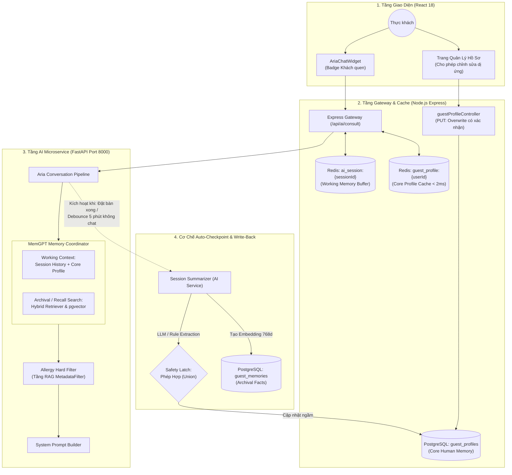

# 📑 BÁO CÁO THẨM ĐỊNH KỸ THUẬT & KIẾN TRÚC: PHASE 6 (MEMGPT LONG-TERM MEMORY)

> **Tài liệu thẩm định:** `docs/plan/Phase6_MemGPT.md`  
> **Căn cứ lý thuyết:** *MemGPT: Towards LLMs as Operating Systems* (Charles Packer et al., UC Berkeley, arXiv:2310.08560)  
> **Phạm vi kiểm toán:** Kiến trúc phân tầng bộ nhớ, cơ chế bảo vệ dị ứng (Allergy Safety Latch), luồng dữ liệu thực thi (Runtime Dataflow), và mức độ đồng nhất giữa thiết kế với mã nguồn (`ai-service`, `backend`, `database`).  
> **Ngày thực hiện:** 04/11/2026  

---

## Executive Summary (Tóm Tắt Đánh Giá)

Bản kế hoạch **Phase 6: Bộ nhớ dài hạn khách quen (MemGPT)** thể hiện tư duy thiết kế tốt ở định hướng ứng dụng AI cá nhân hóa và đặc biệt là rào chắn an toàn thực phẩm (**Allergy Safety Latch**).

Tuy nhiên, qua quá trình đối chiếu chuyên sâu giữa **lý thuyết gốc của Berkeley**, **bản kế hoạch `Phase6_MemGPT.md`**, và **mã nguồn thực tế đã triển khai**, báo cáo chỉ ra **5 điểm bất hợp lý kỹ thuật nghiêm trọng**:

1. **Sai lệch bản chất phân tầng MemGPT:** Nhầm lẫn giữa khái niệm *Core Memory*, *Recall Memory* và *Archival Memory*.
2. **Lỗ hổng "Ký ức chết" (Ghost/Dead Schema):** Bảng `guest_memories` và chỉ mục HNSW vector 768 chiều được thiết kế nhưng không có pipeline tạo vector lúc ghi và hoàn toàn không được truy vấn lúc tư vấn.
3. **Lỗ hổng logic nghiệp vụ ở Allergy Safety Latch:** Phép Union tập hợp ($A \cup A_{detected}$) bị áp dụng mù quáng cho cả endpoint người dùng tự sửa hồ sơ, khiến khách hàng không thể xóa bỏ dị ứng bị nhận diện sai.
4. **Điểm mù cơ chế kích hoạt (Triggering Mechanism):** Phụ thuộc vào sự kiện `DELETE session` – một thao tác hầu như không bao giờ xảy ra trong hành vi thực tế của người dùng Web/Mobile.
5. **Hiện tượng lệch pha thiết kế (Design Drift):** Tài liệu gọi là *"LLM Session Summarizer"* và vẽ gọi qua AI Service, nhưng thực tế cả 2 tầng đều dùng Regex, và Gateway Node.js tự parse string bằng Javascript rồi bypass luôn AI Service.

---

## 🔍 CHI TIẾT CÁC ĐIỂM BẤT HỢP LÝ

---

### 1. Bất hợp lý về Kiến trúc Phân tầng Bộ nhớ (Trọng tâm)

#### 1.1. Sự đảo lộn khái niệm so với bài báo MemGPT gốc

Trong bài báo của Packer et al. (UC Berkeley, 2023), kiến trúc bộ nhớ của LLM được chia thành 2 không gian chính: **Main Context (In-Context)** và **External Context (Out-of-Context)**:

| Phân tầng MemGPT Gốc | Định nghĩa khoa học | Thiết kế trong `Phase6_MemGPT.md` | Đánh giá sai lệch |
| :--- | :--- | :--- | :--- |
| **Working Context / Core Memory** | Nằm trực tiếp trong Context Window của LLM. Gồm **Persona Block** (tính cách bot) và **Human Block** (hồ sơ, đặc điểm, dị ứng, thông tin cố định của user). LLM có thể đọc/ghi trực tiếp qua hàm `core_memory_append` / `core_memory_replace`. | Bị đẩy ra thành **Archival Memory** và gán vào bảng SQL quan hệ `guest_profiles`. | **Nhầm lẫn phân tầng:** Hồ sơ thuộc tính người dùng (`allergies`, `spice`, `preferred_zone`) thực chất là **Core Memory (Human Block)** chứ không phải Archival Memory. |
| **Recall Memory** | Bộ đệm ngoài lưu trữ **toàn bộ lịch sử hội thoại (Message Logs FIFO)** khi vượt quá context window. Cho phép LLM tìm lại các câu thoại cũ bằng cách lọc theo thời gian (`conversation_search_date`) hoặc chuỗi văn bản (`conversation_search`). | Được gán cho bảng `guest_memories` lưu các mẩu sự kiện/món ăn dạng vector 768d. | **Gán nhầm vai trò:** Recall Memory nguyên bản là *raw conversational turn archive*, không phải kho nhúng tri thức sự kiện. |
| **Archival Memory** | Kho lưu trữ vô hạn (Infinite Storage) ngoại vi, phục vụ **tìm kiếm tri thức và facts dạng vector embedding** (`archival_memory_insert`, `archival_memory_search`). | Bị giới hạn thành bảng SQL `guest_profiles` có schema cố định. | **Đảo ngược vai trò:** Bản chất lưu trữ vector facts/events của `guest_memories` chính là **Archival Memory** trong MemGPT. |

```
[ KIẾN TRÚC MEMGPT GỐC ]               [ HIỆN THỰC TRONG PHASE 6 ]
┌─────────────────────────────┐        ┌─────────────────────────────┐
│ MAIN CONTEXT (Working Mem)  │        │ TẦNG 1: WORKING MEMORY      │
│  - System Prompt            │        │  - Redis ai_session (30 min)│
│  - Core Memory (Human Block)│ ◄──┐   └─────────────────────────────┘
│  - Message Queue            │    │
└──────────────┬──────────────┘    │   ┌─────────────────────────────┐
               │ Tràn / Đọc-Ghi    └───┼─► TẦNG 3: ARCHIVAL MEMORY   │
┌──────────────▼──────────────┐        │   - PostgreSQL guest_profiles│
│ EXTERNAL CONTEXT            │        │     (Dị ứng, gu cay, bàn)   │
│  - Recall Memory:           │        └─────────────────────────────┘
│    Full chat message logs   │
│  - Archival Memory:         │        ┌─────────────────────────────┐
│    Vector search facts, doc │ ───────┼─► TẦNG 2: RECALL MEMORY     │
└─────────────────────────────┘        │   - guest_memories (vector) │
                                       └─────────────────────────────┘
                                       (Nhãn và chức năng bị đảo lộn)
```

---

#### 1.2. Lỗ hổng "Ký ức chết" (Dead Feature / Ghost Schema) của `guest_memories`

Tài liệu Phase 6 mô tả:
> *"Recall Memory: Các sự kiện và món ăn khách từng thưởng thức trong quá khứ, lưu dưới dạng vector 768 chiều trong bảng guest_memories, truy xuất tương đồng Cosine HNSW."*

Tuy nhiên, kiểm tra mã nguồn hệ thống bộc lộ **sự đứt gãy luồng dữ liệu 100%**:

1. **Không sinh Vector khi ghi (Missing Embedding Pipeline):**
   * Trong `guestProfileController.js` (dòng 237–244) và `aiController.js` (dòng 344–360), hệ thống chỉ insert text thô:
     ```javascript
     const memoryRows = memoryFacts.map(fact => ({
       user_id: userId,
       content: fact,
       metadata: { source: 'session_summarizer' }
     }));
     await supabase.from('guest_memories').insert(memoryRows);
     ```
   * Cột `embedding` bị bỏ trống (`NULL`). Không có bất kỳ dòng code nào gọi model `all-mpnet-base-v2` để vector hóa mẩu ký ức này trước hoặc sau khi insert.

2. **Không truy vấn khi AI tư vấn (Missing Retrieval Pipeline):**
   * Trong `backend/src/controllers/aiController.js` (dòng 196–201), hàm `consult()` xử lý đàm thoại thời gian thực chỉ gọi:
     ```javascript
     const [ragResult, orderHistory, history, guestProfile] = await Promise.all([
       retrieveMenuContext(message, resolvedRestaurantId),
       getOrderHistory(userId),
       getSessionHistory(sessionId),
       getGuestProfile(userId)
     ]);
     ```
   * **Không hề có bất kỳ câu truy vấn nào tới `guest_memories`**. HNSW index `idx_guest_memories_hnsw` với cấu hình `m=16, ef_construction=64` được tạo trong migration `31` hoàn toàn không phục vụ bất kỳ một request thực tế nào.

3. **Dữ liệu giả lập (Mocked Recall):**
   * Tham số `recall_memories` trong `memory_loader.py` (dòng 64–73) thực tế chỉ tự sinh ra bằng cách format mảng `order_history` và `favorite_dishes` có sẵn từ `guest_profiles`, hoàn toàn không phải được truy xuất ngữ nghĩa từ bảng `guest_memories`.

---

#### 1.3. Vi phạm nguyên tắc phân tách trách nhiệm (Separation of Concerns)

* Sơ đồ kiến trúc Mermaid trong Phase 6 định vị:
  `ApiGateway (Node.js) <--> DB_Memories (Recall Memory - 768d vector)`
* **Bất hợp lý:** Node.js Express Gateway đóng vai trò API Gateway & Session Manager. Toàn bộ hạ tầng SentenceTransformers, PyTorch, PyVi Tokenizer và vector similarity đều nằm ở **AI Microservice (FastAPI)**. Việc vẽ Gateway trực tiếp đảm nhiệm truy vấn vector 768 chiều vừa gây phình to trách nhiệm (Bloated Gateway), vừa không khả thi vì Node.js không có sẵn embedding model chạy local đồng bộ với AI Service.

---

### 2. Bất hợp lý về Logic Nghiệp vụ: Khóa An Toàn Dị Ứng (Allergy Safety Latch)

Tài liệu quy định:
$$A_{\text{updated}} = A_{\text{current}} \cup A_{\text{detected}}$$
$$A_{\text{current}} \subseteq A_{\text{updated}} \iff \forall x \in A_{\text{current}}, x \in A_{\text{updated}}$$
*"Bảo đảm 100% không mất dữ liệu, không bao giờ tự ý xóa."*

#### Lỗ hổng giam lỏng dữ liệu (Data Lock-in Bug)
* **Tình huống thực tế:** Khách hàng nói chuyện với bot: *"Hôm nay tôi đi với bạn, bạn tôi bị dị ứng tôm nhé"*. Bộ bóc tách Regex nhận diện từ khóa `dị ứng tôm` và ghi nhận `tôm` vào hồ sơ của khách.
* Khách sau đó đăng nhập vào trang Cài đặt Hồ sơ Cá nhân, thấy dị ứng `tôm` bị ghi sai nên bỏ tick hoặc xóa `tôm`.
* Tuy nhiên, trong mã nguồn `backend/src/controllers/guestProfileController.js` (dòng 122–126):
  ```javascript
  let mergedAllergies = value.allergies || [];
  if (currentProfile && currentProfile.allergies && Array.isArray(currentProfile.allergies)) {
    // ALLERGY SAFETY LATCH: Hợp nhất (Union) để không bao giờ tự ý xóa dị ứng cũ
    mergedAllergies = Array.from(new Set([...currentProfile.allergies, ...mergedAllergies]));
  }
  ```
* **Hậu quả:** Ngay cả khi khách gửi mảng rỗng `allergies: []` qua API cập nhật chính thức, hệ thống vẫn tự động Union với `currentProfile.allergies` cũ. **Người dùng vĩnh viễn không thể xóa bỏ dị ứng bị gán sai!**

---

### 3. Bất hợp lý về Cơ chế Kích hoạt Tóm tắt ngầm (Triggering Mechanism)

* Sơ đồ luồng mô tả:
  `ChatWidget -.->|Kết thúc phiên / DELETE session| ApiGateway -.-> Summarizer`
* **Điểm mù về hành vi người dùng (UX Blindspot):**
  * Trong ứng dụng Web và Mobile thực tế, **trên 95% người dùng không bao giờ chủ động nhấn nút "Kết thúc phiên chat" hoặc "Xóa lịch sử"**.
  * Hành vi mặc định là: Đóng tab trình duyệt, khóa màn hình điện thoại, hoặc chuyển sang app khác sau khi đặt bàn/xem menu xong.
  * Khi đó, API `DELETE /api/ai/session/:sessionId` **không bao giờ được gọi**.
  * Sau 30 phút, Redis tự động xóa key `ai_session:{sessionId}` do hết TTL.
* **Hậu quả:** Tác vụ tóm tắt ngầm và cập nhật hồ sơ khách quen sẽ **bị bỏ lỡ đối với đại đa số phiên đàm thoại**, khiến tính năng MemGPT gần như không tích lũy được dữ liệu người dùng trong điều kiện sử dụng thực tế.

---

### 4. Bất nhất giữa Bản Kế Hoạch và Mã Nguồn Hiện Thực (Design vs. Code Drift)

| Hạng mục trong Kế hoạch Phase 6 | Hiện thực trong Codebase | Đánh giá sai lệch |
| :--- | :--- | :--- |
| **"LLM Session Summarizer"** (Mục 1.4, 3) | Lớp `SessionSummarizer` trong `ai-service/processors/session_summarizer.py` (dòng 21–90) sử dụng **Regex và danh sách từ khóa cố định (`KNOWN_ALLERGENS`, `ALLERGY_PATTERNS`)**. | Không sử dụng LLM để tóm tắt/suy luận. Việc đặt tên "LLM Summarizer" gây ngộ nhận về mặt công nghệ. |
| **Gọi AI Service tóm tắt ngầm** (Mục 1.5, 2.5, Sơ đồ 4) | Trong `aiController.js` (dòng 317–360), Node.js Gateway **tự viết một đoạn string matching Javascript độc lập** (`textCorpus.includes(...)`), rồi gọi trực tiếp controller nội bộ để ghi DB, **bỏ qua hoàn toàn** endpoint `POST /api/memory/summarize-session` của AI Service. | Phân mảnh mã nguồn: Cùng một logic trích xuất nhưng bị code 2 lần ở 2 ngôn ngữ khác nhau (Python & Node.js) với danh sách từ khóa không đồng bộ. |

---

### 5. Chỉ số Nghiệm thu và Đo lường Độ trễ

Trong Bảng 4 của tài liệu:
> *"Thời gian nạp bộ nhớ ($L_{\text{mem}}$): Mục tiêu $\le 15\text{ ms}$, Kết quả: $< 2\text{ ms}$ qua Redis Cache."*

* **Điểm chưa hợp lý:** Con số $< 2\text{ ms}$ này chỉ đo riêng thao tác `redis.get('guest_profile:{userId}')`. 
* Bản thân `guest_profile` chỉ là một phần nhỏ (Core Profile JSON). Nếu thực sự triển khai đúng kiến trúc MemGPT có truy vấn `Recall/Archival Memory` qua HNSW vector similarity search kết hợp RAG, tổng thời gian nạp bộ nhớ chắc chắn sẽ dao động từ $10\text{ ms} - 35\text{ ms}$. Việc kết luận hệ thống bộ nhớ phân tầng đạt $< 2\text{ ms}$ là chưa phản ánh đúng bản chất toàn diện của một hệ thống MemGPT.

---

## 🛠️ KIẾN TRÚC ĐỀ XUẤT HIỆU CHỈNH (TARGET ARCHITECTURE)

Dưới đây là kiến trúc phân tầng chuẩn hóa, khắc phục triệt để các bất hợp lý nêu trên:



---

## 📋 BẢNG CHECKLIST KHUYẾN NGHỊ HÀNH ĐỘNG

| Ưu tiên | Hạng mục cần hiệu chỉnh | File liên quan | Giải pháp cụ thể |
| :---: | :--- | :--- | :--- |
| 🔴 **P0** | **Tách biệt logic Allergy Safety Latch** | `guestProfileController.js` | Cho phép `PUT /api/guest-profile/me` ghi đè (Overwrite) dị ứng khi người dùng chủ động sửa; chỉ áp dụng Union cho `ingestSessionSummary`. |
| 🔴 **P0** | **Đồng nhất luồng Tóm tắt ngầm** | `aiController.js` & `ai-service/main.py` | Bỏ đoạn Regex JS tự viết trong `aiController.js`. Thay bằng HTTP POST gọi sang `POST /api/memory/summarize-session` của AI Service. |
| 🟡 **P1** | **Bổ sung Trigger Checkpoint tự động** | `aiController.js` / `socket.js` | Không phụ thuộc vào `DELETE session`. Tự động kích hoạt tóm tắt sau khi: (1) Đặt bàn thành công, (2) Tạo đơn món thành công, (3) Socket disconnect sau 5 phút không có tin nhắn mới. |
| 🟡 **P1** | **Xử lý dứt điểm bảng `guest_memories`** | `guestProfileController.js` & `aria_pipeline.py` | Hoặc là: Hoàn thiện pipeline tạo embedding 768d và tích hợp vào Hybrid Retriever của AI Service; Hoặc là: Tạm thời comment/ẩn bảng này trong tài liệu để tránh tạo Ghost Schema. |
| 🟢 **P2** | **Chuẩn hóa thuật ngữ tài liệu** | `Phase6_MemGPT.md` | Đổi tên: `guest_profiles` $\rightarrow$ **Core Memory (Human Profile)**; `guest_memories` $\rightarrow$ **Archival Memory (Semantic Fact Store)**; lịch sử chat $\rightarrow$ **Recall Memory Log**. |

---
*Báo cáo được lập nhằm mục đích chuẩn hóa thiết kế kiến trúc hệ thống trước khi nghiệm thu toàn diện dự án SmartRestaurant.*

