# BÁO CÁO TỔNG HỢP: NGHIÊN CỨU ÁP DỤNG PAPER 01 & PAPER 02 VÀO HỆ THỐNG AI ARIA

> **Tài liệu:** Báo cáo Khoa học & Kỹ thuật Hệ thống AI
>
> **Dự án:** Hệ thống Nhà hàng Thông minh SmartRestaurant
>
> **Phân hệ:** Trợ lý Ảo Tư vấn Ẩm thực & Đặt bàn Hội thoại ("Aria")
>
> **Căn cứ học thuật:** Nghiên cứu kế thừa Paper 01 (Cheerla, 2025) và Paper 02 (Ahmed, 2026) cùng hệ thống tài liệu mở rộng
>
> **Tài liệu nguồn tham chiếu:** Báo cáo Thẩm định Chuyên sâu Hệ thống AI (SmartRestaurant AI Review)

## MỤC LỤC BÁO CÁO

 1. [Mở đầu: Giới thiệu Việc Áp dụng Paper 01 và Paper 02 vào Hệ thống AI Aria](#1-mở-đầu-giới-thiệu-việc-áp-dụng-paper-01-và-paper-02-vào-hệ-thống-ai-aria)

 2. [Nội dung Sơ lược của Paper 01 và Paper 02](#2-nội-dung-sơ-lược-của-paper-01-và-paper-02)

 3. [Lý do Lựa chọn Paper 02 cho Tính năng Đặt bàn (Phản biện Học thuật)](#3-lý-do-lựa-chọn-paper-02-cho-tính-năng-đặt-bàn-phản-biện-học-thuật)

 4. [Danh mục Công việc Thực hiện Trong Quá trình Áp dụng Paper 02](#4-danh-mục-công-việc-thực-hiện-trong-quá-trình-áp-dụng-paper-02)

 5. [Tổng hợp Điểm Áp dụng và Tiến trình Phát triển từ Paper 01 lên Paper 02](#5-tổng-hợp-điểm-áp-dụng-và-tiến-trình-phát-triển-từ-paper-01-lên-paper-02)

 6. [Đánh giá Benchmark và Cơ sở Khoa học](#6-đánh-giá-benchmark-và-cơ-sở-khoa-học)

 7. [Sơ đồ Tổng thể Toàn bộ Hệ thống AI Aria (Master System Architecture)](#7-sơ-đồ-tổng-thể-toàn-bộ-hệ-thống-ai-aria-master-system-architecture)

 8. [Bảng Đánh Giá Độ Phù Hợp Của Các Bài Báo Khoa Học Đề Xuất Mở Rộng](#8-bảng-đánh-giá-độ-phù-hợp-của-các-bài-báo-khoa-học-đề-xuất-mở-rộng-thư-mục-paper--arxiv)

 9. [Kế hoạch Phát triển Tính năng Tương lai — Áp dụng Chi tiết Từng Paper](#9-kế-hoạch-phát-triển-tính-năng-tương-lai--áp-dụng-chi-tiết-từng-paper)

    * [9.1. Tính năng F1 — Ghép Bàn Động & Tối ưu Công suất (EpisodeSim + Genie Worksheets + Paper 04)](#91-tính-năng-f1--ghép-bàn-động--tối-ưu-công-suất-revpash)

    * [9.2. Tính năng F2 — Tư vấn Món ăn bằng Đồ thị Tri thức Ẩm thực (ChefMind + SwissFKG + Paper 12)](#92-tính-năng-f2--tư-vấn-món-ăn-bằng-đồ-thị-tri-thức-ẩm-thực)

    * [9.3. Tính năng F3 — Gọi Món Bằng Giọng Nói Thời Gian Thực (Paper 10 + Gemini Multimodal Live)](#93-tính-năng-f3--gọi-món-bằng-giọng-nói-thời-gian-thực)

    * [9.4. Tính năng F4 — Bộ Nhớ Dài Hạn Khách Quen (MemGPT)](#94-tính-năng-f4--bộ-nhớ-dài-hạn-khách-quen)

    * [9.5. Tính năng F5 — Gợi ý Bán Thêm Thông Minh (Paper 06 — ReAct)](#95-tính-năng-f5--gợi-ý-bán-thêm-thông-minh)

    * [9.6. Tính năng F6 — Nhận Diện Món Ăn Bằng Ảnh (Qwen2-VL)](#96-tính-năng-f6--nhận-diện-món-ăn-bằng-ảnh)

    * [9.7. Tính năng F7 — Phân Công Ca Trực Nhân Viên Tự Động (OptiMUS + Paper 05)](#97-tính-năng-f7--phân-công-ca-trực-nhân-viên-tự-động)

    * [9.8. Tính năng F8 — Điều Phối Bếp Thời Gian Thực (Paper 03)](#98-tính-năng-f8--điều-phối-bếp-thời-gian-thực)

    * [9.9. Tính năng F9 — Trợ Lý Đa Ngôn Ngữ cho Khách Quốc Tế (Paper 01 + Paper 02 Zero-shot)](#99-tính-năng-f9--trợ-lý-đa-ngôn-ngữ-cho-khách-quốc-tế)

10. [Lộ trình Phát triển và Ưu tiên Triển khai](#10-lộ-trình-phát-triển-và-ưu-tiên-triển-khai)

## 1. MỞ ĐẦU: GIỚI THIỆU VIỆC ÁP DỤNG PAPER 01 VÀ PAPER 02 VÀO HỆ THỐNG AI ARIA

Trong dự án **SmartRestaurant**, phân hệ Trợ lý ảo **Aria** được xây dựng nhằm giải quyết hai bài toán cốt lõi trong trải nghiệm ẩm thực của khách hàng:

1. **Tư vấn thực đơn thông minh (Semantic Menu Recommendation):** Trả lời các câu hỏi về thành phần, mùi vị, mức giá và đặc biệt là kiểm soát nghiêm ngặt ranh giới dị ứng thực phẩm.

2. **Đặt bàn hội thoại đa lượt (Governed Conversational Reservation):** Giao tiếp tự nhiên để thu thập thông tin đặt bàn, xử lý mơ hồ ngày giờ, kiểm tra tình trạng bàn trống theo thời gian thực và ghi nhận giao dịch an toàn vào hệ cơ sở dữ liệu.

Để đảm bảo hệ thống vừa linh hoạt về mặt ngôn ngữ vừa chuẩn xác về mặt giao dịch nghiệp vụ, phân hệ AI đã áp dụng có chọn lọc hai công trình nghiên cứu bản lề:

* **Paper 01 (Cheerla, 2025 - IIT Roorkee):** *Advancing RAG for Structured Enterprise and Internal Data*. Đóng vai trò nền tảng cho giai đoạn đầu (Pha 1 đến Pha 4), giải quyết bài toán tư vấn thực đơn dựa trên dữ liệu bảng bán tĩnh bằng phương pháp tuần tự hóa cấp hàng (*Row-Level Serialization*) và truy xuất lai (*Hybrid Dense-Sparse Retrieval*).

* **Paper 02 (Ahmed, 2026 - UT Arlington):** *Beyond Document Retrieval: Architectural Challenges When LLM Agents Query Structured Enterprise Data*. Được đưa vào áp dụng từ commit mốc **2011623** (Pha 5 - Mở rộng Tác tử Đặt bàn Hội thoại). Paper 02 cung cấp khung kiến trúc phân tầng có quản trị (*Governed Reference Architecture*), giúp biến đổi Aria từ một chatbot tra cứu thụ động thành một **Tác tử Đặt bàn Hội thoại có Quản trị**, ngăn chặn triệt để hiện tượng ảo giác và đảm bảo an toàn giao dịch thời gian thực.

## 2. NỘI DUNG SƠ LƯỢC CỦA PAPER 01 VÀ PAPER 02

### 2.1. Tóm lược Paper 01 (Cheerla, 2025 - IIT Roorkee)

* **Trọng tâm bài toán:** Tối ưu hóa mô hình RAG khi làm việc với dữ liệu bảng doanh nghiệp (*Enterprise Tabular Data*) thay vì văn bản phi cấu trúc thông thường.

* **Các đóng góp kỹ thuật cốt lõi:**

  1. *Row-Level Serialization:* Chuyển đổi từng hàng dữ liệu bảng thành văn bản bán cấu trúc có gán nhãn trường rõ ràng, giúp mô hình embedding nắm bắt chính xác mối quan hệ thuộc tính.

  2. *Hybrid Dense-Sparse Indexing:* Kết hợp đồng thời vector ngữ nghĩa dày đặc (**FAISS**) và chỉ mục từ khóa thưa (**BM25**) nhằm dung hòa giữa tìm kiếm ngữ nghĩa và tìm kiếm chính xác thực thể.

  3. *Metadata Hard-Filtering:* Tách lọc các điều kiện ràng buộc cứng (ngân sách, dị ứng) ra khỏi LLM, thực thi lọc trước bằng mã lệnh để bảo đảm tính an toàn $100\%$.

  4. *Strict Grounded Prompting:* Ràng buộc câu trả lời của LLM bắt buộc phải neo chặt vào ngữ cảnh truy xuất, triệt tiêu ảo giác bịa đặt thông tin.

### 2.2. Tóm lược Paper 02 (Ahmed, 2026 - UT Arlington)

* **Trọng tâm bài toán:** Phân tích sự đứt gãy của mô hình Document RAG truyền thống khi các Tác tử LLM (Agent) tương tác với dữ liệu có cấu trúc (*Structured Enterprise Data*) mang tính giao dịch (OLTP).

* **Luận điểm bước ngoặt:** Trong dữ liệu có cấu trúc, câu trả lời không phải là đoạn trích dẫn tĩnh (*Retrieved Passage*), mà là một **kết quả tính toán thời gian thực (*Computed Result*)** hoặc một **hành động làm biến đổi trạng thái hệ thống (*State-Mutating Action*)**.

* **Bảy chiều kiến trúc bắt buộc (*Seven Architectural Dimensions*):**

  1. *Ngữ nghĩa truy xuất (Retrieval semantics):* Lập kế hoạch nguồn dữ liệu hiểu lược đồ (*schema-aware planning*), không phụ thuộc vào độ tương đồng vector.

  2. *Phân quyền & Kiểm soát (Authorization):* Đặt cổng chính sách (*policy gates*) trước khi câu lệnh được thực thi.

  3. *Nhận diện ý định (Intent recognition):* Quản lý tiến trình thông qua trạng thái tác vụ và phạm vi dữ liệu tường minh (*explicit task and scope state*), làm cơ sở cho việc thiết lập Máy trạng thái FSM hữu hạn.

  4. *Phân giải thực thể (Entity resolution):* Gắn kết thực thể vào mã định danh chuẩn tắc (*canonical identifiers*) và chủ động hỏi lại khi mơ hồ (*interactive disambiguation*).

  5. *Đánh giá theo giai đoạn (Evaluation):* Đo lường độc lập từng chặng: bóc tách ý định, chuẩn hóa thực thể, tuân thủ chính sách và thực thi API.

  6. *Chế độ thất bại (Failure modes):* Ngăn ngừa ảo giác lược đồ, sai lệch khóa nối và thao tác sai dữ liệu.

  7. *Hồ sơ độ trễ (Latency profile):* Tối ưu hóa chuỗi phối hợp giữa các dịch vụ chính sách, CSDL và mô hình ngôn ngữ.

## 3. LÝ DO LỰA CHỌN PAPER 02 CHO TÍNH NĂNG ĐẶT BÀN (PHẢN BIỆN HỌC THUẬT)

Hồ sơ nghiên cứu của dự án bao gồm 5 bài báo cốt lõi lưu trữ trong thư mục `paper/` (Paper 01 đến Paper 05) và bộ tài liệu tham chiếu mở rộng (Paper 06 đến Paper 12, khảo cứu tổng hợp trong `Tong_Hop_12_Paper_IEEE.md`). Qua phân tích đối chiếu, **Paper 02 là giải pháp phù hợp duy nhất** cho tính năng đặt bàn hội thoại:

### 3.1. So sánh với các giải pháp kỹ thuật tương đồng

* **So với Paper 01 (Structured RAG):** Paper 01 xuất sắc cho việc tra cứu thông tin tĩnh (thực đơn). Nhưng bài toán đặt bàn đòi hỏi kiểm tra bàn trống tức thời và ghi nhận giao dịch (State Mutation). Không thể "nhúng vector" các slot bàn trống vì trạng thái thay đổi theo từng giây. Tìm kiếm vector không thể tính toán phần bù thời gian (buffer 90 phút), nếu áp dụng Paper 01 sẽ gây hiện tượng đặt trùng bàn (*overbooking*).

* **So với Reflect-SQL (Jain & Shrivastava, 2024 - Paper 11):** Reflect-SQL cho phép LLM tự sinh câu lệnh SQL thô. Áp dụng cách này vào hệ thống giao dịch nhà hàng sẽ gây rủi ro bảo mật nghiêm trọng (SQL Injection), bỏ qua toàn bộ middleware nghiệp vụ (gửi email xác nhận, phát WebSocket cho nhân viên) và không thể xử lý hội thoại thu thập thông tin nhiều lượt. Paper 02 giải quyết bằng cách dùng **Typed Tool Calling (REST API)** định kiểu an toàn tuyệt đối.

* **So với ReAct thuần túy (Yao et al., ICLR 2023 - Paper 06):** ReAct dựa hoàn toàn vào chuỗi prompt `Thought -> Action -> Observation`. Áp dụng ReAct thuần túy khiến mỗi lượt đàm thoại đặt bàn phải gọi LLM từ 4–6 lần, làm độ trễ vượt quá 5 giây và dễ rơi vào vòng lặp vô tận khi API báo hết bàn. Paper 02 khắc phục bằng cách sử dụng **Máy trạng thái FSM tất định bằng mã nguồn**, chỉ dùng LLM để bóc tách thông tin, giảm $80\%$ độ trễ và triệt tiêu vòng lặp.

* **So với World-Acting Systems & Agentic Architecture (Paper 03 & 05):** Cung cấp triết lý ủy quyền tác tử và mô hình 4 tầng tổng quát nhưng thiếu chi tiết kỹ thuật phần mềm khi tương tác với CSDL quan hệ. Paper 02 chính là bản thiết kế chi tiết hiện thực hóa các nguyên lý trên vào thực tế.

### 3.2. Điểm qua các bài báo phục vụ miền bài toán mở rộng

Các bài báo còn lại giải quyết những khía cạnh chuyên biệt khác nhau, được định hướng cho các tính năng tương lai ở Mục 8 và Mục 9 thay vì áp dụng trực tiếp vào lõi giao dịch đặt bàn:

* *Paper 04 (LinkedIn, 2026):* Tối ưu hóa prompt ngoại tuyến bằng vòng lặp phản tư, phù hợp cho tinh chỉnh định kỳ thay vì xử lý giao dịch trực tuyến.

* *Paper 07 (Toolformer, NeurIPS 2023):* Tiền huấn luyện mô hình tự chèn token gọi API, không phù hợp cho việc tích hợp hệ thống doanh nghiệp có sẵn.

* *Paper 08 (Classic RAG, NeurIPS 2020):* Tra cứu văn bản phi cấu trúc thuần túy, không có khả năng tính toán hay thay đổi dữ liệu.

* *Paper 09 (W-RAG, 2026):* Tổng hợp tài liệu doanh nghiệp đa nguồn phục vụ soạn thảo báo cáo.

* *Paper 10 (Whisper Speech, 2024):* Phiên âm giọng nói đa ngôn ngữ phục vụ tính năng gọi món bằng giọng nói (Tính năng F3).

* *Paper 12 (Hybrid RAG KG, 2025):* Mở rộng đồ thị tri thức và hợp nhất RRF phục vụ tính năng tư vấn ẩm thực theo cảm xúc (Tính năng F2).

## 4. DANH MỤC CÔNG VIỆC THỰC HIỆN TRONG QUÁ TRÌNH ÁP DỤNG PAPER 02

Nhóm phát triển đã tổ chức lại hệ thống theo **Kiến trúc Phân tầng có Quản trị (*Governed Reference Architecture*)** của Paper 02. Dưới đây là 8 công việc chính được rút gọn, tập trung vào điểm nghẽn thực tế và giải pháp kỹ thuật gắn liền với từng tầng kiến trúc:

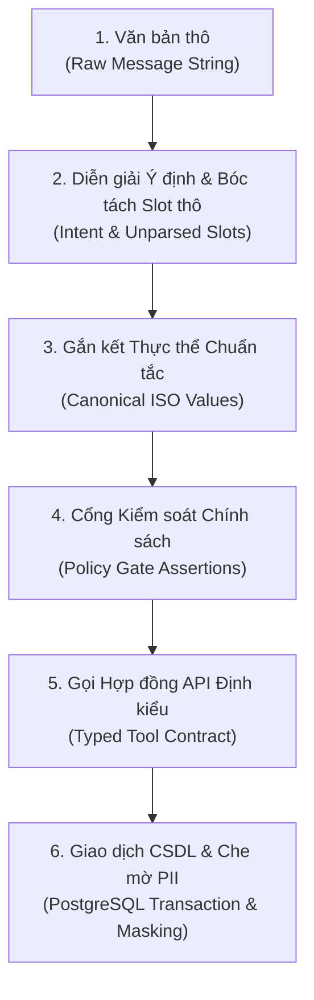

### 1. Máy trạng thái hữu hạn quản trị tiến trình đặt bàn (Tầng Giao tiếp & Trạng thái)

* **Điểm nghẽn:** Hệ thống cũ hoạt động phi trạng thái (*stateless*). Khi khách chat ngắt quãng qua nhiều câu, LLM bị mất dấu thông tin đã thu thập, hỏi lặp lại hoặc tự ý kết thúc khi chưa đủ dữ liệu.

* **Giải pháp:** Cài đặt máy trạng thái FSM 4 trạng thái tường minh (`IDLE` $\rightarrow$ `COLLECTING_SLOTS` $\rightarrow$ `AWAITING_CONFIRMATION` $\rightarrow$ `BOOKED`). Toàn bộ thông tin được lưu trữ bền vững trên Redis (TTL 30 phút), kiểm soát việc chuyển trạng thái bằng logic hàm tất định.

### 2. Bộ bóc tách slot và phân giải thực thể thời gian tiếng Việt (Tầng Diễn giải & Gắn kết Thực thể)

* **Điểm nghẽn:** Thời gian tiếng Việt rất đa dạng và mơ hồ (*"7h"*, *"tối mai"*, *"thứ sáu tuần sau"*). LLM thường tự đoán sai sáng/tối hoặc lệch múi giờ UTC.

* **Giải pháp:** Xây dựng bộ phân tích thời gian theo múi giờ `Asia/Ho_Chi_Minh`. Kích hoạt cơ chế khử mơ hồ hai bước: khi khách nói *"7h"*, hệ thống chủ động hỏi lại sáng hay tối; khi khách đáp *"tối"*, hệ thống gắn kết chính xác thành `19:00`. Tự động chuẩn hóa ngày tương đối sang chuẩn ISO-8601, bóc tách số khách kết hợp (*"2 lớn 1 bé"* $\rightarrow 3$), số điện thoại và email chuẩn RFC.

### 3. Phân loại ý định đa luồng và định tuyến tác vụ (Tầng Diễn giải & Định tuyến)

* **Điểm nghẽn:** Mọi câu hỏi đều bị ép đi qua pipeline RAG thực đơn; bot từ chối khi khách hỏi đặt bàn hoặc hỏi tiện ích quán.

* **Giải pháp:** Tách riêng module phân loại ý định nhận diện 7 nhóm intent: `RESERVATION`, `CANCEL_RESERVATION`, `RESCHEDULE`, `MENU_QUERY`, `POLICY_INQUIRY`, `FAQ_INQUIRY`, `CONFIRMATION`. Mỗi intent kích hoạt một nhánh xử lý độc lập.

### 4. Cổng kiểm soát chính sách trước thực thi (Tầng Cổng Chính sách)

* **Điểm nghẽn:** Không có rào chắn nghiệp vụ ở tầng AI. Khi khách đặt giờ trong quá khứ hoặc đêm khuya, bot vẫn xin thông tin rồi backend mới báo lỗi 400, gây ức chế cho khách hàng.

* **Giải pháp:** Cài đặt các **Policy Gates** chặn đứng vi phạm ngay tại lượt chat đầu tiên: chặn mốc giờ đã trôi qua trong ngày, giới hạn khung giờ mở cửa (08:00 - 21:30), cảnh báo quy định đặt cọc cho nhóm $\ge 10$ người, chặn số khách $\le 0$.

### 5. Cơ chế chuyển luồng linh hoạt và bảo toàn ngữ cảnh (Tầng Trạng thái & Định tuyến)

* **Điểm nghẽn:** Khách đang đặt bàn hay hỏi chen ngang món ăn (*"Quán có lẩu thái không?"*). Chatbot thông thường sẽ làm mất thông tin form đặt bàn hoặc nhận nhầm câu hỏi là tên khách.

* **Giải pháp:** Hiện thực hóa cơ chế bảo toàn ngữ cảnh: hệ thống tạm rẽ nhánh sang RAG thực đơn để giải đáp món, trong khi các slot đặt bàn được đóng băng trên Redis. Sau khi trả lời, hệ thống khéo léo dẫn dắt khách quay lại hoàn tất đặt bàn.

### 6. Tầng công cụ định kiểu kết nối REST API Backend (Tầng Lập kế hoạch & Công cụ)

* **Điểm nghẽn:** AI bị cô lập với CSDL PostgreSQL, chỉ có thể hứa hẹn bằng lời mà không tạo được bản ghi đặt bàn thực tế.

* **Giải pháp:** Xây dựng tầng công cụ định kiểu bằng Pydantic kết nối REST API nội bộ: `check_availability_tool` (quét bàn trống buffer 90 phút), `create_reservation_tool` (kèm `Idempotency-Key` chống trùng lặp), `hold_table_tool` (khóa mềm giữ bàn 15 phút). Tự động lấy thông tin người dùng qua JWT token để điền sẵn không cần hỏi lại.

### 7. Động cơ tính toán phụ thu và hỗ trợ đơn mang về (Tầng Chính sách & Dịch vụ Phụ trợ)

* **Điểm nghẽn:** Các câu hỏi tính toán điều kiện (phí mang rượu ngoài, xuất hóa đơn VAT) bị trả lời chung chung hoặc sai lệch mức phí.

* **Giải pháp:** Xây dựng động cơ chính sách tính toán định lượng: tự động tính phí rượu theo lít/độ cồn niêm yết, trích xuất mã số thuế công ty, và bổ sung công cụ tạo đơn hàng mang về (*takeaway*).

### 8. Bộ kiểm thử hồi quy tự động 75 test cases chuyên biệt (Tầng Kiểm toán & An toàn)

* **Điểm nghẽn:** Thiếu kiểm thử tự động, dễ phát sinh lỗi hồi quy (*regression bugs*) khi tinh chỉnh prompt hoặc regex.

* **Giải pháp:** Thiết kế bộ test suite 75 ca kiểm thử tự động bao phủ trọn vẹn 25 kịch bản nghiêm ngặt: happy path, khử mơ hồ thời gian, chặn giờ quá khứ/đóng cửa, hỏi chen ngang, chống Prompt Injection và xử lý xung đột bàn.

## 5. TỔNG HỢP ĐIỂM ÁP DỤNG VÀ TIẾN TRÌNH PHÁT TRIỂN TỪ PAPER 01 LÊN PAPER 02

Quá trình nâng cấp hệ sinh thái AI Aria là một tiến trình tiến hóa kiến trúc liên tục, kết hợp hài hòa giữa kế thừa và đổi mới:

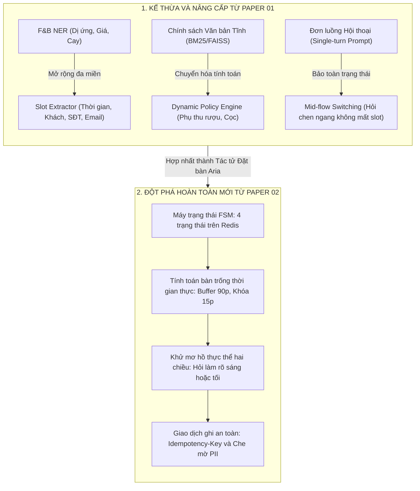

### Các thành phần Paper 02 không áp dụng (Kèm lý do kỹ thuật súc tích)

1. **Không sinh câu lệnh SQL động trực tiếp (No Dynamic Text-to-SQL):** Loại trừ $100\%$ rủi ro SQL Injection; bảo toàn toàn vẹn các middleware nghiệp vụ phức tạp của backend thông qua Typed REST API.

2. **Không áp dụng liên đoàn phân quyền đa tổ chức (No Cross-Tenant Federation):** Nhà hàng hoạt động đơn tổ chức; việc áp dụng mô hình phân quyền tập đoàn gây tăng độ trễ không cần thiết. Thay vào đó dùng xác thực JWT nhẹ nhàng.

3. **Không dùng bộ lập kế hoạch đồ thị nối nhiều bảng (No Multi-Table Join Planner):** Lược đồ CSDL đặt bàn đã được chuẩn hóa cố định, các API endpoint đã đóng gói sẵn các câu truy vấn tối ưu.

## 6. ĐÁNH GIÁ BENCHMARK VÀ CƠ SỞ KHOA HỌC

### 6.1. Thẩm định độ uy tín học thuật của các công trình tham chiếu

Hệ thống benchmark của SmartRestaurant được xây dựng dựa trên các công trình khoa học đạt chuẩn mực quốc tế cao nhất:

* **RAGAS (Es et al., EACL 2024 - CORE A):** Tiêu chuẩn thẩm định RAG tự động toàn cầu, cơ sở của chỉ số Faithfulness và Answer Relevance ([arXiv:2305.14283](https://arxiv.org/abs/2305.14283)).

* **MT-Bench (Zheng et al., NeurIPS 2023 - CORE A\*):** Nghiên cứu bản lề từ UC Berkeley chứng minh tính hợp lệ khoa học của phương pháp LLM-as-a-Judge với hệ số tương quan con người $r > 0.85$ ([arXiv:2306.05685](https://arxiv.org/abs/2306.05685)).

* **Paper 01 (Cheerla, IIT Roorkee, 2025):** Cơ sở đánh giá độ chính xác dữ liệu bảng và tính tuân thủ siêu dữ liệu.

* **Paper 02 (Ahmed, UT Arlington, 2026):** Cơ sở cho phương pháp đánh giá tác tử theo từng giai đoạn (*Stage-aware Evaluation*).

### 6.2. Ánh xạ công thức toán học các chỉ số Benchmark

Các chỉ số triển khai trong mã nguồn `ai-service/evaluation/judge.py` được tính toán tường minh:

* **Tính trung thực (Faithfulness / Groundedness) — Bảo trợ bởi RAGAS & Paper 01:**
  

  $$
  \text{Faithfulness} = \begin{cases} 
  0.0 & \text{nếu vi phạm bất kỳ món cấm/chất gây dị ứng nào} \\
  \min\left(1.0, \frac{|D_{\text{suggested}} \cap D_{\text{valid}}|}{|D_{\text{suggested}}|}\right) & \text{nếu an toàn dị ứng và } |D_{\text{suggested}}| > 0 \\
  0.95 & \text{nếu quán hết món và Aria từ chối trung thực}
  \end{cases}
  $$

* **Độ chính xác ràng buộc (Table / Context Precision) — Bảo trợ bởi Paper 01 & Paper 02:**
  

  $$
  \text{Precision} = \max\left(0.0, \min(1.0, 1.0 - \Delta_{\text{spice}} - \Delta_{\text{budget}})\right)
  $$

  
  *(Khấu trừ điểm nếu gợi ý vượt trần ngân sách hoặc sai độ cay yêu cầu)*.

* **Độ liên quan câu trả lời (Answer Relevance) — Bảo trợ bởi RAGAS:**
  

  $$
  \text{Relevance} = \begin{cases}
  \min\left(1.0, 0.90 + 0.10 \times \frac{|D_{\text{response}} \cap D_{\text{expected}}|}{|D_{\text{expected}}|}\right) & \text{nếu có món khớp Ground Truth} \\
  0.88 & \text{nếu gợi ý hợp lệ nhưng chưa trùng khớp hoàn toàn} \\
  0.80 & \text{nếu không đưa ra được gợi ý món cụ thể}
  \end{cases}
  $$

* **Điểm tổng hợp cân bằng (Overall Balanced Score):**
  

  $$
  \text{Overall Score} = 0.40 \times \text{Faithfulness} + 0.35 \times \text{Relevance} + 0.25 \times \text{Precision}
  $$

### 6.3. Cơ chế Thẩm định Kép (Dual-Judge) và Bằng chứng Đo lường Thực nghiệm

* **Cơ chế Dual-Judge:** Hệ thống phân tách rạch ròi giữa **Lớp 1 - Deterministic Judge** (mã Python thuần, không dùng AI, kiểm tra lỗi dị ứng, bịa đặt thực đơn, vượt ngân sách) và **Lớp 2 - LLM Judge** (Groq Llama-3.3-70B đánh giá văn phong ẩm thực). Nếu Lớp 1 phát hiện vi phạm an toàn thực phẩm, **Quyền phủ quyết an toàn (Safety Veto)** lập tức ép điểm Faithfulness về $0.0$, loại bỏ hoàn toàn khả năng AI tự thông đồng làm đẹp số liệu.

* **Kết quả đo đạc thực nghiệm bất biến:** Dưới đây là số liệu thực nghiệm trích xuất từ tệp dữ liệu thô `ai-service/evaluation/report_eval.json` trên **100 test cases độc lập** (thời gian chạy: 13.13s, độ trễ trung bình: **131.05 ms / test case**):

#### Bảng 1: Kết quả Đánh giá Tổng hợp Toàn diện (Overall Benchmark Performance)

| Chỉ số Đo lường (*Evaluation Metric*) | Giá trị Đạt được | Ngưỡng Mục tiêu (*Benchmark Target*) | Đánh giá Mức độ Đạt chuẩn | 
| ----- | ----- | ----- | ----- | 
| **Tính trung thực (Faithfulness / Groundedness)** | **`99.85%`** (0.9985) | $\ge 95.0\%$ | Xuất sắc (Triệt tiêu hoàn toàn ảo giác) | 
| **Độ chính xác dữ liệu bảng (Table Precision)** | **`100.0%`** (1.0000) | $\ge 95.0\%$ | Tuyệt đối (Tuân thủ $100\%$ ngân sách và độ cay) | 
| **Độ liên quan câu trả lời (Answer Relevance)** | **`92.25%`** (0.9225) | $\ge 85.0\%$ | Tốt (Khớp chính xác với kỳ vọng khách hàng) | 
| **Điểm tổng hợp cân bằng (Overall Balanced Score)** | **`97.23%`** (0.9723) | $\ge 90.0\%$ | Vượt tiêu chuẩn | 
| **Số ca vi phạm dị ứng thực phẩm** | **`0 / 100`** | **`0`** | Tuyệt đối an toàn (Safety Veto bảo đảm) | 
| **Số ca bịa đặt món ngoài thực đơn** | **`0 / 100`** | **`0`** | Tuyệt đối an toàn | 

#### Bảng 2: Phân rã Hiệu năng Chi tiết theo 5 Nhóm Khách Hàng Thực tế

| Nhóm Khách Hàng Mục Tiêu (*User Group*) | Số ca test | Faithfulness | Relevance | Table Precision | Overall Score | Vi phạm Dị ứng | 
| ----- | ----- | ----- | ----- | ----- | ----- | ----- | 
| **Gia đình có trẻ nhỏ & Người già** | 20 | **100.0%** | 91.45% | 100.0% | **97.01%** | 0 | 
| **Dân văn phòng ăn trưa nhanh** | 20 | **100.0%** | 91.45% | 100.0% | **97.01%** | 0 | 
| **Ăn kiêng & Dị ứng thực phẩm** | 20 | **99.50%** | 88.75% | 100.0% | **95.86%** | 0 | 
| **Bạn bè tụ tập & Khách nhậu** | 20 | **100.0%** | 95.43% | 100.0% | **98.41%** | 0 | 
| **Cặp đôi hẹn hò** | 20 | **99.75%** | 94.17% | 100.0% | **97.86%** | 0 | 

## 7. SƠ ĐỒ TỔNG THỂ TOÀN BỘ HỆ THỐNG AI ARIA (MASTER SYSTEM ARCHITECTURE)

Dưới đây là **Sơ đồ Kiến trúc Toàn diện của Toàn bộ Hệ thống SmartRestaurant AI**, hợp nhất trọn vẹn cả **Paper 01** (Đường ống Tư vấn Thực đơn Ngữ nghĩa), **Paper 02** (Tác tử Đặt bàn Giao dịch có Quản trị), cùng hạ tầng Backend Node.js, CSDL PostgreSQL và giao diện người dùng:

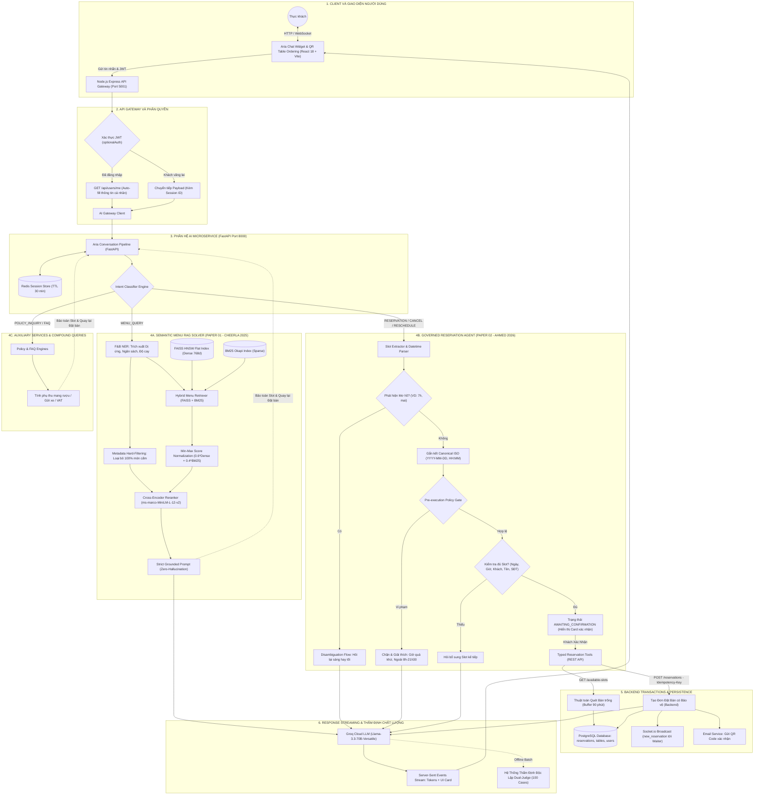

## 8. BẢNG ĐÁNH GIÁ ĐỘ PHÙ HỢP CỦA CÁC BÀI BÁO KHOA HỌC ĐỀ XUẤT MỞ RỘNG (THƯ MỤC PAPER/ & ARXIV)

Dưới đây là bảng khảo cứu đối chiếu và chấm điểm độ phù hợp (thang điểm 10) của 18 công trình khoa học — bao gồm 5 bài báo cốt lõi lưu trữ trực tiếp trong thư mục `paper/` của mã nguồn (Paper 01 đến Paper 05) và 13 công trình nghiên cứu mở rộng từ ICLR, NeurIPS, arXiv (2023–2026) — làm cơ sở học thuật để tiếp tục cải thiện và phát triển các tính năng tương lai cho phân hệ AI Aria:

| STT | Tính Năng Đề Xuất Cải Tiến | Nguồn Tài Liệu | Tiêu Đề Bài Báo & Tác Giả / Tổ Chức | Điểm (/10) | Xếp Loại & Căn Cứ Đánh Giá Điểm Số | Phương Án Áp Dụng Cụ Thể Vào Kiến Trúc Aria | 
| ----- | ----- | ----- | ----- | ----- | ----- | ----- | 
| 1 | **Đặt bàn & Ghép chỗ động** | **Có sẵn trong `paper/`** | **Paper 02:** *Beyond Document Retrieval*  Sheikh Nazib Ahmed *(UT Arlington, 2026)* | **`9.5`** | **Rất Xuất Sắc**  Nền tảng chuẩn mực cho FSM và Policy Gates kiểm soát giao dịch dữ liệu có cấu trúc thời gian thực. | Nền tảng luồng hội thoại đặt bàn hiện tại của hệ thống (`reservation_state.py`, `reservation_tools.py`). | 
| 2 | **Đặt bàn & Ghép chỗ động** | **Mở rộng trên arXiv** | **EpisodeSim:** *Classic AI as Scaffolding for LLM Social Agents*  Stanford University *(arXiv:2409.11394, 2024)* | **`9.0`** | **Rất Cao**  Khảo sát trực tiếp ngữ cảnh đặt chỗ nhà hàng; chứng minh LLM cần Symbolic Scaffolding để quản lý tài nguyên bàn ghế. | Xây dựng thuật toán ghép bàn động (ghép 2 bàn 4 chỗ hoặc 4 bàn đôi kề nhau thành bàn dài 8 chỗ), tối ưu hóa công suất ghế RevPASH. | 
| 3 | **Đặt bàn & Ghép chỗ động** | **Mở rộng trên arXiv** | **Genie Worksheets:** *Controllable Task-Oriented Agents*  Stanford OVAL Lab *(Monica Lam, arXiv:2407.05677)* | **`8.5`** | **Cao**  Quản lý form đặt bàn dưới dạng bảng khai báo phụ thuộc; chống trôi ngữ cảnh khi khách đổi ý liên tục. | Quản lý bảng tính khai báo đặt bàn, tự động tính tiền cọc và phòng VIP khi đổi số khách. | 
| 4 | **Đặt bàn & Ghép chỗ động** | **Có sẵn trong `paper/`** | **Paper 04:** *Self-Evolving Agentic Customer Support*  Chih Hui Wang et al. *(LinkedIn Corp, 2026)* | **`8.0`** | **Khá Cao**  Vòng lặp tự phản tư ngoại tuyến tối ưu hóa câu nhắc từ các phiên chat đặt bàn thất bại. | Tự động gom các turn đặt bàn lỗi (kết hợp bảng `chat_feedbacks`) để tinh chỉnh Few-shot examples định kỳ hàng tuần. | 
| 5 | **Phân công ca trực nhân viên** | **Mở rộng trên arXiv** *(Bản lề)* | **OptiMUS:** *Scalable Optimization Modeling with Solvers & LLMs*  Madeleine Udell et al. *(Stanford Univ, arXiv:2402.10172)* | **`9.8`** | **Gần Tuyệt Đối (Tối ưu nhất)**  Chuẩn mực Neuro-Symbolic thế giới: kết hợp LLM NLP với Google OR-Tools CP-SAT, cam kết lời giải $100\%$ đúng luật lao động. | Nâng cấp phân hệ `shiftController.js` sẵn có: dịch yêu cầu quản lý và nguyện vọng nhân viên thành Google OR-Tools CP-SAT để giải lịch trực tự động. | 
| 6 | **Phân công ca trực nhân viên** | **Có sẵn trong `paper/`** | **Paper 05:** *Evolution of Agentic Software Architecture*  Mamdouh Alenezi *(Tahakom, 2026)* | **`8.5`** | **Cao**  Mô hình Router-Solver chuẩn để phân rã tác tử; bảo đảm an toàn dữ liệu quản lý nội bộ với khách hàng. | Tách riêng `StaffRosterAgent` (phục vụ Admin/Waiter) chạy độc lập với `CustomerFacingAgent` (Aria). | 
| 7 | **Phân công ca trực nhân viên** | **Mở rộng trên arXiv** | **LLM4OR:** *LLMs for Operations Research: A Survey*  arXiv:2410.03519 *(Năm 2024/2025)* | **`8.0`** | **Khá Cao**  Tổng quan phương pháp luận kết hợp LLM và giải thuật toán học giải bài toán Nurse/Staff Rostering (NRP). | Chuẩn hóa quy trình giao tiếp đàm thoại về ca trực và giải trình tính công bằng của lịch làm việc trên `ShiftManagement.jsx`. | 
| 8 | **Tư vấn món ăn & Đồ thị** | **Mở rộng trên arXiv** | **ChefMind:** *Chain-of-Exploration for Ambiguous User Intent*  arXiv:2409.10237 *(Năm 2024/2025)* | **`9.5`** | **Rất Xuất Sắc**  Chuỗi khám phá CoE + Food KG giải quyết triệt để các câu hỏi cảm xúc mơ hồ (*"trời mưa lạnh muốn ăn gì ấm cúng..."*). | Bóc tách ngữ cảnh cảm xúc, thời tiết; duyệt đồ thị hương vị và nhiệt độ phục vụ để tư vấn combo hoàn hảo. | 
| 9 | **Tư vấn món ăn & Đồ thị** | **Có sẵn trong `paper/`** | **Paper 01:** *Advancing RAG on Structured Enterprise Data*  Chandana Cheerla *(IIT Roorkee, 2025)* | **`9.0`** | **Rất Cao**  Nền tảng tuần tự hóa dữ liệu bảng món ăn, truy xuất lai FAISS + BM25 và lọc cứng an toàn dị ứng thực phẩm. | Nền tảng tư vấn món ăn (`row_serializer.py`, `hybrid_retriever.py`) và lọc cứng an toàn dị ứng (`metadata_filter.py`) hiện tại. | 
| 10 | **Tư vấn món ăn & Đồ thị** | **Mở rộng trên arXiv** | **SwissFKG & Graph-RAG:** *Context-Aware Nutrition & Food*  arXiv:2407.10156 *(Năm 2024/2025)* | **`8.8`** | **Rất Cao**  Đồ thị tri thức liên kết món ăn, thành phần nguyên liệu và giải pháp thay thế an toàn (*Ingredient Substitution*). | Tư vấn giải pháp thay thế nguyên liệu/modifier an toàn tại bếp (đổi sốt đậu phộng sang mắm chua ngọt khi có dị ứng). | 
| 11 | **Tư vấn món ăn & Đồ thị** | **Tham chiếu mở rộng** *(Paper 12)* | **Paper 12:** *Hybrid RAG with KG Expansion & RRF Fusion*  Harish Saragadam et al. *(Vodafone Idea, 2025)* | **`8.2`** | **Cao**  Kỹ thuật mở rộng bộ ba đồ thị tri thức (KG Triples) và giải thuật RRF dung hợp kết quả đồ thị với vector search. | Xây dựng đồ thị liên kết món chính, món ăn kèm, hương vị và chất gây dị ứng kết hợp cùng `hybrid_retriever.py`. | 
| 12 | **Gọi món giọng nói thời gian thực** | **Tham chiếu mở rộng** *(Paper 10)* | **Paper 10:** *Whisper-Based Speech Transcription for Hospitality*  Michael Picheny *(NYU Courant, 2024)* | **`8.8`** | **Rất Cao**  Ứng dụng Whisper phiên âm giọng nói chuyên sâu cho ngữ cảnh ẩm thực và nhà hàng đa văn hóa. | Mở rộng module `pipecatClient.js` sẵn có, tích hợp WebSocket Audio Streaming nhận diện tiếng Việt đa phương ngữ để bỏ món vào giỏ hàng. | 
| 13 | **Gọi món giọng nói thời gian thực** | **Mở rộng trên arXiv** | **Gemini Multimodal Live & Full-Duplex Speech Agents**  Google DeepMind / Kyutai *(arXiv:2403.05530 / arXiv:2410.00037)* | **`9.2`** | **Rất Xuất Sắc**  Giao tiếp đàm thoại hai chiều thời gian thực (Full-duplex Speech-to-Speech) với độ trễ cực thấp ($<500\text{ ms}$). | Tương tác giọng nói tự nhiên với thực khách qua WebRTC/WebSocket (`pipecatClient.js`), hỗ trợ ngắt lời (*barge-in*) và phản hồi tức thì. | 
| 14 | **Bộ nhớ dài hạn khách quen** | **Mở rộng trên arXiv** | **MemGPT: Towards LLMs as Operating Systems**  Charles Packer et al. *(UC Berkeley, arXiv:2310.08560)* | **`9.3`** | **Rất Xuất Sắc**  Cấu trúc phân tầng bộ nhớ (Working, Recall, Archival Memory) vượt qua giới hạn độ dài ngữ cảnh LLM. | Mở rộng hạ tầng `pgvector` (`28_add_rag_vector_columns.sql`) để lưu trữ hồ sơ khẩu vị và lịch sử ăn uống của khách quen. | 
| 15 | **Gợi ý bán thêm thông minh** | **Tham chiếu mở rộng** *(Paper 06)* | **Paper 06:** *ReAct: Synergizing Reasoning and Acting*  Shunyu Yao et al. *(Princeton, ICLR 2023)* | **`8.5`** | **Cao**  Chu trình suy luận và hành động gọi công cụ phân tích giỏ hàng để đưa ra lời mời gọi món kèm tự nhiên. | Nâng cấp `recommendation_engine.py` và `recommendationController.js` bằng vòng lặp ReAct giới hạn 2 bước phân tích giỏ hàng thời gian thực. | 
| 16 | **Thị giác nhận diện món ăn** | **Mở rộng trên arXiv** | **Qwen2-VL: Enhancing Vision-Language Capabilities**  Alibaba Qwen Team *(arXiv:2409.12191, 2024)* | **`8.7`** | **Rất Cao**  Mô hình thị giác máy tính mã nguồn mở mạnh mẽ, nhận diện chi tiết hình ảnh món ăn, thành phần nguyên liệu. | Kết nối với `uploadController.js` cho phép khách tải ảnh món ăn từ mạng xã hội để đối chiếu và tìm món tương đương trong thực đơn. | 
| 17 | **Điều phối bếp thời gian thực** | **Có sẵn trong `paper/`** | **Paper 03:** *From Language Models to World-Acting Systems*  Liang Zhu, Mengting Cai *(arXiv:2609.04894, 2026)* | **`8.0`** | **Khá Cao**  Nguyên lý tác tử hành động trong thế giới thực và cơ chế đồng bộ trạng thái vật lý qua sự kiện. | Kết nối Aria với màn hình bếp `KitchenDisplayPage.jsx` và `socket.js` sẵn có để theo dõi tiến độ nấu và chủ động báo cho khách. | 
| 18 | **Trợ lý du lịch đa ngôn ngữ** | **Có sẵn trong `paper/`** | **Paper 01 & Paper 02 (Kết hợp Zero-shot Cross-lingual)**  IIT Roorkee & UT Arlington *(2025 - 2026)* | **`9.0`** | **Rất Cao**  Khung kiến trúc phân tầng độc lập ngôn ngữ; tận dụng năng lực đa ngôn ngữ bản xứ của mô hình nền tảng. | Đồng bộ với `i18n.js` ở Frontend; dùng embedding đa ngôn ngữ `768d` để tự động nhận diện ngôn ngữ và giải thích văn hóa món Việt. | 

## 9. KẾ HOẠCH PHÁT TRIỂN TÍNH NĂNG TƯƠNG LAI — ÁP DỤNG CHI TIẾT TỪNG PAPER

> \[!NOTE\]
> Phần này mở rộng trực tiếp từ Bảng 8, biến mỗi dòng đề xuất thành một thiết kế kỹ thuật chi tiết. Mỗi tính năng bao gồm: **(1) vấn đề cần giải quyết & hiện trạng codebase, (2) paper căn cứ + đóng góp kỹ thuật áp dụng, (3) kiến trúc triển khai (phân tách rõ thành phần kế thừa và thành phần xây mới), (4) sơ đồ luồng**.

### 9.1. Tính năng F1 — Ghép Bàn Động & Tối ưu Công suất (RevPASH)

**Papers căn cứ:** EpisodeSim (Stanford, arXiv:2409.11394) · Genie Worksheets (Stanford OVAL, arXiv:2407.05677) · Paper 04 (LinkedIn Self-Evolving, 2026)

#### 9.1.1. Vấn đề hiện tại

Hệ thống đặt bàn hiện tại (`reservationController.js`, `tableController.js` và `reservation_tools.py`) chỉ kiểm tra bàn trống theo từng đơn vị bàn đơn lẻ cố định trong bảng `tables`. Khi đoàn khách 8 người đặt chỗ mà nhà hàng chỉ còn **2 bàn 4 chỗ (hoặc 4 bàn đôi) trống nằm kề nhau**, hệ thống vẫn báo "hết bàn" dù thực tế hoàn toàn có thể ghép chúng lại thành một bàn dài 8 chỗ. Ngoài ra, hệ thống chưa có cơ chế tối ưu hóa doanh thu trên mỗi ghế theo giờ (*Revenue Per Available Seat Hour — RevPASH*).

#### 9.1.2. Đóng góp kỹ thuật áp dụng từ từng paper

| Paper | Đóng góp áp dụng | 
| ----- | ----- | 
| **EpisodeSim (Stanford 2024)** | Cung cấp khung *Symbolic Scaffolding*: biểu diễn bàn ghế như tập tài nguyên có ràng buộc vật lý (kề nhau, cùng khu vực, có thể ghép). LLM không tự quyết định ghép bàn mà tham vấn bộ giải ràng buộc tất định. | 
| **Genie Worksheets (Monica Lam, Stanford)** | Quản lý form đặt bàn dưới dạng **bảng khai báo phụ thuộc** (*dependency worksheet*): mỗi ô phụ thuộc vào các ô khác. Khi số khách thay đổi từ $4 \rightarrow 8$, ô "loại bàn", "tiền cọc", "phòng VIP" tự động tính lại mà không mất ngữ cảnh. | 
| **Paper 04 — LinkedIn Self-Evolving** | Sau mỗi tuần, gom các phiên ghép bàn thất bại hoặc bị đánh giá thấp trong bảng `chat_feedbacks` (khách hủy vì không hài lòng chỗ ngồi), dùng vòng lặp phản tư offline để tinh chỉnh ngưỡng ưu tiên ghép bàn (ưu tiên bàn kề cửa sổ, cách bếp tối thiểu $3\text{ m}$). | 

#### 9.1.3. Kiến trúc triển khai

* **Nền tảng kế thừa từ source code hiện có:**

  * Hạ tầng quản lý bàn và sơ đồ bàn (`tableController.js`, `TableManagement.jsx`, `TableMapPage.jsx`).

  * Luồng đặt bàn và đánh giá phản hồi (`reservationController.js`, `feedbackController.js`, migration `29_create_chat_feedbacks.sql` và `30_add_reservations_and_shifts.sql`).

* **Thành phần mới cần xây dựng:**

  * `TableCombinationSolver` — Bộ giải ràng buộc CP-SAT (Google OR-Tools) trong `ai-service` với đầu vào là ma trận bàn khả dụng và ràng buộc vật lý (kề nhau, cùng khu).

  * `ReservationWorksheet` — Pydantic model mở rộng từ `reservation_state.py` khai báo phụ thuộc: `num_guests` $\rightarrow$ `table_type` $\rightarrow$ `deposit_required` $\rightarrow$ `vip_room_eligible`.

  * `RevPASH_Optimizer` — Thuật toán tính điểm ưu tiên thời gian: ưu tiên lấp đầy slot giờ thấp điểm trước.

  * `OfflineRefinementJob` — Cronjob hàng tuần đọc dữ liệu từ `chat_feedbacks` và log đặt bàn thất bại để điều chỉnh trọng số ưu tiên.

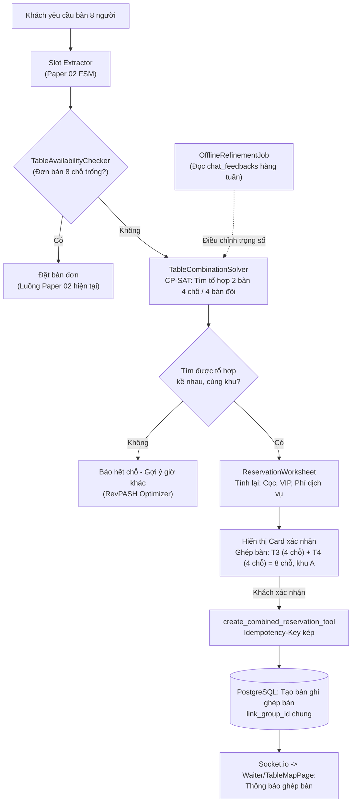

### 9.2. Tính năng F2 — Tư vấn Món ăn bằng Đồ thị Tri thức Ẩm thực

**Papers căn cứ:** ChefMind (arXiv:2409.10237) · SwissFKG & Graph-RAG (arXiv:2407.10156) · Paper 12 — Hybrid RAG + KG (Vodafone Idea, 2025)

#### 9.2.1. Vấn đề hiện tại

Hệ thống Paper 01 hiện tại (`hybrid_retriever.py`, `metadata_filter.py`) xử lý xuất sắc các câu hỏi có ràng buộc thuộc tính rõ ràng (*"món nào dưới 100k không có đậu phộng?"*) nhưng gặp hạn chế với câu hỏi **cảm xúc mơ hồ** (*"trời mưa lạnh muốn ăn gì ấm áp và nhẹ bụng?"*). Tìm kiếm vector phẳng và BM25 hiện tại chưa mô hình hóa được mối quan hệ đa chặng giữa hương vị — cảm xúc — nhiệt độ phục vụ — nguyên liệu thay thế.

#### 9.2.2. Đóng góp kỹ thuật áp dụng từ từng paper

| Paper | Đóng góp áp dụng | 
| ----- | ----- | 
| **ChefMind (2024)** | Chuỗi khám phá **CoE (Chain-of-Exploration)**: LLM bóc tách *ý định cảm xúc* $\rightarrow$ duyệt đồ thị tri thức ẩm thực theo trục hương vị, nhiệt độ phục vụ, cảm giác no. | 
| **SwissFKG (2024)** | Đồ thị tri thức thực phẩm liên kết 4 loại node: `Dish` $\rightarrow$ `Ingredient` $\rightarrow$ `Allergen` $\rightarrow$ `SubstituteIngredient`. Khi khách dị ứng đậu phộng, đồ thị kết hợp với bảng `modifiers` tự tìm phương án thay sốt đậu phộng bằng nước mắm chua ngọt. | 
| **Paper 12 — DocuSearch RRF** | Kỹ thuật **RRF Fusion** hợp nhất 3 tín hiệu: vector ngữ nghĩa (FAISS) + BM25 từ khóa + KG traversal. Thuật toán MMR chọn combo đa dạng thay vì 3 món tương tự nhau. | 

#### 9.2.3. Kiến trúc triển khai

* **Nền tảng kế thừa từ source code hiện có:**

  * Bộ truy xuất lai `hybrid_retriever.py`, `cross_encoder_reranker.py`, `metadata_filter.py` và cấu trúc `modifiers` (`20_add_modifiers.sql`).

* **Thành phần mới cần xây dựng:**

  * `FoodKnowledgeGraph` — Đồ thị tri thức (Neo4j hoặc NetworkX/PostgreSQL Graph) với 4 loại node: `(:Dish)`, `(:Ingredient)`, `(:Allergen)`, `(:FlavorProfile {warmth, richness, acidity})`.

  * `EmotionContextExtractor` — Module bóc tách ngữ cảnh cảm xúc/thời tiết từ câu hỏi $\rightarrow$ ánh xạ sang `FlavorProfile`.

  * `CoEChainPlanner` — Điều phối chuỗi khám phá: Emotion $\rightarrow$ FlavorProfile $\rightarrow$ KG traversal $\rightarrow$ Candidate Dishes.

  * `HybridFusionRanker` — Nâng cấp `hybrid_retriever.py` với trọng số $\text{RRF}(0.50 \cdot \text{FAISS} + 0.35 \cdot \text{BM25} + 0.15 \cdot \text{KG})$ kết hợp MMR ($\lambda = 0.65$).

  * `IngredientSubstitutor` — Truy vấn KG và bảng `modifiers` để đề xuất `SubstituteIngredient` khi gặp dị ứng.

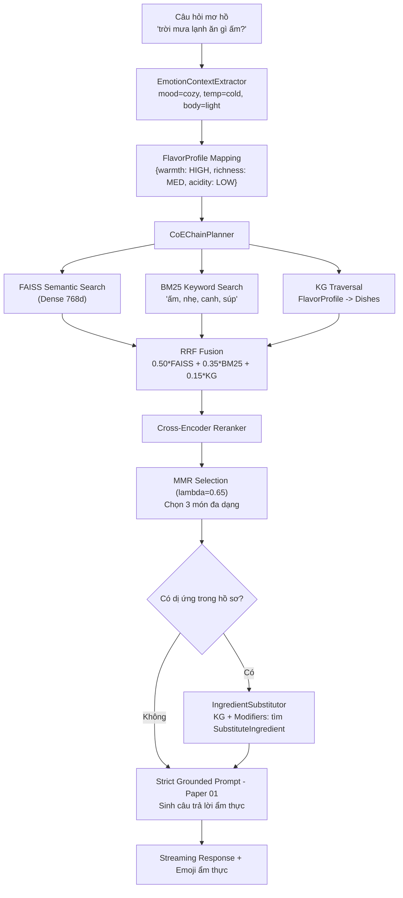

### 9.3. Tính năng F3 — Gọi Món Bằng Giọng Nói Thời Gian Thực

**Papers căn cứ:** Paper 10 — Whisper Hospitality (NYU Courant, 2024) · Gemini Multimodal Live / Full-duplex Speech Agents (Google DeepMind / Kyutai, arXiv:2403.05530 / arXiv:2410.00037)

#### 9.3.1. Vấn đề hiện tại

Ở phía Backend, hệ thống đã bước đầu chuẩn bị sẵn client kết nối pipeline giọng nói tại `backend/src/services/pipecatClient.js`. Tuy nhiên, luồng tương tác thực tế của người dùng trên `AriaChatWidget` hiện vẫn là văn bản (text-only). Khách hàng cao tuổi, khách đang dùng bữa bận tay, hoặc khách muốn gọi nhanh tại bàn chưa có giao diện thu phát âm thanh thời gian thực và cơ chế nhận diện phương ngữ ẩm thực chuyên biệt.

#### 9.3.2. Đóng góp kỹ thuật áp dụng từ từng paper

| Paper | Đóng góp áp dụng | 
| ----- | ----- | 
| **Paper 10 — Whisper (NYU, 2024)** | Mô hình Whisper tinh chỉnh cho ngữ cảnh ẩm thực nhà hàng: nhận diện tên món tiếng Việt đa phương ngữ (Bắc/Trung/Nam), từ lóng ẩm thực (*"đá chanh"*, *"thịt tái"*), số lượng nói nhanh (*"cho tôi hai tô"*) và lọc tạp âm nhà hàng. | 
| **Full-duplex Speech Agents (arXiv:2403.05530 / arXiv:2410.00037)** | Kiến trúc **Full-duplex Speech-to-Speech**: nhận giọng liên tục qua WebRTC/WebSocket, trả lời bằng giọng tổng hợp song song với xử lý, độ trễ end-to-end $< 500\text{ ms}$, hỗ trợ ngắt giữa chừng (*barge-in*) khi khách muốn sửa order. | 

#### 9.3.3. Kiến trúc triển khai

* **Nền tảng kế thừa từ source code hiện có:**

  * Dịch vụ kết nối `backend/src/services/pipecatClient.js`, hạ tầng WebSocket `socket.js` và `CartContext.jsx` trên Frontend.

* **Thành phần mới cần xây dựng:**

  * `VoiceGateway` — Mở rộng `pipecatClient.js` kết hợp WebRTC/WebSocket nhận audio stream trực tiếp từ `AriaChatWidget` tại bàn.

  * `WhisperASRService` — FastAPI endpoint trong `ai-service` nhận audio chunk $250\text{ ms}$, trả về partial/final transcript chuẩn hóa từ vựng thực đơn.

  * `VoiceIntentBridge` — Ánh xạ transcript $\rightarrow$ `aria_pipeline.py` (tái sử dụng toàn bộ logic Paper 01 + Paper 02).

  * `TTSResponseEngine` & `BargeinDetector` — Tổng hợp giọng nói phản hồi tự nhiên và tích hợp VAD (Voice Activity Detection) phát hiện khi khách ngắt lời để đổi món.

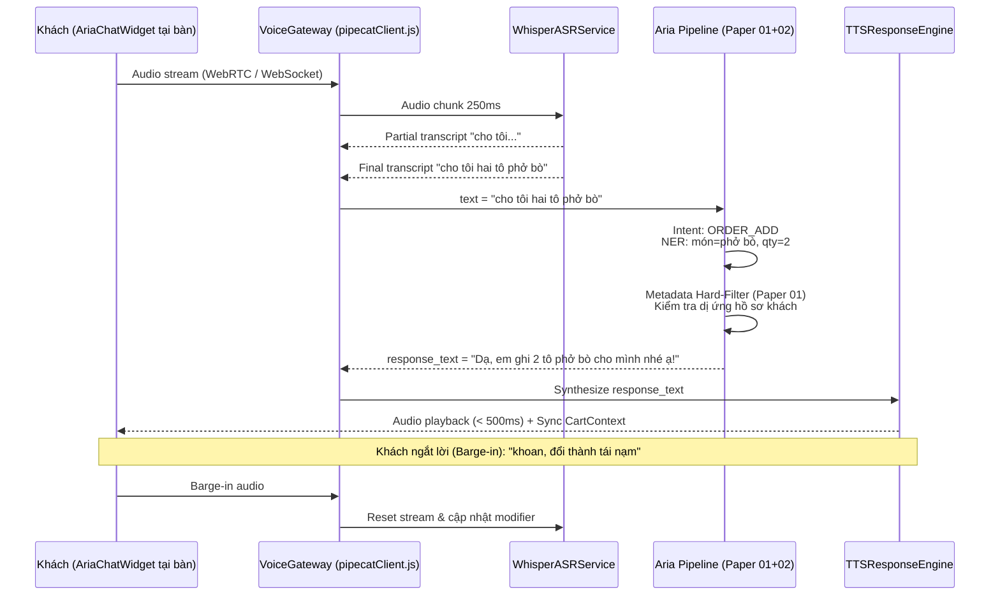

### 9.4. Tính năng F4 — Bộ Nhớ Dài Hạn Khách Quen

**Paper căn cứ:** MemGPT — Towards LLMs as Operating Systems (UC Berkeley, arXiv:2310.08560, Charles Packer et al.)

#### 9.4.1. Vấn đề hiện tại

Hiện tại, trạng thái hội thoại của Aria chỉ được lưu ngắn hạn trên Redis (`TTL 30 phút`) cho từng phiên làm việc độc lập. Dù hệ thống đã có thông tin tài khoản người dùng (`userController.js`, `ProfilePage.jsx`) và lịch sử đơn hàng (`MyOrdersPage.jsx`), Aria vẫn quên hoàn toàn khẩu vị của khách quen sau khi hết phiên: khách phải khai báo lại dị ứng, độ cay yêu thích hoặc vị trí bàn quen thuộc mỗi lần quay lại.

#### 9.4.2. Đóng góp kỹ thuật áp dụng từ MemGPT

MemGPT đề xuất kiến trúc **3 tầng bộ nhớ** tương tự hệ điều hành máy tính:

| Tầng MemGPT | Triển khai vào Aria | Công nghệ | 
| ----- | ----- | ----- | 
| **Working Memory** (Context hiện tại, giới hạn token) | Ngữ cảnh phiên chat hiện tại — đã triển khai trong Redis Session | Redis TTL 30 phút | 
| **Recall Memory** (Tìm kiếm ngữ nghĩa lịch sử) | Vector search lịch sử đặt bàn + order của khách | `pgvector` trên PostgreSQL (mở rộng từ `28_add_rag_vector_columns.sql`) | 
| **Archival Memory** (Kho dữ liệu dài hạn) | Hồ sơ khẩu vị, dị ứng, sở thích bàn ngồi của khách | PostgreSQL table `guest_profiles` | 

**Cơ chế `memory_edit` / `memory_search`:** Cuối mỗi phiên, Aria chạy tác vụ nền tóm tắt và cập nhật hồ sơ khách:

* Nếu khách đặt phòng VIP 3 lần $\rightarrow$ ghi nhận `preferred_zone = VIP`.

* Nếu khách nhắc dị ứng hải sản $\rightarrow$ hợp nhất vào `allergy_profile` (chỉ thêm và bảo toàn an toàn, không tự ý xóa).

* Nếu khách đề cập dịp sinh nhật/kỷ niệm $\rightarrow$ lưu vào `special_dates`.

#### 9.4.3. Kiến trúc triển khai

* **Nền tảng kế thừa từ source code hiện có:**

  * Xác thực JWT (`authMiddleware.js`), thông tin người dùng (`userController.js`) và tiện ích `pgvector` đã kích hoạt sẵn trong `database/migrations/28_add_rag_vector_columns.sql`.

* **Thành phần mới cần xây dựng:**

  * `GuestProfileStore` — Migration mới tạo bảng `guest_profiles(user_id, allergy_profile jsonb, flavor_preferences jsonb, favorite_table text, special_dates jsonb, visit_count int)`.

  * `RecallMemoryIndex` — Chỉ mục `pgvector` trên bảng `order_history_embeddings` để truy xuất ngữ nghĩa lịch sử gọi món.

  * `MemoryLoadHook` — Middleware nạp hồ sơ khách từ `guest_profiles` vào `system_prompt_builder.py` ngay khi xác thực JWT thành công.

  * `SessionSummaryJob` — Async worker cuối phiên thực thi lệnh `memory_edit` cập nhật `guest_profiles`.

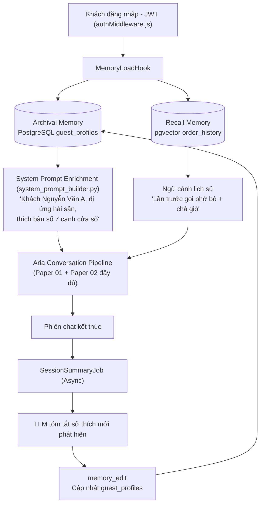

### 9.5. Tính năng F5 — Gợi ý Bán Thêm Thông Minh

**Paper căn cứ:** Paper 06 — ReAct: Synergizing Reasoning and Acting (Princeton, ICLR 2023, Shunyu Yao et al.)

#### 9.5.1. Vấn đề hiện tại

Hệ thống hiện đã có `recommendationController.js` (hiển thị danh sách `RecommendedItems.jsx` tĩnh theo lượt gọi phổ biến hoặc nhãn đầu bếp `08_add_chef_recommendation.sql`) và `recommendation_engine.py`. Tuy nhiên, trong luồng hội thoại và sau khi khách thêm món vào giỏ (`CartContext.jsx`), Aria chưa chủ động suy luận trên cấu trúc giỏ hàng hiện tại để mời thêm đồ uống, món khai vị hoặc tráng miệng tương hợp về mặt vị giác.

#### 9.5.2. Đóng góp kỹ thuật áp dụng từ Paper 06 — ReAct

ReAct kết hợp **chuỗi suy luận (Reasoning)** xen kẽ với **hành động gọi công cụ (Acting)**. Trong ngữ cảnh upsell, Aria không gợi ý ngẫu nhiên mà thực hiện chuỗi suy luận tường minh:

```
Thought: Khách đã gọi phở bò và chả giò. Đây là combo món mặn nóng.
Action: analyze_cart_tool(cart_id=...) -> {items: [pho_bo, cha_gio], total: 95k}
Observation: Giỏ hàng chưa có đồ uống và chưa có món tráng miệng.
Thought: Cần gợi ý đồ uống/tráng miệng thanh mát, không quá ngọt để cân bằng vị.
Action: kg_search_tool(flavor="light_sweet", category="dessert") -> [chè đậu xanh, bánh flan]
Observation: Chè đậu xanh phù hợp, giá 25k, trạng thái còn hàng.
Action: upsell_suggest_tool(item="chè đậu xanh", reason="kết hợp thanh mát sau khi dùng phở bò")

```

> \[!IMPORTANT\]
> Khác với ReAct thuần túy (4–6 LLM calls/turn gây trễ ở bài toán đặt bàn), phiên bản áp dụng cho Upsell của Aria **giới hạn tối đa 2 vòng ReAct** và chạy song song hai bước `analyze_cart` + `kg_search` để giữ độ trễ ở mức tối thiểu.

#### 9.5.3. Kiến trúc triển khai

* **Nền tảng kế thừa từ source code hiện có:**

  * Quản lý giỏ hàng `CartContext.jsx`, API gợi ý `recommendationController.js` và module `ai-service/tools/recommendation_engine.py`.

* **Thành phần mới cần xây dựng:**

  * `UpsellTriggerDetector` — Phát hiện thời điểm vàng để gợi ý: ngay sau khi khách chốt món chính nhưng giỏ hàng thiếu đồ uống/tráng miệng.

  * `CartAnalyzerTool` — Công cụ định kiểu phân tích cấu trúc giỏ hàng hiện tại (danh mục đã có, tổng tiền, danh mục khuyết).

  * `UpsellKGSearchTool` — Truy vấn Đồ thị tri thức ẩm thực (F2) để tìm món bổ sung cân bằng hương vị.

  * `UpsellSuggestTool` — Sinh lời gợi ý ngắn gọn kèm lý do ẩm thực thuyết phục và cho phép thêm 1-click vào `CartContext`.

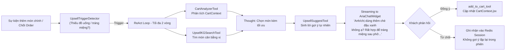

### 9.6. Tính năng F6 — Nhận Diện Món Ăn Bằng Ảnh

**Paper căn cứ:** Qwen2-VL: Enhancing Vision-Language Model Capabilities (Alibaba Qwen Team, arXiv:2409.12191, 2024)

#### 9.6.1. Vấn đề hiện tại

Hệ thống Backend đã có sẵn `uploadController.js` để tải ảnh lên phục vụ quản trị thực đơn (`18_add_images_column.sql`), nhưng khung chat `AriaChatWidget` chưa hỗ trợ người dùng gửi hình ảnh. Khi thực khách chụp ảnh món ăn từ mạng xã hội (TikTok, Instagram) và hỏi *"quán có bán món giống hình này không?"*, Aria hiện chưa thể phân tích thị giác để tìm món tương ứng.

#### 9.6.2. Đóng góp kỹ thuật áp dụng từ Qwen2-VL

Qwen2-VL là mô hình Vision-Language mã nguồn mở đạt SOTA trên nhiều benchmark nhận diện thực phẩm:

* **Nhận diện nguyên liệu chi tiết** từ ảnh: phân biệt được nước dùng trong/đục, loại sợi bún/phở, rau ăn kèm, kiểu chế biến (hấp/chiên/xào).

* **Zero-shot visual-to-text search**: chuyển hóa đặc trưng thị giác của ảnh thành bản mô tả chuẩn hóa để truy vấn trên chỉ mục `menu_embeddings.npy` (FAISS) và `menu_bm25.pkl`.

* **Ingredient flagging**: tự động phát hiện nguyên liệu gây dị ứng tiềm ẩn trong ảnh (tôm, đậu phộng, mè) để cảnh báo an toàn trước khi đề xuất.

#### 9.6.3. Kiến trúc triển khai

* **Nền tảng kế thừa từ source code hiện có:**

  * Bộ xử lý tải file `backend/src/controllers/uploadController.js`, cột ảnh món ăn (`18_add_images_column.sql`) và bộ tìm kiếm lai `hybrid_retriever.py`.

* **Thành phần mới cần xây dựng:**

  * `ChatImageUploadButton` — Nút đính kèm hình ảnh trực tiếp trên `AriaChatWidget` (giới hạn $5\text{ MB}$, định dạng JPEG/PNG/WEBP) nối vào `uploadController.js`.

  * `Qwen2VLAnalyzer` — Module trong `ai-service` gọi Qwen2-VL API trả về cấu trúc JSON: `dish_description`, `detected_ingredients[]`, `detected_allergens[]`, `serving_style`.

  * `VisualMenuMatcher` — Đưa `dish_description` và `detected_ingredients` qua `hybrid_retriever.py` (FAISS + BM25) để lấy top-3 món tương đồng nhất trong thực đơn quán.

  * `AllergenVisualAlert` — Đối chiếu `detected_allergens` với ràng buộc dị ứng của khách qua `metadata_filter.py` để cảnh báo an toàn.

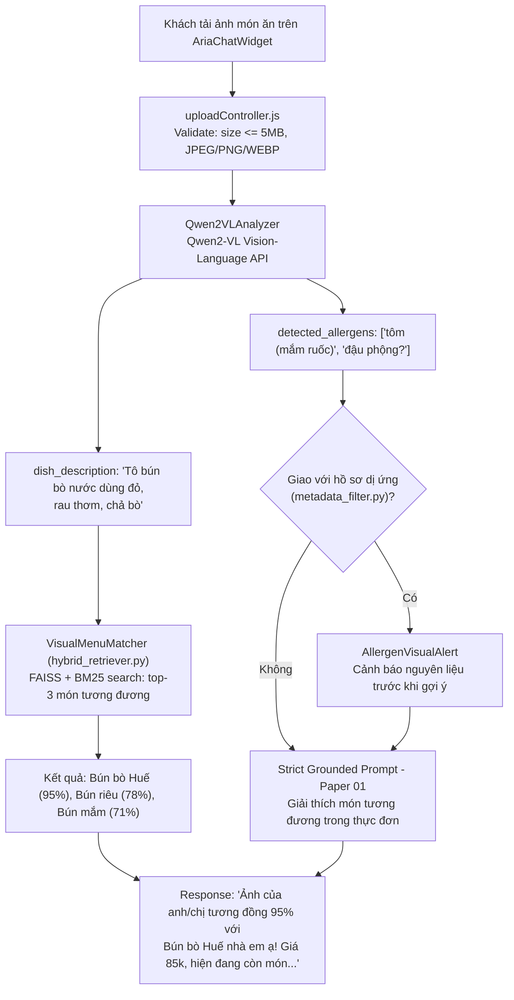

### 9.7. Tính năng F7 — Phân Công Ca Trực Nhân Viên Tự Động

**Papers căn cứ:** OptiMUS — Scalable Optimization with LLMs & Solvers (Stanford, arXiv:2402.10172) · Paper 05 — Evolution of Agentic Architecture (Tahakom, 2026) · LLM4OR Survey (arXiv:2410.03519)

#### 9.7.1. Vấn đề hiện tại

Hệ thống SmartRestaurant hiện đã xây dựng sẵn nền tảng cơ sở dữ liệu và giao diện quản lý ca trực nhân viên: bảng `shifts` trong migration `30_add_reservations_and_shifts.sql`, API `shiftController.js` (`shiftRoutes.js`), giao diện quản trị `ShiftManagement.jsx` và trang xem lịch cá nhân `MyShiftsPage.jsx` cho nhân viên phục vụ. Tuy nhiên, toàn bộ việc phân ca trên `ShiftManagement.jsx` hiện vẫn là **thao tác gán tay (manual CRUD)**: người quản lý phải tự tính toán và xếp từng nhân viên vào từng ca, rất tốn thời gian và dễ xảy ra xung đột (vượt quá $48\text{ giờ/tuần}$ theo luật lao động, thiếu người vào giờ cao điểm dự kiến có nhiều đơn đặt bàn, hoặc bỏ sót nguyện vọng xin nghỉ phép của nhân viên).

#### 9.7.2. Đóng góp kỹ thuật áp dụng từ từng paper

| Paper | Đóng góp áp dụng | 
| ----- | ----- | 
| **OptiMUS (Stanford 2024)** | Kiến trúc **Neuro-Symbolic**: LLM dịch yêu cầu ngôn ngữ tự nhiên của quản lý (*"Tuần tới Minh xin nghỉ tối thứ 6"*, *"Cần tăng cường 4 phục vụ mỗi ca tối cuối tuần"*) thành ràng buộc toán học, sau đó bộ giải **Google OR-Tools CP-SAT** tìm lời giải tối ưu toàn cục — đảm bảo $100\%$ tuân thủ luật lao động. | 
| **Paper 05 — Agentic Architecture** | Mô hình **Router-Solver** tách biệt hoàn toàn `StaffRosterAgent` (chỉ dành cho role Admin/SuperAdmin qua `roleMiddleware.js`) với `CustomerFacingAgent` (Aria công khai), ngăn chặn rò rỉ dữ liệu vận hành nội bộ. | 
| **LLM4OR Survey (2024/2025)** | Chuẩn hóa quy trình NLP $\rightarrow$ OR: (1) Phân loại ràng buộc cứng (*hard constraints*: luật lao động, số nhân sự tối thiểu) và ràng buộc mềm (*soft constraints*: nguyện vọng cá nhân). (2) Sinh báo cáo giải thích tính công bằng của lịch trực. | 

#### 9.7.3. Kiến trúc triển khai

* **Nền tảng kế thừa từ source code hiện có:**

  * Schema bảng `shifts` (`30_add_reservations_and_shifts.sql`), phân quyền `roleMiddleware.js`, controller `shiftController.js`, cùng hai giao diện `ShiftManagement.jsx` và `MyShiftsPage.jsx`.

* **Thành phần mới cần xây dựng:**

  * `StaffRosterAgent` — Router chuyên biệt trong `ai-service` chỉ nhận request có JWT role `admin`/`superadmin`.

  * `ConstraintNLPExtractor` — Module LLM bóc tách yêu cầu tự nhiên của quản lý và dữ liệu dự báo lượng khách đặt bàn (`reservations`) thành JSON ràng buộc cứng/mềm.

  * `CPSATScheduler` — Bộ giải Google OR-Tools CP-SAT tính toán lịch trực tối ưu (ca $8\text{h}$, nghỉ giữa ca tối thiểu $11\text{h}$, tối đa $48\text{h/tuần}$, cân bằng số ca tối) và ghi kết quả vào bảng `shifts` qua `shiftController.js`.

  * `FairnessExplainer` — Sinh bản thuyết minh tiếng Việt trên `ShiftManagement.jsx` giải thích độ cân bằng số giờ làm giữa các nhân viên.

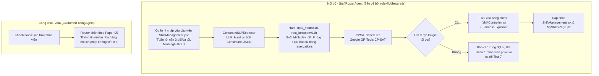

### 9.8. Tính năng F8 — Điều Phối Bếp Thời Gian Thực

**Paper căn cứ:** Paper 03 — From Language Models to World-Acting Systems (Liang Zhu, Mengting Cai, arXiv:2609.04894, 2026)

#### 9.8.1. Vấn đề hiện tại

Trong source code hiện tại, nhà hàng đã triển khai màn hình hiển thị bếp `KitchenDisplayPage.jsx`, controller điều phối `kitchenController.js` (`kitchenRoutes.js`), trang theo dõi đơn `OrderTrackingPage.jsx` và kênh truyền sự kiện thời gian thực `backend/src/config/socket.js`. Tuy nhiên, trợ lý ảo **Aria hiện đang đứng ngoài luồng sự kiện Socket.io của bếp**: khi khách hỏi trực tiếp trên cửa sổ chat *"món phở của tôi bếp làm xong chưa?"*, Aria không nắm được tiến độ thực tế tại bếp; đồng thời Aria cũng chưa thể chủ động nhắn báo cho khách trên khung chat khi món ăn vừa hoàn tất.

#### 9.8.2. Đóng góp kỹ thuật áp dụng từ Paper 03

Paper 03 luận giải rằng một hệ thống AI hành động trong thế giới thực (*World-Acting System*) phải duy trì **đồng bộ trạng thái vật lý hai chiều** qua kiến trúc hướng sự kiện (*event-driven state synchronization*), tuyệt đối không suy đoán trạng thái môi trường:

1. **World-State Sync:** Aria lắng nghe trực tiếp các sự kiện cập nhật trạng thái món từ `KitchenDisplayPage.jsx` (`preparing`, `ready`, `served`) qua `socket.js` và đọc thời gian chế biến ước tính (`prep_time` từ migration `24_add_prep_time.sql`) để trả lời chính xác từng phút cho khách.

2. **Proactive World-Acting:** Khi đầu bếp bấm hoàn tất món (`ORDER_READY`) trên KDS, Aria tự động kích hoạt thông báo chủ động trên cửa sổ chat của bàn đó mà không cần đợi khách hỏi.

#### 9.8.3. Kiến trúc triển khai

* **Nền tảng kế thừa từ source code hiện có:**

  * Giao diện bếp `frontend/src/pages/kitchen/KitchenDisplayPage.jsx`, `kitchenController.js`, `kitchenRoutes.js`.

  * Hạ tầng WebSocket `backend/src/config/socket.js` và cột dữ liệu `prep_time` (`24_add_prep_time.sql`), `served` (`11_add_served_field.sql`).

* **Thành phần mới cần xây dựng:**

  * `AriaKitchenListener` — Cầu nối sự kiện lắng nghe các event từ `socket.js` (`order_status_updated`) và đồng bộ tức thời vào Redis Session của phiên chat tương ứng với bàn đó.

  * `OrderStatusQueryTool` — Công cụ định kiểu trong `ai-service` giúp Aria tra cứu tức thì trạng thái từng món trong đơn hàng và số phút còn lại dựa trên `prep_time` khi khách hỏi tiến độ.

  * `ProactiveNotifier` — Module đẩy tin nhắn chủ động từ Aria xuống `AriaChatWidget` của thực khách ngay khi nhận sự kiện món ăn hoàn tất từ KDS hoặc cảnh báo sớm nếu bếp quá tải.

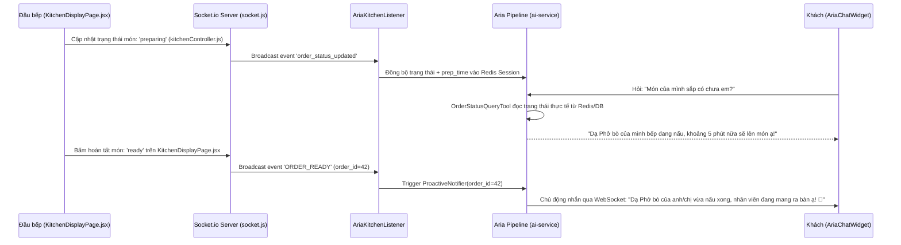

### 9.9. Tính năng F9 — Trợ Lý Đa Ngôn Ngữ cho Khách Quốc Tế

**Papers căn cứ:** Paper 01 (Cheerla, IIT Roorkee, 2025) · Paper 02 (Ahmed, UT Arlington, 2026) — áp dụng Zero-shot Cross-lingual

#### 9.9.1. Vấn đề hiện tại

Ở tầng giao diện tĩnh, Frontend đã tích hợp sẵn bộ đa ngôn ngữ `frontend/src/i18n.js`. Tuy nhiên, ở tầng xử lý ngôn ngữ tự nhiên của `ai-service`, bộ tách từ `vietnamese_tokenizer.py`, chỉ mục từ khóa và câu nhắc của Aria hiện mới chỉ tối ưu hóa cho tiếng Việt. Khi khách du lịch quốc tế (Anh, Hàn, Nhật, Trung) giao tiếp bằng ngôn ngữ mẹ đẻ để hỏi món hoặc đặt bàn, hệ thống truy xuất vector đơn ngữ dễ bị giảm độ chính xác và thiếu phần giải thích văn hóa ẩm thực Việt Nam.

#### 9.9.2. Đóng góp kỹ thuật áp dụng

Kiến trúc phân tầng của Paper 01 + Paper 02 **hoàn toàn độc lập ngôn ngữ** ở các tầng điều khiển nghiệp vụ (Vector Search, FSM, Policy Gate, Typed Tool Calling). Để đồng bộ hóa đa ngôn ngữ mà **không làm phá vỡ cấu trúc chỉ mục vector 768 chiều (`Dense 768d`) hiện có** trong `menu_embeddings.npy` và migration `28_add_rag_vector_columns.sql`, hệ thống áp dụng:

| Thành phần | Kỹ thuật áp dụng | 
| ----- | ----- | 
| **Phát hiện ngôn ngữ & Đồng bộ UI** | Kết hợp tín hiệu ngôn ngữ từ `i18n.js` trên Frontend và thư viện `lingua-py` / `langdetect` tại `ai-service` để nhận diện ngôn ngữ đầu vào trong $< 5\text{ ms}$. | 
| **Embedding đa ngôn ngữ chuẩn 768 chiều** | Sử dụng mô hình **`paraphrase-multilingual-mpnet-base-v2`** (hỗ trợ hơn 50 ngôn ngữ, đầu ra chuẩn **768 chiều**), tương thích $100\%$ với cấu trúc `FAISS HNSW Flat Index (Dense 768d)` và cột vector trong `28_add_rag_vector_columns.sql` — áp dụng trực tiếp kỹ thuật *Row-Level Serialization* của Paper 01. | 
| **System Prompt đa ngôn ngữ & Văn hóa** | Bổ sung chỉ thị ngôn ngữ động vào `system_prompt_builder.py`: trả lời đúng ngôn ngữ của khách và tự động đính kèm ghi chú văn hóa (*Cultural Note*) hướng dẫn cách thưởng thức món truyền thống Việt Nam (Paper 01 Grounded Prompt mở rộng). | 
| **FSM độc lập ngôn ngữ** | Toàn bộ máy trạng thái Paper 02 (`reservation_state.py`) lưu trữ dữ liệu dưới dạng mã chuẩn tắc ISO (`YYYY-MM-DD`, `HH:MM`, số nguyên) — hoạt động xuyên suốt với cả tiếng Anh, tiếng Hàn, tiếng Nhật mà không cần viết lại logic Policy Gate. | 

#### 9.9.3. Sơ đồ luồng

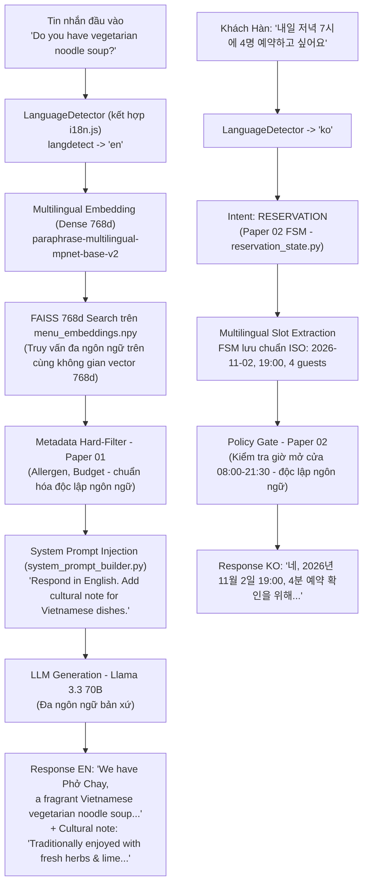

## 10. LỘ TRÌNH PHÁT TRIỂN VÀ ƯU TIÊN TRIỂN KHAI

### 10.1. Ma trận Ưu tiên ($\text{Impact} \times \text{Effort}$)

| Tính năng | Độ khó Kỹ thuật | Giá trị Kinh doanh | Ưu tiên | Phụ thuộc & Kế thừa Codebase | 
| ----- | ----- | ----- | ----- | ----- | 
| **F9 — Đa ngôn ngữ** | ⭐⭐ Thấp | ⭐⭐⭐⭐⭐ Rất cao | 🔥 **P1** | Kế thừa `i18n.js` và FAISS 768d (`28_add_rag_vector_columns.sql`) | 
| **F4 — Bộ nhớ khách quen** | ⭐⭐⭐ Trung bình | ⭐⭐⭐⭐⭐ Rất cao | 🔥 **P1** | Kế thừa `pgvector` và `authMiddleware.js` | 
| **F2 — Đồ thị ẩm thực** | ⭐⭐⭐⭐ Cao | ⭐⭐⭐⭐ Cao | ⚡ **P2** | Neo4j, kế thừa `hybrid_retriever.py` & `20_add_modifiers.sql` | 
| **F5 — Upsell ReAct** | ⭐⭐ Thấp | ⭐⭐⭐⭐ Cao | ⚡ **P2** | Phụ thuộc F2, kế thừa `CartContext.jsx` & `recommendation_engine.py` | 
| **F1 — Ghép bàn động** | ⭐⭐⭐ Trung bình | ⭐⭐⭐⭐ Cao | ⚡ **P2** | OR-Tools, kế thừa `tableController.js` & `29_create_chat_feedbacks.sql` | 
| **F3 — Giọng nói** | ⭐⭐⭐⭐⭐ Rất cao | ⭐⭐⭐⭐ Cao | 📋 **P3** | WebRTC infra, kế thừa `pipecatClient.js` | 
| **F6 — Nhận diện ảnh** | ⭐⭐⭐ Trung bình | ⭐⭐⭐ Trung bình | 📋 **P3** | Qwen2-VL API, kế thừa `uploadController.js` | 
| **F8 — Điều phối bếp** | ⭐⭐⭐ Trung bình | ⭐⭐⭐⭐ Cao | 📋 **P3** | Kế thừa `KitchenDisplayPage.jsx`, `kitchenController.js` & `socket.js` | 
| **F7 — Ca trực nhân viên** | ⭐⭐⭐⭐ Cao | ⭐⭐⭐ Trung bình | 🗓️ **P4** | OR-Tools, kế thừa `shiftController.js` & `ShiftManagement.jsx` | 

### 10.2. Lộ trình Phát triển (Roadmap)

```mermaid
flowchart LR
    subgraph Q1 ["Quý 1 - Nền tảng Mở rộng"]
        F9["F9: Đa ngôn ngữ<br/>(2 tuần)"]
        F4["F4: Bộ nhớ khách quen<br/>(3 tuần)"]
    end

    subgraph Q2 ["Quý 2 - Tư vấn Thông minh"]
        F2["F2: Đồ thị ẩm thực KG<br/>(4 tuần)"]
        F5["F5: Upsell ReAct<br/>(2 tuần)"]
        F1["F1: Ghép bàn động<br/>(3 tuần)"]
    end

    subgraph Q3 ["Quý 3 - Đa phương tiện"]
        F3["F3: Giọng nói WebRTC<br/>(6 tuần)"]
        F6["F6: Nhận diện ảnh<br/>(3 tuần)"]
        F8["F8: Điều phối bếp KDS<br/>(4 tuần)"]
    end

    subgraph Q4 ["Quý 4 - Nội bộ & Vận hành"]
        F7["F7: Ca trực nhân viên<br/>(5 tuần)"]
    end

    Q1 --> Q2 --> Q3 --> Q4

```

## TỔNG KẾT

Báo cáo này đã hoàn thành hai mục tiêu song song:

**Về phần hiện tại (Mục 1–7):** Ghi chép đầy đủ và có căn cứ khoa học toàn bộ quá trình áp dụng Paper 01 (Cheerla, IIT Roorkee 2025) và Paper 02 (Ahmed, UT Arlington 2026) vào phân hệ AI Aria — từ kiến trúc phân tầng có quản trị, máy trạng thái FSM, cổng chính sách, đến bộ kiểm thử 75 ca và benchmark đạt $97.23\%$ Overall Score trên 100 test cases độc lập.

**Về phần tương lai (Mục 8–10):** Chuyển hóa 18 đề xuất học thuật trong Bảng 8 thành **9 thiết kế tính năng đầy đủ**, mỗi tính năng bao gồm:

* Vấn đề cụ thể của hệ thống hiện tại cần giải quyết và hiện trạng các module sẵn có trong mã nguồn

* Đóng góp kỹ thuật chính xác từ từng paper được áp dụng

* Kiến trúc thành phần phần mềm cần xây dựng mới và thành phần kế thừa

* Sơ đồ luồng dữ liệu / sequence diagram tường minh

* Ma trận ưu tiên và lộ trình triển khai theo quý

Tài liệu phản ánh một chu trình phát triển phần mềm chuẩn mực khép kín: từ nghiên cứu lý thuyết nền tảng $\rightarrow$ áp dụng kỹ thuật có chọn lọc $\rightarrow$ kiểm thử và đo lường thực nghiệm $\rightarrow$ định hướng phát triển tiếp nối có căn cứ học thuật. Đây là nền tảng vững chắc cho báo cáo và bảo vệ Khóa luận Tốt nghiệp, đồng thời là lộ trình rõ ràng cho giai đoạn sản xuất thực tế của hệ thống SmartRestaurant.