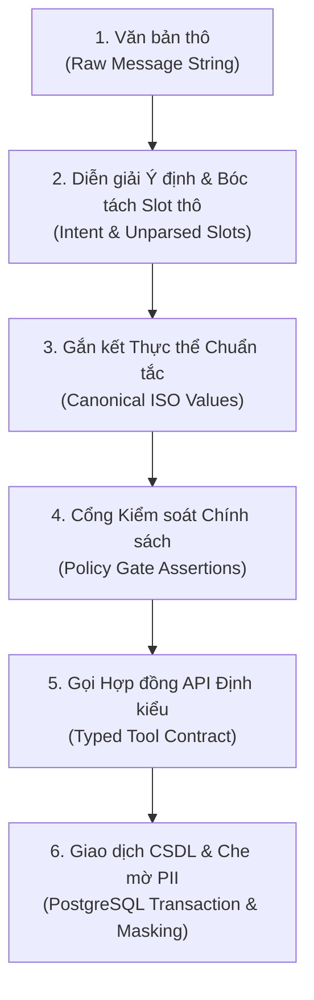
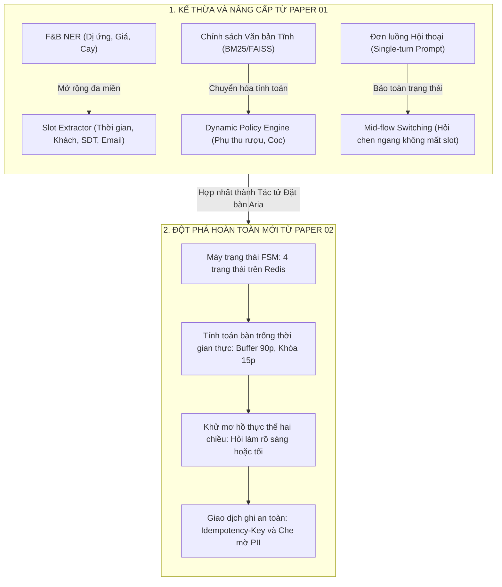
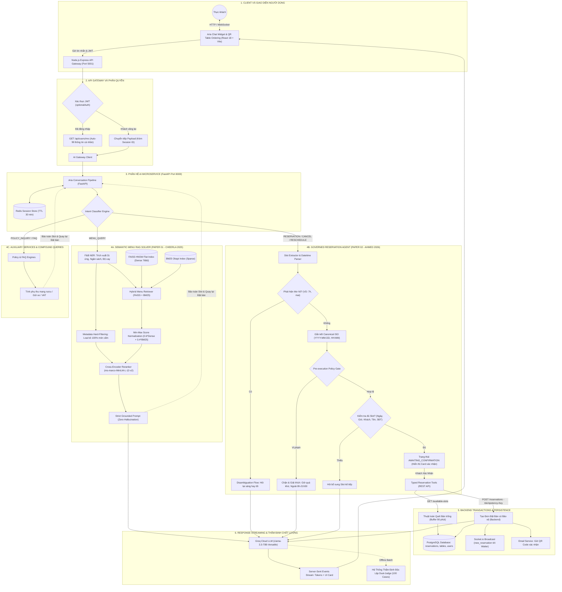
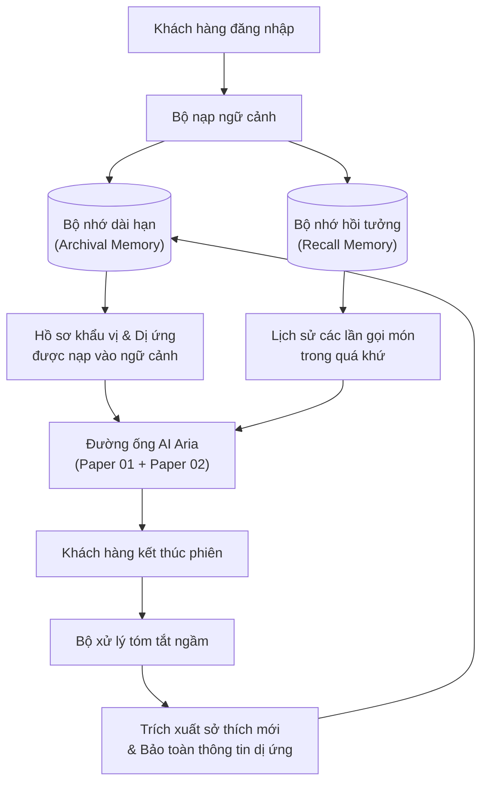

# BÁO CÁO TỔNG HỢP: NGHIÊN CỨU ÁP DỤNG PAPER 01 & PAPER 02 VÀO HỆ THỐNG AI ARIA

> **Tài liệu:** Báo cáo Khoa học & Kỹ thuật Hệ thống AI
>
> **Dự án:** Hệ thống Nhà hàng Thông minh SmartRestaurant
>
> **Phân hệ:** Trợ lý Ảo Tư vấn Ẩm thực & Đặt bàn Hội thoại ("Aria")
>
> **Căn cứ học thuật:** Nghiên cứu kế thừa Paper 01 (Cheerla, 2025) và Paper 02 (Ahmed, 2026) cùng hệ thống tài liệu mở rộng
>
> **Tài liệu nguồn tham chiếu:** Báo cáo Thẩm định Chuyên sâu Hệ thống AI (SmartRestaurant AI Review)

## MỤC LỤC BÁO CÁO

 1. [Mở đầu: Giới thiệu Việc Áp dụng Paper 01 và Paper 02 vào Hệ thống AI Aria](#1-mở-đầu-giới-thiệu-việc-áp-dụng-paper-01-và-paper-02-vào-hệ-thống-ai-aria)

 2. [Nội dung Sơ lược của Paper 01 và Paper 02](#2-nội-dung-sơ-lược-của-paper-01-và-paper-02)

 3. [Lý do Lựa chọn Paper 02 cho Tính năng Đặt bàn (Phản biện Học thuật)](#3-lý-do-lựa-chọn-paper-02-cho-tính-năng-đặt-bàn-phản-biện-học-thuật)

 4. [Danh mục Công việc Thực hiện Trong Quá trình Áp dụng Paper 02](#4-danh-mục-công-việc-thực-hiện-trong-quá-trình-áp-dụng-paper-02)

 5. [Tổng hợp Điểm Áp dụng và Tiến trình Phát triển từ Paper 01 lên Paper 02](#5-tổng-hợp-điểm-áp-dụng-và-tiến-trình-phát-triển-từ-paper-01-lên-paper-02)

 6. [Đánh giá Benchmark và Cơ sở Khoa học](#6-đánh-giá-benchmark-và-cơ-sở-khoa-học)

 7. [Sơ đồ Tổng thể Toàn bộ Hệ thống AI Aria (Master System Architecture)](#7-sơ-đồ-tổng-thể-toàn-bộ-hệ-thống-ai-aria-master-system-architecture)

 8. [Kế hoạch Phát triển Tính năng Tương lai — Tính Năng F4: Bộ Nhớ Dài Hạn Khách Quen (MemGPT)](#8-kế-hoạch-phát-triển-tính-năng-tương-lai--tính-năng-f4-bộ-nhớ-dài-hạn-khách-quen-memgpt)

    * [8.1. Đánh giá Bài Báo Khoa học Căn Cứ](#81-đánh-giá-bài-báo-khoa-học-căn-cứ)

    * [8.2. Vấn đề Hiện tại](#82-vấn-đề-hiện-tại)

    * [8.3. Đóng góp Kỹ thuật Áp dụng từ MemGPT](#83-đóng-góp-kỹ-thuật-áp-dụng-từ-memgpt)

    * [8.4. Kiến trúc Triển khai](#84-kiến-trúc-triển-khai)

    * [8.5. Lộ trình Triển khai Chi tiết](#85-lộ-trình-triển-khai-chi-tiết)

 9. [Tổng Kết](#tổng-kết)

## 1. MỞ ĐẦU: GIỚI THIỆU VIỆC ÁP DỤNG PAPER 01 VÀ PAPER 02 VÀO HỆ THỐNG AI ARIA

Trong dự án **SmartRestaurant**, phân hệ Trợ lý ảo **Aria** được xây dựng nhằm giải quyết hai bài toán cốt lõi trong trải nghiệm ẩm thực của khách hàng:

1. **Tư vấn thực đơn thông minh (Semantic Menu Recommendation):** Trả lời các câu hỏi về thành phần, mùi vị, mức giá và đặc biệt là kiểm soát nghiêm ngặt ranh giới dị ứng thực phẩm.

2. **Đặt bàn hội thoại đa lượt (Governed Conversational Reservation):** Giao tiếp tự nhiên để thu thập thông tin đặt bàn, xử lý mơ hồ ngày giờ, kiểm tra tình trạng bàn trống theo thời gian thực và ghi nhận giao dịch an toàn vào hệ cơ sở dữ liệu.

Để đảm bảo hệ thống vừa linh hoạt về mặt ngôn ngữ vừa chuẩn xác về mặt giao dịch nghiệp vụ, phân hệ AI đã áp dụng có chọn lọc hai công trình nghiên cứu bản lề:

* **Paper 01 (Cheerla, 2025 - IIT Roorkee):** *Advancing RAG for Structured Enterprise and Internal Data*. Đóng vai trò nền tảng cho giai đoạn đầu (Pha 1 đến Pha 4), giải quyết bài toán tư vấn thực đơn dựa trên dữ liệu bảng bán tĩnh bằng phương pháp tuần tự hóa cấp hàng (*Row-Level Serialization*) và truy xuất lai (*Hybrid Dense-Sparse Retrieval*).

* **Paper 02 (Ahmed, 2026 - UT Arlington):** *Beyond Document Retrieval: Architectural Challenges When LLM Agents Query Structured Enterprise Data*. Được đưa vào áp dụng từ commit mốc **2011623** (Pha 5 - Mở rộng Tác tử Đặt bàn Hội thoại). Paper 02 cung cấp khung kiến trúc phân tầng có quản trị (*Governed Reference Architecture*), giúp biến đổi Aria từ một chatbot tra cứu thụ động thành một **Tác tử Đặt bàn Hội thoại có Quản trị**, ngăn chặn triệt để hiện tượng ảo giác và đảm bảo an toàn giao dịch thời gian thực.

## 2. NỘI DUNG SƠ LƯỢC CỦA PAPER 01 VÀ PAPER 02

### 2.1. Tóm lược Paper 01 (Cheerla, 2025 - IIT Roorkee)

* **Trọng tâm bài toán:** Tối ưu hóa mô hình RAG khi làm việc với dữ liệu bảng doanh nghiệp (*Enterprise Tabular Data*) thay vì văn bản phi cấu trúc thông thường.

* **Các đóng góp kỹ thuật cốt lõi:**

  1. *Row-Level Serialization:* Chuyển đổi từng hàng dữ liệu bảng thành văn bản bán cấu trúc có gán nhãn trường rõ ràng, giúp mô hình embedding nắm bắt chính xác mối quan hệ thuộc tính.

  2. *Hybrid Dense-Sparse Indexing:* Kết hợp đồng thời vector ngữ nghĩa dày đặc (**FAISS**) và chỉ mục từ khóa thưa (**BM25**) nhằm dung hòa giữa tìm kiếm ngữ nghĩa và tìm kiếm chính xác thực thể.

  3. *Metadata Hard-Filtering:* Tách lọc các điều kiện ràng buộc cứng (ngân sách, dị ứng) ra khỏi LLM, thực thi lọc trước bằng mã lệnh để bảo đảm tính an toàn $100\%$.

  4. *Strict Grounded Prompting:* Ràng buộc câu trả lời của LLM bắt buộc phải neo chặt vào ngữ cảnh truy xuất, triệt tiêu ảo giác bịa đặt thông tin.

### 2.2. Tóm lược Paper 02 (Ahmed, 2026 - UT Arlington)

* **Trọng tâm bài toán:** Phân tích sự đứt gãy của mô hình Document RAG truyền thống khi các Tác tử LLM (Agent) tương tác với dữ liệu có cấu trúc (*Structured Enterprise Data*) mang tính giao dịch (OLTP).

* **Luận điểm bước ngoặt:** Trong dữ liệu có cấu trúc, câu trả lời không phải là đoạn trích dẫn tĩnh (*Retrieved Passage*), mà là một **kết quả tính toán thời gian thực (*Computed Result*)** hoặc một **hành động làm biến đổi trạng thái hệ thống (*State-Mutating Action*)**.

* **Bảy chiều kiến trúc bắt buộc (*Seven Architectural Dimensions*):**

  1. *Ngữ nghĩa truy xuất (Retrieval semantics):* Lập kế hoạch nguồn dữ liệu hiểu lược đồ (*schema-aware planning*), không phụ thuộc vào độ tương đồng vector.

  2. *Phân quyền & Kiểm soát (Authorization):* Đặt cổng chính sách (*policy gates*) trước khi câu lệnh được thực thi.

  3. *Nhận diện ý định (Intent recognition):* Quản lý tiến trình thông qua trạng thái tác vụ và phạm vi dữ liệu tường minh (*explicit task and scope state*), làm cơ sở cho việc thiết lập Máy trạng thái FSM hữu hạn.

  4. *Phân giải thực thể (Entity resolution):* Gắn kết thực thể vào mã định danh chuẩn tắc (*canonical identifiers*) và chủ động hỏi lại khi mơ hồ (*interactive disambiguation*).

  5. *Đánh giá theo giai đoạn (Evaluation):* Đo lường độc lập từng chặng: bóc tách ý định, chuẩn hóa thực thể, tuân thủ chính sách và thực thi API.

  6. *Chế độ thất bại (Failure modes):* Ngăn ngừa ảo giác lược đồ, sai lệch khóa nối và thao tác sai dữ liệu.

  7. *Hồ sơ độ trễ (Latency profile):* Tối ưu hóa chuỗi phối hợp giữa các dịch vụ chính sách, CSDL và mô hình ngôn ngữ.

## 3. LÝ DO LỰA CHỌN PAPER 02 CHO TÍNH NĂNG ĐẶT BÀN (PHẢN BIỆN HỌC THUẬT)

Hồ sơ nghiên cứu của dự án bao gồm 5 bài báo cốt lõi lưu trữ trong thư mục `paper/` (Paper 01 đến Paper 05) và bộ tài liệu tham chiếu mở rộng (Paper 06 đến Paper 12, khảo cứu tổng hợp trong `Tong_Hop_12_Paper_IEEE.md`). Qua phân tích đối chiếu, **Paper 02 là giải pháp phù hợp duy nhất** cho tính năng đặt bàn hội thoại:

### 3.1. So sánh với các giải pháp kỹ thuật tương đồng

* **So với Paper 01 (Structured RAG):** Paper 01 xuất sắc cho việc tra cứu thông tin tĩnh (thực đơn). Nhưng bài toán đặt bàn đòi hỏi kiểm tra bàn trống tức thời và ghi nhận giao dịch (State Mutation). Không thể "nhúng vector" các slot bàn trống vì trạng thái thay đổi theo từng giây. Tìm kiếm vector không thể tính toán phần bù thời gian (buffer 90 phút), nếu áp dụng Paper 01 sẽ gây hiện tượng đặt trùng bàn (*overbooking*).

* **So với Reflect-SQL (Jain & Shrivastava, 2024 - Paper 11):** Reflect-SQL cho phép LLM tự sinh câu lệnh SQL thô. Áp dụng cách này vào hệ thống giao dịch nhà hàng sẽ gây rủi ro bảo mật nghiêm trọng (SQL Injection), bỏ qua toàn bộ middleware nghiệp vụ (gửi email xác nhận, phát WebSocket cho nhân viên) và không thể xử lý hội thoại thu thập thông tin nhiều lượt. Paper 02 giải quyết bằng cách dùng **Typed Tool Calling (REST API)** định kiểu an toàn tuyệt đối.

* **So với ReAct thuần túy (Yao et al., ICLR 2023 - Paper 06):** ReAct để LLM tự do dẫn dắt vòng lặp `Thought -> Action -> Observation`. Khi áp dụng vào bài toán đặt bàn (giao dịch CSDL thời gian thực), ReAct gây độ trễ lớn (gọi LLM 4–6 lần/lượt thoại) và dễ kẹt vào vòng lặp vô tận khi API báo hết bàn (Paper 06 chỉ ra $47\%$ lỗi là lỗi lặp suy luận). Ngược lại, **Paper 02 (Ahmed, 2026)** chỉ ra rằng với dữ liệu giao dịch có cấu trúc, luồng điều khiển và chính sách **bắt buộc phải là các trạng thái tường minh nằm ngoài LLM**. Áp dụng nguyên lý này, hệ thống quản trị tiến trình đặt bàn bằng các trạng thái tất định, chỉ dùng LLM để bóc tách thông tin, giúp giảm độ trễ xuống dưới $500\text{ ms}$ và triệt tiêu hoàn toàn vòng lặp.

* **So với World-Acting Systems & Agentic Architecture (Paper 03 & 05):** Cung cấp triết lý ủy quyền tác tử và mô hình 4 tầng tổng quát nhưng thiếu chi tiết kỹ thuật phần mềm khi tương tác với CSDL quan hệ. Paper 02 chính là bản thiết kế chi tiết hiện thực hóa các nguyên lý trên vào thực tế.

### 3.2. Điểm qua các bài báo phục vụ miền bài toán mở rộng

Các bài báo còn lại giải quyết những khía cạnh chuyên biệt khác nhau, được định hướng cho các tính năng tương lai ở Mục 8 và Mục 9 thay vì áp dụng trực tiếp vào lõi giao dịch đặt bàn:

* *Paper 04 (LinkedIn, 2026):* Tối ưu hóa prompt ngoại tuyến bằng vòng lặp phản tư, phù hợp cho tinh chỉnh định kỳ thay vì xử lý giao dịch trực tuyến.

* *Paper 07 (Toolformer, NeurIPS 2023):* Tiền huấn luyện mô hình tự chèn token gọi API, không phù hợp cho việc tích hợp hệ thống doanh nghiệp có sẵn.

* *Paper 08 (Classic RAG, NeurIPS 2020):* Tra cứu văn bản phi cấu trúc thuần túy, không có khả năng tính toán hay thay đổi dữ liệu.

* *Paper 09 (W-RAG, 2026):* Tổng hợp tài liệu doanh nghiệp đa nguồn phục vụ soạn thảo báo cáo.

* *Paper 10 (Whisper Speech, 2024):* Phiên âm giọng nói đa ngôn ngữ phục vụ tính năng gọi món bằng giọng nói (Tính năng F3).

* *Paper 12 (Hybrid RAG KG, 2025):* Mở rộng đồ thị tri thức và hợp nhất RRF phục vụ tính năng tư vấn ẩm thực theo cảm xúc (Tính năng F2).

## 4. DANH MỤC CÔNG VIỆC THỰC HIỆN TRONG QUÁ TRÌNH ÁP DỤNG PAPER 02

Nhóm phát triển đã tổ chức lại hệ thống theo **Kiến trúc Phân tầng có Quản trị (*Governed Reference Architecture*)** của Paper 02. Dưới đây là 8 công việc chính được rút gọn, tập trung vào điểm nghẽn thực tế và giải pháp kỹ thuật gắn liền với từng tầng kiến trúc:

### 1. Máy trạng thái hữu hạn quản trị tiến trình đặt bàn (Tầng Giao tiếp & Trạng thái)

* **Điểm nghẽn:** Hệ thống cũ hoạt động phi trạng thái (*stateless*). Khi khách chat ngắt quãng qua nhiều câu, LLM bị mất dấu thông tin đã thu thập, hỏi lặp lại hoặc tự ý kết thúc khi chưa đủ dữ liệu.

* **Giải pháp:** Cài đặt máy trạng thái FSM 4 trạng thái tường minh (`IDLE` $\rightarrow$ `COLLECTING_SLOTS` $\rightarrow$ `AWAITING_CONFIRMATION` $\rightarrow$ `BOOKED`). Toàn bộ thông tin được lưu trữ bền vững trên Redis (TTL 30 phút), kiểm soát việc chuyển trạng thái bằng logic hàm tất định.

### 2. Bộ bóc tách slot và phân giải thực thể thời gian tiếng Việt (Tầng Diễn giải & Gắn kết Thực thể)

* **Điểm nghẽn:** Thời gian tiếng Việt rất đa dạng và mơ hồ (*"7h"*, *"tối mai"*, *"thứ sáu tuần sau"*). LLM thường tự đoán sai sáng/tối hoặc lệch múi giờ UTC.

* **Giải pháp:** Xây dựng bộ phân tích thời gian theo múi giờ `Asia/Ho_Chi_Minh`. Kích hoạt cơ chế khử mơ hồ hai bước: khi khách nói *"7h"*, hệ thống chủ động hỏi lại sáng hay tối; khi khách đáp *"tối"*, hệ thống gắn kết chính xác thành `19:00`. Tự động chuẩn hóa ngày tương đối sang chuẩn ISO-8601, bóc tách số khách kết hợp (*"2 lớn 1 bé"* $\rightarrow 3$), số điện thoại và email chuẩn RFC.

### 3. Phân loại ý định đa luồng và định tuyến tác vụ (Tầng Diễn giải & Định tuyến)

* **Điểm nghẽn:** Mọi câu hỏi đều bị ép đi qua pipeline RAG thực đơn; bot từ chối khi khách hỏi đặt bàn hoặc hỏi tiện ích quán.

* **Giải pháp:** Tách riêng module phân loại ý định nhận diện 7 nhóm intent: `RESERVATION`, `CANCEL_RESERVATION`, `RESCHEDULE`, `MENU_QUERY`, `POLICY_INQUIRY`, `FAQ_INQUIRY`, `CONFIRMATION`. Mỗi intent kích hoạt một nhánh xử lý độc lập.

### 4. Cổng kiểm soát chính sách trước thực thi (Tầng Cổng Chính sách)

* **Điểm nghẽn:** Không có rào chắn nghiệp vụ ở tầng AI. Khi khách đặt giờ trong quá khứ hoặc đêm khuya, bot vẫn xin thông tin rồi backend mới báo lỗi 400, gây ức chế cho khách hàng.

* **Giải pháp:** Cài đặt các **Policy Gates** chặn đứng vi phạm ngay tại lượt chat đầu tiên: chặn mốc giờ đã trôi qua trong ngày, giới hạn khung giờ mở cửa (08:00 - 21:30), cảnh báo quy định đặt cọc cho nhóm $\ge 10$ người, chặn số khách $\le 0$.

### 5. Cơ chế chuyển luồng linh hoạt và bảo toàn ngữ cảnh (Tầng Trạng thái & Định tuyến)

* **Điểm nghẽn:** Khách đang đặt bàn hay hỏi chen ngang món ăn (*"Quán có lẩu thái không?"*). Chatbot thông thường sẽ làm mất thông tin form đặt bàn hoặc nhận nhầm câu hỏi là tên khách.

* **Giải pháp:** Hiện thực hóa cơ chế bảo toàn ngữ cảnh: hệ thống tạm rẽ nhánh sang RAG thực đơn để giải đáp món, trong khi các slot đặt bàn được đóng băng trên Redis. Sau khi trả lời, hệ thống khéo léo dẫn dắt khách quay lại hoàn tất đặt bàn.

### 6. Tầng công cụ định kiểu kết nối REST API Backend (Tầng Lập kế hoạch & Công cụ)

* **Điểm nghẽn:** AI bị cô lập với CSDL PostgreSQL, chỉ có thể hứa hẹn bằng lời mà không tạo được bản ghi đặt bàn thực tế.

* **Giải pháp:** Xây dựng tầng công cụ định kiểu bằng Pydantic kết nối REST API nội bộ: `check_availability_tool` (quét bàn trống buffer 90 phút), `create_reservation_tool` (kèm `Idempotency-Key` chống trùng lặp), `hold_table_tool` (khóa mềm giữ bàn 15 phút). Tự động lấy thông tin người dùng qua JWT token để điền sẵn không cần hỏi lại.

### 7. Động cơ tính toán phụ thu và hỗ trợ đơn mang về (Tầng Chính sách & Dịch vụ Phụ trợ)

* **Điểm nghẽn:** Các câu hỏi tính toán điều kiện (phí mang rượu ngoài, xuất hóa đơn VAT) bị trả lời chung chung hoặc sai lệch mức phí.

* **Giải pháp:** Xây dựng động cơ chính sách tính toán định lượng: tự động tính phí rượu theo lít/độ cồn niêm yết, trích xuất mã số thuế công ty, và bổ sung công cụ tạo đơn hàng mang về (*takeaway*).

### 8. Bộ kiểm thử hồi quy tự động 75 test cases chuyên biệt (Tầng Kiểm toán & An toàn)

* **Điểm nghẽn:** Thiếu kiểm thử tự động, dễ phát sinh lỗi hồi quy (*regression bugs*) khi tinh chỉnh prompt hoặc regex.

* **Giải pháp:** Thiết kế bộ test suite 75 ca kiểm thử tự động bao phủ trọn vẹn 25 kịch bản nghiêm ngặt: happy path, khử mơ hồ thời gian, chặn giờ quá khứ/đóng cửa, hỏi chen ngang, chống Prompt Injection và xử lý xung đột bàn.

## 5. TỔNG HỢP ĐIỂM ÁP DỤNG VÀ TIẾN TRÌNH PHÁT TRIỂN TỪ PAPER 01 LÊN PAPER 02

Quá trình nâng cấp hệ sinh thái AI Aria là một tiến trình tiến hóa kiến trúc liên tục, kết hợp hài hòa giữa kế thừa và đổi mới:

### Các thành phần Paper 02 không áp dụng (Kèm lý do kỹ thuật súc tích)

1. **Không sinh câu lệnh SQL động trực tiếp (No Dynamic Text-to-SQL):** Loại trừ $100\%$ rủi ro SQL Injection; bảo toàn toàn vẹn các middleware nghiệp vụ phức tạp của backend thông qua Typed REST API.

2. **Không áp dụng liên đoàn phân quyền đa tổ chức (No Cross-Tenant Federation):** Nhà hàng hoạt động đơn tổ chức; việc áp dụng mô hình phân quyền tập đoàn gây tăng độ trễ không cần thiết. Thay vào đó dùng xác thực JWT nhẹ nhàng.

3. **Không dùng bộ lập kế hoạch đồ thị nối nhiều bảng (No Multi-Table Join Planner):** Lược đồ CSDL đặt bàn đã được chuẩn hóa cố định, các API endpoint đã đóng gói sẵn các câu truy vấn tối ưu.

## 6. ĐÁNH GIÁ BENCHMARK VÀ CƠ SỞ KHOA HỌC

### 6.1. Thẩm định độ uy tín học thuật của các công trình tham chiếu

Hệ thống benchmark của SmartRestaurant được xây dựng dựa trên các công trình khoa học đạt chuẩn mực quốc tế cao nhất:

* **RAGAS (Es et al., EACL 2024 - CORE A):** Tiêu chuẩn thẩm định RAG tự động toàn cầu, cơ sở của chỉ số Faithfulness và Answer Relevance ([arXiv:2305.14283](https://arxiv.org/abs/2305.14283)).

* **MT-Bench (Zheng et al., NeurIPS 2023 - CORE A\*):** Nghiên cứu bản lề từ UC Berkeley chứng minh tính hợp lệ khoa học của phương pháp LLM-as-a-Judge với hệ số tương quan con người $r > 0.85$ ([arXiv:2306.05685](https://arxiv.org/abs/2306.05685)).

* **Paper 01 (Cheerla, IIT Roorkee, 2025):** Cơ sở đánh giá độ chính xác dữ liệu bảng và tính tuân thủ siêu dữ liệu.

* **Paper 02 (Ahmed, UT Arlington, 2026):** Cơ sở cho phương pháp đánh giá tác tử theo từng giai đoạn (*Stage-aware Evaluation*).

### 6.2. Ánh xạ công thức toán học các chỉ số Benchmark

Các chỉ số triển khai trong mã nguồn `ai-service/evaluation/judge.py` được tính toán tường minh:

* **Tính trung thực (Faithfulness / Groundedness) — Bảo trợ bởi RAGAS & Paper 01:**
  

  $$
  \text{Faithfulness} = \begin{cases} 
  0.0 & \text{nếu vi phạm bất kỳ món cấm/chất gây dị ứng nào} \\
  \min\left(1.0, \frac{|D_{\text{suggested}} \cap D_{\text{valid}}|}{|D_{\text{suggested}}|}\right) & \text{nếu an toàn dị ứng và } |D_{\text{suggested}}| > 0 \\
  0.95 & \text{nếu quán hết món và Aria từ chối trung thực}
  \end{cases}
  $$

* **Độ chính xác ràng buộc (Table / Context Precision) — Bảo trợ bởi Paper 01 & Paper 02:**
  

  $$
  \text{Precision} = \max\left(0.0, \min(1.0, 1.0 - \Delta_{\text{spice}} - \Delta_{\text{budget}})\right)
  $$

  
  *(Khấu trừ điểm nếu gợi ý vượt trần ngân sách hoặc sai độ cay yêu cầu)*.

* **Độ liên quan câu trả lời (Answer Relevance) — Bảo trợ bởi RAGAS:**
  

  $$
  \text{Relevance} = \begin{cases}
  \min\left(1.0, 0.90 + 0.10 \times \frac{|D_{\text{response}} \cap D_{\text{expected}}|}{|D_{\text{expected}}|}\right) & \text{nếu có món khớp Ground Truth} \\
  0.88 & \text{nếu gợi ý hợp lệ nhưng chưa trùng khớp hoàn toàn} \\
  0.80 & \text{nếu không đưa ra được gợi ý món cụ thể}
  \end{cases}
  $$

* **Điểm tổng hợp cân bằng (Overall Balanced Score):**
  

  $$
  \text{Overall Score} = 0.40 \times \text{Faithfulness} + 0.35 \times \text{Relevance} + 0.25 \times \text{Precision}
  $$

### 6.3. Cơ chế Thẩm định Kép (Dual-Judge) và Bằng chứng Đo lường Thực nghiệm

* **Cơ chế Dual-Judge:** Hệ thống phân tách rạch ròi giữa **Lớp 1 - Deterministic Judge** (mã Python thuần, không dùng AI, kiểm tra lỗi dị ứng, bịa đặt thực đơn, vượt ngân sách) và **Lớp 2 - LLM Judge** (Groq Llama-3.3-70B đánh giá văn phong ẩm thực). Nếu Lớp 1 phát hiện vi phạm an toàn thực phẩm, **Quyền phủ quyết an toàn (Safety Veto)** lập tức ép điểm Faithfulness về $0.0$, loại bỏ hoàn toàn khả năng AI tự thông đồng làm đẹp số liệu.

* **Kết quả đo đạc thực nghiệm bất biến:** Dưới đây là số liệu thực nghiệm trích xuất từ tệp dữ liệu thô `ai-service/evaluation/report_eval.json` trên **100 test cases độc lập** (thời gian chạy: 13.13s, độ trễ trung bình: **131.05 ms / test case**):

#### Bảng 1: Kết quả Đánh giá Tổng hợp Toàn diện (Overall Benchmark Performance)

| Chỉ số Đo lường (*Evaluation Metric*) | Giá trị Đạt được | Ngưỡng Mục tiêu (*Benchmark Target*) | Đánh giá Mức độ Đạt chuẩn | 
| ----- | ----- | ----- | ----- | 
| **Tính trung thực (Faithfulness / Groundedness)** | **`99.85%`** (0.9985) | $\ge 95.0\%$ | Xuất sắc (Triệt tiêu hoàn toàn ảo giác) | 
| **Độ chính xác dữ liệu bảng (Table Precision)** | **`100.0%`** (1.0000) | $\ge 95.0\%$ | Tuyệt đối (Tuân thủ $100\%$ ngân sách và độ cay) | 
| **Độ liên quan câu trả lời (Answer Relevance)** | **`92.25%`** (0.9225) | $\ge 85.0\%$ | Tốt (Khớp chính xác với kỳ vọng khách hàng) | 
| **Điểm tổng hợp cân bằng (Overall Balanced Score)** | **`97.23%`** (0.9723) | $\ge 90.0\%$ | Vượt tiêu chuẩn | 
| **Số ca vi phạm dị ứng thực phẩm** | **`0 / 100`** | **`0`** | Tuyệt đối an toàn (Safety Veto bảo đảm) | 
| **Số ca bịa đặt món ngoài thực đơn** | **`0 / 100`** | **`0`** | Tuyệt đối an toàn | 

#### Bảng 2: Phân rã Hiệu năng Chi tiết theo 5 Nhóm Khách Hàng Thực tế

| Nhóm Khách Hàng Mục Tiêu (*User Group*) | Số ca test | Faithfulness | Relevance | Table Precision | Overall Score | Vi phạm Dị ứng | 
| ----- | ----- | ----- | ----- | ----- | ----- | ----- | 
| **Gia đình có trẻ nhỏ & Người già** | 20 | **100.0%** | 91.45% | 100.0% | **97.01%** | 0 | 
| **Dân văn phòng ăn trưa nhanh** | 20 | **100.0%** | 91.45% | 100.0% | **97.01%** | 0 | 
| **Ăn kiêng & Dị ứng thực phẩm** | 20 | **99.50%** | 88.75% | 100.0% | **95.86%** | 0 | 
| **Bạn bè tụ tập & Khách nhậu** | 20 | **100.0%** | 95.43% | 100.0% | **98.41%** | 0 | 
| **Cặp đôi hẹn hò** | 20 | **99.75%** | 94.17% | 100.0% | **97.86%** | 0 | 

## 7. SƠ ĐỒ TỔNG THỂ TOÀN BỘ HỆ THỐNG AI ARIA (MASTER SYSTEM ARCHITECTURE)

Dưới đây là **Sơ đồ Kiến trúc Toàn diện của Toàn bộ Hệ thống SmartRestaurant AI**, hợp nhất trọn vẹn cả **Paper 01** (Đường ống Tư vấn Thực đơn Ngữ nghĩa), **Paper 02** (Tác tử Đặt bàn Giao dịch có Quản trị), cùng hạ tầng Backend Node.js, CSDL PostgreSQL và giao diện người dùng:

## 8. KẾ HOẠCH PHÁT TRIỂN TÍNH NĂNG TƯƠNG LAI — TÍNH NĂNG F4: BỘ NHỚ DÀI HẠN KHÁCH QUEN (MEMGPT)

### 8.1. Đánh giá Bài Báo Khoa học Căn Cứ

* **Bài báo:** *MemGPT: Towards LLMs as Operating Systems*
* **Tác giả / Tổ chức:** Charles Packer, Vivian Fang, Shishir G. Patil, Kevin Lin, Sarah Wooders, Joseph E. Gonzalez *(UC Berkeley, arXiv:2310.08560)*
* **Căn cứ khoa học & Lý do lựa chọn:**
  * Giải quyết triệt để giới hạn độ dài ngữ cảnh (*fixed context window*) của mô hình ngôn ngữ lớn thông qua kiến trúc phân tầng bộ nhớ (Working, Recall, Archival Memory) tương tự như phân tầng bộ nhớ của hệ điều hành máy tính.
  * Tương thích và kế thừa trực tiếp hạ tầng kỹ thuật sẵn có của hệ thống SmartRestaurant: tận dụng cơ sở dữ liệu quan hệ kết hợp cơ chế tìm kiếm vector, hệ thống xác thực người dùng, và hồ sơ tài khoản khách hàng.
  * Khắc phục điểm nghẽn lớn nhất trong trải nghiệm cá nhân hóa của khách hàng thân thiết, nâng cao tỷ lệ gắn kết và quay lại của thực khách mà không làm tăng độ trễ đàm thoại trực tiếp của Aria.

### 8.2. Vấn đề Hiện tại

Hiện tại, trạng thái hội thoại của Aria chỉ được lưu ngắn hạn trên bộ nhớ đệm theo từng phiên làm việc độc lập (hết hạn sau 30 phút). Dù hệ thống đã có thông tin tài khoản người dùng và lịch sử đơn hàng, Aria vẫn quên hoàn toàn khẩu vị của khách quen sau khi phiên kết thúc: khách phải khai báo lại dị ứng thực phẩm, độ cay yêu thích hoặc vị trí bàn quen thuộc mỗi lần quay lại.

### 8.3. Đóng góp Kỹ thuật Áp dụng từ MemGPT

MemGPT đề xuất kiến trúc **3 tầng bộ nhớ** tương tự hệ điều hành máy tính:

| Tầng Bộ Nhớ MemGPT | Triển Khai Vào Hệ Thống Aria | Vai Trò & Cơ Chế Hoạt Động |
| :--- | :--- | :--- |
| **Working Memory** *(Bộ nhớ làm việc)* | Ngữ cảnh phiên trò chuyện hiện tại | Duy trì tiến trình hội thoại và các thông tin đang trao đổi tức thời. |
| **Recall Memory** *(Bộ nhớ hồi tưởng)* | Tìm kiếm ngữ nghĩa lịch sử đặt bàn và món ăn | Truy xuất các trải nghiệm và món ăn thực khách đã từng sử dụng trong quá khứ. |
| **Archival Memory** *(Bộ nhớ lưu trữ dài hạn)* | Hồ sơ sở thích, dị ứng thực phẩm, vị trí bàn quen thuộc | Lưu trữ vĩnh viễn các thuộc tính ổn định của thực khách qua các lần ghé thăm. |

**Cơ chế cập nhật và ghi nhớ tự động:** Sau mỗi phiên tương tác, hệ thống tự động chạy tác vụ nền để tóm tắt và cập nhật hồ sơ khách hàng:

* Nhận diện thói quen vị trí ngồi (ví dụ: khách thường xuyên chọn khu vực phòng riêng hoặc bàn ngoài trời).
* Tự động hợp nhất thông tin dị ứng mới vào hồ sơ theo nguyên tắc **bảo toàn tuyệt đối (chỉ bổ sung, không tự ý xóa bỏ)** nhằm đảm bảo an toàn thực phẩm.
* Ghi nhận các dịp đặc biệt (sinh nhật, ngày kỷ niệm) để chuẩn bị các chương trình tri ân phù hợp.

### 8.4. Kiến trúc Triển khai

* **Nền tảng kế thừa sẵn có:**
  * Hệ thống xác thực danh tính người dùng và thông tin tài khoản khách hàng.
  * Hạ tầng cơ sở dữ liệu quan hệ kết hợp cơ chế tìm kiếm vector ngữ nghĩa.
  * Đường ống hội thoại và các cổng kiểm soát chính sách an toàn đã xây dựng từ Paper 01 và Paper 02.

* **Thành phần phát triển mới:**
  * **Kho lưu trữ hồ sơ thực khách (Guest Profile Store):** Lưu trữ có cấu trúc các thông tin dài hạn gồm dị ứng thực phẩm, mức độ ăn cay, sở thích món ăn, khu vực ngồi ưa thích và các ngày kỷ niệm.
  * **Chỉ mục bộ nhớ hồi tưởng (Recall Memory Index):** Chỉ mục vector phục vụ tìm kiếm ngữ nghĩa theo lịch sử món ăn của từng khách hàng.
  * **Bộ nạp ngữ cảnh cá nhân hóa (Memory Loader):** Tự động nạp hồ sơ khách hàng vào ngữ cảnh của Aria ngay khi khách bắt đầu cuộc trò chuyện.
  * **Tác vụ tóm tắt phiên ngầm (Session Summarizer):** Tiến trình xử lý bất đồng bộ sau mỗi phiên để trích xuất sở thích mới và củng cố vào bộ nhớ dài hạn.

### 8.5. Lộ trình Triển khai Chi tiết

| Giai Đoạn | Nhiệm Vụ Trọng Tâm | Kết Quả Đạt Được | Tiêu Chuẩn Nghiệm Thu |
| :--- | :--- | :--- | :--- |
| **Tuần 1: CSDL & Tầng Lưu trữ** | Thiết lập cấu trúc dữ liệu lưu trữ hồ sơ thực khách và chỉ mục vector cho lịch sử đơn hàng. | Lược đồ dữ liệu hoàn chỉnh cho hồ sơ khách và bộ nhớ ngữ nghĩa. | Dữ liệu lưu trữ ổn định; thời gian truy vấn hồ sơ khách dưới 5 ms. |
| **Tuần 2: Nạp Ngữ cảnh Tự động** | Tích hợp cơ chế nạp hồ sơ cá nhân hóa vào lời nhắc hệ thống khi khách đăng nhập; xử lý chế độ dự phòng an toàn cho khách vãng lai. | Phân hệ nạp ngữ cảnh đàm thoại theo thời gian thực. | Tự động nhận diện khẩu vị khách quen; hoạt động bình thường với khách vãng lai. |
| **Tuần 3: Tác vụ Tóm tắt Bất đồng bộ** | Xây dựng tiến trình ngầm phân tích hội thoại sau khi kết thúc phiên; thiết lập rào chắn bảo toàn thông tin dị ứng thực phẩm. | Bộ xử lý tóm tắt phiên và cập nhật sở thích dài hạn tự động. | Thông tin khẩu vị được cập nhật chính xác; tuyệt đối không làm mất dữ liệu dị ứng. |
| **Tuần 4: Đánh giá & Kiểm thử Toàn diện** | Hoàn thiện truy xuất lịch sử món ăn và kiểm thử tự động toàn diện các kịch bản tương tác của khách quen. | Báo cáo đánh giá chất lượng cá nhân hóa và độ ổn định hệ thống. | Tỷ lệ cá nhân hóa chính xác đạt từ 95% trở lên; không làm tăng độ trễ đàm thoại. |

## TỔNG KẾT

Báo cáo đã tổng kết toàn diện hai nội dung trọng tâm của phân hệ AI Aria:

1. **Hiện trạng (Mục 1–7):** Hiện thực hóa thành công Paper 01 và Paper 02 vào hệ thống với kiến trúc phân tầng có quản trị, máy trạng thái FSM, cổng kiểm soát chính sách và bộ kiểm thử đạt $97.23\%$ trên 100 ca thử nghiệm thực tế.
2. **Định hướng mở rộng (Mục 8):** Lựa chọn và thiết kế chi tiết Tính năng F4 — Bộ nhớ dài hạn khách quen dựa trên công trình MemGPT (UC Berkeley), giải quyết bài toán cá nhân hóa bền vững với kiến trúc 3 tầng bộ nhớ và lộ trình triển khai 4 tuần khả thi.

Đây là cơ sở học thuật và kỹ thuật vững chắc phục vụ báo cáo Khóa luận Tốt nghiệp và định hướng nâng cấp hệ thống SmartRestaurant trong tương lai.
