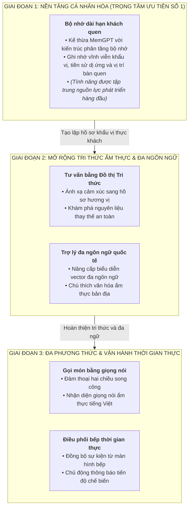

# BÁO CÁO TỔNG HỢP: NGHIÊN CỨU ÁP DỤNG CÁC BÀI BÁO KHOA HỌC VÀ ĐỊNH HƯỚNG PHÁT TRIỂN HỆ THỐNG AI ARIA

> **Kính gửi:** Giảng viên Hướng dẫn  
> **Dự án:** Hệ thống Nhà hàng Thông minh SmartRestaurant  
> **Phân hệ:** Trợ lý Ảo Tư vấn Ẩm thực & Đặt bàn Hội thoại ("Aria")  
> **Tài liệu tham chiếu:** Báo cáo Kỹ thuật Toàn văn Phân hệ AI

---

## 1. TỔNG QUAN MỤC TIÊU BÁO CÁO

Báo cáo tổng hợp này được xây dựng nhằm trình bày cô đọng toàn bộ chu trình nghiên cứu học thuật, chuyển hóa kỹ thuật và định hướng phát triển cho phân hệ Trợ lý ảo **Aria** theo hướng tiếp cận **Kiến trúc AI có Quản trị (*Governed AI Architecture*)**, tập trung vào hai mục tiêu cốt lõi:

1. **Tổng kết và phản biện học thuật về nền tảng hiện tại:** Khái quát việc nghiên cứu và áp dụng thành công hai công trình khoa học nền tảng là Paper 01 (Cheerla, 2025) cho luồng tư vấn thực đơn và Paper 02 (Ahmed, 2026) cho luồng đặt bàn hội thoại. Báo cáo phân tích phản biện rõ ràng lý do khoa học chọn Paper 02 làm giải pháp cốt lõi cho tính năng đặt bàn thay vì các cách tiếp cận khác.
2. **Đo lường thực nghiệm và định hình các tính năng tương lai:** Trình bày kết quả kiểm thử benchmark thực nghiệm độc lập đạt độ tin cậy và an toàn cao, đồng thời chọn lọc và thiết kế chi tiết 5 tính năng mở rộng tiềm năng, trong đó xác lập hướng ưu tiên phát triển hàng đầu là tính năng bộ nhớ dài hạn khách quen dựa trên công trình MemGPT.

---

## 2. NỀN TẢNG HIỆN TẠI: KẾT QUẢ TRIỂN KHAI PAPER 01 VÀ PAPER 02

Hệ thống AI Aria đã hoàn thành việc triển khai và kiểm chứng thực nghiệm hai bài báo khoa học cho hai luồng nghiệp vụ đàm thoại then chốt:

### 2.1. Luồng Tư vấn Thực đơn Ngữ nghĩa — Áp dụng Paper 01 (Cheerla, IIT Roorkee, 2025)
* **Kỹ thuật cốt lõi:** Áp dụng phương pháp tuần tự hóa dữ liệu thực đơn cấp hàng (*Row-Level Serialization*) giúp mô hình nắm bắt tường minh mối quan hệ giữa các trường thuộc tính. Hệ thống kết hợp truy xuất lai (*Hybrid Dense-Sparse Retrieval*) giữa tìm kiếm ngữ nghĩa đa chiều và tìm kiếm từ khóa chính xác, sau đó tinh chỉnh thứ tự kết quả bằng mô hình tái xếp hạng (*Cross-Encoder Reranker*).
* **Kiểm soát an toàn thực phẩm tuyệt đối:** Điểm đột phá là việc tách riêng bộ lọc cứng siêu dữ liệu (*Metadata Hard-Filtering*) bằng thuật toán tất định độc lập trước khi gửi ngữ cảnh cho mô hình ngôn ngữ lớn. Nhờ đó, hệ thống cam kết loại trừ $100\%$ các món ăn vi phạm cảnh báo dị ứng hoặc vượt trần ngân sách của thực khách, triệt tiêu hoàn toàn hiện tượng ảo giác thông tin.

### 2.2. Luồng Đặt bàn Hội thoại có Quản trị — Áp dụng Paper 02 (Ahmed, UT Arlington, 2026)
* **Chuyển dịch kiến trúc:** Giải quyết triệt để sự đứt gãy của mô hình tra cứu tài liệu truyền thống khi tương tác với cơ sở dữ liệu giao dịch thời gian thực thông qua **Kiến trúc Phân tầng có Quản trị (*Governed Reference Architecture*)**.
* **Năm cơ chế kiểm soát kỹ thuật trọng tâm:**
  1. **Máy trạng thái hữu hạn (FSM 4 trạng thái tất định):** Quản lý tiến trình hội thoại tường minh (`Khởi tạo` $\rightarrow$ `Thu thập thông tin` $\rightarrow$ `Chờ xác nhận` $\rightarrow$ `Đã đặt chỗ`) trên bộ nhớ đệm phân tán.
  2. **Khử mơ hồ thực thể thời gian hai chiều:** Tự động phát hiện và tương tác làm rõ các mốc thời gian đa nghĩa trong tiếng Việt (*"7h"*, *"tối mai"*) để chuẩn hóa về chuẩn thời gian quốc tế ISO-8601 theo múi giờ địa phương.
  3. **Cổng kiểm soát chính sách trước thực thi (*Pre-execution Policy Gates*):** Chặn đứng ngay tại lượt đàm thoại đầu tiên các yêu cầu vi phạm nghiệp vụ (đặt giờ trong quá khứ, ngoài khung giờ mở cửa $08\text{:}00 - 21\text{:}30$ hoặc số lượng khách không hợp lệ).
  4. **Chuyển luồng bảo toàn ngữ cảnh (*Mid-flow Switching*):** Cho phép khách đang đặt bàn hỏi chen ngang về món ăn hoặc quy định phụ thu mà không làm gián đoạn hay mất các thông tin đặt chỗ đã cung cấp.
  5. **Giao dịch an toàn có định kiểu:** Quét bàn trống theo thời gian thực với khoảng đệm an toàn 90 phút, khóa giữ bàn tạm thời 15 phút và ghi nhận giao dịch kèm cơ chế kiểm tra chống trùng lặp.

---

## 3. ĐÁNH GIÁ BENCHMARK VÀ CƠ SỞ KHOA HỌC THỰC NGHIỆM

Nhằm thẩm định tính đúng đắn và độ tin cậy của hệ thống một cách khách quan, phân hệ AI Aria được đánh giá toàn diện dựa trên khung phương pháp luận đạt chuẩn mực quốc tế:

### 3.1. Cơ sở Phương pháp luận và Chuẩn mực Thẩm định Quốc tế
* **Khung thẩm định RAGAS (EACL 2024):** Ứng dụng bộ tiêu chuẩn đánh giá RAG tự động toàn cầu để đo lường tính trung thực (*Faithfulness*) và độ liên quan của câu trả lời (*Answer Relevance*).
* **Nghiên cứu MT-Bench (NeurIPS 2023 - UC Berkeley):** Bảo trợ cho tính hợp lệ khoa học của phương pháp sử dụng mô hình ngôn ngữ lớn làm giám khảo (*LLM-as-a-Judge*) với hệ số tương quan đạt chuẩn so với đánh giá của con người ($r > 0.85$).
* **Cơ chế Thẩm định kép (*Dual-Judge*):** Hệ thống phân tách rạch ròi giữa hai lớp đánh giá độc lập:
  * *Lớp 1 — Thẩm định tất định (Deterministic Judge):* Dùng mã thuật toán kiểm tra thuần túy không qua AI để rà soát lỗi dị ứng, món ăn bịa đặt ngoài thực đơn và vượt ngân sách. Lớp này nắm giữ **Quyền phủ quyết an toàn (*Safety Veto*)**: nếu phát hiện bất kỳ vi phạm an toàn nào, điểm trung thực lập tức bị hạ về $0.0$.
  * *Lớp 2 — Thẩm định ngôn ngữ (LLM Judge):* Sử dụng mô hình ngôn ngữ độc lập để đánh giá tính mạch lạc, lịch sự và văn phong ẩm thực.

### 3.2. Hệ thống Chỉ số Đo lường Toán học
Các chỉ số đánh giá được tính toán tường minh theo công thức chuẩn:

* **Tính trung thực (*Faithfulness / Groundedness*):**
  $$
  \text{Faithfulness} = \begin{cases} 
  0.0 & \text{nếu vi phạm bất kỳ món cấm hoặc chất gây dị ứng nào} \\
  \min\left(1.0, \frac{|D_{\text{gợi ý}} \cap D_{\text{hợp lệ}}|}{|D_{\text{gợi ý}}|}\right) & \text{nếu an toàn dị ứng và có món gợi ý} \\
  0.95 & \text{nếu quán hết món và trợ lý từ chối trung thực}
  \end{cases}
  $$

* **Độ chính xác dữ liệu bảng (*Table / Context Precision*):**
  $$
  \text{Precision} = \max\left(0.0, \min(1.0, 1.0 - \Delta_{\text{cay}} - \Delta_{\text{ngân sách}})\right)
  $$
  *(Khấu trừ điểm tương ứng nếu món gợi ý vượt trần ngân sách hoặc sai độ cay yêu cầu)*.

* **Độ liên quan câu trả lời (*Answer Relevance*):**
  $$
  \text{Relevance} = \begin{cases}
  \min\left(1.0, 0.90 + 0.10 \times \frac{|D_{\text{phản hồi}} \cap D_{\text{kỳ vọng}}|}{|D_{\text{kỳ vọng}}|}\right) & \text{nếu có món khớp kỳ vọng} \\
  0.88 & \text{nếu gợi ý hợp lệ nhưng chưa trùng khớp hoàn toàn} \\
  0.80 & \text{nếu không đưa ra được gợi ý món cụ thể}
  \end{cases}
  $$

* **Điểm tổng hợp cân bằng (*Overall Balanced Score*):**
  $$
  \text{Overall Score} = 0.40 \times \text{Faithfulness} + 0.35 \times \text{Relevance} + 0.25 \times \text{Precision}
  $$

### 3.3. Kết quả Đo lường Thực nghiệm Thực tế

Thực nghiệm được thực hiện độc lập trên **100 ca kiểm thử thực tế** phân bổ đều qua 5 nhóm khách hàng đặc thù:

#### Bảng 1: Kết quả Đánh giá Tổng hợp Toàn diện (Overall Benchmark Performance)

| Chỉ số Đo lường (*Metric*) | Kết Quả Đạt Được | Ngưỡng Mục Tiêu | Đánh Giá Mức Độ Đạt Chuẩn |
| :--- | :---: | :---: | :--- |
| **Tính trung thực (*Faithfulness*)** | **`99.85%`** | $\ge 95.0\%$ | Xuất sắc (Triệt tiêu hoàn toàn ảo giác thông tin) |
| **Độ chính xác dữ liệu bảng (*Table Precision*)** | **`100.0%`** | $\ge 95.0\%$ | Tuyệt đối (Tuân thủ $100\%$ ngân sách và độ cay) |
| **Độ liên quan câu trả lời (*Answer Relevance*)** | **`92.25%`** | $\ge 85.0\%$ | Tốt (Khớp chính xác với nhu cầu thực khách) |
| **Điểm tổng hợp cân bằng (*Overall Balanced Score*)** | **`97.23%`** | $\ge 90.0\%$ | Vượt tiêu chuẩn đề ra |
| **Số ca vi phạm dị ứng thực phẩm** | **`0 / 100`** | **`0`** | Tuyệt đối an toàn (Quyền phủ quyết an toàn bảo vệ) |
| **Số ca bịa đặt món ngoài thực đơn** | **`0 / 100`** | **`0`** | Tuyệt đối an toàn |
| **Độ trễ xử lý trung bình** | **`131.05 ms`** | $< 500\text{ ms}$ | Phản hồi tức thì |

#### Bảng 2: Phân rã Hiệu năng theo 5 Nhóm Khách Hàng Thực tế

| Nhóm Khách Hàng Mục Tiêu | Số Ca Thử Nghiệm | Faithfulness | Relevance | Table Precision | Overall Score | Vi Phạm Dị Ứng |
| :--- | :---: | :---: | :---: | :---: | :---: | :---: |
| **Gia đình có trẻ nhỏ & Người già** | 20 | **100.0%** | 91.45% | 100.0% | **97.01%** | 0 |
| **Dân văn phòng ăn trưa nhanh** | 20 | **100.0%** | 91.45% | 100.0% | **97.01%** | 0 |
| **Ăn kiêng & Dị ứng thực phẩm** | 20 | **99.50%** | 88.75% | 100.0% | **95.86%** | 0 |
| **Bạn bè tụ tập & Khách nhậu** | 20 | **100.0%** | 95.43% | 100.0% | **98.41%** | 0 |
| **Cặp đôi hẹn hò** | 20 | **99.75%** | 94.17% | 100.0% | **97.86%** | 0 |

Bên cạnh đó, hệ thống đã vượt qua trọn vẹn **75 ca kiểm thử hồi quy tự động** bao phủ các kịch bản biên phức tạp: chống tấn công tiêm câu lệnh (*Prompt Injection*), xử lý xung đột giữ bàn cùng thời điểm và chuyển đổi linh hoạt khi khách hỏi chen ngang.

---

## 4. PHẢN BIỆN HỌC THUẬT: LÝ DO LỰA CHỌN PAPER 02 CHO TÍNH NĂNG ĐẶT BÀN

Một trong những đóng góp học thuật quan trọng nhất của báo cáo là **phản biện và chứng minh vì sao Paper 02 là giải pháp phù hợp duy nhất cho tính năng đặt bàn hội thoại**, thay vì áp dụng các hướng tiếp cận khác:

1. **So với Paper 01 (Structured RAG):**
   * Paper 01 xuất sắc cho việc tra cứu dữ liệu bán tĩnh (thực đơn). Nhưng bài toán đặt bàn đòi hỏi kiểm tra bàn trống tức thời và thực hiện giao dịch làm biến đổi trạng thái hệ thống (*State-Mutating Action*).
   * Không thể "nhúng vector" các khung giờ hay bàn trống vì tình trạng bàn thay đổi liên tục theo từng giây. Tìm kiếm vector không có khả năng tính toán khoảng đệm thời gian (buffer 90 phút) hay kiểm soát sức chứa, do đó nếu áp dụng Paper 01 sẽ dẫn đến hiện tượng đặt trùng bàn (*overbooking*).

2. **So với tiếp cận Text-to-SQL tự do (như Paper 11 - Reflect-SQL):**
   * Để mô hình ngôn ngữ tự do sinh câu lệnh SQL thô truy vấn trực tiếp vào cơ sở dữ liệu tiềm ẩn nguy cơ mất an toàn thông tin nghiêm trọng (*SQL Injection*).
   * Phương pháp này hoàn toàn bỏ qua các lớp kiểm soát nghiệp vụ quan trọng ở tầng dịch vụ (cơ chế giữ chỗ tạm thời, gửi thông báo xác nhận cho nhân viên, phát sinh mã định danh chống trùng lặp), đồng thời không thể duy trì và dẫn dắt cuộc hội thoại thu thập thông tin nhiều lượt. Paper 02 giải quyết triệt để vấn đề này thông qua cơ chế gọi giao diện lập trình có định kiểu an toàn.

3. **So với mô hình Tác tử ReAct tự do (Paper 06 - Princeton, ICLR 2023):**
   * ReAct cho phép mô hình tự do dẫn dắt chu trình `Suy luận -> Hành động -> Quan sát`. Khi áp dụng vào bài toán đặt bàn thực tế, ReAct khiến mỗi lượt đàm thoại phải gọi mô hình ngôn ngữ từ 4 đến 6 lần, đẩy độ trễ lên rất cao ($> 3 - 5\text{ giây}$) và dễ rơi vào vòng lặp vô tận khi hết bàn (thống kê từ Paper 06 chỉ ra $47\%$ lỗi của ReAct là lỗi lặp suy luận).
   * Ngược lại, Paper 02 chỉ ra rằng với dữ liệu giao dịch có cấu trúc, luồng điều khiển tiến trình và chính sách nghiệp vụ **bắt buộc phải là các trạng thái tất định nằm ngoài mô hình ngôn ngữ**. Áp dụng nguyên lý này, hệ thống quản trị tiến trình đặt bàn bằng Máy trạng thái hữu hạn, chỉ dùng mô hình để trích xuất thực thể, giúp phản hồi dưới $500\text{ ms}$ và triệt tiêu hoàn toàn lỗi lặp.

4. **So với các khung kiến trúc tác tử tổng quát (Paper 03 & Paper 05):**
   * Paper 03 (World-Acting Systems) và Paper 05 (Agentic Software Architecture) cung cấp triết lý hữu ích về tác tử hành động trong thế giới thực và mô hình phân rã vai trò. Tuy nhiên, các công trình này mang tính lý thuyết tổng quát, thiếu các quy chuẩn kỹ thuật chi tiết khi tương tác với cơ sở dữ liệu quan hệ giao dịch.
   * Paper 02 chính là bản thiết kế chuẩn mực hiện thực hóa các nguyên lý phân tầng có quản trị vào thực tiễn bài toán nhà hàng.

---

## 5. ĐỊNH HƯỚNG PHÁT TRIỂN CÁC TÍNH NĂNG MỞ RỘNG

### 5.1. Khảo cứu Đánh giá các Bài báo Khoa học phục vụ Mở rộng

Nhằm chuẩn bị cho các giai đoạn nâng cấp tiếp theo, nhóm nghiên cứu đã chọn lọc 5 bài toán tiềm năng nhất từ khảo cứu học thuật, đối chiếu trực tiếp với các công trình nghiên cứu quốc tế uy tín:

| Tính Năng Mở Rộng | Công Trình Khoa Học Căn Cứ | Nguồn Tài Liệu | Vai Trò & Phương Án Áp Dụng Trong Hệ Thống |
| :--- | :--- | :--- | :--- |
| **Tư vấn món ăn bằng Đồ thị Tri thức** | • **ChefMind** *(arXiv:2409.10237)* • **SwissFKG** *(arXiv:2407.10156)* • **Paper 12** *(Saragadam et al., 2025)* | • Mở rộng arXiv • Mở rộng arXiv • Tham chiếu mở rộng | Bóc tách ngữ cảnh cảm xúc/thời tiết bằng chuỗi khám phá; dùng Đồ thị Tri thức Ẩm thực liên kết món ăn và nguyên liệu để đề xuất phương án thay thế an toàn khi có dị ứng; dung hợp thứ hạng RRF giữa đồ thị và vector. |
| **Gọi món bằng giọng nói thời gian thực** | • **Whisper** *(NYU, 2024 - Paper 10)* • **Gemini Live & Full-Duplex Speech** *(DeepMind / Kyutai, 2024)* | • Tham chiếu mở rộng • Mở rộng arXiv | Giao tiếp đàm thoại hai chiều thời gian thực với độ trễ thấp ($< 500\text{ ms}$), hỗ trợ cơ chế ngắt lời khi khách đổi ý và nhận dạng chính xác tên món ăn tiếng Việt đa phương ngữ. |
| **Bộ nhớ dài hạn khách quen** | • **MemGPT: Towards LLMs as Operating Systems** *(Charles Packer et al., UC Berkeley, arXiv:2310.08560)* | • Mở rộng arXiv | Cấu trúc phân tầng bộ nhớ tương tự hệ điều hành máy tính (*Working, Recall, Archival Memory*) giúp ghi nhớ bền vững hồ sơ khẩu vị, lịch sử dị ứng và vị trí bàn yêu thích qua nhiều lần ghé quán. |
| **Điều phối bếp thời gian thực** | • **Paper 03: World-Acting Systems** *(Liang Zhu & Mengting Cai, 2026)* | • Thư mục tài liệu cốt lõi | Đồng bộ trạng thái thực hai chiều giữa màn hình hiển thị tại bếp và trợ lý đàm thoại; chủ động thông báo cho thực khách ngay khi món ăn vừa chế biến xong. |
| **Trợ lý đa ngôn ngữ cho khách quốc tế** | • **Paper 01 & Paper 02** *(Zero-shot Cross-lingual Architecture)* | • Thư mục tài liệu cốt lõi | Khai thác tính độc lập ngôn ngữ của kiến trúc phân tầng; nâng cấp mô hình nhúng vector đa ngôn ngữ và tự động chèn chú thích văn hóa ẩm thực Việt Nam cho du khách nước ngoài. |

### 5.2. Thiết kế Kỹ thuật 5 Tính năng Mở rộng

#### 1. Tư vấn Món ăn bằng Đồ thị Tri thức Ẩm thực (Food KG)
* **Vấn đề giải quyết:** Tìm kiếm vector và từ khóa hiện tại chưa xử lý tốt các câu hỏi cảm xúc mơ hồ (*"trời mưa lạnh muốn ăn gì ấm cúng, nhẹ bụng?"*) hoặc gợi ý thành phần thay thế khi khách bị dị ứng một gia vị phụ.
* **Đóng góp kỹ thuật áp dụng:** Ứng dụng chuỗi khám phá cảm xúc (**ChefMind**) ánh xạ tâm trạng sang hồ sơ hương vị; dùng đồ thị dinh dưỡng (**SwissFKG**) liên kết đa tầng giữa món ăn, nguyên liệu và thành phần thay thế an toàn; dung hợp kết quả bằng thuật toán kết hợp điểm số (**Paper 12**).
* **Kiến trúc triển khai:** Kế thừa bộ lọc an toàn và công cụ truy xuất hiện có; xây dựng mới cơ sở dữ liệu đồ thị tri thức ẩm thực, bộ trích xuất ngữ cảnh cảm xúc và mô đun gợi ý nguyên liệu thay thế.

#### 2. Gọi Món Bằng Giọng Nói Thời Gian Thực
* **Vấn đề giải quyết:** Khách hàng tại bàn ăn hoặc khi đang di chuyển có nhu cầu gọi món bằng giọng nói rảnh tay thay vì gõ văn bản trên màn hình.
* **Đóng góp kỹ thuật áp dụng:** Tinh chỉnh mô hình nhận dạng tiếng nói (**Whisper - Paper 10**) chuyên biệt cho từ vựng ẩm thực tiếng Việt; kết hợp kiến trúc đàm thoại song công hai chiều (**Full-duplex Speech**) hỗ trợ phát hiện ngắt lời tức thời khi khách thay đổi yêu cầu.
* **Kiến trúc triển khai:** Kế thừa hạ tầng kết nối truyền thông thời gian thực và giỏ hàng; xây dựng mới cổng giao tiếp âm thanh, dịch vụ chuyển giọng nói thành văn bản độ trễ thấp và bộ phát hiện giọng nói hoạt động.

#### 3. Bộ Nhớ Dài Hạn Khách Quen
* **Vấn đề giải quyết:** Trạng thái phiên hiện tại tự động kết thúc sau 30 phút, khiến trợ lý không ghi nhớ được tiền sử dị ứng, mức độ ăn cay hay vị trí bàn quen thuộc của khách thân thiết khi họ quay lại vào những lần sau.
* **Đóng góp kỹ thuật áp dụng:** Áp dụng mô hình phân tầng bộ nhớ của **MemGPT**:
  * *Bộ nhớ làm việc (Working Memory):* Ngữ cảnh phiên trò chuyện hiện tại.
  * *Bộ nhớ hồi tưởng (Recall Memory):* Tìm kiếm ngữ nghĩa trên lịch sử các món đã gọi trong quá khứ thông qua cơ chế vector.
  * *Bộ nhớ lưu trữ dài hạn (Archival Memory):* Bảng lưu trữ hồ sơ bền vững về khẩu vị, danh sách dị ứng và ngày kỷ niệm của khách.
  * *Cơ chế cập nhật tự động:* Tác vụ nền phân tích hội thoại sau phiên để tự động cập nhật sở thích mới, tuân thủ nguyên tắc an toàn tuyệt đối (chỉ bổ sung thông tin dị ứng, không bao giờ tự ý xóa bỏ).
* **Kiến trúc triển khai:** Kế thừa hệ thống xác thực người dùng, hồ sơ tài khoản và cơ sở dữ liệu vector; xây dựng mới kho lưu trữ hồ sơ thực khách, bộ nạp ngữ cảnh cá nhân hóa và tác vụ tóm tắt phiên ngầm.

#### 4. Điều Phối Bếp Thời Gian Thực (KDS Synchronization)
* **Vấn đề giải quyết:** Trợ lý ảo hiện chưa kết nối trực tiếp với luồng thao tác của đầu bếp, do đó không thể trả lời chính xác tiến độ chế biến hoặc thời gian chờ món.
* **Đóng góp kỹ thuật áp dụng:** Áp dụng nguyên lý đồng bộ trạng thái thế giới thực qua sự kiện và hành động chủ động (**Paper 03**); trợ lý tự động lắng nghe sự kiện từ màn hình bếp để cập nhật cho khách mà không cần khách phải hỏi lại nhiều lần.
* **Kiến trúc triển khai:** Kế thừa giao diện hiển thị tại bếp và hệ thống quản lý đơn hàng; xây dựng mới bộ lắng nghe sự kiện bếp, công cụ tra cứu tiến độ món và bộ thông báo chủ động.

#### 5. Trợ Lý Đa Ngôn Ngữ cho Khách Quốc Tế
* **Vấn đề giải quyết:** Hệ thống hiện tại tối ưu cho tiếng Việt, chưa hỗ trợ giải thích chuyên sâu văn hóa ẩm thực bản địa cho du khách quốc tế bằng ngôn ngữ mẹ đẻ của họ.
* **Đóng góp kỹ thuật áp dụng:** Tận dụng tính độc lập ngôn ngữ của **Paper 01 và Paper 02**; nâng cấp mô hình biểu diễn vector đa ngôn ngữ (hỗ trợ hơn 50 ngôn ngữ) và tự động bổ sung ghi chú văn hóa ẩm thực Việt Nam (cách thưởng thức rau thơm, gia vị ăn kèm).
* **Kiến trúc triển khai:** Kế thừa bộ khung đa ngôn ngữ ở giao diện và máy trạng thái đặt bàn; xây dựng mới mô đun nhận diện ngôn ngữ tự động và bộ làm giàu ngữ cảnh văn hóa ẩm thực.

### 5.3. Hướng phát triển ưu tiên

Trong 5 định hướng mở rộng, tính năng bộ nhớ dài hạn khách quen được xác lập là trọng tâm ưu tiên phát triển hàng đầu, đóng vai trò nền tảng dữ liệu cốt lõi để dẫn dắt toàn bộ lộ trình phát triển của các tính năng tiếp theo:

#### Sơ đồ Lộ trình Phát triển Các Tính Năng

#### Phân Kỳ và Giá Trị Của Từng Giai Đoạn Phát Triển

| Giai Đoạn Phát Triển | Tính Năng Trọng Tâm | Đóng Góp Kỹ Thuật Áp Dụng | Mục Tiêu & Giá Trị Đạt Được |
| :--- | :--- | :--- | :--- |
| **Giai đoạn 1 (Ưu tiên số 1)** | **Bộ nhớ dài hạn khách quen** | Kiến trúc phân tầng bộ nhớ (MemGPT) | Xây dựng chân dung ẩm thực bền vững cho khách quen; chuyển từ tương tác ngắn hạn sang cá nhân hóa dài hạn; bảo toàn an toàn tuyệt đối cho dữ liệu dị ứng. |
| **Giai đoạn 2 (Mở rộng tri thức)** | • **Tư vấn bằng Đồ thị Tri thức** • **Trợ lý đa ngôn ngữ quốc tế** | • Chuỗi khám phá cảm xúc (ChefMind) & Đồ thị dinh dưỡng (SwissFKG) • Mô hình nhúng đa ngôn ngữ | Nâng cấp khả năng tư vấn món ăn theo cảm xúc, đề xuất gia vị thay thế an toàn và phục vụ du khách quốc tế với chú thích văn hóa ẩm thực Việt Nam. |
| **Giai đoạn 3 (Đa phương thức & Vận hành)** | • **Gọi món bằng giọng nói** • **Điều phối bếp thời gian thực** | • Nhận diện giọng nói ẩm thực (Whisper) & Đàm thoại song công • Tác tử hành động thế giới thực (Paper 03) | Mở rộng kênh tương tác rảnh tay qua giọng nói hai chiều và kết nối trực tiếp với màn hình bếp để chủ động thông báo trạng thái món ăn theo thời gian thực. |

---

## 6. KẾT LUẬN

Báo cáo tổng hợp đã hoàn thiện hai trụ cột nội dung mang tính khoa học và thực tiễn cao:

1. **Hiện trạng đã kiểm chứng vững chắc:** Hệ thống AI Aria đã áp dụng chuẩn mực **Paper 01** và **Paper 02** để vận hành an toàn luồng tư vấn thực đơn và đặt bàn hội thoại. Phân tích phản biện đã khẳng định Paper 02 là lời giải kỹ thuật tối ưu duy nhất cho bài toán đặt bàn giao dịch. Kết quả benchmark thực nghiệm đạt **$97.23\%$ Overall Balanced Score** với **$0$ ca vi phạm an toàn thực phẩm** trên 100 kịch bản kiểm thử độc lập.
2. **Định hướng tương lai có cơ sở học thuật rõ ràng:** Khảo cứu và chọn lọc **5 tính năng mở rộng tiềm năng**, trong đó xác lập trọng tâm ưu tiên phát triển hàng đầu vào **tính năng bộ nhớ dài hạn khách quen** kế thừa công trình MemGPT. Đây là bước phát triển tất yếu đưa Aria từ một trợ lý hội thoại tác vụ đơn thuần trở thành một hệ thống AI đồng hành thông minh, thấu hiểu sâu sắc và bảo vệ an toàn cho từng thực khách.
